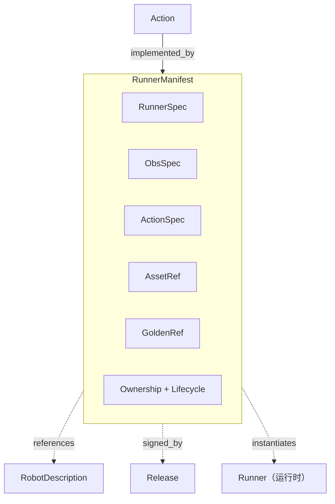

# 给 GPT 的重写任务书：把 Collie MC 架构改写成“先全貌、再模块、再接口”的书

> 用途：把现有 V1.3 合并稿重写成一本**有整体视角**的架构书，而不是继续在 V1.0/V1.1/V1.2 的 Part 结构上打补丁。
>
> 目标读者：能读 C++/Python、但不熟悉 Collie MC 的软件工程师；以及需要给非软件背景决策者讲清楚的架构负责人。
>
> 输入基线：
> - `v1.3/merged/Collie_MC_V1.3_Full_D0-D16_50Hz.md`
> - `runner/t1-mc-decomposition.md`
> - `v1.3/ADR-25_策略频率50Hz.md`
> - `v1.3/merged/Appendix_A_HAL_Contract.md`
> - `v1.3/merged/Appendix_B_Schema_Canon.md`
> - `v1.3/REVIEW_V1.3.md`

---

## 0. 一句话目标

**先让读者在一张图上建立“谁是谁、谁拥有谁、谁在运行时调用谁”的整体视角；然后按模块逐个展开；每个模块都必须说清楚它在总图的位置、内部设计、上游/下游接口、失败兜底；最后再讲横切与演进。**

不要写成“V1.0 的 D0–D16 + V1.2 补丁 + V1.3 频率修订”的拼接稿。

---

## 1. 你的角色

你是这本书的**总架构师 + 技术编辑**，不是版本合并工具。

你的任务不是“保留原文所有句子”，而是：

1. 建立唯一的概念模型；
2. 按这个模型重排内容；
3. 删掉重复、合并同义段落；
4. 把“旧版第几节”降级为附录映射，不再进入正文叙事；
5. 保证每个模块都能在总图中找到位置。

---

## 2. 输入与权威顺序

发生冲突时，按以下顺序裁决：

1. `proto/`、`schemas/`、`HAL_CONTRACT.md`、`SCHEMA_CANON.md` 的字段/合同；
2. V1.1 的架构决策（进程、唯一 writer、Lease、Epoch、安全状态机）；
3. V1.3 的 50 Hz 频率决策；
4. T1 的实测/配置证据（只作对标，不自动成为 Collie 事实）；
5. V1.2/V1.0 的解释性文字（可删改，不作合同）。

**T1 的 100 Hz、196 Hz 发布、WBC 10.5 ms 是 T1 事实，不要改写成 Collie 的 50 Hz。**  
Collie 的基线是：**50 Hz 策略 / 50 Hz Worker / 200 Hz RT / ZOH / 15/20 ms 预算 / 25 ms TTL**。

---

## 3. 现稿为什么读起来割裂（必须解决）

1. **概念地图把不同层级画成同一层**：`RunnerManifest`、`ObsSpec`、`ActionSpec`、`ExecutionKind/BehaviorRole` 都指向 `Runner`，看起来像四个平级模块；实际上后三者是 Manifest 的子合同/字段。
2. **静态合同与运行时序混在一张图**：`RobotDescription`、`Golden`、`Blackbox`、`Session/Lease` 与 Worker/RT/HAL 同图，读者不知道哪些是“文档”，哪些是“进程”，哪些是“权限”。
3. **每个 Part 自带一套小图/小词表**，但没有“你在这里”的定位；读完一章不知道它和总图哪条边对应。
4. **Part 编号与 D 编号穿插**：`Part 1（D0–D2）` 这种写法把“书的结构”和“旧版章节号”混在一起，出戏。
5. **接口散落在各章**：读者要自己拼 Gateway→Worker→RT→HAL；没有一个“接口矩阵”作为骨架。
6. **模块章节没有统一模板**：有的先讲状态机，有的先讲字段，有的先讲失败；无法横向比较。

---

## 4. 目标读者体验

读完“第1篇 全貌”后，读者应能回答：

1. 这个系统有哪几个运行时主体？
2. 一个“站起来”请求从 Task 到电机经过哪些模块？
3. 哪些是静态合同，哪些是运行时对象？
4. 为什么只有 RT 能写 HAL？
5. `RunnerManifest` 和 `ObsSpec/ActionSpec` 是什么关系？
6. `Action`、`ActionBundle`、`ActionExecution`、`Runner` 的区别？
7. 四把钥匙分别在哪一层生效？
8. 50 Hz 策略与 200 Hz RT 怎么共存？
9. 切换时 `ActionEpoch` 解决什么问题？
10. 出故障时谁兜底？

读完任一“模块章”后，读者应能回答：

1. 它一句话负责什么？
2. 它不负责什么？
3. 它的上游是谁、输入是什么、多久一次？
4. 它的下游是谁、输出是什么、失败怎么办？
5. 它和运控框架的接口是 RPC、共享内存、配置还是事件？
6. 它有哪些关键不变量？
7. 它在 Running Example 的哪一步？

---

## 5. 新书结构（硬约束）

### 5.1 篇/章

正文只用“第 N 篇 / 第 N 章 / N.M 节”；**正文不得出现 `Part 1（D0–D2）`、`D3.5`、`[V1.2-解释]` 这类版本/旧章节标记**。旧编号只在附录 A 的映射表出现。

```text
第0篇 读前须知
  0.1 这本书回答什么
  0.2 一张图怎么读（图例）
  0.3 证据等级：设计/建议/实测/待定
  0.4 版本边界：T1 vs Collie；V1.3 的 50 Hz

第1篇 全貌
  1.1 系统上下文与边界
  1.2 静态概念地图（谁拥有谁、谁引用谁）
  1.3 运行时总览（一个请求、一个 tick、一次切换）
  1.4 部署视图（进程/线程/内存）
  1.5 权限与安全视图（Session/ControlLease/SafetyLease/HAL writer）
  1.6 一页总结：五层、四流、三时钟、一条铁律

第2篇 核心模块
  2.1 Gateway 与 PolicyManager
  2.2 ActionGraph 与 ActionBundle
  2.3 Registry、RunnerManifest 与 Loader
  2.4 Worker 与 Runner Runtime
  2.5 ObsSpec、ActionSpec 与 ActionCodec
  2.6 RT、Snapshot 与 VelocityArbiter
  2.7 SwitchCoordinator 与 ActionEpoch
  2.8 JointMux、OutputGuard 与 ModeTransition
  2.9 SafetyKernel 与 SafetyLease
  2.10 HAL 与 device_hal
  2.11 Status、Events、黑匣子与 Replay

第3篇 接口
  3.1 外部接口：Task/Nav/RC/HMI
  3.2 内部接口矩阵（一张总表）
  3.3 Gateway↔Worker
  3.4 Worker↔RT
  3.5 RT↔HAL
  3.6 Safety↔RT/HAL
  3.7 配置/发布/资产接口
  3.8 故障与事件接口

第4篇 横切与演进
  4.1 时序与预算（50/200/1k）
  4.2 生命周期与状态机
  4.3 配置、资产、回放与测试
  4.4 路线图、ADR 与未决

附录
  A. 旧版 D0–D16 → 新章映射（只在这里出现旧编号）
  B. HAL Contract
  C. Schema Canon
  D. 术语表与证据等级
```

### 5.2 每章模板（硬约束）

每个核心模块章必须按以下顺序，不得自由发挥：

```text
N. 模块名

N.1 一句话职责
N.2 在总图的位置（一张“你在这里”小图 + 一句话）
N.3 边界：做什么 / 不做什么
N.4 内部设计
    N.4.1 状态与数据
    N.4.2 关键流程（正常/失败）
    N.4.3 线程、周期、内存
N.5 上游接口
    （表：来源 / 输入 / 传输 / 频率或时限 / 校验 / 失败）
N.6 下游接口
    （表：消费者 / 输出 / 传输 / 频率或时限 / 失败）
N.7 与运控框架的接口
    （RPC/IDL、共享内存、配置、事件、所有权）
N.8 关键不变量与失败模式
N.9 配置、资产、测试
N.10 常见误解（3–5 条）
```

`N.2` 的小图必须从总图裁出来，不能另画一套；让读者始终知道“这章在总图哪一块”。

### 5.3 接口章模板

每个接口必须写清：

| 项 | 内容 |
|---|---|
| 接口名 | 例如 `Worker→RT Candidate` |
| 生产者/消费者 | 谁写、谁读 |
| 传输 | RPC / SHM / DDS / 配置 / 事件 |
| 频率/时限 | 50 Hz、200 Hz、事件、deadline |
| 关键字段 | ID、seq、epoch、时间戳、mask、错误码 |
| 校验 | 身份、权限、新鲜度、数值、mask |
| 失败 | 拒收、超时、降级、保护、告警 |
| 权威源 | proto/schema/HAL 合同 |

先给一张**接口总矩阵**，再按接口展开；模块章引用矩阵行号，不重复定义。

---

## 6. 概念层级：Manifest 子树是硬约束，整体分层由 GPT 提出

### 6.1 硬约束：RunnerManifest 子树

`RunnerManifest` 不是一个和 `ObsSpec/ActionSpec` 并列的节点。它是一个**静态合同容器**：

```text
RunnerManifest
├─ RunnerSpec（execution_kind / behavior_role / class_id / backend_id / abi / period_ms / budget）
├─ ObsSpec（逐维观测配方；可以是独立文件，由 Manifest 用 path+SHA 拥有）
├─ ActionSpec（逐维输出解码配方；同上）
├─ AssetRef（ONNX / 轨迹 / BUILTIN）
├─ GoldenRef（发布验收向量）
├─ Ownership（owns_mask）
└─ Lifecycle（entry / exit / completion / failure_target）
   ├─ references RobotDescription（本体事实，外部权威）
   ├─ signed by Release（发布签名，外部权威）
   └─ instantiates Runner（运行时对象）
```



**三个动词必须区分：**

- **contains / owns**：`RunnerManifest` 拥有 `RunnerSpec/ObsSpec/ActionSpec/AssetRef/GoldenRef/Ownership/Lifecycle`。`ObsSpec/ActionSpec` 可以是独立文件，但由 Manifest 通过 path+SHA 拥有，**不是 Manifest 的平级兄弟**。
- **references**：`RunnerManifest` 引用 `RobotDescription`、`Release`，但不拥有它们。
- **instantiates**：`RunnerManifest` 在运行时被实例化为 `Runner`；Manifest 是静态合同，Runner 是运行时对象。

### 6.2 整体静态层级：由 GPT 提出，不由任务书拍死

任务书只规定“必须覆盖哪些概念”，不规定唯一的层级图。Stage 1 必须先给：

1. **概念放置表**（每个概念：层 / 类型 / 关系 / 为什么不是别的层）；
2. **静态概念图**（按放置表画）；
3. **覆盖检查**（逐项打勾）。

**候选分层（可调整，但覆盖不能少）：**

| 层 | 候选概念 | 回答的问题 |
|---|---|---|
| L0 意图/产品 | Task、Nav、RC、Behavior | 谁提出意图？ |
| L1 编排/决策 | PolicyManager、ActionGraph、ActionBundle、Registry、ControlLease | 谁编排、走哪条路、用哪个资产？ |
| L2 合同/资产 | Action、RunnerManifest（含子树）、RobotDescription、Release | 动作靠什么合同/资产执行？ |
| L3 运行时 | Worker、Runner、ObsBuilder、InferenceBackend、ActionCodec、Snapshot、VelocityArbiter、SwitchCoordinator、JointMux、OutputGuard、SafetyKernel、HAL/device_hal | 每拍谁算、谁发、谁保护？ |
| L4 数据/状态 | Candidate、HalCommand、MotionStatus、ActionEpoch、ActionExecution | 运行时产生/传递什么？ |
| L5 横切/验证 | Session、SafetyLease、HAL writer、Golden、Blackbox、Replay | 谁授权、谁验证、谁回放？ |

**必须覆盖的节点清单（Stage 1 缺一项即退回）：**

- 产品/意图：Task、Nav、RC、Behavior；
- 编排：PolicyManager、ActionGraph、ActionBundle、Registry、ControlLease；
- 合同：Action、RunnerManifest、RunnerSpec、ObsSpec、ActionSpec、AssetRef、GoldenRef、Ownership、Lifecycle、RobotDescription、Release；
- 运行时：Worker、Runner、ObsBuilder、InferenceBackend、ActionCodec、Snapshot、VelocityArbiter、SwitchCoordinator、JointMux、OutputGuard、SafetyKernel、HAL/device_hal；
- 数据/状态：Candidate、HalCommand、MotionStatus、ActionEpoch、ActionExecution；
- 横切/验证：Session、SafetyLease、HAL writer、Golden、Blackbox、Replay。

**PolicyManager 的放置说明（这是上一版漏掉的重点）：**

- `PolicyManager` 是 **Gateway 里的编排服务**，不是 Manifest，不是 Runner；
- 它读 `ActionGraph`、查 `Registry`/Manifest、验 `ControlLease`，产出 `ActionBundle` 和切换准备事务；
- `ActionGraph` 是它使用的**数据**，`Registry` 是 Manifest/Asset 的**注册表**，`ActionBundle` 是它产出的**组合**；
- 如果静态图里没有 `PolicyManager/ActionGraph/Registry/ActionBundle`，说明层级不完整，直接退回。

**放置表模板：**

| 概念 | 层 | 类型（服务/数据/合同/运行时/门/资产） | 关键关系 | 为什么不是别的层 |
|---|---|---|---|---|
| PolicyManager | L1 | 服务 | 读 Graph/Registry，产出 Bundle/准备事务 | 不是 Runner/Manifest |
| ActionGraph | L1 | 数据 | 节点是 Action，边是合法路径 | 不是安全状态机 |
| Registry | L1 | 注册表 | 存 Manifest/Asset；供 Worker 加载 | 不是运行时 Runner |
| RunnerManifest | L2 | 合同 | 拥有 Spec/Asset/Golden；实例化 Runner | 不是模型/Graph |
| Runner | L3 | 运行时对象 | 在 Worker 内执行 `step` | 不是 Manifest |
| ... | ... | ... | ... | ... |

### 6.3 关系类型

| 关系 | 例子 | 画法 |
|---|---|---|
| 组合/拥有 | Manifest → ObsSpec/ActionSpec/RunnerSpec | 嵌套框/实心菱形 |
| 组合 | ActionBundle → Action | 嵌套框 |
| 引用 | Manifest → RobotDescription/Release | 虚线箭头 |
| 实例化 | Manifest → Runner | 虚线 + “instantiate” |
| 运行时调用 | Worker → RT → HAL | 实线箭头 |
| 授权/门 | Session/ControlLease/SafetyLease/HAL writer | 侧栏 gate，不画成层 |
| 验证/观测 | Golden/Blackbox/Replay | 点线，不进入控制路径 |

### 6.4 现稿必须修掉的画法

- 不要把 `RunnerManifest`、`ObsSpec`、`ActionSpec`、`ExecutionKind+BehaviorRole` 画成四个都指向 `Runner` 的平级节点；
- 不要把 `RobotDescription` 画成 Manifest 的子项；它是外部权威引用；
- 不要把 `Golden`、`Blackbox`、`Replay` 画进运行时调用链；它们是验证/观测资产；
- 不要把 `ActionBundle` 画成 Runner 之前的“执行阶段”；它是 Action 的组合；
- 不要把 `ActionGraph` 画成 `Action` 的父节点；Graph 的节点是 Action，PolicyManager 使用 Graph；
- 不要把 `Session`、`ControlLease`、`SafetyLease`、`HAL writer` 画成四个“层”；它们是四个检查点/门；
- 不要把 `ActionEpoch` 画成 Manifest 字段；它是 RT 本地状态；
- 不要把 `HAL` 画成 Runner；它是设备合同/进程边界；
- **不要漏掉 `PolicyManager/ActionGraph/Registry/ActionBundle`**；漏掉就不是完整静态层级。

### 6.5 概念归属表（写作时逐项核对）

| 概念 | 类型 | 归属 | 不是什么 |
|---|---|---|---|
| Task/Nav/RC | 外部意图源 | 平台 | 不是 MC 进程 |
| Behavior | 产品能力 | 平台/Task | 不是 Runner |
| Action | 可执行定义 | Graph/Registry | 不是运行实例 |
| ActionBundle | 组合 | PolicyManager | 不是 Manifest/执行阶段 |
| PolicyManager | 编排服务 | Gateway | 不是 Runner |
| ActionGraph | 编排图 | Gateway | 不是安全状态机 |
| Registry | 注册表 | Gateway/Worker | 不是运行时 Runner |
| RunnerManifest | 静态合同 | Action/Registry | 不是模型/Graph/Runner |
| RunnerSpec | Manifest 子合同 | Manifest | 不是独立模块 |
| ObsSpec | Manifest 子合同 | Manifest | 不是观测进程 |
| ActionSpec | Manifest 子合同 | Manifest | 不是输出模块 |
| AssetRef | Manifest 引用 | Manifest | 不是 Manifest 本身 |
| GoldenRef | 验证引用 | Manifest/Release | 不是运行时输入 |
| RobotDescription | 本体事实 | 本体/HAL | 不是 Manifest 子项 |
| Release | 发布签名 | 发布系统 | 不是 Manifest |
| Runner | 运行时对象 | Worker | 不是 Manifest |
| ActionExecution | 运行实例 | Worker/RT | 不是 Action |
| ActionEpoch | RT 版本 | RT | 不是 Manifest 字段 |
| Snapshot | RT 数据 | RT | 不是 Worker |
| Candidate | Worker 输出 | Worker | 不是 HalCommand |
| JointMux/OutputGuard | RT 出口 | RT | 不是 HAL |
| SafetyKernel/Lease | 安全许可 | Safety | 不是 ControlLease |
| ControlLease | 资源租约 | Gateway/RT | 不是 SafetyLease |
| HAL | 设备合同/进程 | device_hal | 不是 Runner |
| Blackbox/Replay | 观测/验证 | 非实时 | 不是控制路径 |

---

## 7. 图规则

全书只允许四类主图，每类一张，最多 12 个主节点：

1. **静态概念图**：必须覆盖 §6.2 清单，至少包含 Task/Nav/RC、PolicyManager、ActionGraph、ActionBundle、Registry、Action、RunnerManifest（嵌套 ObsSpec/ActionSpec/RunnerSpec）、Runner、RT、HAL、Safety、四把钥匙；不能只画合同树。太大可拆两张 panel，但覆盖不能少。
2. **运行时管道图**：Task/Nav → Gateway → Worker → RT → HAL；Safety 侧栏。
3. **部署图**：4 个 MC 进程 + device_hal；线程/周期/内存。
4. **生命周期/状态图**：Runner 生命周期、ActionEpoch、安全状态机。

每张图必须带：

- 图例：实线=运行时调用/数据；虚线=静态引用；实心菱形=组合；点线=验证/观测；
- 读图 3 句话：横向是谁、纵向是什么、空白处谁在跑；
- 失败分支：拒绝/超时/降级/保护；
- “你在这里”标记：模块章的小图从总图裁出并高亮。

**禁止**：

- 一张图里同时出现进程、线程、模块、文档、权限；
- 没有标签的箭头；
- 超过 12 个主节点的“大杂烩”；
- 只用文字说“见图”，却不给读法。

---

## 8. 写作规则

1. **一个 Running Example 贯穿全书**：上电 `INIT/UNKNOWN` → `quad_stand` → `quad_drive` → `quad_stop` → `q2b`（禁用）→ `biped_balance`（禁用）→ `b2q` → 急停 → 复位。每章至少出现一次“在例子的哪一步”。
2. **先结论后细节**：每章第一段不超过 5 行，先说“这模块解决什么问题”。
3. **接口表优先**：能用表说清楚的，不要用长段落。
4. **50 Hz 基线**：策略/Worker 50 Hz，RT 200 Hz，HAL 1 kHz；ZOH 保持，不默认插值。
5. **P0 必须可见**：`can_exit` pre-step READY 仍是 P0；50 Hz 把窗口放大到 20 ms，切换前必须先修。
6. **证据等级**：每个关键数字标【设计】【建议】【实测】【待定】；T1 实测与 Collie 目标分开。
7. **不重复**：同一接口只在接口章定义一次；模块章引用行号。
8. **不出现旧编号**：正文无 `D0–D16`、无 `Part 1`、无 `[V1.2-解释]`；附录 A 只做映射。
9. **不写“合并说明”**：读者不需要知道 V1.0/V1.1/V1.2 怎么合并；只保留“证据/边界”说明。
10. **中文技术写作**：短句、主动语态、每段一个论点；避免“赋能/闭环/抓手”等空话。

---

## 9. 交付阶段（必须分阶段，不要一次写全）

### Stage 1（先只交这个）

`00_OUTLINE_AND_MAP.md`，包含：

1. 一页诊断：现稿为什么割裂（不超过 10 条）；
2. 新书完整目录（篇/章/节）；
3. 一张静态概念图（分层由 GPT 提出）+ 一张概念放置表（§6.2 模板）+ 覆盖打勾；
4. 一张运行时管道图；
5. 一张模块归属矩阵（模块 → 进程/线程 → 拥有的数据 → 不负责什么）；
6. 一张接口总矩阵骨架（接口名/生产者/消费者/频率/失败）；
7. 旧 D0–D16 → 新章映射表；
8. 3–5 个仍不确定、需要作者拍板的问题。

**Stage 1 不写模块正文。** 等作者确认概念层级和目录后，再进入 Stage 2。

### Stage 2

`01_OVERVIEW.md` + 2 个样板模块章（建议 `2.3 RunnerManifest`、`2.6 RT`）。  
目的：校准“总图定位 + 接口表 + 失败模式”的写法。

### Stage 3

其余模块章 + `03_INTERFACES.md`。

### Stage 4

`04_CROSS_CUTTING.md` + 附录 A 映射 + 全书一致性检查（术语/图/接口/旧编号）。

---

## 10. 验收 rubric

| 维度 | 满分 | 通过标准 |
|---|---:|---|
| 全貌可复述 | 15 | 读完第1篇能回答 §4 的 10 个问题 |
| 概念层级完整/正确 | 20 | Manifest 包含 ObsSpec/ActionSpec；RobotDescription/Release 是引用；Runner 是实例；Bundle 是组合；静态图覆盖 PolicyManager/ActionGraph/Registry/ActionBundle/四把钥匙；有放置表 |
| 模块章一致 | 20 | 11 章都按 §5.2 模板；每章有“你在这里”+上下游表+失败 |
| 接口完整 | 15 | 矩阵覆盖 Gateway/Worker/RT/HAL/Safety/配置/事件；每行有频率/失败 |
| 图可读 | 10 | 四类图各一张；图例/读法/失败分支齐全；无大杂烩 |
| 无旧版拼接感 | 10 | 正文无 D 编号/Part 编号/合并说明；旧编号只在附录 A |
| 证据与边界 | 5 | T1 vs Collie、50 Hz、P0、不能上机都明确 |
| 中文与去重 | 5 | 无重复定义；短句；术语一致 |
| **合计** | **100** | **≥85 才进入 Stage 2；≥90 才可发布** |

**一票否决**：

- 把 `ObsSpec/ActionSpec` 画成 `RunnerManifest` 的平级节点；
- 静态图漏掉 `PolicyManager/ActionGraph/Registry/ActionBundle`；
- 正文继续出现 `Part 1（D0–D2）`；
- 模块章没有上下游接口；
- 用“合并说明”替代概念模型；
- 把 T1 的 100 Hz 写成 Collie 的 50 Hz，或反过来。

---

## 11. 禁止事项

- 不要保留“V1.0/V1.1/V1.2 合并”的叙事；
- 不要用旧 D 编号做正文标题；
- 不要把“Part”当模块；
- 不要每个 Part 重新定义一遍术语；
- 不要把“概念图”画成“所有箭头指向所有东西”；
- 不要把 `RunnerManifest` 当成 ONNX 文件；
- 不要把 `ObsSpec/ActionSpec` 当成独立进程；
- 不要把 `Golden/Blackbox` 画进控制链；
- 不要把 `Session/Lease` 画成层；
- 不要用 T1 的数字冒充 Collie 实测；
- 不要隐藏 P0。

---

## 12. 可直接粘贴给 GPT 的启动语

```text
你是 Collie MC 架构书的总架构师和技术编辑。请基于我给的 V1.3 合并稿、T1 详解、ADR-25、HAL 合同、Schema Canon 和评审意见，重写一本“先全貌、再模块、再接口”的架构书，不要做版本合并。

硬约束：
1) 正文只用“第N篇/第N章/N.M节”，不得出现 Part 1（D0–D2）、D3.5、[V1.2-解释]；旧编号只放附录 A 映射表。
2) 静态层级由你提出，不要照抄一个只包含合同链的树：先给概念放置表，必须覆盖 Task/Nav/RC、PolicyManager、ActionGraph、ActionBundle、Registry、Action、RunnerManifest 子树、Runner、Worker、RT、HAL、SafetyKernel、四把钥匙（Session/ControlLease/SafetyLease/HAL writer）。RunnerManifest 必须包含 RunnerSpec、ObsSpec、ActionSpec、AssetRef、GoldenRef、Ownership、Lifecycle；RobotDescription/Release 是外部引用；Runner 是运行时实例；ObsSpec/ActionSpec 不得画成 Manifest 的平级节点。
3) 第1篇必须让读者回答 10 个问题（见任务书 §4）；第2篇每个模块章必须按统一模板：一句话职责、你在这里、边界、内部设计、上游接口、下游接口、与框架接口、不变量/失败、配置/测试、常见误解。
4) 第3篇先给接口总矩阵，再逐接口展开；每个接口写生产者/消费者/传输/频率/字段/校验/失败/权威源。
5) 50 Hz 策略、50 Hz Worker、200 Hz RT、ZOH、15/20 ms、25 ms TTL；T1 的 100 Hz 只作对照；P0 can_exit 必须保留警示。
6) 不要一次写全。Stage 1 只交 00_OUTLINE_AND_MAP.md：诊断、目录、静态图、运行时图、模块矩阵、接口矩阵骨架、旧 D→新章映射、3–5 个待拍板问题。等确认后再写正文。

先输出 Stage 1，不要写模块正文。Manifest 子树以任务书 §6.1 为硬约束；整体分层由你提出，但必须覆盖 §6.2 清单，漏 PolicyManager/ActionGraph/Registry/ActionBundle 直接退回。
```

---

## 13. 一句话总结

**这本书的主线不是“D0 到 D16”，而是：一张概念地图 → 一条运行时链路 → 每个模块的边界与接口 → 横切与演进。**  
`RunnerManifest` 是“合同”，`ObsSpec/ActionSpec` 是它的子合同，`Runner` 是它的运行时实例；这三者不能画成兄弟。
