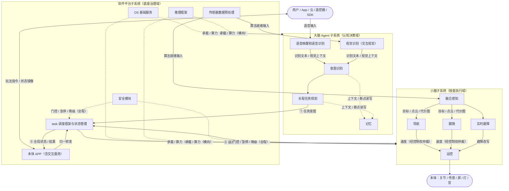
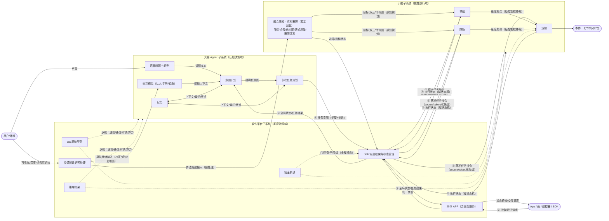
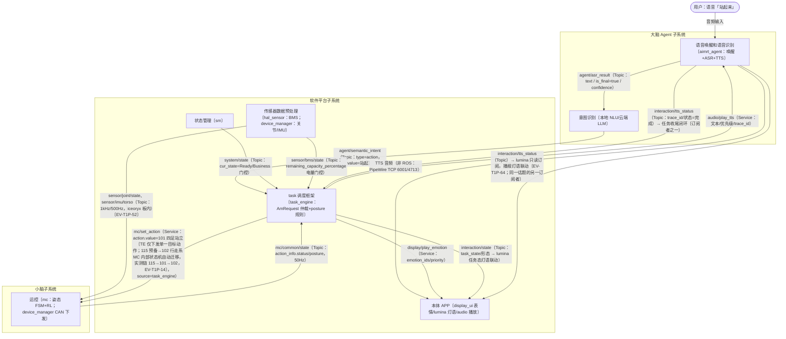
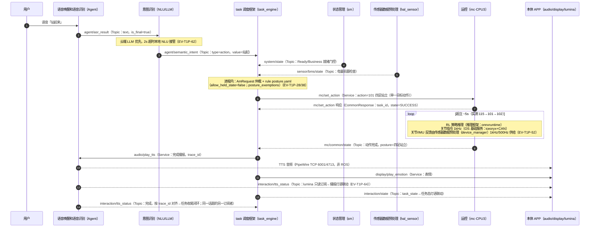
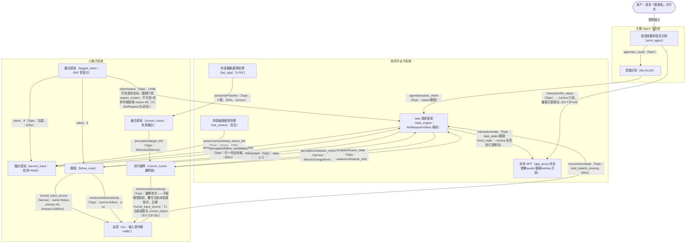
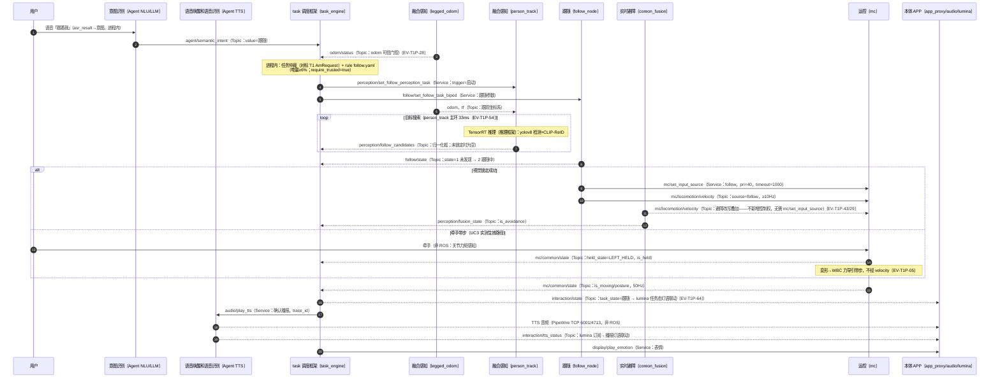
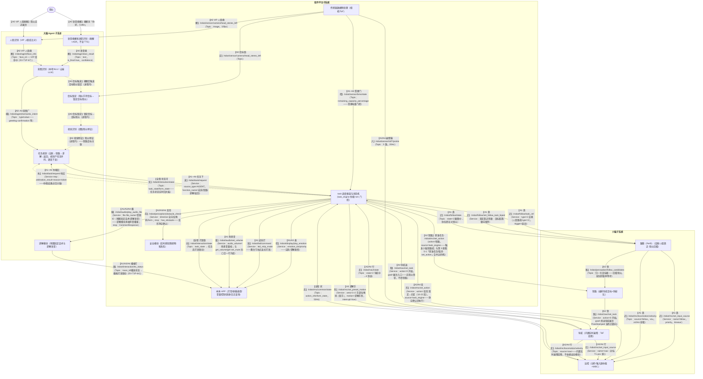

# 第 3 章 系统总体架构：三大子系统职责划分

| 项 | 内容 |
|---|---|
| 所属文档 | QDOG-SFS-001《四足狗软件特性设计说明书》（见 [README](./README.md)） |
| 章节版本 | V0.40（草案，2026-11-20；§3.8.1.4 补 AmCancel（task/cancel）完整结构——五粒度取消、预留条目〔场景 A 未触发〕，证据档〔合理推断〕） |
| 视图定位 | 职责视图（三大子系统横向切分）；部署视图概要见 README §3.2，细化归各特性域章节 X.5.6 |
| 证据基线 | 启元 T1 Pro 固件 t2-3 / JetPack 540.4.0（EV 条目来源见 §3.12 与主控文档 §5） |

## 版本表

| 版本 | 日期 | 变更摘要 | 作者 |
|---|---|---|---|
| V0.1 | 2026-11-12 | 首版：三大子系统职责边界、模块功能描述、业务流走查、特性域映射、对标映射与证据清单（新增 EV-T1P-62~66） | liqiliang |
| V0.2 | 2026-11-12 | 新增**第 3A 章并行原稿**：2026-11-12 对话产出「三大子系统职责与模块功能描述」**原封不动收录**（仅加章头说明，正文未按本文档模板改写），待与第 3 章正文整合；第 3 章正文未做任何改动 | liqiliang |
| V0.3 | 2026-11-12 | **整合 3A 入正文并删除 3A 章**：① 视觉归属裁决——交互视觉（认人/手势/姿态）归大脑·视觉识别、感知视觉（跟随检测/避障/语义分割）随小脑/平台（平台 SP 通用感知服务供给、小脑消费），OP-ARCH-05 标记已裁决；② 职责视角互补——§3.2.1 融入「WHAT/WHY–HOW–底座」层定位与一句话边界、业务主链路，与 §3.2.2 五交接物/§3.2.3 三问定责互补；③ §3.3~3.5 模块表新增「T1 模块对照」列；§3.2.2 图 3-1、§3.6 走查、§3.7/§3.8.1 映射同步修正；注记 4 补 T1 部署实证 | liqiliang |
| V0.4 | 2026-11-12 | **感知服务归属调整（暂定）：平台 → 小脑**。全章修订：§3.2.1 职责表、图 3-1（感知服务节点移入小脑域）、§3.3/§3.5 相关表述、§3.4 新增「感知服务」模块行、§3.6 走查、§3.7 映射、§3.8.1 对标行、OP-ARCH-05 追加修订记录。平台不再提供感知服务，仅提供传感器数据预处理（数据就绪）；感知服务（目标/点云/代价图/感知场景）为小脑模块，部署仍在感知算力板 | liqiliang |
| V0.5 | 2026-11-12 | 新增 **§3.2.1 大软件逻辑视图**（图 3-1：三大子系统 × 16 模块权威清单与主数据流；原 §3.2.1~3.2.3 顺延为 §3.2.2~3.2.4、原图 3-1 改号图 3-2）；模块命名对齐权威清单——小脑感知拆分为「融合与感知」+「实时避障」两模块行（§3.2.2/§3.4/图 3-2/§3.6/§3.8.1/OP-ARCH-05 同步），平台「基础 OS」更名「OS 基础服务」（§3.2.2/图 3-2/§3.5） | liqiliang |
| V0.6 | 2026-11-12 | 新增 **§3.6 场景级模块协同（接口视角）**：表 3-1 模块→T1 实体映射（含两场景参与度，无需新增同级模块）；「站起来」「跟我走」各一组流程图+时序图（图 3-3~3-6，最小实体=16 模块，每条边标注接口名/Topic 或 Service/关键参数，全部沿用 T1 Pro 实测）；表 3-2 Topic 接口列表（27 项，含频次实证）、表 3-3 Service 接口列表（26 项，含全参入出）；原 §3.6~3.10 顺延为 §3.7~3.11 | liqiliang |
| V0.7 | 2026-11-12 | §3.6 四图补充**灯带控制逻辑**（按实证口径区分两种方式）：lumina 常驻订阅联动（tts_status/interaction/state → 灯语，EV-T1P-64）加入图 3-3~3-6；显式 LedStripCommand 标注「仅 UC1 跳舞实证，本场景可选」（图 3-3）；修正图 3-6 PlayTts 路由（原误画至 APP，改为 TE→语音模块→PipeWire 播放）；两场景各增灯带要点 | liqiliang |
| V0.8 | 2026-11-13 | **「融合与感知+实时避障」同进程决策落档**（2026-11-13）：§3.4 两模块行加实现注记 + 新增边界注记块（数据关系：避障只消费融合输出；分层关系：反射层 vs 导航规划级；实现形态：融合引擎与避障同进程，对标 coreon_fusion 一进程一份点云，检测/里程计可独立进程）；§3.9.2 新增注记 5（T1 避障非独立模块的实证与不平级判定 + 本产品拆逻辑模块的三理由）；§3.6.3 要点补逻辑模块/部署形态区分 | liqiliang |
| V0.9 | 2026-11-13 | **模块更名：「融合与感知」→「感知与融合」**（语序按流程主链修正）：主链为「单源感知 → 多源融合」（检测/分割先行、目标/点云融合在后，EV-T1P-54/49）；数据级融合在前为特例（多 ToF 点云先合再统一避障判定、EKF 状态估计）——两类并存，模块名以能力主词「感知」在前。全章 24 处有效表述更名（图 3-1/3-2/3-5/3-6 节点、§3.2.2/§3.3/§3.4/§3.6.1/§3.7/§3.9.1/§3.9.2/OP-ARCH-05）；历史版本记录保留旧名 | liqiliang |
| V0.10 | 2026-11-13 | **模块定名「融合感知」（行业通用叫法，最终名）**：复合词不表达先后顺序，规避语序歧义；与 T1 生态外部表述一致（「七路融合感知：双目 RGB + 5 路 ToF + 6 轴 IMU」，C：c4 §7）。全章有效表述再次更名；§3.4 边界注记 0 改写（命名沿革：融合与感知〔V0.8 前〕→ 感知与融合〔V0.9〕→ 融合感知〔V0.10 定名〕）；历史版本记录保留各自时点名 | liqiliang |
| V0.11 | 2026-11-13 | 表 3-1 最前新增「**子系统**」列（大脑/小脑/软件平台），模块归属一目了然；行序按子系统分组（大脑 5 → 小脑 5 → 软件平台 6） | liqiliang |
| V0.12 | 2026-11-13 | 表 3-1「子系统」列**合并重复单元格**：因 GFM 表格不支持 rowspan，该表转为内嵌 HTML 表格实现（大脑 rowspan=5 / 小脑 rowspan=5 / 软件平台 rowspan=6），GitHub/VS Code 均可正常渲染 | liqiliang |
| V0.13 | 2026-11-13 | 图 3-3/3-4 四项排查修正：① 灯带归属——HALB 节点去掉灯带、删除显式 LedStripCommand 可选边（T1 由 hal_sensor 进程承接系实现事实，本产品灯效归本体 APP，表 3-1 加注差异）；② 传感器数据预处理在本场景**有用**——补 joint/state、imu/torso/state（1kHz/500Hz，EV-T1P-52）供 mc 的边（bms/state 电量门控原已画）；③④ 两条 tts_status 边标注为「同一话题的两个订阅者」（TE=任务收尾闭环、lumina=只读订阅灯语联动，多播语义） | liqiliang |
| V0.14 | 2026-11-13 | 表 3-2 **补录 /odom/status**（里程计可信度状态码：UInt8 自评、task_engine 唯一消费者、关联 AmRequest reason=66 与 require_trusted 门控、「质量随流→任务门控」模式实例〔EV-T1P-28/31/37/51〕）；图 3-5 对应边标签同步补用途说明 | liqiliang |
| V0.15 | 2026-11-13 | 图 3-5/3-6 避障 velocity 边与边界注记 2 补「**实时避障不参与控制权抢占**」标注：不调 SetMcInputSource、不注册源（T1 mc 注册源表 7 源无 coreon_fusion，EV-T1P-29），只对当前持权源指令做安全叠写；极端停车走急停链；避障改写 velocity 的 source 名细节标注「推断」 | liqiliang |
| V0.16 | 2026-11-13 | **修正 SetMcAction 接口标签**（图 3-3/3-4）：请求只带**单一目标动作**（action=101 四足站立）——115 预备→102 行走系 MC 内部状态机自动迁移（action_ruler mid-action，实测链 115→101→102，EV-T1P-14），原标签误将内部链写成接口参数；表 3-3 McAction 枚举改为分段写法并明示 101 四足站立 vs 201 双足站立（本产品纯四足 A-2，无 201 链路） | liqiliang |
| V0.17 | 2026-11-13 | 表 3-2 velocity 行与表 3-3 SetMcInputSource 行补「**timeout=1000ms 是看门狗续租窗口，非任务时长**」注记：每帧 velocity（≥10Hz）即续租、持续发布可无限期持有（跟随/遥控均此模式）；连续静默 1000ms=持权方失联的保护性释放并按优先级顺延；正常结束走显式 DELETE；第 5 章控制权机制段同步 | liqiliang |
| V0.18 | 2026-11-13 | **文件更名**：subsystem-responsibilities.md → `architecture-design.md`（架构设计文档；git mv 保留文件历史）；章节内容与编号不变 | liqiliang |
| V0.19 | 2026-11-19 | **接口命名产品化（消除 T1 Pro 前缀痕迹）**：表 3-2/3-3 与图 3-3~3-6 全部接口名统一 `/qdog/` 前缀——消除 `/aima/`、`/aimdk_msgs/`、`/ofilm/` 及 T1 裸根命名空间（`/perception/`、`/percep/`、`/interaction/`、`/sys_guard/`、`/navi/`、`/odom`、`/tf`）；与第 5/6 章 IF 条目一致处对齐条目名并标注编号（IF-TS-01/02/05/06/10/11、IF-SP-01~03/05/07~11），未条目化者为本章暂定名（正式定名归各特性域章节）；两表新增「T1 对标名」列保留实证溯源，★ 随之移至该列（= T1 SDK 官方面）；§3.6 引言、表标题、图边标签、注意事项跨表引用与 §3.4 相关表述同步改写；§3.11 证据条目按原文引用不改 | liqiliang |
| V0.20 | 2026-11-19 | **接口前缀改 `/robot/` 并向 T1 命名回靠**：① `/qdog/` 前缀全文改为 `/robot/`（原 `robot/permission_state` 因与前缀撞名去段为 `/robot/permission_state`）；② 服务名恢复 T1 动词语义与词汇（仅去掉与路径段重复的域词 Mc/Hal）——SetMcAction→`/robot/mc/set_action`、SetMcInputSource→`set_input_source`、GetCurrentInputSource→`get_current_input_source`、SetMcMotion→`set_motion`、SetMcPresetMotion→`set_preset_motion`、SetAvoidance→`set_avoidance`、SetNaviTask→`navi/set_task`、SetFollowTaskBiped→`follow/set_follow_task_biped`、set_follow_perception_task→`perception/set_follow_perception_task`、SetHalCameraStream/SetHalTofStream→`sensor/set_camera_stream`·`set_tof_stream`、PlayAudioFile→`play_audio_file`、音量/静音四口 get_/set_ 展开、FollowTaskCtrl→`follow/task_ctrl`、ShutdownTask→`shutdown_task`、CaptureJpegImage→`capture_jpeg_image`；③ 话题名恢复 T1 路径分段——`mc/common/state`、`mc/locomotion/velocity`、`target_info`；④ 图 3-3~3-6 边标签同步；与第 5/6 章现存 `/qdog/` 命名的前缀与部分条目名差异**待同步**（名字一致者标 IF-xx、仅语义对应者改标「对标 IF-xx」） | liqiliang |
| V0.21 | 2026-11-19 | **第 5/6 章同步落定后的标注复核**：第 5 章 V0.41/第 6 章 V0.7 已统一 `/robot/` 前缀并回靠 T1 命名（IF-TS-11=`/robot/mc/set_input_source`、IF-SP-05=`set_camera_stream`/`set_tof_stream` 双服务、IF-SP-08 `targets`→`target_info`、消息包 qdog_msgs→robot_msgs）——本章相应把 set_input_source、set_camera_stream/set_tof_stream 两处「对标 IF-xx」改回同名标注「IF-xx」，引言与两表标题移除「第 5/6 章待同步」注记；set_follow_perception_task（对标 IF-SP-10——第 6 章为场景三件套的一般化）与 task/cancel（对标 IF-TS-02 取消子面）维持语义对标标注 | liqiliang |
| V0.22 | 2026-11-19 | **新增 §3.8 巴展场景业务流分析和模块间接口（首节 §3.8.1 场景 A：主动迎宾、领路、站立讲解）**：表 3-4 场景实体→权威模块映射（信标锁定/讲解模块/领路/运镜为场景级新增能力，OP-ARCH-07 立项）；图 3-7 关键路径流程图＋图 3-8 完整业务时序图（实体限场景模块清单：大脑 7/小脑 5/平台 5，实线边均标注表 3-2/3-3 既有接口与关键入出参，**不新增接口**，虚线=进程内步骤）；表 3-5 场景接口清单（25 项全部溯源自两表）；要点八条（触发双路径〔EV-T1P-67〕、领路新增技能与第 5 章合并边口径、导航内置避障不依赖安全模块、变形前 obstacle_check 净空门、仲裁结果回大脑+interaction/state 状态可见、灯带两方式、讲解三路输出、运镜 servo）；**记录机型假设冲突**：README §3「纯四足、不做双足变形」vs 场景双足站立/双足↔四足变形（OP-ARCH-07）；原 §3.8~3.11 顺延为 §3.9~3.12（正文交叉引用 8 处同步＋第 6 章归属声明 1 处，历史版本记录保留旧编号）；新增 EV-T1P-67 | liqiliang |
| V0.23 | 2026-11-19 | **巴展场景机型裁决落档**：产品确认支持**双足站立＋四足↔双足变形**（2026-11-19）——OP-ARCH-07② 标记已裁决（原文划线保留）、§3.8.1 前置条件「机型注意（冲突）」改「机型口径（已确认）」、要点④ 同步；README §3 对标对象段落与 A-2 假设同日修订（文档 V0.65）、第 5 章 §5.6.1 状态集引言同步（V0.46）；上肢/手部能力（场景 A 讲解手势依赖）仍待产品定义（A-2 附注、OP-ARCH-07①） | liqiliang |
| V0.24 | 2026-11-19 | **双臂能力裁决落档**：四足→双足变形时**前两腿转为双臂、后两腿站立承重**（2026-11-19 产品定义确认）——OP-ARCH-07① 上肢附注移除、② 裁决内容补双臂（双臂即讲解手势执行机构）；§3.8.1 前置条件机型口径补双臂、要点⑦ 手势注双臂来源；README A-2 同日修订（文档 V0.66）；场景 A 图 3-7/3-8 无需改动（`set_preset_motion` 左手/右手位掩码、T1 优先级阶梯「上肢动作=40」〔EV-T1P-37〕与本口径自洽） | liqiliang |
| V0.25 | 2026-11-19 | **§3.8.1 场景 A 两图按评审口径重构（图 3-7/3-8）**：① 流程图三子系统标题加粗＋放大（style 18px）；② 语音模块去 TTS（仅唤醒+ASR）——删 play_tts×2、TTS 音频、VOICE→APP tts_status 边；③ 播报改 **TE→讲解模块 `audio/play_audio_file`**（`file.file_name`＝音频 ID——AudioFile 字段实证 D《接口说明》AudioFile.msg；对标 T1 PlayAudioFile ★＋固定话术本地直答〔EV-T1P-62〕），讲解模块括号改「预置固定话术与讲解语音」；④ 长程任务规划更名**任务规划**（括号「迎宾→领路→讲解→返回，**规划产任务序列、逐段下发**」）；⑤ 意图识别括号「本地 NLU / 云端 LLM」，唤醒后**意图识别触发信标锁定**（新增 INT→BEACON 进程内边）；⑥ **运镜退出场景 A**（删 GIM 节点与 servo/set 边，表 3-4 注「不参与，预留后续场景」）；⑦ `tts_status` 边改**讲解模块→本体 APP**；⑧ 本体 APP 括号补**音量控制**＋新增 TE→APP `audio/set_volume` 边（四口合一行为组）；⑨ `task/request` **仲裁响应显式回边**（TE→大脑，两图核对补齐）；⑩ **A4 三步显式化**（变形四足→TE 直调 `navi/set_task` 返程〔不经领路〕→变形双足；删 A0 待机模块与回环边）；⑪ 场景描述 A4/前置条件/表 3-4 五行/表 3-5 四行/要点②⑤⑦⑧同步（清单仍 25 项：−play_tts−servo/set＋play_audio_file＋set_volume） | liqiliang |
| V0.26 | 2026-11-19 | **§3.8.1 接口清单拆分重构（参考表 3-2/3-3 体例）**：原单表 25 项拆为**表 3-5 Topic 使用清单（13 项）＋表 3-6 Service 使用清单（12 项）**；列结构改为「接口｜使用阶段｜场景用途｜入参｜出参」——入参与出参各自成列，**入参逐参数给出含义与场景取值**（Topic 沿表 3-2「同负载多播」口径、出参列标注场景订阅方与判定用途；Service 出参亦逐参数释义）；参数语义与枚举值沿用 T1 Pro 实测口径（来源两表＋D《接口说明》AudioFile.msg） | liqiliang |
| V0.27 | 2026-11-19 | **§3.8.1 两图三项修订**：① 流程图子系统标题修复——去 `**`（裸 Markdown 加粗在 mermaid 标签中显形为星号、且放大字号致标签框截断），改为纯文本＋`style … font-weight:bold`（SVG 样式继承标题）；② 两图接口名**全称化**——每条边/消息的接口名均带 `/robot/` 前缀（含合并边「获准任务 · /robot/mc/set_action」与注记内引用），图题与清单引言同步去「省略前缀」表述；③ **新增调用阶段标签**——mermaid 技术上一边多标签（管道分隔）兼容性不稳（部分渲染器解析失败整图不渲染），采用「【调用阶段】＋接口」前缀式单标签（如【A0 语音唤醒】【A2 变形】【A4 步骤二】），两图每条边/消息均标注，图题注明标签体例 | liqiliang |
| V0.28 | 2026-11-19 | **§3.8.1 A4 阶段标签更名**：「A4 步骤一/步骤一前置」→「A4 变形/A4 变形前」、「A4 步骤二」→「A4 导航返程」、「A4 步骤三/步骤三前置」→「A4 变形/A4 变形前」（两图标签与消息尾部冗余描述清理）；流程图 navi 边标签「A4 返程」同步改「A4 导航返程」；表 3-6 set_action/navi/set_task 行与要点② 表述同步（「三步之一与三」→「去程变形/返程变形」） | liqiliang |
| V0.29 | 2026-11-19 | **§3.8.1 表 3-5/3-6 入参分行**：两清单入参单元格由「一行挤排、`；` 分隔」改为**逐参数一行**（GFM 表格内 `<br>` 换行，GitHub/VS Code 均正常渲染）——每行＝`参数名`（含义＋场景取值）；follow_candidates 成员字段、set_follow_task_biped 字段子集随之逐项展开为独立行；列表头「逐参数含义」改「逐参数一行」；内容零增删（仅排版） | liqiliang |
| V0.30 | 2026-11-20 | **新增 §3.8.2 跨子系统接口数据结构（场景 A）**：本章图 3-7/3-8 跨子系统边界的 14 项接口（大脑↔平台 5：task/request、interaction/state、play_audio_file、tts_status、camera；平台↔小脑 9：set_action、set_preset_motion、navi/set_task、follow/task_ctrl、set_follow_task_biped、mc/common/state、follow/state、navi/state、tof），大脑↔小脑无直连（§3.2.2 边界）；数据结构参考 T1 SDK msg/srv（`docs/primebot/sdk_t1-v1.0.0.0/接口说明.md`），两档证据标注——〔SDK 原文〕逐字段转录（仅包名 aimdk_msgs→robot_msgs 替换；SetMcAction 链含 RequestHeader/ResponseHeader/CommonState/CommonTaskResponse/TokenCommon/McActionCommand/McAction 枚举〔变形 10/11/20/21、双足站立 201 等场景核心取值有官方定义〕、SetMcPresetMotion 链含 McControlArea/McPresetMotion 枚举、PlayAudioFile＋AudioFile）、〔依 A 拟定〕SDK 官方面未含者按 A §5.1/§5.2 拟定且类型标注建议值（AmRequest/FollowTaskCtrl/SetFollowTaskBiped/SetNaviTask/InteractionState/TtsStatus/McCommonState/FollowState/NaviState）；标准 ROS 类型（Image/PointCloud2）注明无自定义结构；子系统内部接口不列入（见表 3-5/3-6） | liqiliang |
| V0.31 | 2026-11-20 | **§3.8 小节重划（内容仅移动未改）**：按交付物四分——§3.8.1 场景 A-流程图（场景描述＋前置条件＋图 3-7）、§3.8.2 场景 A-时序图（图 3-8＋要点与边界注记八条，自清单后移至时序图后）、§3.8.3 场景 A-模块间的接口清单（表 3-5/3-6）、§3.8.4 详细数据接口（跨子系统边界的接口，原 §3.8.2 改号）；原 §3.8.1 总标题「巴展场景 A：主动迎宾、领路、站立讲解」并入场景描述行 | liqiliang |
| V0.32 | 2026-11-20 | §3.8 两处小修：① §3.8.4 标题改「**跨子系统边界的接口的详细数据结构**」；② §3.8.3 表 3-5/3-6 **首列对跨子系统边界接口加粗**（14 项＝§3.8.4 覆盖集：大脑↔平台 5＋平台↔小脑 9；子系统内部 11 项维持常规字体），清单引言加图例说明，tof 行内部星号 `\*` 转义防加粗标记截断 | liqiliang |
| V0.33 | 2026-11-20 | **§3.8 层级重划＋证据档加粗标注**：① 场景 A 升为父节 §3.8.1「巴展场景 A：主动迎宾、领路、站立讲解（业务流分析和模块间接口）」（场景描述＋前置条件置于此），四交付物降为 **§3.8.1.1 流程图／§3.8.1.2 时序图／§3.8.1.3 模块间的接口清单／§3.8.1.4 详细数据接口（跨子系统边界的接口）**——为后续场景 B/C 预留 §3.8.2+ 编号；② §3.8.1.3 两表 25 行首列尾标**〔T1 参考〕**（19）/**〔T1 参考＋推断〕**（6——semantic_intent type 扩展、tts_status 发布方、task/request 任务面、set_follow_task_biped 字段名、set_action 领路同面、play_audio_file 承接方）；③ §3.8.1.4 的 15 个代码块前各加粗档位标签（〔T1 参考〕SDK 原文转录 ×6＋camera/tof 注记 ×2；〔合理推断〕依 A 拟定 ×9——含字段建议值声明），引言两档定义同步加粗 | liqiliang |
| V0.34 | 2026-11-20 | §3.8 两处小修：① 证据标签更名——**〔T1 参考〕→〔参考 T1〕**、〔T1 参考＋推断〕→〔参考 T1＋推断〕（§3.8 范围 36 处：清单 25 行＋两处图例＋数据结构 15 块标签与引言；历史版本记录保留旧表述）；② §3.8.1.4 标题改「**跨子系统边界的接口的详细数据结构**」 | liqiliang |
| V0.35 | 2026-11-20 | **§3.8 两处可视性优化**：① 表 3-4 第一列「平台」改「**软件平台**」并**rowspan 合并单元格**（GFM 不支持 rowspan，转内嵌 HTML 表格——同表 3-1 V0.12 做法；大脑 7/小脑 5/软件平台 5，单元格内 Markdown 转义为 b/code 标签）；② §3.8.1.3 两表跨子系统接口行在加粗基础上**再加 ★ 星标**（14 行，星标置于接口名前），图例同步并注明 ★ 为本清单局部图例（与表 3-2/3-3「T1 对标名」列 ★＝SDK 官方面含义不同） | liqiliang |
| V0.36 | 2026-11-20 | **§3.8.1.4 补 PoseStamped 数据结构说明**（NaviTask 块后新增）：`geometry_msgs/PoseStamped` 系**标准 ROS 类型**（ROS 官方定义——非 T1 自定义、非合理推断；T1 SetNaviTask 实测即用此类型传 goal〔A §5.2〕，本产品沿用），标注〔参考 T1〕（标准 ROS 类型）档；字段展开 header/pose（Point position＋Quaternion orientation——orientation 即 navi/set_task 终点朝向「到达即正对观众」的载体）；navi/set_task 与 navi/state 的 goal 同此结构 | liqiliang |
| V0.37 | 2026-11-20 | **§3.8.1.3 星标行渲染修复**：「加粗＋★」双标记在部分渲染器下 `★**接口名**` 相邻导致加粗失效、`**` 显形——14 个星标行**去掉接口名加粗**（★ 单独承担跨子系统标记），证据档标签 `**〔参考 T1（＋推断）〕**` 的加粗保留（单独成段渲染正常）；图例同步改「首列 ★ 星标＝跨子系统边界接口」并记录缘由 | liqiliang |
| V0.38 | 2026-11-20 | **§3.8.1.3 跨子系统标记改圆标**：★ 星标与表 3-2/3-3「T1 对标名」列 ★（＝T1 SDK 官方面）含义冲突，14 行改 **◎ 圆标**——◎ 亦避开表 3-1 参与度列的 ●/○ 占用，全文档无二义；图例改写并记录选型缘由 | liqiliang |
| V0.39 | 2026-11-20 | **token 语义澄清（评审问答复盘）**：task/request 出参 `token` 曾注「获准任务凭据」语义模糊、有改 task_id 之议——经查 T1 与第 5 章口径，**token 与 task_id 系分层两概念不宜合并命名**（token＝仲裁层归属权凭据，AmCancel/ControlTask/FollowTaskCtrl 携带防越权〔A §5.2〕；task_id＝执行层任务实例标识，CommonTaskResponse 返回、get_action 轮询与 mc/common/state 的 task_info 对齐；第 5 章图 5-1 并列两者）——**命名沿用 T1 不改**，改为补注释：表 3-6 task/request/follow/task_ctrl 两行、§3.8.1.4 TaskRequest 块注释＋新增「token 与 task_id 的分层区别」引注块 | liqiliang |
| V0.40 | 2026-11-20 | **§3.8.1.4 补 TaskCancel（AmCancel）完整数据结构**（评审问答复盘）：token 定位「谁的任务」＋`am_mode`（五粒度：0 按动作 id/1 动画 id/2 任务名/3 资源类型/4 全部）＋`cancel_target_id` 定位「取消哪一个」；标注**〔合理推断〕**（SDK 官方面无此接口，字段依 A §5.2、类型建议值）；**预留条目**——场景 A 未触发取消流，A 组改「5 项＋预留 1 项」（共 14＋1），场景 B/C 直接沿用；附任务/动作取消粒度引注（am_mode 0/2 两档＝运控层/仲裁层） | liqiliang |

---

## 3.1 文档定位与视图关系

本章是说明书的**职责视图**：把本产品软件横向切分为三大子系统，回答「每块谁负责什么、边界在哪、在业务流程中如何交接」。它与既有章节的关系：

| 视图/章节 | 回答的问题 | 与本章关系 |
|---|---|---|
| README §3.2（部署概要） | 软件落在哪块板 | 本章给出职责域，板位映射见 §3.10 注记 |
| README §4（特性域总览） | 纵向按特性域深挖设计 | 本章 §3.9 给出特性域 → 子系统归属映射 |
| 第 5/6 章（TS/SP 特性域） | 单个特性域的完整设计 | 本章只界定职责边界，设计细节以特性域章节为准 |

本章**不引入**新的 FR/NFR/IF 条目；涉及的设计取舍以「注记 + 开放问题（OP-ARCH-xx）」形式记录，归口到对应特性域章节展开。

---

## 3.2 三大子系统总览

### 3.2.1 大软件逻辑视图

本节给出本产品的**大软件逻辑视图**：三大子系统及其 **16 个模块**的构成与主数据流。此为本产品模块划分的**权威清单**，§3.3~§3.5 模块职责表与后续设计章节均以此为纲。



图 3-1 大软件逻辑视图：三大子系统 × 16 模块与主数据流（①~⑤ 交接物定义见 §3.2.3；模块职责详表见 §3.3~§3.5；感知归属按 OP-ARCH-05 修订：融合感知/实时避障归小脑〔暂定〕，数据由平台预处理就绪供给）。

### 3.2.2 职责定位与一句话边界

**业务主链路**：用户说话/动作 → **大脑**（听懂、认出、想清楚要做什么）→ **平台**（仲裁：现在能不能做、先做哪件，并备好数据与算力）→ **小脑**（怎么做：实时闭环把任务变成身体运动）→ 本体动作；全程由**平台**提供数据、算力、表现、安全与运行环境。本表为「层视角」（切清职责**性质**），与 §3.2.1 逻辑视图（模块构成）、§3.2.3「流视角」（交接物①~⑤）、§3.2.4「判据视角」（三问定责+负面清单）互补。

| 子系统 | 域性 | 职责定位（层视角） | 一句话职责 | 一句话边界 |
|---|---|---|---|---|
| **大脑 Agent 子系统** | 认知决策域 | 认知与决策层（**WHAT/WHY**）：理解「做什么、为什么」 | **听懂、看懂、想清楚**：把多模态输入理解成结构化意图，规划成任务序列，沉淀记忆 | 只产生「要做什么」，不仲裁、不执行、不碰关节 |
| **小脑子系统** | 技能执行域 | 运动与行为执行层（**HOW**）：决定「怎么动」 | **把任务做成运动**：运控/导航/跟随三类运动技能独占式消费本体运动资源，实时决定「怎么动」并上报执行状态；**融合感知、实时避障（暂定归此）**产出目标/点云/代价图等结果级感知并实时改写避障，供三类技能与任务层消费 | 只管「怎么动」（含感知供给），实时域闭环，不关心用户是谁、说了什么 |
| **软件平台子系统** | 底座治理域 | 横向底座（**让上两层能跑**）：承载与治理 | **承载与治理**：任务调度与状态管理（谁获准做）、传感器数据预处理（数据就绪供给，**不含感知服务**）、推理框架（跑模型）、本体 APP 与交互服务（对外呈现）、安全模块（兜底）、OS 基础服务（运行环境）；是另两个子系统的宿主、仲裁者与监护人 | 不含业务智能、不含运动算法、不含感知服务；对上两层提供「有序、就绪、可用、安全、可运维」 |

### 3.2.3 业务流程主线（职责交接的唯一通道）



图 3-2 三大子系统职责交接图。①~⑤ 为五个交接物（见 §3.7 走查）。

### 3.2.4 职责边界判据（三问定责 + 负面清单）

| 判责问题 | 归属 |
|---|---|
| 决定「做什么」？（理解/意图/规划/记忆） | 大脑 |
| 决定「谁获准做、整机处于什么态、安不安全」？ | 平台 |
| 决定「怎么动」？（步态/路径/跟随控制律） | 小脑 |
| 提供运行环境与公共服务（OS/推理/预处理/对外 APP）？ | 平台 |

负面清单（各自**不得**越界的事项）：

- 大脑：不得直接发布运动/任务执行指令——其输出是意图与计划，必须经平台获准（对标 T1 Pro 语义意图仅广播给 task_engine、由 AmRequest 统一受理，[EV-T1P-27][EV-T1P-63]）。
- 小脑：不得做任务级共存裁决（导航与跟随同抢本体时由平台仲裁；两者速度输出汇入运控输入源仲裁）；不得直接对 App/云（执行状态一律经平台聚合上报）。
- 平台：不含业务智能——不做意图理解、不产生运动策略；安全模块只做门控/监控/降级兜底，不替代各域能力。

---

## 3.3 大脑 Agent 子系统（认知决策域）

**职责**：消费平台预处理后的传感数据流，完成「交互感知理解（听清+认出）→ 意图 → 规划 → 记忆」的认知闭环；输出物是**结构化任务意图与任务计划**（交接物①），交付平台调度。语音链路的音频前端（唤醒检测/AEC/降噪/VAD）就近内嵌于本子系统，不经平台通用预处理（对标 T1 Pro：音频前端在 Agent 侧，[EV-T1P-53]）。本子系统的视觉仅为**交互视觉**（服务对话与个性化）；**感知视觉**（跟随检测/避障/语义分割）归属**小脑（融合感知/实时避障，暂定）**（OP-ARCH-05 修订，见 §3.11）。

| 模块 | 功能描述 | T1 模块对照 | 对标锚点 |
|---|---|---|---|
| **语音唤醒与识别** | 常驻低功耗唤醒词监听（KWS）；唤醒后运行音频前端（AEC/降噪/VAD/波束）并做流式 ASR，输出识别文本（中间结果+终稿+置信度）。识别采用「本地快速 + 云端精准」两级仲裁，云端超时或离线时本地接管 | Agent 语音前端：讯飞 VTN 唤醒 + silero VAD + DTLN AEC；云端 ASR + 本地兜底；播放面 audio_manager | [EV-T1P-53][EV-T1P-62] |
| **视觉识别（交互视觉）** | 消费算法就绪输入（校正图像），完成**交互视觉**理解：人脸检测与成员识别（认出「这是谁」）、手势/人体姿态理解（看懂用户当前状态）、表情与场景要素（如亮度），服务于对话与个性化。**不含**跟随目标检测、避障与语义分割——彼为感知视觉，归属小脑（融合感知/实时避障，暂定） | rk 板 Agent 侧 NPU 六模型：face_detect / face_encode / gesture_cls / hand_detector / pose / reid（RKNN 就地推理） | [EV-T1P-61]；T1 布局见 §3.10.1 |
| **意图识别** | 把 ASR 文本 + 视觉上下文 + 平台反馈的系统状态，映射为结构化意图（意图类型+参数+置信度）；本地规则式 NLU 兜底、云端 LLM 优先仲裁；支持二次确认类语义（确认/取消） | Agent 本地 NLU（nlu_rules.json 关键词意图 + fuzzy_match 模糊匹配）+ 云端 LLM FuncCall → semantic_intent；online_priority 2s 超时 | [EV-T1P-62][EV-T1P-63][EV-T1P-41] |
| **长程任务规划** | 把意图展开为可执行的任务序列/场景流程：步骤编排、前置条件、失败恢复、断点续跑；支持可视化编排（图编程）与定时/事件触发式自主任务 | LLM→semantic_intent 单意图；AgentFlow 图编程（DAG）；scene_engine 定时触发（TimerEvent）；task_engine Orchestrator 场景 DSL（state_file 断点续跑） | [EV-T1P-23][EV-T1P-65][EV-T1P-40] |
| **记忆** | 分层记忆管理：会话记忆（多轮上下文）、任务记忆（断点/进度）、长期记忆（用户偏好/地图/习惯档案），提供统一存取与检索 | biological_entry 声纹/人脸录入、face_id 成员识别与问候、任务历史（GetTaskInfo 消费上次结果）；端侧长期记忆弱——**对标缺口**，见 §3.10 注记 2 | [EV-T1P-65][EV-T1P-16] |

---

## 3.4 小脑子系统（技能执行域）

**职责**：把平台获准下发的任务指令（交接物③）实时转化为本体运动行为；运控/导航/跟随三类技能**独占式**消费本体运动资源，内部经控制权仲裁收敛为单一指令流；持续上报各自域状态机（交接物④）。**融合感知、实时避障（暂定归此子系统）**：前者消费平台预处理产出的算法就绪输入，输出结果级感知（目标/点云/代价图/感知场景/EKF 里程计）；后者消费融合输出实时判定并改写避障——感知视觉由此承载，大脑不重复建设感知链路（OP-ARCH-05 修订，见 §3.11）。

| 模块 | 功能描述 | T1 模块对照 | 对标锚点 |
|---|---|---|---|
| **运控** | 步态生成与平衡控制、动作库执行（起卧/表演/姿势）、躯干姿态调节；维护动作状态机（迁移/就绪判定）与多源输入仲裁（速度/步态/姿态指令按「优先级+租期+看门狗」抢占） | mc_app_main（rk·CPU3 独占，36 线程）+ device_manager（关节 1kHz CAN）；action_ruler 动作迁移图；SetMcInputSource 输入源仲裁；check_fall / security_guard 守护 | [EV-T1P-12][EV-T1P-13][EV-T1P-15][EV-T1P-29][EV-T1P-30][EV-T1P-52] |
| **导航** | 建图（SLAM）、定位（含腿式里程计融合）、全局/局部路径规划、避障速度输出、异常恢复行为；按系统状态需求低功耗启停（暂停/恢复生命周期）；消费本子系统融合感知输出的语义代价图（感知视觉） | nav2 全栈（orin：bt_navigator/planner/controller/behavior/costmap×2、map_server）+ percep 语义代价图 + pointcloud_combiner；legged_odom（rk，EKF） | [EV-T1P-19][EV-T1P-18][EV-T1P-51] |
| **跟随** | 跟随目标检测锁定与重捕获（ReID/深度 ROI——检测为本子系统融合感知形态）、距离方位控制律输出速度指令、与避障输出融合；维护跟随状态机（含丢失/重捕/结束迁移） | person_track（yolov8+CLIP-ReID）→ follow_node 语义跟随规划 → velocity(source=follow)；coreon_fusion 避障改写 | [EV-T1P-18][EV-T1P-54][EV-T1P-39][EV-T1P-28] |
| **融合感知（暂定归此）** | 消费平台预处理的算法就绪输入（校正图像/组织点云/odom），输出结果级感知：多源融合点云、目标服务（检测+跟踪+ReID）、语义理解（室内外/楼梯/可通行性/语义代价图）、感知场景编排（能力组合启停）；含本体融合 EKF 里程计供给；**V1 融合引擎与实时避障同进程实现**（见下边界注记） | orin 感知簇：coreon_fusion（多源融合+BT 场景）、person_track（检测/ReID）、percep（语义/代价图）、nav2_perception（点云合并滤波）；legged_odom（rk，EKF） | [EV-T1P-42~45][EV-T1P-49][EV-T1P-50][EV-T1P-51][EV-T1P-54][EV-T1P-39] |
| **实时避障（暂定归此）** | 消费融合感知输出，实时判定与执行避障：定向障碍查询（/robot/perception/obstacle_check，IF-SP-07）、避障状态广播、速度指令避障改写与限速、局部绕障栅格；输出与导航/跟随速度叠加后进运控；**V1 与融合引擎同进程实现**（见下边界注记） | coreon_fusion 避障链（ObstacleCheck/SetAvoidance/velocity 改写/局部绕障栅格 0.025m）+ nav2 局部避障联动 | [EV-T1P-43][EV-T1P-44][EV-T1P-45] |

**「融合感知 / 实时避障」边界注记（2026-11-13 决策）**：

0. **命名与流程顺序**：模块名采用行业通用叫法「**融合感知**」（多传感器融合感知；T1 生态外部表述亦为「七路融合感知」，C：c4 §7）——复合词不表达先后顺序，规避语序歧义（命名沿革：融合与感知〔V0.8 前〕→ 感知与融合〔V0.9〕→ **融合感知〔V0.10 定名〕**）。模块内流程两种顺序并存：主链「**单源感知 → 多源融合**」（检测/分割先行、目标/点云级融合在后：person_track 检测 → coreon_fusion 目标融合；percep 分割 → fused_obstacle_cloud 供融合消费，EV-T1P-54/49）；数据级融合在前属特例（多 ToF 点云先合成统一障碍云再判定、EKF 先融合 IMU+关节再输出位姿，EV-T1P-42/51）。
1. **数据关系**：实时避障**只消费**融合感知的输出（点云/目标），不自建感知链——避免本说明书多处批评过的「视觉链路重复建设」（T1 实证教训，§3.10.1）；
2. **分层关系**：与导航的避障分层——实时避障＝传感器级**反射层**（50ms tick 类、速度改写/限速，对标 coreon_fusion 避障链），导航＝**规划级**（代价图/绕行重规划，对标 nav2 costmap/behavior）；**实时避障不参与输入源（控制权）抢占**——它不调 /robot/mc/set_input_source（IF-TS-11）抢占、不注册源（T1 mc 注册源表 7 源无 coreon_fusion，EV-T1P-29），只对当前持权源的指令做安全叠写；极端停车走急停链（SystemFSM→E_STOP）而非抢源（避障改写后 velocity 的 source 名发布细节未实证，推断为复用被改写源语义）；
3. **实现形态（已决策）**：逻辑模块 ≠ 进程——**「融合感知（融合引擎部分）+ 实时避障」同进程实现**，对标 coreon_fusion「一个进程一份点云」的工程形态，避免 50ms 环上跨进程传点云；检测（person_track 类）与里程计（legged_odom 类）子组件可独立进程（T1 亦如此）。

---

## 3.5 软件平台子系统（底座治理域）

**职责**：全系统的宿主与治理者。横向三条线：**治理线**（任务调度/状态/安全——决定「谁获准做」并兜底）、**服务线**（传感器预处理/推理框架/本体 APP——提供公共能力与对外呈现）、**环境线**（OS 基础服务——进程/通信/时统/资源）。不含任何业务智能。

| 模块 | 功能描述 | T1 模块对照 | 对标锚点 |
|---|---|---|---|
| **task 调度框架与状态管理** | 统一任务受理（语音/App/遥控器/SDK/自主触发归一为同一请求协议）；前置门控（电量/姿态/odom 可信/系统态）；两级仲裁（任务级共存策略 + 动作级矩阵）；任务生命周期管理与全局状态聚合广播；系统状态机（整机生命周期/功能组激活集） | task_engine（AmRequest 两级仲裁 + rule/*.yaml 23 规则）+ aim_sm_app（9 态状态机 + 模块心跳）+ sys_guard（场景化 cgroup/健康监控） | [EV-T1P-27][EV-T1P-31][EV-T1P-37][EV-T1P-38][EV-T1P-32][EV-T1P-01][EV-T1P-05] |
| **传感器数据预处理** | 传感原始数据 → 算法就绪输入的全链公共加工：采集侧（相机/ToF/IMU/关节驱动、曝光控制、硬件同步）、几何预处理（去畸变/立体校正/多源拼接/TF 变换）、点云滤波（去噪/去地面/下采样/合并）、标定管理、传感器新鲜度路由。**不含感知服务**（结果级感知归小脑，暂定）——本模块止步于「数据就绪」 | hal_camera / hal_rgbd / hal_sensor / device_manager（1kHz 关节/500Hz IMU）+ iceoryx/dmabuf 零拷贝 + 标定/同步/质量设施 | [EV-T1P-48][EV-T1P-49][EV-T1P-50][EV-T1P-56][EV-T1P-58]；收敛决策见第 6 章 |
| **推理框架** | 模型全生命周期管理（加载/版本/热更新）、多后端推理引擎（NPU/GPU/CPU：RKNN/TensorRT/ONNX Runtime/MNN）、推理服务化（同步/异步、多路复用）、算力资源调度 | rk：onnxruntime（RL/VAD）+ RKNN（交互视觉 NPU）+ MNN（AEC）+ sherpa-onnx（KWS）；orin：TensorRT 10.7（24 个 engine） | [EV-T1P-61][EV-T1P-49] |
| **本体 APP（含交互服务）** | 设备侧应用服务：对 App/云/遥控器的接入（连接/鉴权/指令归一转发）、全局状态镜像上报、交互呈现统一播控（表情/灯效/音效/TTS 两级播报）、场景化玩法服务（拍照/看相机等） | display_ui（flutter-pi 胸屏）/ lumina 灯效 / audio_manager / picture_service·resource_manager〔sys_guard 前身〕 / rc·quanji·insta360 配件 / app_proxy·housekeeper | [EV-T1P-64][EV-T1P-62][EV-T1P-27] |
| **安全模块** | 全局安全治理：安全状态（急停/保护姿态）、准入安全门控（低电/倾角/odom 可信/障碍）、运行安全监控（跌倒/碰撞/温升/磁盘）、降级与恢复策略、数据与权限合规 | SM EStop 态 + TriggerEStop；permission_state 停流门控；REASON_LOW_BATTERY 族拦截；held_state 拒绝；动作白/黑名单；extreme_action 30 天/终生配额 | [EV-T1P-06][EV-T1P-28][EV-T1P-37][EV-T1P-44][EV-T1P-20][EV-T1P-22]；收敛决策见注记 3 |
| **OS 基础服务** | 双板 OS/BSP 与驱动栈、中间件基座（ROS 2 DDS + 板内零拷贝 IPC）、时间同步（PTP/chrony）、进程编排与守护（分组启动/心跳/回滚）、资源治理（cgroup/优先级/隔离核）、文件系统与 OTA 基座、数据记录与日志 | Ubuntu 22.04 + em 体系（process_manager 分组拉起 30+ 应用）+ FastDDS + iceoryx + AimRT + linuxptp/chrony + ota_master/slave + abox/cloud_proxy/hds/drp | [EV-T1P-26][EV-T1P-57][EV-T1P-60][EV-T1P-66][EV-T1P-20] |

---

## 3.6 场景级模块协同（接口视角）：「站起来」与「跟我走」

本节以「站起来」「跟我走」两个场景为分析对象，把 §3.2.1 权威清单的 16 模块映射到 T1 Pro 运行实体，输出模块级流程图/时序图（每条边标注：接口名、Topic/Service、关键参数）与完备场景所需的 Topic/Service 接口列表。**接口命名采用本产品命名（统一 `/robot/` 前缀，无 T1 Pro 命名空间痕迹），并尽量保持与 T1 实测命名的类似性**：服务名保留 T1 动词语义与词汇（Set/Get/Play/Load/Capture 等，如 SetMcAction→`/robot/mc/set_action`、SetMcInputSource→`/robot/mc/set_input_source`，仅去掉与路径段重复的域词 Mc/Hal）；话题名保留 T1 路径叶名与分段（仅替换 T1 专有命名空间段 aima/hal/sm/algo/coreon_fusion/percep/ofilm/sys_guard，如 `/aima/mc/common/state`→`/robot/mc/common/state`）。与第 5/6 章 IF 条目的对应关系以编号标注（第 5/6 章已同步 `/robot/` 前缀并回靠 T1 命名；名字一致者标 IF-xx、仅语义对应者标「对标 IF-xx」），未条目化者为本章**暂定名**（正式定名归各特性域章节）；**参数、语义与频次沿用 T1 Pro 实测口径**（来源：A §5.1/§5.2 接口全表、§6.2 UC2/UC3 实测链路、B 配置实证、D SDK 官方面 ★），实测原名见两表「T1 对标名」列——对本产品而言这是**对标基线**。

### 3.6.1 模块 → T1 Pro 实体映射与补充说明

表 3-1 权威模块与 T1 Pro 实体映射（子系统列已合并；含两场景参与度）

<table>
  <thead>
    <tr><th>子系统</th><th>权威模块（§3.2.1）</th><th>T1 Pro 对应实体</th><th>站起来</th><th>跟我走</th></tr>
  </thead>
  <tbody>
    <tr><td rowspan="5">大脑</td><td>语音唤醒和语音识别</td><td>aimrt_agent（讯飞 VTN 唤醒 + silero VAD/DTLN 前端 + ASR；TTS 合成与 PlayTts 服务亦在此）</td><td>●</td><td>●</td></tr>
    <tr><td>视觉识别</td><td>aimrt_agent NPU 六模型（face/gesture/hand/pose/reid）</td><td>○</td><td>○（上下文/锁定辅助）</td></tr>
    <tr><td>意图识别</td><td>Agent 本地 NLU（nlu_rules）+ 云端 LLM → semantic_intent</td><td>●</td><td>●</td></tr>
    <tr><td>长程任务规划</td><td>LLM FuncCall / AgentFlow / task_engine Orchestrator</td><td>—（单步任务）</td><td>—</td></tr>
    <tr><td>记忆</td><td>biological_entry / face_id 档案</td><td>—</td><td>—</td></tr>
    <tr><td rowspan="5">小脑</td><td>运控</td><td>mc（/mc_ros2_node，rk·CPU3）+ device_manager（14 关节 CAN，1kHz）</td><td>●</td><td>●</td></tr>
    <tr><td>导航</td><td>nav2 栈</td><td>—</td><td>—（接口列表收录）</td></tr>
    <tr><td>跟随</td><td>follow_node</td><td>—</td><td>●</td></tr>
    <tr><td>融合感知</td><td>person_track（检测+ReID）+ legged_odom（EKF）+ coreon_fusion（多源融合）+ percep</td><td>—</td><td>●</td></tr>
    <tr><td>实时避障</td><td>coreon_fusion 避障链（ObstacleCheck/velocity 改写/绕障栅格）</td><td>—</td><td>●</td></tr>
    <tr><td rowspan="6">软件平台</td><td>task 调度框架与状态管理</td><td>task_engine（AmRequest 仲裁）+ sm（system_state 门控）+ sys_guard</td><td>●</td><td>●</td></tr>
    <tr><td>传感器数据预处理</td><td>hal_camera（双目）/ hal_rgbd（ToF）/ hal_sensor（BMS/触摸）〔注：T1 的灯带控制也在 hal_sensor 进程；本产品灯效业务归本体 APP〕/ device_manager（关节/IMU）</td><td>●（BMS/关节/IMU）</td><td>●（图像/ToF/odom 源）</td></tr>
    <tr><td>推理框架</td><td>onnxruntime（mc RL）/ TensorRT（person_track）/ RKNN</td><td>○承载</td><td>○承载</td></tr>
    <tr><td>本体 APP（含交互服务）</td><td>audio_manager（播放）/ display_ui（表情）/ lumina（灯语）/ app_proxy（状态镜像）</td><td>●</td><td>●</td></tr>
    <tr><td>安全模块</td><td>permission_state 门控 / mc security_guard / 急停链</td><td>○门控</td><td>○门控</td></tr>
    <tr><td>OS 基础服务</td><td>process_manager / iceoryx / FastDDS / PipeWire / 系统时钟</td><td>○承载</td><td>○承载</td></tr>
  </tbody>
</table>

**补充模块说明（要求 1）**：两场景无需新增同级模块即可表述完备——BMS/灯带/触摸数据与控制在 T1 中均由 hal_sensor 承载（归「传感器数据预处理」）；TTS 合成在 Agent（归「语音唤醒和语音识别」）、播放经 audio_manager（归「本体 APP」，PipeWire TCP 6001/4713 非 ROS 直连）；「推理框架」「安全模块」「OS 基础服务」为承载/门控层，图中以注记或虚线示意，不作为业务通信实体。●=主参与，○=辅助/承载，—=不参与。

### 3.6.2 场景一「站起来」

图 3-3 场景一流程图（T1 Pro 实测同构：UC2「躺→四足站立」，起立链 115→101→102；接口名为产品命名 `/robot/` 前缀，图内省略前缀）



图 3-4 场景一时序图（步骤 7 起立时长为 T1 实测 ~5s）



要点：①意图经 agent/semantic_intent 单向广播进入平台，无请求-返回（T1 实证形态）；②站起动作序列 115→101→102 由 mc 内部状态机编排，TE 只下发目标动作；③进程内步骤（ASR→意图、AmRequest 仲裁）无外显接口；④**灯带**：本场景无显式灯带调用实证——灯语为 lumina **常驻只读订阅联动**（tts_status/interaction/state 等 9 路，EV-T1P-64）；显式 `LedStripCommand` 仅 UC1 跳舞实证，且 T1 中由 hal_sensor 进程承接——**本产品灯效业务归本体 APP（表 3-1 lumina 行）**，与 T1 进程归属的差异已在表 3-1 注明；⑤两条 tts_status 边为**同一话题的两个订阅者**：TE 做任务收尾闭环（按 trace_id 对齐），lumina 做说话灯效联动——多播语义，非两个话题。

### 3.6.3 场景二「跟我走」

图 3-5 场景二流程图（T1 Pro 实测同构：UC3；视觉路径与牵手带步双路径；接口名为产品命名 `/robot/` 前缀，图内省略前缀）



图 3-6 场景二时序图（含目标搜索、控制权抢占与牵手带步备选路径）



要点：①跟随为双路径设计——视觉路径（person_track→perception/follow_candidates→follow_node→mc/locomotion/velocity）与牵手带步路径（held_state 力导引，不经 velocity）；②确认播报与灯语联动链：audio/play_tts→语音模块合成→PipeWire 直连播放；lumina 常驻订阅 tts_status/interaction/state 自主灯语（EV-T1P-64），显式 LedStripCommand 在跟随场景无实证调用（舞蹈类场景才有）；③图中 FUS/AVO 为**逻辑模块**视图，V1 部署形态为融合引擎+实时避障同进程（§3.10.2 注记 5）。

### 3.6.4 Topic 接口列表（完备场景）

表 3-2 Topic 接口列表（接口名为本产品命名：`/robot/` 前缀，叶名与分段尽量沿用 T1 实测名；与第 5/6 章 IF 条目对应处标注编号（第 5/6 章已同步 `/robot/` 前缀），未标注者为本章暂定名——正式定名归各特性域章节；★〔T1 对标名列〕= T1 Pro SDK 官方对外 30 接口面之一（对外暴露优先级参考）；nav2 内部/调试流/proto 桥通道未收录，全量见 A §5.1）

| 接口（产品命名） | T1 对标名 | 接口功能简介 | 入参（发布方填写） | 出参（订阅方读取） | 频次 | 注意事项 |
|---|---|---|---|---|---|---|
| /robot/agent/asr_result | /aima/agent/asr_result ★ | 语音识别结果 | `header`；`text` 识别文本；`event_id`；`is_final` 是否终稿；`confidence`；`language` | 同负载；task_engine/lumina 订阅 | 流式（中间结果+终稿） | `is_final=false` 为中间结果；唤醒后有效 |
| /robot/agent/semantic_intent | /aima/agent/semantic_intent | 语义意图（LLM 结构化输出） | `header`；`type` 意图类型；`value` | 同负载；task_engine 订阅 | 事件级 | 单向广播无返回；确认类 `type=confirmation value=yes/no` |
| /robot/system/state（IF-TS-05） | /aima/sm/system_state | 整机状态机当前状态（门控源） | `header`；`cur_state`；`cur_status`；`next_state` | 同负载；全图 8 订阅 | 1Hz 级+迁移事件 | 非就绪态多数服务返回 NOT_READY；`next_state` 仅 IN_MOVE 有效 |
| /robot/interaction/state | /aima/interaction/state ★ | 交互长任务状态（任务+形态+模式） | `header`；`interaction_id`；`mp_state` 上肢动作态；`form_state` 形态；`action_info`；`mode`(0 室内/1 户外/2 超能)；`mode_speed`；`task_state`(1-17 任务类型) | 同负载；全图 6 订阅 | 事件+周期 | App/云状态镜像数据源 |
| /robot/mc/common/state | /aima/mc/common/state ★ | 运控全量状态（权威状态源） | `header`；`input_source`(name/priority/timeout)；`action_info`(current_action/source/status/switch_ready)；`runtime_model`；`motion_status`；`fsm_state`；`form_state`；`posture`(roll/pitch/yaw)；`is_moving`；`is_fallen`；`lift_state`(提起概率/阈值)；`task_info`(task_id)；`held_state`(牵手态) | 同负载；全图 10 订阅 | 50Hz〔EV-T1P-12〕 | 下发动作前看 `switch_ready`；McActionStatus 100=RUNNING（≠CommonState 语义） |
| /robot/mc/locomotion/velocity | /aima/mc/locomotion/velocity ★ | 走跑控制指令（全图中枢） | `source` 输入源名(rc/vr/app_proxy/interaction/pnc/follow…)；`forward_velocity` m/s(+前−后)；`lateral_velocity`(+左)；`angular_velocity`(+左旋)；`pitch_velocity`；`level` 档位 | 同负载；mc 仲裁后消费 | 建议 ≥10Hz 持续 | **必须先 /robot/mc/set_input_source（IF-TS-11）抢占**；1000ms 为**看门狗续租窗口**——每帧发布即续租，持续发布可无限期持有（跟随即此模式）；仅连续静默 1000ms（节点崩溃/断链）才自动释放并按优先级顺延，**非任务时长限制**；全图 11 发布源〔EV-T1P-30〕 |
| /robot/sensor/bms/state | /aima/hal/bms/state ★ | 电源/电池数据 | `header`；`manufacturer/serial_number`；protocol/hw/sw 版本×3；`power_request`；`status`；`voltage`(mV 级)；`current`；`power`；`temperature`；`remaining_capacity`；`remaining_capacity_percentage`；`cycle_count`；`cycle_total_capacity` | 同负载；7 订阅（Agent/TE/ota…） | 周期（频率未实证） | 低电触发功能门控（REASON_LOW_BATTERY） |
| /robot/sensor/joint/state（IF-SP-03） | /aima/hal/joint/state ★ | 关节状态反馈（14 关节） | `header`；`joints[]`:JointState(`name`；`position`；`velocity`；`effort`；`coil_temp`；`motor_temp`；`motor_vol`) | 同负载；mc/legged_odom/感知消费 | 1kHz〔EV-T1P-52〕 | iceoryx 板内发布不出 DDS 图；跨板订阅收不到（生产模式） |
| /robot/sensor/imu/torso（IF-SP-03） | /aima/hal/imu/torso/state | 躯干 IMU 原始数据 | sensor_msgs/Imu（角速度/线加速度/姿态） | 同负载；coreon_fusion/legged_odom 消费 | 500Hz〔EV-T1P-52〕 | 同上 iceoryx；跨板实取走 legged_odom 转发 `/odom_torso`、`/torso_imu_orientation` |
| /robot/odom（IF-SP-11） | /odom ★相关 | 足式里程计（定位基准） | `header`；`pose`(含 covariance)；`twist` | 同负载；7 订阅（nav2/follow/感知） | ~10Hz（500Hz÷抽取 50） | 坐标系 odom；跟随/导航基准 |
| /robot/odom/status | /odom/status | 里程计可信度状态码（质量自评） | `data`(UInt8 状态码：被抱起/跌倒/特殊动作态等条件下 EKF 输出漂移，legged_odom 按 mc 动作态与触地状态自评可信度) | 同负载；**task_engine 订阅（唯一消费者，实证）** | 事件级（状态变化） | 任务门控用：follow 规则 `odom_condition.require_trusted` 受理前检查+运行中监控；不可信→拒绝/取消，关联 /robot/task/request 拒绝 reason=66（ODOM_STATUS_BLOCKED）〔EV-T1P-28/31/37/51〕；「质量随流→任务门控」模式实例（FR-SP-07×FR-TS-07 联动） |
| /robot/tf、/robot/tf_static（IF-SP-11） | /tf、/tf_static | 坐标变换树 | TFMessage(`transforms[]`:frame/child/transform) | 同负载；9 订阅 | 动态(odom→base)+静态(传感器外参) | 静态外原来自标定文件；nav2 强依赖 |
| /robot/sensor/camera/head_stereo_left(_right)（IF-SP-01 命名模式） | /aima/hal/camera/head_stereo_left(_right) | 头部双目图像 | sensor_msgs/Image(2592×1944) | 同负载；person_track/percep 订阅 | 10fps〔EV-T1P-48〕 | iceoryx 板内（ROS 图 publisher=0）；跨板不可见 |
| /robot/sensor/tof/{main,front,rear,left,right}/points（IF-SP-02） | /ofilm/tof/{main,front,rear,left,right}/point_cloud | 5 路 ToF 点云 | sensor_msgs/PointCloud2（组织点云） | 同负载；coreon_fusion 订阅 | 20Hz〔EV-T1P-46〕 | iceoryx；控制面 rk/数据面 orin 分板 |
| /robot/perception/follow_candidates | /perception/follow_candidates ★ | 跟随候选目标列表 | `header`；`perception_list[]`(`id`；`x,y` 归一化左上；`w,h` 归一化宽高) | 同负载；TE/app_proxy 订阅 | ~30Hz（person_track 主环 33ms〔EV-T1P-54〕） | **归一化坐标非米制**；选定目标经 `follow_target_selection` 下发 |
| /robot/follow/state | /aima/algo/follow/state ★ | 跟随任务状态 | `state`(0 空闲/1 未发现/2 跟随中/3 丢失/4 跟错/5 太远/6 太近/7 受阻) | 同负载；TE 订阅 | 事件+周期 | 丢失防抖：双足 1500ms/四足室内 3000ms〔EV-T1P-37〕 |
| /robot/perception/fusion_state（IF-SP-08） | /aima/coreon_fusion/state | 融合避障状态 | `header`；`is_avoidance` 是否避障中；`source` 触发源；`obstacle_info` | 同负载；TE/app 订阅 | 事件级 | 跟随/导航避障联动信号 |
| /robot/interaction/tts_status | /interaction/tts_status ★ | TTS 播报状态 | `text`；`priority`；`trace_id`；`tts_status`(播放中/完成/失败)；`domain`；`error_message` | 同负载；TE/lumina 订阅 | 事件级 | 打断/完成判定按 `trace_id` 对齐 |
| /robot/agent/face_info | /aima/agent/face_info | 人脸信息（交互视觉输出） | `header`；`list[]`:FaceInfo(`face_id`…) | 同负载；Agent 侧 3 订阅 | 事件级 | 迎宾/记忆联动（greeting_state 配套） |
| /robot/permission_state | /aima/robot/permission_state | 隐私权限状态（安全门控） | `microphone`；`camera`；`location`；`updated_timestamp` | 同负载；5 订阅（相机/ToF 门控） | 事件级 | 权限关闭→相机/麦克风停流 |
| /robot/sensor/touch/state | /aima/hal/touch/state ★ | 头部触摸事件 | `header`；`sensor_id`；`event_type`(1-6 单击~六击/8 左滑/9 右滑) | 同负载；3 订阅 | 事件级 | TouchEnable 服务可开关 |
| /robot/display_state | /aima/display_state | 胸屏当前表情回显 | `header`；`emoticon_id` | 同负载；TE 订阅 | 事件级 | 屏侧回显 |
| /robot/perception/semantic_env（IF-SP-09） | /percep/detect/env | 环境判定（室内外） | `data`(0 室内/1 室外/2 判定中) | 同负载；TE 订阅 | 低频周期 | 与 mode（室内限动作）联动 |
| /robot/perception/follow_brightness_dark | /perception/follow_brightness_dark | 跟随亮度门控 | `allow_follow`；`brightness`(0-255 灰度均值) | 同负载；TE/感知订阅 | 活跃时 10Hz〔EV-T1P-55〕 | 过暗禁跟随；set_brightness_enable 可开关 |
| /robot/navi/state | /aima/algo/navi/state ★ | 导航任务状态 | `state`(0 空闲/1 初始化/2 导航中/3 暂停/4 到达/5 失败/6 取消/7 低功耗/8 初始化失败)；`goal` PoseStamped；`description` | 同负载；TE/map_server 订阅 | 2s 周期（B：nav2_t1_dog.yaml state_publish_period=2.0） | LOW_POWER=7 对应 nav2 被 lifecycle pause |
| /robot/map/build_state | /aima/map/build_state | 建图任务状态 | `stage`(1 建图/2 保存/3 取消)；`state`；`mapping_type`(1 手动/2 自动探索)；`task_id`；`map_info`；`png_data[]`；`trajectory[]` | 同负载；TE/app 订阅 | 事件+周期 | 与 /robot/map/command 服务配对 |
| /robot/resource/state（IF-TS-10） | /sys_guard/active_scene | 当前活动资源场景 | `key`；`value`(JSON) | 同负载；资源调度消费 | 场景切换事件 | cgroup/算力档位依据 |
| /robot/audio/play_state | /aima/hal/audio/play_state | 音频播放状态变化 | `pkg_name` 来源包名；`state` PlayStateType | 同负载；Agent/TE 订阅 | 事件级 | 与 /robot/audio/play_audio_file 及 T1 ControlMusic 联动 |

### 3.6.5 Service 接口列表（完备场景）

表 3-3 Service 接口列表（接口名为本产品命名：`/robot/` 前缀＋保留 T1 动词语义（Set/Get/Play/Load/Capture 等，去掉与路径段重复的域词 Mc/Hal）；与第 5/6 章 IF 条目对应处标注编号（第 5/6 章已同步 `/robot/` 前缀；名字一致标 IF-xx、仅语义对标标「对标 IF-xx」），未标注者为本章暂定名——正式定名归各特性域章节；★〔T1 对标名列〕= T1 Pro SDK 官方面（对外暴露优先级参考）；平台内部 proto 桥/参数服务未收录，全量见 A §5.2）

| 接口（产品命名） | T1 对标名 | 接口功能简介 | 入参（Request） | 出参（Response） | 注意事项 |
|---|---|---|---|---|---|
| /robot/task/request（IF-TS-01） | /aimdk_msgs/srv/AmRequest | 任务仲裁请求（长任务统一入口） | `header`；`token_common`(source,token)；`source_type`(0-9 APP/AGENT/…/SYSTEM)；`requester_module`；`am_mode`(0 按 function_name/1 按 action)；`function_name`；`request_action_type`+`request_action_id`；`scene_tag`；`role_name` | `header`；`arbitration_result`(0 UNKNOWN/1 拒绝/2 抢占/3 取消/4 二次确认/5 成功)；`arbitration_code`+`arbitration_reason`(0-66)；`extra_message`(JSON)；`token` | App 玩法先过此口；同一时刻仅一个长任务（reason=15）〔EV-T1P-31/38〕 |
| /robot/task/cancel（对标 IF-TS-02 取消子面） | /aimdk_msgs/srv/AmCancel | 取消长任务 | `header`；`token_common`；`source_type`；`cancel_reason`；`am_mode`(0-4 按动作/动画/任务名/资源类型/全部)；`cancel_target_id` | `header`；`arbitration_result`(1 已取消/2 失败)；`reason_message` | 五粒度取消〔EV-T1P-41〕 |
| /robot/task/control（IF-TS-02） | /aimdk_msgs/srv/ControlTask | 通用任务控制（13 类任务起停暂停取消） | `header`；`control_type`(1-4)；`task_type`(1 交互/2 跟随/…/11 环绕/12 希区柯克/13 合影)；`interaction_id`；`task_name`；`animation_id`；`direction/step/distance`；`token` | `header`；`success`；`info` | — |
| /robot/mc/set_action | /aimdk_msgs/srv/SetMcAction ★ | 设置运动模式/动作（站起/躺下/变形/急停…） | `header`；`source`；`command.action.value`(McAction 枚举分段〔EV-T1P-13〕：1-3 被动/阻尼/四足躺、10-22 变形、**100-124 四足系列**（101 四足站立、102 行走、115 四足预备站立）、**200-303 双足系列**（201 双足站立、300 WBC）、400 转圈、1001-1019 Q 系列——请求只带**单一目标动作**，中间动作由 mc 内部状态机自动迁移)；`action_desc` | `response.header`；`task_id`；`state`(CommonState) | 异步：受理后**轮询 /robot/mc/get_action** 至 200→100；限频 500ms（-10001）；source 空(-10002)；白名单/形态/电量门控〔EV-T1P-41〕 |
| /robot/mc/get_action | /aimdk_msgs/srv/GetMcAction ★ | 查询当前运动状态 | `header` | `header`；`info`(current_action/source/status/switch_ready) | status：0 空闲/100 运行/200 切换中 |
| /robot/mc/set_motion | /aimdk_msgs/srv/SetMcMotion ★ | 全身动作（模仿/自定义模型） | `header`；`source`；`type`(1 QY/2 灵创)；`motion`；`model`；`resource`；`interrupt`；`operation`(1 预加载/2 执行) | `header`；`task_id`；`state` | PRELOAD→EXECUTION 两段式 |
| /robot/mc/set_preset_motion | /aimdk_msgs/srv/SetMcPresetMotion ★ | 预设动作（头/腰/手区域） | `header`；`source`；`area`(位掩码 1 左手/2 右手/4 头/8 腰)；`motion`；`interrupt`；`ani_path` | `header`；`task_id`；`state` | — |
| /robot/mc/set_input_source（IF-TS-11） | /aimdk_msgs/srv/SetMcInputSource ★ | 抢占速度控制权 | `header`；`action`(ADD/MODIFY/DELETE/DISABLE/ENABLE)；`input_source`(`name`/`priority` 0-100/`timeout` ms 默认 1000) | `header`；`task_id`；`state` | 发 /robot/mc/locomotion/velocity 前必做；高优先级绝对抢占/等优先级先入为主/看门狗到期顺延；**timeout 是无续约静默窗口**（每帧 velocity 续租、可无限期持有，静默 1000ms=失联保护性释放，非任务时长）；正常收尾显式 DELETE；修改仅存 RAM〔EV-T1P-29〕 |
| /robot/mc/get_current_input_source | /aimdk_msgs/srv/GetCurrentInputSource ★ | 查询当前控制输入源 | `header` | `response`；`input_source` | 控制权闭环校验 |
| /robot/audio/play_tts | /aimdk_msgs/srv/PlayTts ★ | 语音合成播报 | `header`；`tts_req`(文本/优先级/trace_id/语速等) | `header`；`tts_resp` | 完成态经 tts_status；打断用 StopTtsTraceId |
| /robot/display/play_emotion | /aimdk_msgs/srv/PlayEmotion ★ | 表情/视频播放（胸屏） | `header`；`type`；`emotion_ids[]`；`file_paths[]`；`priority`；`loop_count` | `header` | display_ui 渲染 |
| /robot/audio/play_audio_file | /aimdk_msgs/srv/PlayAudioFile ★ | 播放音频文件 | `header`；`file`(AudioFile 路径等) | `response` | 另有 TCP 6001/4713 PulseAudio 兼容直连 |
| /robot/audio/get_volume、set_volume、get_mute、set_mute（四口合一行为组） | GetVolume/SetVolume/GetMute/SetMute ★ | 音量/静音查询设置 | `header`[；`audio_volume` / `is_mute`] | `response`；`audio_volume` / `is_mute` | 四口合一行为组 |
| /robot/follow/task_ctrl | /aimdk_msgs/srv/FollowTaskCtrl | 跟随任务控制（跟随/召唤/乘梯） | `header`；`trigger`；`type`(1 跟随/2 召唤/3 人脸/4 人体/5 方向/6 进梯/7 出梯/8 拍照跟随)；`direction`(1 左/2 右/3 近/4 远)；`id`；`x/y/h/w` 框；`timestamp`；`token` | `header` | 状态看 follow/state |
| /robot/perception/set_follow_perception_task（对标 IF-SP-10） | /perception/set_follow_perception_task | 跟随感知任务开关 | `header`；`trigger` | `response` | person_track 与 TE 双端提供 |
| /robot/follow/set_follow_task_biped | SetFollowTaskBiped | 双足跟随参数下发 | /robot/follow/task_ctrl 字段子集 | `response` | follow_node 承接 |
| /robot/perception/obstacle_check（IF-SP-07） | /aimdk_msgs/srv/ObstacleCheck | 定向障碍检查 | `header`；`range`；`height`；`direction`(位掩码 1 前/2 后/4 左/8 右/16 上)；`form`(1 四足/2 双足) | `header`；`has_obstacle`；`obstacle_direction/confidence/type` | coreon_fusion（实时避障）承接 |
| /robot/perception/set_avoidance | /aimdk_msgs/srv/SetAvoidance | 避障开关 | `header`；`trigger`；`source` | `header` | coreon_fusion 承接 |
| /robot/navi/set_task | /navi/command（SetNaviTask）★ | 导航任务控制 | `header`；`action`(0 开始/1 暂停/2 继续/3 终止/4 进低功耗/5 退低功耗)；`goal` PoseStamped；`description` | `response` | 状态看 navi/state；低功耗=lifecycle pause |
| /robot/navi/load_map | /navi/loadmap（LoadNaviMap）★ | 加载地图 | `header`；`map_path`；`mode`(0 全量/1 仅地图/2 仅虚拟墙) | `response`；`msg`；`rlt_code`(1 成功) | map_server 承接 |
| /robot/map/command | /aimdk_msgs/srv/MapCommand | 建图任务（开始/取消/保存） | `header`；`command`(1/2/3)；`mapping_type`(1 手动/2 自动探索)；`task_id`；`map_name`；`token` | `header`；`task_id`；`map_name`；`save_time` | 进度看 /robot/map/build_state |
| /robot/sensor/camera/capture_jpeg_image | /aima/hal/camera/CaptureJpegImage ★ | 获取相机单帧 JPEG | `request`；`camera_id`；`timeout_ms` | `response`；`jpeg`(JpegImage) | 相机权限关闭时失败 |
| /robot/sensor/set_camera_stream、set_tof_stream（IF-SP-05） | SetHalCameraStream / SetHalTofStream | 相机/ToF 供电出流掩码 | `request`；`trace_id`；`req_type`(0 设置/1 查询)；`power_ctrl_mask`；`stream_ctrl_mask`(bit per 传感) | `response`；`switch_state`(切换中/已切换)；`target_state_mask` | 省电态与系统状态联动 |
| /robot/system/get_state、migrate（IF-TS-06） | GetSystemState / MigrateSystemState | 整机状态查询/迁移 | `header`[；`state` 目标态] | `cur_state`；`cur_status` | 迁移**受理≠成功**（结果看 /robot/system/state）；非法迁移被拒〔EV-T1P-35〕 |
| /robot/system/shutdown_task | /aimdk_msgs/srv/ShutdownTask ★ | 主动关机 | `header`；`token`(source 不得为空，否则拒绝) | `header` | 断电执行在 SetPowerDown/SetPowerDownOrin |
| /robot/servo/set | /aimdk_msgs/srv/SetServo ★ | 舵机控制（相机抬升） | `request`；`position`(0-100)；`speed` | `header` | 状态看 servo/state |
| /robot/led/command | /aimdk_msgs/srv/LedStripCommand ★ | 整机灯带灯语 | `request`；`led_strip_mode`(0-20 预设/254 自定义呼吸/255 自定义闪烁)；`r/g/b`；`period` | `header` | hal_sensor 承接 |

> 频次/参数实证来源：50Hz〔EV-T1P-12〕、1kHz/500Hz〔EV-T1P-52〕、20Hz〔EV-T1P-46〕、10fps〔EV-T1P-48〕、~30Hz〔EV-T1P-54〕、亮度 10Hz〔EV-T1P-55〕、navi/state 2s〔B：`orin_full/.../nav2_t1_dog.yaml` state_publish_period〕；其余事件级或未实测（已标注）。接口语义与枚举全集见 A §5.1/§5.2 与 D《接口说明.md》（按「T1 对标名」列对照实测原名）。

---

## 3.7 业务流走查：一句「跟我走」（职责衔接验证）

以语音发起跟随为例，验证三个子系统在流程中各司其职、交接物清晰（T1 Pro 同场景实证见 UC3 [EV-T1P-28]）：

| 阶段 | 子系统 | 动作 | 交接物 |
|---|---|---|---|
| 1 感知理解 | 大脑 | 唤醒→ASR 出文本；视觉识别出「面前有人」上下文 | — |
| 2 意图 | 大脑 | 意图识别输出 `{意图:跟随, 参数:-}`（本地/云端两级仲裁） | — |
| 3 规划 | 大脑 | 规划判定为单步任务，直接下发任务意图 | ① 任务意图 → 平台 |
| 4 准入与仲裁 | 平台 | 调度框架门控（电量≥阈值、odom 可信、无冲突任务）→ 获准；系统状态迁移至跟随态；拒绝则回统一 reason | — |
| 5 委派 | 平台 → 小脑 | 获准任务指令下发跟随模块 | ③ 获准指令（source/token） |
| 6 技能执行 | 小脑 | 跟随 FSM 启动：检测锁定目标（消费本子系统融合感知——感知视觉，非大脑交互视觉；数据由平台预处理就绪供给）→ 控制律输出速度 → 汇入运控控制权仲裁 → 关节执行 | — |
| 7 状态回灌 | 小脑 → 平台 | 跟随/运控域状态机持续上报 | ④ 执行状态流 |
| 8 对外呈现与反馈 | 平台 | 状态聚合广播；本体 APP 镜像到 App/云，TTS/灯效播报「好的，跟你走」；全局状态反馈给大脑 | ⑤ 状态/结果 → 外部与大脑 |
| 9 记忆更新 | 大脑 | 执行结果写入会话/任务记忆（断点可续） | — |
| 全程 | 平台·安全 | 低电/跌倒/失联任一触发 → 门控拒绝新任务或急停保护姿态，横向生效 | — |

结论：三个子系统的职责在流程中按「理解→治理→执行→反馈」串联，任一步只有一个子系统为责任方，边界可判定（对照 §3.2.4 三问）。

---

## 3.8 巴展场景业务流分析和模块间接口

本节以**巴展（展会现场演示）场景**为对象做端到端业务流分析：把 §3.6 的接口面放进一个多阶段、带循环的长流程场景中走查，验证「模块划分 + 接口清单」在真实业务下的完备性。画法沿用 §3.6 约定——每条边标注：接口名、Topic/Service、关键入出参（仅关键项）；接口一律取自表 3-2（§3.6.4）/ 表 3-3（§3.6.5），**本节不新增任何接口**。

**总调用序（巴展场景通则）**：观众 → 大脑（听懂/认出/想清楚）→ 软件平台（task 调度框架仲裁下发）→ 小脑（运动执行）＋ 屏幕表情 ＋ 灯带 → 本体呈现；执行状态与仲裁结果全程回灌大脑。

**场景实体与权威模块的关系**：场景分析按业务视角组织模块，其中若干实体是 §3.2.1 权威清单 16 模块的**场景子能力或归并视图**，映射见表 3-4——模块划分的权威口径仍以 §3.2.1 为准，场景级新增能力（领路/运镜/信标锁定/讲解）的正式模块化立项见 OP-ARCH-07。

表 3-4 巴展场景实体 → §3.2.1 权威模块映射（子系统列 rowspan 合并，内嵌 HTML 表格——同表 3-1 做法）

<table>
  <thead>
    <tr><th>子系统</th><th>场景实体</th><th>权威模块映射与说明</th></tr>
  </thead>
  <tbody>
    <tr><td rowspan="7">大脑</td><td>语音唤醒和语音识别</td><td>权威模块同名（音频前端内嵌，EV-T1P-53）；场景 A 仅用其<b>唤醒+ASR</b>——TTS 合成链不参与，播报全部走讲解模块预置音频（要点⑦）</td></tr>
    <tr><td>人脸识别</td><td>视觉识别（交互视觉）的场景子能力：VIP 人脸库比对命中；对标 T1 Agent NPU face 模型 + greeting_state 迎宾触发链〔EV-T1P-67〕</td></tr>
    <tr><td>信标锁定</td><td><b>产品新增</b>（OP-ARCH-07）：锁定观众手持信标以确定目标观众，交视觉识别提取特征；信标形态（视觉标签/UWB）待选型</td></tr>
    <tr><td>视觉识别</td><td>权威模块同名（交互视觉：认人/特征/上下文，EV-T1P-61）</td></tr>
    <tr><td>意图识别</td><td>权威模块同名（本地 NLU + 云端 LLM 两级仲裁，EV-T1P-62）</td></tr>
    <tr><td>任务规划</td><td>权威「长程任务规划」的场景简称——巴展场景为多阶段长程任务（迎宾→领路→讲解→返回循环），<b>规划产任务序列、逐段下发</b></td></tr>
    <tr><td>讲解模块</td><td><b>产品新增</b>（OP-ARCH-07）：<b>预置固定话术与讲解语音</b>（音频库，按音频 ID 经 <code>audio/play_audio_file</code> 播放——对标 T1 PlayAudioFile ★ 与固定话术本地直答〔EV-T1P-62〕）；手势语义对标 PlayAnimation（1=问候/60=说话动作）〔EV-T1P-67〕</td></tr>
    <tr><td rowspan="5">小脑</td><td>运控</td><td>权威模块同名</td></tr>
    <tr><td>导航</td><td>权威模块同名；<b>内置实时避障</b>＝nav2 规划级避障（§3.10.2 注记 5），消费 ToF 点云绕障，不依赖安全模块</td></tr>
    <tr><td>领路</td><td><b>产品新增技能</b>（OP-ARCH-07）：T1 无领路任务面（FollowTaskCtrl 8 型/ControlTask 13 型均无，A §5.2）；沿「导航+跟随」组合——领路编排导航目标，回看观众防掉队</td></tr>
    <tr><td>运镜</td><td><b>产品新增</b>（OP-ARCH-07）：相机指向随动（servo 相机抬升实现；§3.10.2 注记 5 横切消费方之一）；<b>场景 A 不参与</b>（无运镜需求，预留后续巴展场景使用）</td></tr>
    <tr><td>跟随（含 ReID）</td><td>权威「跟随」+「融合感知」person_track（检测+ReID）的场景归并视图：本场景用其<b>召唤/人脸靠近</b>与领路中观众回看能力</td></tr>
    <tr><td rowspan="5">软件平台</td><td>task 调度框架与状态机</td><td>权威「task 调度框架与状态管理」（task_engine 仲裁 + sm 门控）</td></tr>
    <tr><td>传感器数据预处理</td><td>权威模块同名（相机/ToF/伺服机构等数据就绪与设备控制面）</td></tr>
    <tr><td>推理框架</td><td>权威模块同名——承载层，图中以注记示意、不作为业务通信实体（同 §3.6.1 约定）</td></tr>
    <tr><td>安全模块（实时感知障碍物和危险）</td><td>权威「安全模块」+ 小脑「实时避障」的场景归并视图：obstacle_check 服务由实时避障承接（表 3-3），变形前净空确认经此入口</td></tr>
    <tr><td>本体 APP（灯带/屏幕表情/音量控制/遥操/日志查询）</td><td>权威「本体 APP（含交互服务）」：lumina 灯带/display_ui 表情/音量控制（get·set_volume 与 get·set_mute 四口合一行为组，表 3-3）/app_proxy 遥操接入；日志查询走运维链（EV-T1P-66），本场景不展开</td></tr>
  </tbody>
</table>

### 3.8.1 巴展场景 A：主动迎宾、领路、站立讲解（业务流分析和模块间接口）

**场景描述**（阶段编号 A0~A4，A4 后回到 A0 循环）：

- **A0 待机迎宾**：四足狗**双足站立**于展台入口，等待触发。触发为两条路径**或门**：① 观众说出唤醒词「你好，Collie」（语音唤醒）；② 观众靠近时，对人脸识别并与本体内**预设 VIP 人脸库**比对命中（主动人脸识别）。
- **A1 迎宾靠近与问候**：唤醒后**主动靠近观众**、正面朝向观众，打招呼并主动询问「要不要带您去具身科技展台」。语音路径下经**信标锁定**（观众手持信标）确定目标观众，再由视觉识别提取观众特征。
- **A2 确认与领路**：得到观众确认后，从双足**变形为四足**，开启领路模式带观众前往「具身科技展台」。领路依赖导航（导航向运控发布速度指令，从 A 点走到 B 点），过程中回看观众防止掉队。
- **A3 到达与站立讲解**：到达后从四足**变形为双足**、正面朝向观众，讲解展台内容，手部搭配简单讲解动作；期间可回答观众提问。
- **A4 送别与返回循环（三步）**：讲解完观众无进一步问题（Q&A 空闲超时/观众离开），依次执行三步——① 变形为四足；② 导航返回展台入口（无观众领带，不经领路，TE 直调导航）；③ 变形为双足站立——随后回到 A0 循环等待迎宾。

**前置条件**：场馆地图开机已加载（`/robot/navi/load_map`，非业务流）；VIP 人脸库预设完成；语音路径观众手持信标；**讲解模块内置预置固定话术与讲解语音音频库**（按音频 ID 播放，见要点⑦）。**机型口径**（2026-11-19 产品定义确认）：本产品支持**双足站立＋四足↔双足变形**——双足形态下**前两腿转为双臂、后两腿站立承重**，场景 A 的双足环节与讲解手势（双臂执行）即按此口径（README §3.3 A-2 已修订，OP-ARCH-07② 已裁决）。

#### 3.8.1.1 流程图

图 3-7 场景 A 关键业务路径流程图（只画关键路径，备选分支与节拍细节见图 3-8；**每边标签＝【调用阶段】＋接口全称〔含 `/robot/` 前缀〕＋Topic/Service 与关键参数**；实线边均标注表 3-2/3-3 既有接口，虚线边为进程内步骤或状态反馈——状态反馈边标注接口、纯进程内边无外显接口，同 §3.6 口径；子系统名称加粗放大）



#### 3.8.1.2 时序图

图 3-8 场景 A 完整业务时序图（阶段 A0~A4 全流；**每条消息标注【调用阶段】＋接口全称〔含 `/robot/` 前缀〕＋关键参数**；「推理框架/OS 基础服务」为承载层以注记示意）

```mermaid
sequenceDiagram
    autonumber
    participant U as 观众
    participant VOICE as 语音唤醒和语音识别〔大脑：唤醒+ASR，不含 TTS〕
    participant VIS as 人脸识别·信标锁定·视觉识别〔大脑〕
    participant INT as 意图识别〔大脑：本地 NLU / 云端 LLM〕
    participant PLAN as 任务规划〔大脑〕
    participant EXP as 讲解模块〔大脑：预置固定话术与讲解语音〕
    participant HAL as 传感器数据预处理〔平台〕
    participant TE as task 调度框架与状态机〔平台〕
    participant SAFE as 安全模块〔平台〕
    participant APP as 本体 APP〔平台：灯带/屏幕表情/音量控制〕
    participant FLW as 跟随（ReID）〔小脑〕
    participant LEAD as 领路〔小脑〕
    participant NAV as 导航〔小脑〕
    participant MC as 运控〔小脑〕

    Note over U,EXP: A0/A1 待机触发与迎宾靠近（大脑感知→平台仲裁→小脑执行）
    U->>VOICE: 【A0 语音唤醒】唤醒词「你好，Collie」
    VOICE->>INT: 【A0 语音唤醒】/robot/agent/asr_result（Topic：text，is_final=true，confidence）
    INT->>VIS: 【A0 信标触发】唤醒后触发信标锁定（进程内）——语音路径目标观众锁定
    HAL-->>VIS: 【A0 信标锁定】/robot/sensor/camera/head_stereo_left（Topic：Image，10fps）
    Note over VIS: 信标锁定：锁定观众手持信标→视觉识别提取观众特征〔推理框架 NPU 就地推理〕——领路目标关联
    alt 视觉触发路径（A0：观众走近，与语音路径或门）
        HAL-->>VIS: 【A0 VIP 人脸唤醒】/robot/sensor/camera/head_stereo_left（Topic：Image，10fps）
        Note over VIS: 人脸识别：VIP 人脸库比对
        VIS->>INT: 【A0 VIP 人脸唤醒】/robot/agent/face_info（Topic：face_id 命中〔EV-T1P-67〕）
    end
    INT->>PLAN: 【A0 意图】/robot/agent/semantic_intent（Topic：type=greeting，value=迎宾）
    PLAN->>TE: 【A1 任务下发】/robot/task/request（Service：source_type=AGENT，function_name=迎宾）
    TE-->>PLAN: 【A1 仲裁回执】/robot/task/request 响应（arbitration_result=5 成功+token；拒绝则 arbitration_reason）——仲裁结果必回大脑
    Note over TE: 进程内：状态机门控（/robot/system/state）+ 规则仲裁（/robot/sensor/bms/state 电量门控）
    TE->>APP: 【A1 场景音量】/robot/audio/set_volume（Service：audio_volume=迎宾场景音量档〔四口合一行为组〕）
    TE->>FLW: 【A1 靠近】/robot/follow/task_ctrl（Service：type=2 召唤〔人脸路径 type=3〕，trigger=启动）
    TE->>FLW: 【A1 靠近】/robot/follow/set_follow_task_biped（Service：双足靠近参数：目标距离/朝向保持）
    HAL-->>FLW: 【A1 靠近】/robot/sensor/camera/head_stereo_left（Topic：ReID 目标跟踪输入）
    FLW->>MC: 【A1 靠近】/robot/mc/set_input_source（Service：name=follow，priority=40，timeout=1000ms）
    loop 【A1 靠近】迎宾靠近（双足行走至观众面前）
        FLW->>MC: 【A1 靠近】/robot/mc/locomotion/velocity（Topic：source=follow，v/ω，≥10Hz 续租）
    end
    FLW-->>TE: 【A1 靠近】/robot/follow/state（Topic：state=2 跟随中→到位；到位即正对观众）
    TE->>EXP: 【A1 问候】/robot/audio/play_audio_file（Service：file.file_name=问候+「要不要带您去具身科技展台？」音频 ID）
    EXP-->>TE: 【A1 问候】/robot/audio/play_audio_file 响应（CommonResponse：受理）
    Note over EXP,APP: 预置音频播报（对标 T1 audio_pre_cache 预缓存直答〔EV-T1P-62〕）；语音模块仅唤醒+ASR，不经 TTS 合成链
    EXP-->>APP: 【A1 问候】/robot/interaction/tts_status（Topic：trace_id/播放状态 → 播报灯语联动〔EV-T1P-64〕）
    TE->>APP: 【A1/A3 表情】/robot/display/play_emotion（Service：emotion_ids=迎宾表情）
    TE->>APP: 【A1 迎宾灯效】/robot/led/command（Service：led_strip_mode——舞台节拍点显式灯语；常规灯语走联动）
    TE-->>APP: 【全程 灯语联动】/robot/interaction/state（Topic：task_state → 任务态灯语联动）

    Note over U,LEAD: A2 观众确认与领路（变形前安全确认→四足领路）
    U->>VOICE: 【A2 确认】「好，带我去吧」
    VOICE->>INT: 【A2 确认】/robot/agent/asr_result（Topic：text，is_final=true）
    INT->>PLAN: 【A2 确认】/robot/agent/semantic_intent（Topic：type=confirmation，value=yes）
    PLAN->>TE: 【A2 任务下发】/robot/task/request（Service：function_name=领路，goal=具身科技展台）
    TE-->>PLAN: 【A2 仲裁回执】/robot/task/request 响应（arbitration_result+token）
    TE->>SAFE: 【A2 变形前】/robot/perception/obstacle_check（Service：direction=全向位掩码，form=双足）
    SAFE-->>TE: 【A2 变形前】/robot/perception/obstacle_check 响应（has_obstacle=false——四周净空）
    TE->>MC: 【A2 变形】/robot/mc/set_action（Service：action=变形·双足→四足〔10-22 段〕，source=task_engine）
    MC-->>TE: 【A2 变形】/robot/mc/set_action 响应（task_id，state=SUCCESS——受理≠完成）
    MC-->>TE: 【A2 变形】/robot/mc/common/state（Topic：form_state=四足，变形完成）
    TE->>LEAD: 【A2 领路】获准任务 · /robot/mc/set_action（action=领路，source=task_engine）〔与第 5 章图 5-1 合并边同构〕
    LEAD->>NAV: 【A2 领路】/robot/navi/set_task（Service：action=0 开始，goal=具身科技展台 PoseStamped〔含终点朝向〕）
    NAV->>MC: 【A2/A4 行走】/robot/mc/set_input_source（Service：name=navi〔对标 T1 pnc 源〕）
    loop 【A2 领路】领路行走（导航中）
        HAL-->>NAV: 【A2 领路】/robot/sensor/tof/*/points（Topic：20Hz——导航内置实时避障绕障，不依赖安全模块）
        NAV->>MC: 【A2 领路】/robot/mc/locomotion/velocity（Topic：source=navi，v/ω）
        FLW-->>LEAD: 【A2 领路】/robot/perception/follow_candidates（Topic：归一化框——观众回看）
        opt 观众掉队
            LEAD->>NAV: 【A2 领路】/robot/navi/set_task（Service：action=1 暂停 → 0 继续——等待观众跟上）
        end
        NAV-->>TE: 【A2/A4 行走】/robot/navi/state（Topic：state=2 导航中，2s 周期）
        TE-->>PLAN: 【全程 状态可见】/robot/interaction/state（Topic：task_state=领路中——大脑实时可见）
    end
    NAV-->>TE: 【A2/A4 行走】/robot/navi/state（Topic：state=4 到达）

    Note over U,APP: A3 变形双足与站立讲解（讲解三路输出：预置语音/表情/手势）
    TE->>SAFE: 【A3 变形前】/robot/perception/obstacle_check（Service：form=四足）
    SAFE-->>TE: 【A3 变形前】/robot/perception/obstacle_check 响应（has_obstacle=false）
    TE->>MC: 【A3 变形】/robot/mc/set_action（Service：action=变形·四足→双足〔10-22 段〕→ 201 双足站立）
    MC-->>TE: 【A3 变形】/robot/mc/common/state（Topic：form_state=双足，posture 就绪——终点朝向已由 navi goal 保证正对观众）
    PLAN->>TE: 【A3 任务下发】/robot/task/request（Service：function_name=讲解）
    TE-->>PLAN: 【A3 仲裁回执】/robot/task/request 响应（arbitration_result+token）
    loop 【A3 讲解】讲解段落（三路输出：预置语音/表情/手势）
        TE->>EXP: 【A3 讲解】/robot/audio/play_audio_file（Service：file.file_name=讲解段落 N 音频 ID）
        EXP-->>TE: 【A3 讲解】/robot/audio/play_audio_file 响应（CommonResponse：受理）
        Note over EXP: 段落播放完成（tts_status 状态机）→ 下一段
        EXP-->>APP: 【A3 讲解】/robot/interaction/tts_status（Topic：播放状态 → 播报灯语联动〔EV-T1P-64〕）
        TE->>MC: 【A3 讲解手势】/robot/mc/set_preset_motion（Service：area=1+2 手部位掩码〔双手〕，motion=讲解手势，interrupt=true）
        TE->>APP: 【A3 讲解表情】/robot/display/play_emotion（Service：emotion_ids=讲解表情）
    end
    opt Q&A（可多轮）
        U->>VOICE: 【A3 提问】提问
        VOICE->>INT: 【A3 提问】/robot/agent/asr_result（Topic：text）
        INT->>PLAN: 【A3 提问】/robot/agent/semantic_intent（Topic：type=question）
        Note over PLAN,EXP: 云端 LLM 优先、2s 超时本地接管〔EV-T1P-62〕→ 讲解模块选定回答音频（预置答案库）
        TE->>EXP: 【A3 回答】/robot/audio/play_audio_file（Service：file.file_name=回答音频 ID）
    end

    Note over U,MC: A4 送别与返回循环（三步：变形四足 → 导航返回 → 变形双足）
    INT->>PLAN: 【A4 结束判定】/robot/agent/semantic_intent（Topic：type=讲解结束〔Q&A 空闲超时/观众离开〕）
    PLAN->>TE: 【A4 任务下发】/robot/task/request（Service：function_name=返回迎宾位，goal=展台入口）
    TE-->>PLAN: 【A4 仲裁回执】/robot/task/request 响应（arbitration_result+token）
    TE->>SAFE: 【A4 变形前】/robot/perception/obstacle_check（Service：变形前净空确认）
    SAFE-->>TE: 【A4 变形前】/robot/perception/obstacle_check 响应（has_obstacle=false）
    TE->>MC: 【A4 变形】/robot/mc/set_action（Service：action=变形·双足→四足，source=task_engine）
    MC-->>TE: 【A4 变形】/robot/mc/common/state（Topic：form_state=四足，变形完成）
    TE->>NAV: 【A4 导航返程】/robot/navi/set_task（Service：action=0 开始，goal=展台入口——不经领路）
    loop 【A4 导航返程】返程行走
        NAV->>MC: 【A4 导航返程】/robot/mc/locomotion/velocity（Topic：source=navi，v/ω）
    end
    NAV-->>TE: 【A4 导航返程】/robot/navi/state（Topic：state=4 到达展台入口）
    TE->>SAFE: 【A4 变形前】/robot/perception/obstacle_check（Service：净空确认）
    SAFE-->>TE: 【A4 变形前】/robot/perception/obstacle_check 响应（has_obstacle=false）
    TE->>MC: 【A4 变形】/robot/mc/set_action（Service：action=变形·四足→双足 → 201 双足站立）
    MC-->>TE: 【A4 变形】/robot/mc/common/state（Topic：form_state=双足，站立就绪）
    TE->>EXP: 【A4 送别】/robot/audio/play_audio_file（Service：file.file_name=送别话术音频 ID）
    EXP-->>APP: 【A4 送别】/robot/interaction/tts_status（Topic：播放状态 → 播报灯语联动）
    Note over U,MC: 循环：回到待机迎宾位（双足站立@展台入口，等待下一轮触发）
```



**要点与边界注记**（对应图 3-7/3-8 两图）：

1. **触发双路径**：语音（唤醒词——产品自定义，唤醒链对标 T1 讯飞 VTN〔EV-T1P-53〕）与人脸（VIP 库命中——对标 T1 迎宾链 face_info+greeting_state/FaceGreet〔EV-T1P-67〕）；本产品以 `face_info`＋`semantic_intent` 表达触发，无需新增接口。
2. **领路为产品新增技能**：T1 任务面无领路（FollowTaskCtrl 8 型/ControlTask 13 型，A §5.2）；领路＝导航编排（`navi/set_task`）＋观众回看（`follow_candidates`）＋掉队暂停；任务下发沿用第 5 章图 5-1「获准任务/取消 · set_action」合并边口径（IF-TS-14/15 双通道），正式定名归 TS/NV 域章节。领路仅去程（A2）使用——A4 导航返程无观众领带，TE 直接 `navi/set_task` 返回入口（【A4 导航返程】）。
3. **导航内置实时避障**：领路行走中由导航消费 ToF 点云做规划级绕障，**不依赖安全模块**——与 §3.10.2 注记 5 一致（实时避障的反射层 velocity 改写为横切能力，本场景未触发急停链）。
4. **变形安全门**：双足↔四足变形（`set_action` 10-22 段）前必经 `obstacle_check` 净空确认（`form` 参与形态联动）——安全模块在场景 A 中仅此参与；机型口径已确认（双足站立＋四足↔双足变形，2026-11-19，OP-ARCH-07② 已裁决）。
5. **结果反馈与状态可见**：`task/request` 响应（成功/拒绝+reason）必回大脑——图 3-7 为显式回边（`task/request 响应`），图 3-8 四处任务请求均带回程响应；运行态经 `interaction/state`（任务态/形态）与各域状态（`navi/state`、`follow/state`、`mc/common/state`）订阅实时可见——「受理≠完成」以响应+状态流区分。
6. **灯带两种方式**（沿用 §3.6 口径）：常规＝lumina 常驻只读订阅联动（`tts_status`/`interaction/state`〔EV-T1P-64〕）；舞台节拍点＝显式 `led/command`（本产品场景设计；T1 显式实证仅 UC1 舞蹈）。
7. **播报与讲解三路输出（语音模块仅唤醒+ASR，不经 TTS 合成链）**：全部声音播报由 TE 调用讲解模块执行——`audio/play_audio_file`（`file.file_name`＝预置音频库**音频 ID**；对标 T1 PlayAudioFile ★ 与固定话术本地直答〔EV-T1P-62 的 audio_pre_cache 预缓存形态〕）；讲解另两路：表情（`play_emotion`）、手势（`set_preset_motion` 手部位掩码——双臂＝双足形态下前两腿〔A-2〕；对标 T1 PlayAnimation 60=说话动作〔EV-T1P-67〕，优先级阶梯「上肢动作=40」〔EV-T1P-37〕）；播报状态 `interaction/tts_status` 由讲解模块发布→APP 灯语联动〔EV-T1P-64〕。注：T1 中 PlayAudioFile 服务端为 audio_manager（平台音频栈）——本场景视图由讲解模块承接（预置音频库），服务归属实现待 TS/VI 域定名（OP-ARCH-07①）。
8. **音量控制与运镜留白**：场景音量经 `audio/set_volume`（与 get_volume/get·set_mute 四口合一行为组〔表 3-3〕）由 TE 下发本体 APP（A1 设迎宾音量档）；运镜（servo 相机抬升）场景 A 不参与——预留后续巴展场景（OP-ARCH-07①）。

#### 3.8.1.3 模块间的接口清单

**本场景用到的接口清单**（全部可在表 3-2〔§3.6.4〕/ 表 3-3〔§3.6.5〕找到，无新增；图内接口名均为**全称**〔含 `/robot/` 前缀〕，每条边/消息另标**【调用阶段】**；参数语义与枚举值沿用 T1 Pro 实测口径，场景取值以〔〕标注；**首列 ◎ 圆标＝跨子系统边界接口**——共 14 项，详细数据结构见 §3.8.1.4，子系统内部接口无圆标。圆标选用 ◎ 的原因：避开表 3-2/3-3「T1 对标名」列已占用的 ★（＝T1 SDK 官方面）与表 3-1 参与度列已占用的 ●/○（＝主参与/辅助），◎ 在全文档无二义（曾用 ★ 星标，V0.38 改 ◎；亦曾用「加粗＋★」双标记，因部分渲染器下 `★**加粗**` 相邻会显形失效——圆标行接口名为纯文本，仅证据档标签加粗）；**首列尾标证据两档**：**〔参考 T1〕**＝接口名、参数与枚举语义均出自 T1 实测，**〔参考 T1＋推断〕**＝接口出自 T1 但场景取值/承接方/任务面为本产品合理推断——推断点已在行内注明〔semantic_intent 的 type 扩展、tts_status 发布方=讲解模块、task/request 的 function_name 任务面（领路/讲解/返回，T1 无领路）、set_follow_task_biped 字段名建议值、set_action 领路获准同面、play_audio_file 讲解模块承接〕）——按 Topic / Service 分列两表（Topic 为同负载多播：入参即出参负载，出参列标注场景订阅方与判定用途）：

表 3-5 场景 A Topic 接口使用清单（13 项，出自表 3-2）

| 接口（产品命名） | 使用阶段 | 场景用途 | 入参（发布方填写——逐参数一行） | 出参（订阅方读取——同负载） |
|---|---|---|---|---|
| /robot/agent/asr_result **〔参考 T1〕** | A1/A2/A3 | 语音输入→文本（唤醒词/确认语/提问） | `header`（消息头：时间戳，多模态对齐用）<br>`text`（识别文本原文——唤醒词「你好，Collie」、确认语「好，带我去吧」、观众提问）<br>`event_id`（语音事件标识——同一次语音的流式帧关联）<br>`is_final`（是否终稿：false=流式中间结果、true=整句完成——场景仅消费 true 触发意图）<br>`confidence`（识别置信度——低置信转云端/二次确认）<br>`language`（语种） | 同负载；订阅方：意图识别（触发意图链） |
| /robot/agent/semantic_intent **〔参考 T1＋推断〕** | A1~A4 | 结构化意图（大脑→平台单向广播） | `header`（消息头）<br>`type`（意图类型——greeting 迎宾触发/confirmation 确认/question 提问/讲解结束）<br>`value`（意图取值——confirmation 取 yes/no；greeting 附迎宾上下文） | 同负载；订阅方：任务规划（汇总后经 task/request 下发） |
| /robot/agent/face_info **〔参考 T1〕** | A1 视觉触发 | 人脸识别输出（VIP 命中触发迎宾） | `header`（消息头）<br>`list[]`（人脸信息列表——`face_id`：人脸档案 ID，与预设 VIP 人脸库比对命中即触发迎宾〔EV-T1P-67〕） | 同负载；订阅方：意图识别（视觉路径触发源） |
| ◎/robot/interaction/state **〔参考 T1〕** | 全程 | 交互长任务状态（任务/形态/上肢） | `header`（消息头）<br>`interaction_id`（长任务实例标识）<br>`task_state`（任务类型码 1-17——迎宾/领路/讲解各阶段任务态）<br>`form_state`（形态四足/双足）<br>`mp_state`（上肢动作态——讲解手势进行中）<br>`action_info`（当前动作摘要）<br>`mode`（0 室内/1 户外/2 超能）<br>`mode_speed`（模式速度档） | 同负载；订阅方：任务规划〔实时状态可见〕、本体 APP（任务态灯语联动） |
| ◎/robot/interaction/tts_status **〔参考 T1＋推断〕** | A1/A3/A4 | 播报状态（讲解模块播报→灯语联动） | `text`（播报文本回显）<br>`priority`（播报优先级）<br>`trace_id`（播报实例标识——打断/完成按其对齐）<br>`tts_status`（播放中/完成/失败）<br>`domain`（播报域）<br>`error_message`（失败原因） | 同负载；订阅方：本体 APP（播报灯语联动〔EV-T1P-64〕） |
| ◎/robot/sensor/camera/head_stereo_left **〔参考 T1〕** | A1/A2 | 头部双目左目图像（视觉输入源） | `header`（采集时间戳）<br>图像数据（sensor_msgs/Image——2592×1944，10fps，iceoryx 板内） | 同负载；订阅方：人脸识别/信标锁定/视觉识别、跟随（ReID 目标跟踪） |
| ◎/robot/sensor/tof/\*/points **〔参考 T1〕** | A2 领路 | 5 路 ToF 点云（导航避障输入） | `header`（采集时间戳/传感器坐标系）<br>点云数据（sensor_msgs/PointCloud2 组织点云——5 路 20Hz，iceoryx） | 同负载；订阅方：导航（内置实时避障绕障，不依赖安全模块） |
| /robot/sensor/bms/state **〔参考 T1〕** | 受理门控 | 电源数据（任务受理电量门控） | `header`（消息头）<br>`remaining_capacity_percentage`（剩余电量百分比——TE 规则受理阈值判据；电压/电流/温度等其余电源字段见表 3-2） | 同负载；订阅方：task 调度框架与状态机（电量门控） |
| ◎/robot/mc/common/state **〔参考 T1〕** | 全程 | 运控全量状态（权威状态源，50Hz） | `header`（消息头）<br>`action_info`（当前动作：current_action/source/status/switch_ready——受理≠完成的完成侧判定）<br>`form_state`（形态——变形完成判定）<br>`posture`（姿态 roll/pitch/yaw）<br>`is_moving`（是否运动中）<br>`input_source`（当前持权输入源 name/priority/timeout）<br>`task_info`（task_id——与受理动作关联）<br>`runtime_model`/`motion_status`/`fsm_state`（运行时模型/运动状态/内部状态机，详见表 3-2） | 同负载；订阅方：task 调度框架与状态机（变形完成/站立就绪判定→触发下一步） |
| ◎/robot/follow/state **〔参考 T1〕** | A1 | 跟随任务状态 | `state`（0 空闲/1 未发现/2 跟随中/3 丢失/4 跟错/5 太远/6 太近/7 受阻——场景消费 2 跟随中→到位即停） | 同负载；订阅方：task 调度框架与状态机（靠近到位判定） |
| /robot/perception/follow_candidates **〔参考 T1〕** | A2 领路 | 跟随候选目标（观众回看） | `header`（消息头）<br>`perception_list[]`（候选列表，逐成员如下）<br>`id`（目标标识——与信标锁定目标关联）<br>`x,y`（归一化左上角坐标）<br>`w,h`（归一化宽高）<br>（**归一化坐标非米制**） | 同负载；订阅方：领路（观众掉队判定——丢失→navi/set_task 暂停等待） |
| /robot/mc/locomotion/velocity **〔参考 T1〕** | A1/A2 | 走跑速度指令（运动中枢） | `source`（输入源名——follow 靠近/navi 导航行走〔对标 T1 pnc〕）<br>`forward_velocity`（前向速度 m/s，+前−后）<br>`lateral_velocity`（侧向速度，+左）<br>`angular_velocity`（角速度，+左旋）<br>`pitch_velocity`（俯仰角速度——双足姿态微调）<br>`level`（档位）<br>（≥10Hz 持续发布即续租） | 同负载；消费方：运控（输入源仲裁后执行——发布前须 set_input_source 抢占） |
| ◎/robot/navi/state **〔参考 T1〕** | A2/A4 | 导航任务状态（2s 周期） | `state`（0 空闲/1 初始化/2 导航中/3 暂停/4 到达/5 失败/6 取消——场景消费 2 导航中、4 到达）<br>`goal`（当前目标 PoseStamped 回显）<br>`description`（状态描述文本） | 同负载；订阅方：task 调度框架与状态机（到达判定→触发下一步）、领路 |

表 3-6 场景 A Service 接口使用清单（12 项，出自表 3-3）

| 接口（产品命名） | 使用阶段 | 场景用途 | 入参（Request——逐参数一行） | 出参（Response——逐参数含义） |
|---|---|---|---|---|
| ◎/robot/task/request（IF-TS-01） **〔参考 T1＋推断〕** | A1/A2/A3/A4 | 任务仲裁请求（长任务统一入口；仲裁结果必回大脑） | `header`（消息头）<br>`token_common`（source 来源＋token 请求凭据——幂等/关联用）<br>`source_type`（请求方类型 0-9——场景取 AGENT〔大脑〕）<br>`requester_module`（请求模块名——任务规划）<br>`am_mode`（仲裁模式：0 按 function_name 任务名/1 按 action 动作）<br>`function_name`（任务名——迎宾/领路/讲解/返回迎宾位）<br>`request_action_type`＋`request_action_id`（am_mode=1 时的动作类型与 ID）<br>`scene_tag`（场景标签——巴展）<br>`role_name`（角色名——权限判据） | `arbitration_result`（仲裁结果：0 未知/1 拒绝/2 抢占/3 取消/4 二次确认/5 成功——回大脑）；`arbitration_code`＋`arbitration_reason`（结果码 0-66 与原因——拒绝时大脑据此改口/重试）；`extra_message`（附加信息 JSON）；`token`（**仲裁层凭据**——后续 task/cancel、task/control 携带以校验任务归属权、防越权；**≠ 执行层任务实例标识 task_id**——task_id 由 mc/域执行器的 CommonTaskResponse 产出，见 mc/set_action 行） |
| /robot/mc/set_input_source（IF-TS-11） **〔参考 T1〕** | A1/A2 | 抢占速度控制权（velocity 前置） | `header`（消息头）<br>`action`（源操作：ADD 注册/DELETE 释放——任务收尾显式释放）<br>`input_source.name`（源名——follow 跟随靠近/navi 导航行走）<br>`input_source.priority`（优先级 0-100——高者绝对抢占、同价先入为主）<br>`input_source.timeout`（无续约静默窗口 ms，默认 1000——每帧 velocity 即续租，静默超时＝失联保护性释放） | `task_id`（操作标识）；`state`（CommonState——注册/释放结果） |
| ◎/robot/follow/task_ctrl **〔参考 T1〕** | A1 靠近 | 跟随任务控制（召唤/人脸靠近） | `header`（消息头）<br>`trigger`（启停开关——启动靠近/到位停止）<br>`type`（跟随类型——2 召唤〔语音路径：走向持信标观众〕/3 人脸〔视觉路径：走向 VIP〕）<br>`id`（目标标识——信标/人脸关联 ID）<br>`x/y/h/w`（目标框——归一化坐标，与 follow_candidates 同制）<br>`direction`（方向微调 1 左/2 右/3 近/4 远——本场景未用）<br>`timestamp`（目标时间戳——时效校验）<br>`token`（仲裁层凭据——同 task/request 出参 token，防越权） | `header`（消息头）——受理即回，执行状态看 /robot/follow/state |
| ◎/robot/follow/set_follow_task_biped **〔参考 T1＋推断〕** | A1 靠近 | 双足跟随/靠近参数下发 | follow/task_ctrl 字段子集（双足形态参数，逐项如下）<br>目标保持距离（靠近到位阈值）<br>朝向保持（到位即正对观众）<br>掉队防抖 1500ms〔EV-T1P-37〕 | `response`（CommonResponse——受理） |
| /robot/perception/obstacle_check（IF-SP-07） **〔参考 T1〕** | A2/A3/A4 变形前 | 定向障碍检查（变形净空门） | `header`（消息头）<br>`direction`（检查方向位掩码 1 前/2 后/4 左/8 右/16 上——变形取全向 1+2+4+8）<br>`range`（检查距离——变形净空半径）<br>`height`（检查高度带——躯干抬升空间）<br>`form`（形态 1 四足/2 双足——按当前形态碰撞盒评估） | `has_obstacle`（是否有障碍——true 则禁止变形）；`obstacle_direction`（障碍方向）；`confidence`（判定置信度）；`obstacle_type`（障碍类型） |
| ◎/robot/mc/set_action **〔参考 T1＋推断〕** | A2/A3/A4 | 设置运动模式/动作（变形/站立；领路获准任务同面） | `header`（消息头）<br>`source`（下发方——task_engine，空则拒绝 −10002）<br>`command.action.value`（单一目标动作枚举——10-22 变形段〔双足↔四足：A2 去程变形/A4 返程变形〕、201 双足站立〔A3/A4 终态〕；中间动作由 mc 内部状态机自动迁移）<br>`action_desc`（动作描述文本） | `task_id`（受理任务标识——受理≠完成，完成看 mc/common/state）；`state`（CommonState——SUCCESS 仅表示受理） |
| ◎/robot/mc/set_preset_motion **〔参考 T1〕** | A3 讲解 | 预设区域动作（讲解手势） | `header`（消息头）<br>`source`（下发方——task_engine）<br>`area`（部位位掩码 1 左手/2 右手/4 头/8 腰——讲解手势取 1+2 双手〔双臂＝变形后前两腿，A-2〕）<br>`motion`（预设动作 ID——讲解手势组）<br>`interrupt`（可否被打断——true：新段落手势即时接管）<br>`ani_path`（动作资源路径） | `task_id`（受理标识）；`state`（CommonState） |
| ◎/robot/navi/set_task **〔参考 T1〕** | A2/A4 | 导航任务控制（领路目标/返程直达） | `header`（消息头）<br>`action`（0 开始/1 暂停/2 继续/3 终止——A2 领路掉队时 1→0 等待观众跟上；A4 导航返程 TE 直调取 0〔不经领路〕）<br>`goal`（目标位姿 PoseStamped——具身科技展台〔含终点朝向：到达即正对观众〕/展台入口）<br>`description`（任务描述文本） | `response`（CommonResponse——受理；执行状态看 /robot/navi/state） |
| ◎/robot/audio/play_audio_file **〔参考 T1＋推断〕** | A1/A3/A4 | 播放音频文件（全部声音播报——讲解模块承接） | `header`（消息头）<br>`file.pkg_name`（音频来源包名——讲解模块预置库标识）<br>`file.file_name`（文件名＝**音频 ID**——问候/询问、讲解段落 N、回答、送别话术）<br>`file.file_path`（完整绝对路径——预置音频库定位）<br>`file.priority`（播放优先级 1-10）<br>`file.priority_weight`（优先级细化加权百分比）<br>`file.media_role`（PulseAudio 角色——非 Music 播放时自动压低音乐音量）<br>`file.info`（音频格式参数——PCM 必要，预缓存可省〔D《接口说明》AudioFile.msg〕） | `response`（CommonResponse——受理；播放完成状态经 interaction/tts_status 按 trace_id 回报） |
| /robot/audio/set_volume（四口合一行为组：get_volume/set_volume/get_mute/set_mute） **〔参考 T1〕** | A1 | 音量控制（场景音量档） | `header`（消息头）<br>`audio_volume`（目标音量——迎宾/讲解场景档位〔set_mute 子口为 `is_mute` 布尔静音〕） | `response`（CommonResponse）；查询子口出 `audio_volume`/`is_mute`（当前值） |
| /robot/display/play_emotion **〔参考 T1〕** | A1/A3 | 表情/视频播放（胸屏） | `header`（消息头）<br>`type`（播放类型——表情/视频）<br>`emotion_ids[]`（表情 ID 序列——迎宾表情/讲解表情）<br>`file_paths[]`（视频文件路径）<br>`priority`（播放优先级）<br>`loop_count`（循环次数） | `header`（消息头）——渲染由 display_ui 承接 |
| /robot/led/command **〔参考 T1〕** | A1（节拍点） | 整机灯带灯语（舞台显式灯语） | `request`（请求头）<br>`led_strip_mode`（灯语模式 0-20 预设/254 自定义呼吸/255 自定义闪烁——迎宾舞台灯效取预设档）<br>`r/g/b`（自定义颜色分量）<br>`period`（呼吸/闪烁周期 ms） | `header`（消息头）——常规播报灯语走 tts_status/interaction/state 联动（要点⑥） |

#### 3.8.1.4 跨子系统边界的接口的详细数据结构

本小节给出本章图 3-7/3-8 中**跨越子系统边界**的接口（大脑↔软件平台 5 项＋预留 1 项、软件平台↔小脑 9 项，共 14＋1 项——`/robot/task/cancel` 为同族预留接口，场景 A 未触发取消流，结构先行给出）的详细数据结构；**大脑↔小脑无直连接口**（§3.2.2 边界：大脑不直接驱动小脑，一切经平台仲裁）。子系统内部接口（大脑内 asr_result/semantic_intent/face_info；平台内 bms/state、obstacle_check、play_emotion/led/command/set_volume；小脑内 set_input_source、velocity、follow_candidates 及领路→导航编排）不在此列，字段摘要见表 3-5/3-6。数据结构参考启元 T1 SDK（`docs/primebot/sdk_t1-v1.0.0.0/接口说明.md`）的 msg/srv 定义，**证据加粗标注两档（每个代码块前的加粗标签）**：**〔参考 T1〕**（SDK 原文）＝逐字段转录自 SDK PROTOCOL 定义（产品包名 `robot_msgs` 替换 `aimdk_msgs`）；**〔合理推断〕**（依 A 拟定）＝SDK 官方面未含该接口，字段清单依 A §5.1/§5.2 接口全表拟定、类型为建议值（正式定名归各特性域章节）。

**通用类型**（robot_msgs/common，各接口引用）——**〔参考 T1〕**（SDK 原文转录）：

```srv
# RequestHeader（对标 aimdk_msgs/common/RequestHeader.msg）
builtin_interfaces/Time stamp          # 请求时间戳

# ResponseHeader（对标 aimdk_msgs/common/ResponseHeader.msg）
builtin_interfaces/Time stamp          # 响应时间戳
int64  code                            # 响应码

# CommonState（对标 aimdk_msgs/common/CommonState.msg）
int32  value     # 0 UNKNOWN/1 SUCCESS/2 FAILURE/3 ABORTED/4 TIMEOUT/5 INVALID/6 IN_MANUAL/100 NOT_READY/200 PENDING/300 CREATED/400 RUNNING
uint32 reason    # 故障原因码（0 成功/1 开箱中/2 开机自检/3 关机中/…）

# CommonTaskResponse（对标 aimdk_msgs/common/CommonTaskResponse.msg）
ResponseHeader header                  # 响应头
uint64 task_id                         # 任务标识（受理≠完成，完成看各域状态话题）
CommonState state                      # 受理结果状态

# TokenCommon（对标 aimdk_msgs/interaction/msg/TokenCommon.msg）
string source                          # 来源标识（不能为空）
string token                           # 令牌（可为空）
```

**A. 大脑 ↔ 软件平台（5 项＋预留 1 项）**

**〔合理推断〕**（字段依 A §5.2 拟定，类型为建议值）：

```srv
# robot_msgs/srv/TaskRequest —— /robot/task/request（对标 aimdk_msgs/srv/AmRequest〔依 A 拟定〕）
# 大脑·任务规划 → 平台·task 调度框架：任务仲裁请求（A1~A4 四次下发）
RequestHeader header                   # 请求头〔SDK 原文〕
TokenCommon token_common               # 来源＋请求凭据〔SDK 原文〕
uint8  source_type                     # 请求方类型 0-9（APP/AGENT/…/SYSTEM——场景取 AGENT）
string requester_module                # 请求模块名（任务规划）
uint8  am_mode                         # 仲裁模式：0 按 function_name 任务名/1 按 action 动作
string function_name                   # 任务名（迎宾/领路/讲解/返回迎宾位）
uint8  request_action_type             # am_mode=1：动作类型
int32  request_action_id               # am_mode=1：动作 ID
string scene_tag                       # 场景标签（巴展）
string role_name                       # 角色名（权限判据）
---
ResponseHeader header                  # 响应头〔SDK 原文〕
uint8  arbitration_result              # 仲裁结果：0 未知/1 拒绝/2 抢占/3 取消/4 二次确认/5 成功——回大脑
uint8  arbitration_code                # 仲裁结果码
uint32 arbitration_reason              # 原因码 0-66（拒绝时大脑据此改口/重试）
string extra_message                   # 附加信息（JSON）
string token                           # 仲裁层凭据——后续取消/控制携带以校验归属权（≠执行层 task_id）
```

> **token 与 task_id 的分层区别**（命名沿用 T1，勿混用）：`token`＝**仲裁层凭据**——AmRequest 获准后发给请求方，task/cancel、task/control、follow/task_ctrl 均携带以证明「该任务归我」、防越权操作他人任务（T1：AmRequest/AmCancel/ControlTask/FollowTaskCtrl 均带 token/token_common〔A §5.2〕）；`task_id`＝**执行层任务实例标识**——由 mc/域执行器在 CommonTaskResponse 返回（uint64，SDK 原文），用于轮询执行状态（get_action 200→100）并与 mc/common/state 的 task_info 对齐。第 5 章图 5-1 亦将两者并列为不同概念（TaskState FSM/token/task_id）。

**〔合理推断〕**（字段依 A §5.2 拟定，类型为建议值；**场景 A 未触发取消流，结构预留**——场景 B/C 出现打断/取消时直接沿用）：

```srv
# robot_msgs/srv/TaskCancel —— /robot/task/cancel（对标 aimdk_msgs/srv/AmCancel；对标 IF-TS-02 取消子面）
# 大脑（或任一请求方）→ 平台·task 调度框架：取消长任务——token 定位「谁的任务」，am_mode＋cancel_target_id 定位「取消哪一个」
RequestHeader header                   # 请求头〔SDK 原文〕
TokenCommon token_common               # 归属权凭据〔SDK 原文〕——防越权（见上 token 分层注）
uint8  source_type                     # 请求方类型（同 task/request）
string cancel_reason                   # 取消原因（记录/回溯）
uint8  am_mode                         # 取消维度（五粒度）：0 按动作 id/1 按动画 id/2 按任务名/3 按资源类型/4 全部
string cancel_target_id                # 所选维度下的目标标识（任务名/动作 id 等——类型为建议值；am_mode=4 时无需填写）
---
ResponseHeader header                 # 响应头〔SDK 原文〕
uint8  arbitration_result              # 1 已取消/2 失败
string reason_message                  # 失败原因
```

> 任务与动作的取消粒度即 `am_mode` 两档（0 按动作 id＝运控层单指令、2 按任务名＝仲裁层业务单元）——任务/动作的分层区别见要点⑦与第 5 章 §5.6.2「mc 双指令面」；实际多数场景无需精确寻址（T1 同一时刻仅一个长任务 RUNNING〔EV-T1P-31/38〕），am_mode=4 全部取消为兜底形态。

**〔合理推断〕**（字段依 A §5.1 拟定，类型为建议值）：

```msg
# robot_msgs/msg/InteractionState —— /robot/interaction/state（对标 /aima/interaction/state〔依 A 拟定〕）
# 平台 → 大脑（任务规划实时状态可见）；平台内 APP 亦订阅（任务态灯语联动）
std_msgs/Header header
uint64 interaction_id                  # 长任务实例标识
uint8  mp_state                        # 上肢动作态（讲解手势进行中）
uint8  form_state                      # 形态（四足/双足）
uint8  action_info                     # 当前动作摘要
uint8  mode                            # 0 室内/1 户外/2 超能
uint8  mode_speed                      # 模式速度档
uint8  task_state                      # 任务类型 1-17（迎宾/领路/讲解各阶段任务态）
```

**〔参考 T1〕**（SDK 原文转录）：

```srv
# robot_msgs/srv/PlayAudioFile —— /robot/audio/play_audio_file（对标 aimdk_msgs/srv/PlayAudioFile〔SDK 原文〕）
# 平台·TE → 大脑·讲解模块：预置固定话术与讲解语音播报（A1 问候/A3 讲解段落/回答/A4 送别）
RequestHeader request
AudioFile file                         # 音频信息（见下）
---
CommonResponse response                # 受理结果；播放完成状态经 tts_status 回报
```

**〔参考 T1〕**（SDK 原文转录）：

```msg
# robot_msgs/msg/AudioFile（对标 aimdk_msgs/hal/audio/msg/AudioFile.msg〔SDK 原文〕）
string pkg_name                        # 来源包名（讲解模块预置库标识）
string file_name                       # 文件名＝音频 ID（问候/询问、讲解段落 N、回答、送别话术）
string file_path                       # 完整绝对路径（预置音频库定位）
AudioInfo info                         # 音频格式参数（PCM 必要，预缓存可省）
uint32 priority                        # 播放优先级 1-10
uint32 priority_weight                 # 优先级细化加权百分比
string media_role                      # PulseAudio 角色：Alert/Notification/Communication/Music（非 Music 播放自动压低音乐音量）
```

**〔合理推断〕**（字段依 A §5.1 拟定，类型为建议值）：

```msg
# robot_msgs/msg/TtsStatus —— /robot/interaction/tts_status（对标 /interaction/tts_status〔依 A 拟定〕）
# 大脑·讲解模块 → 平台·本体 APP：播报状态（灯语联动〔EV-T1P-64〕）
string text                            # 播报文本回显
uint32 priority                        # 播报优先级
string trace_id                        # 播报实例标识（打断/完成按其对齐）
uint8  tts_status                      # 播放中/完成/失败
string domain                          # 播报域
string error_message                   # 失败原因
```

> /robot/sensor/camera/head_stereo_left（平台→大脑：人脸识别/信标锁定输入；平台→小脑：ReID）：`sensor_msgs/Image` 标准 ROS 类型（2592×1944、10fps、iceoryx 板内〔EV-T1P-48〕），无自定义结构——**〔参考 T1〕**（标准 ROS 类型，参数为 T1 实测）。

**B. 软件平台 ↔ 小脑（9 项）**

**〔参考 T1〕**（SDK 原文转录）：

```srv
# robot_msgs/srv/SetMcAction —— /robot/mc/set_action（对标 aimdk_msgs/mc/action/srv/SetMcAction.srv〔SDK 原文〕）
# 平台·TE → 小脑·运控（A2/A4 变形、A3 双足站立）与领路域（获准任务同面）
RequestHeader header
string source                          # 触发源（task_engine，空则拒绝）
McActionCommand command                # 动作命令（见下）
---
CommonTaskResponse response            # task_id＋state（受理≠完成）
```

**〔参考 T1〕**（SDK 原文转录，含 McAction 枚举）：

```msg
# robot_msgs/mc/action/McActionCommand（对标 aimdk_msgs/mc/action/McActionCommand.msg〔SDK 原文〕）
McAction action                        # 动作枚举
string action_desc                     # 动作描述

# robot_msgs/mc/action/McAction：int32 value〔SDK 原文枚举，场景相关节选〕
#  10 QUADRUPED_TO_BIPED 四足→双足·常规      11 QUADRUPED_TO_BIPED_ROTATE 同·带旋转
#  20 BIPED_TO_QUADRUPED 双足→四足·常规      21 BIPED_TO_QUADRUPED_ROTATE 同·带旋转
# 101 QUADRUPED_STAND_DEFAULT 四足站立      102 QUADRUPED_LOCOMOTION_DEFAULT 四足行走
# 115 QUADRUPED_READY_STAND_DEFAULT 预备站立
# 201 BIPED_STAND_DEFAULT 双足站立          202 BIPED_LOCOMOTION_DEFAULT 双足行走
# 300 BIPED_LOCOMOTION_WBC 双足全身控制
# （全量 40 项见 D《接口说明》McAction 枚举字典；中间动作由 mc 内部状态机自动迁移）
```

**〔参考 T1〕**（SDK 原文转录，含 McControlArea/McPresetMotion 枚举）：

```srv
# robot_msgs/srv/SetMcPresetMotion —— /robot/mc/set_preset_motion（对标 aimdk_msgs/mc/motion/srv/SetMcPresetMotion.srv〔SDK 原文〕）
# 平台·TE → 小脑·运控：A3 讲解手势（area=1+2 双手）
RequestHeader header
string source                          # 触发源（task_engine）
McControlArea area                     # 部位位掩码：1 LEFT_HAND/2 RIGHT_HAND/4 HEAD/8 WAIST〔SDK 原文枚举〕
McPresetMotion motion                  # 预设动作〔SDK 原文枚举节选：1001 右手挥手/1002 右手握手/1011 左手挥手/1012 左手握手…——讲解手势组沿此段定义〕
bool interrupt                         # 打断前一动作（true：新段落手势即时接管）
string ani_path                        # 自定义动作地址
---
CommonTaskResponse response
```

**〔合理推断〕**（字段依 A §5.2 拟定，类型为建议值）：

```srv
# robot_msgs/srv/NaviTask —— /robot/navi/set_task（对标 /navi/command·SetNaviTask〔依 A 拟定〕）
# 平台·TE → 小脑·导航（领路编排时经领路模块调用；A4 导航返程 TE 直调）
RequestHeader header
uint8 action                           # 0 开始/1 暂停/2 继续/3 终止/4 进低功耗/5 退低功耗（掉队暂停取 1→0）
geometry_msgs/PoseStamped goal         # 目标位姿（具身科技展台〔含终点朝向〕/展台入口）
string description                     # 任务描述
---
CommonResponse response                # 受理；执行状态看 /robot/navi/state
```

**〔参考 T1〕**（`geometry_msgs/PoseStamped` 为**标准 ROS 类型**——ROS 官方定义，非 T1 自定义、非推断；T1 SetNaviTask 实测即用此类型传 goal〔A §5.2〕，本产品沿用。navi/set_task 的 `goal` 与 navi/state 的 `goal` 回显同此结构）：

```msg
# geometry_msgs/msg/PoseStamped（ROS 标准定义）
std_msgs/Header header                 # 时间戳＋坐标系（导航目标取 map 系）
geometry_msgs/Pose pose                # 目标位姿
#   Point position（float64 x/y/z）            # 目标坐标（场景取展位平面坐标，z=0）
#   Quaternion orientation（float64 x/y/z/w）  # 朝向四元数——含终点朝向：yaw 对准观众方向，
#                                              # 到达即正对观众（A2 展台 goal / A4 返程后的站位同理）
```

**〔合理推断〕**（字段依 A §5.2 拟定，类型为建议值）：

```srv
# robot_msgs/srv/FollowTaskCtrl —— /robot/follow/task_ctrl（对标 aimdk_msgs/srv/FollowTaskCtrl〔依 A 拟定〕）
# 平台·TE → 小脑·跟随（A1 靠近：召唤/人脸）
RequestHeader header
uint8 trigger                          # 启停开关（启动靠近/到位停止）
uint8 type                             # 1 跟随/2 召唤〔语音路径〕/3 人脸〔视觉路径〕/4 人体/5 方向/6 进梯/7 出梯/8 拍照跟随
uint8 direction                        # 方向微调 1 左/2 右/3 近/4 远（本场景未用）
uint64 id                              # 目标标识（信标/人脸关联 ID）
float32 x                              # 目标框归一化左上 x（与 follow_candidates 同制）
float32 y                              # 归一化左上 y
float32 h                              # 归一化高
float32 w                              # 归一化宽
uint64 timestamp                       # 目标时间戳（时效校验）
string token                           # 任务凭据
---
CommonResponse response                # 受理；执行状态看 /robot/follow/state
```

**〔合理推断〕**（字段依 A §5.2 拟定，字段名为建议值）：

```srv
# robot_msgs/srv/SetFollowTaskBiped —— /robot/follow/set_follow_task_biped（对标 SetFollowTaskBiped〔依 A 拟定〕）
# 平台·TE → 小脑·跟随：双足靠近参数（FollowTaskCtrl 字段子集＋双足专属项，建议字段）
float32 follow_distance                # 目标保持距离（靠近到位阈值）
bool   keep_orientation                # 朝向保持（到位即正对观众）
uint32 lost_hold_ms                    # 丢失防抖（双足 1500ms〔EV-T1P-37〕）
---
CommonResponse response
```

**〔合理推断〕**（字段依 A §5.1 拟定，类型为建议值）：

```msg
# robot_msgs/msg/McCommonState —— /robot/mc/common/state（对标 /aima/mc/common/state〔依 A 拟定，场景相关字段节选〕）
# 小脑·运控 → 平台·TE（50Hz〔EV-T1P-12〕；变形完成/站立就绪判定→触发下一步）
std_msgs/Header header
InputSource input_source               # 当前持权输入源（name/priority/timeout）
McActionInfo action_info               # 当前动作（current_action/source/status/switch_ready）
uint8  form_state                      # 形态（四足/双足——变形完成判定）
uint8  fsm_state                       # mc 内部状态机
float32[3] posture                     # 姿态 roll/pitch/yaw
bool is_moving                         # 运动中
bool is_fallen                         # 跌倒
McTaskInfo task_info                   # task_id（与受理动作关联）
# 全量另含 runtime_model/motion_status/lift_state/held_state 等，见 A §5.1
```

**〔合理推断〕**（字段依 A §5.1 拟定）：

```msg
# robot_msgs/msg/FollowState —— /robot/follow/state（对标 /aima/algo/follow/state〔依 A 拟定〕）
# 小脑·跟随 → 平台·TE（靠近到位判定）
uint8 state                            # 0 空闲/1 未发现/2 跟随中/3 丢失/4 跟错/5 太远/6 太近/7 受阻
```

**〔合理推断〕**（字段依 A §5.1 拟定）：

```msg
# robot_msgs/msg/NaviState —— /robot/navi/state（对标 /aima/algo/navi/state〔依 A 拟定〕）
# 小脑·导航 → 平台·TE（2s 周期〔B：nav2 state_publish_period〕；到达判定）
uint8 state                            # 0 空闲/1 初始化/2 导航中/3 暂停/4 到达/5 失败/6 取消/7 低功耗/8 初始化失败
geometry_msgs/PoseStamped goal         # 当前目标回显
string description                     # 状态描述
```

> /robot/sensor/tof/*/points（平台→小脑：导航内置避障输入）：`sensor_msgs/PointCloud2` 标准 ROS 类型（5 路、20Hz〔EV-T1P-46〕、组织点云），无自定义结构——**〔参考 T1〕**（标准 ROS 类型，参数为 T1 实测）。

**注**：① 数据结构与表 3-5/3-6 的参数摘要一一对应，正式 msg/srv 定名与字段终版归各特性域章节（TS/NV/VI/SP）；② SDK 原文转录仅做包名与路径替换（aimdk_msgs→robot_msgs、T1 话题路径→产品路径），枚举值未改动——变形动作 10/11/20/21 与双足站立 201 等**本场景核心取值均有 SDK 官方定义支撑**，非推断。

---

## 3.9 特性域 → 子系统归属映射

| 特性域（README §4） | 归属子系统 | 说明 |
|---|---|---|
| TS 任务调度框架与状态机管理 | 平台 | 治理线主体 |
| SP 传感器数据预处理与通用感知服务 | **跨两个子系统**：预处理 → 平台；感知服务 → 小脑（暂定） | 特性域覆盖不变，归属拆分：传感器数据预处理（HAL/管线/标定/传输/质量）归平台；通用感知服务（融合避障/目标/语义/感知场景/EKF）归小脑（暂定，OP-ARCH-05 修订，见 §3.11）；部署同在感知算力板 |
| MC 运动控制服务 | 小脑 | — |
| VI 语音交互与 Agent | 大脑 | — |
| NV 导航、建图与跟随 | 小脑 | — |
| OM 运维/健康/OTA | 平台 | 环境/运维线，落 OS 基础服务模块 |
| SEC 安全与合规 | 平台 | 安全模块 |
| — App/云/SDK 接入 | 平台（本体 APP）+ 大脑（云端智能） | 设备侧接入归平台，云端认知服务归大脑 |

---

## 3.10 对标映射与差异注记

### 3.10.1 模块级对标映射

| 本产品 | T1 Pro 对应（模块/板位） | 差异要点 |
|---|---|---|
| 大脑·语音唤醒与识别 | rk：Agent（aimrt_agent）+ audio_manager 前端（讯飞 4 麦/silero VAD/DTLN） | 位置一致（语音链在主控板），本产品归入大脑子系统概念域 |
| 大脑·视觉识别（**交互视觉**） | rk：Agent 侧 NPU 六模型（face_detect/face_encode/gesture_cls/hand_detector/pose/reid） | T1 交互视觉本就在 Agent 侧（rk NPU 就地推理）——归属一致；percep/person_track/coreon 系属感知视觉（下行） |
| （**感知视觉**·归小脑·融合感知/实时避障，暂定） | orin：percep（语义分割/语义代价图）、person_track（跟随检测/ReID）、coreon_fusion（融合避障）、nav2_perception（点云滤波/合并） | T1 感知视觉本就随跟随/导航链分布在 orin（与小脑技能同侧）——本产品归属小脑与之同构；预处理输入由平台供给，「计算跟着传感器走」实证布局（第 6 章方案） |
| 大脑·意图识别 | rk：task_engine 内嵌 SemanticIntentPlugin（订阅 semantic_intent）；nlu_rules 本地 + 云端 NLU 仲裁 | **重组**：T1 Pro 把意图识别放在任务引擎内，本产品划入大脑，须显式定义意图输出协议（OP-ARCH-03） |
| 大脑·长程任务规划 | rk：task_engine 内置 Orchestrator（场景步骤脚本）+ AgentFlow 图编程 + scene_engine 定时触发 | 同上，规划与调度在 T1 Pro 同进程，本产品拆为大脑（规划）与平台（调度）两层（OP-ARCH-02） |
| 大脑·记忆 | 端侧仅状态文件级（场景 state_file）+ 会话级；长期记忆依托云端/App | 对标缺口，见注记 2 |
| 小脑·运控 | rk：mc + device_manager（关节 1kHz）+ hal | — |
| 小脑·导航 | orin：nav2 栈 + legged_odom（rk） | — |
| 小脑·跟随 | orin：follow + person_track + coreon_fusion following 场景 | — |
| 平台·task 调度与状态 | rk：task_engine（AmRequest 仲裁）+ sm（SystemManager 9 态） | 三分治理结构直接继承（第 5 章） |
| 平台·传感器预处理 | 双板：hal_camera/hal_rgbd/device_manager + percep/coreon/nav2_perception 内嵌预处理 | T1 Pro **分散实现**（6 处点云滤波、外参≥6 处，无统一模块）；本产品收敛为公共服务是第 6 章结论 |
| 平台·推理框架 | orin：TensorRT/onnxruntime；rk：RKNN/MNN/sherpa-onnx——各模块自带 | 本产品显式平台化（OP-ARCH-04 邻项，归第 6 章） |
| 平台·本体 APP | rk：app_proxy（App 接入）/ lumina（灯语）/ audio_manager（TTS 播报）/ display_ui（表情） | — |
| 平台·安全 | 分散：SM e-stop、规则门控、IMU 姿态安全、sys_guard 健康监控、跌倒守护 | 见注记 3 |
| 平台·OS 基础服务 | 双板：em 进程编排 / ROS 2+FastDDS+iceoryx / linuxptp+chrony / sys_guard cgroup / drp 录包 / ota / hds 运维链 | — |

### 3.10.2 差异注记

1. **「大脑子系统」是对 T1 Pro 分布式现状的重组而非照搬**：T1 Pro 的意图识别与场景编排住在 rk 的 task_engine 里、视觉在 orin、语音在 rk——认知能力物理上被拆在两板三处。本产品将其**逻辑上**归集为大脑子系统（板位是部署问题，见注记 4），收益是认知域可独立演进（换 LLM/加模态不动平台）；代价是必须显式定义「意图/计划 → 调度」的接口协议（可借鉴 T1 Pro 的 semantic_intent 话题 + AmRequest 服务形态，[EV-T1P-63][EV-T1P-27]）。
2. **记忆是对标缺口（推断）**：T1 Pro 端侧记忆证据仅到状态文件级（场景断点续跑 [EV-T1P-65]）与会话级（Agent 会话状态 [EV-T1P-16]），长期记忆（用户档案/偏好）在云端/App 侧，端侧证据不足。本产品记忆模块的分层范围（会话/任务/长期，端云边界）待产品定义（OP-ARCH-01）。
3. **安全模块是收敛决策**：T1 Pro 无独立安全模块，安全能力分散在 SM 急停 [EV-T1P-06]、任务规则门控 [EV-T1P-28][EV-T1P-37]、感知侧 IMU 姿态安全 [EV-T1P-44]、sys_guard 健康监控 [EV-T1P-20~22]、跌倒守护 reason 码 [EV-T1P-25]。本产品将其收敛为平台安全模块（统一安全状态/门控/监控/降级面），粒度与接口归 SEC 域章节展开。
4. **部署注记**：概念职责域 ≠ 板位。T1 Pro 实测形态即为例证：其「大脑」Agent 实际跑在 **rk 运控板**（非 orin——业务大脑 Agent 在 rk、感知/导航在 orin，主文档 §7.5 修正点①）；「小脑」拆在两板（运控在 rk 隔离核 CPU3 的 1kHz 实时环，导航/跟随及其感知视觉在 orin）；平台横跨两板——物理落板遵循「实时确定性 / 算力需求 / 大带宽数据不出采集板」三准则。本产品合理初值：大脑落感知算力板；小脑跨板（运控在实时运控板，导航/跟随在算力板）；平台随两板分布（调度与 OS 基座双板，预处理/推理重仓算力板）。具体板位属部署视图，随各特性域 X.5.6 细化（A-1 双板假设）。
5. **「实时避障」在 T1 Pro 非独立模块；本产品列为逻辑模块但同进程实现（2026-11-13 决策）**：T1 的避障内嵌于 coreon_fusion——BT 场景（`scene_avoidance`，tick 50ms）+ 服务面（SetAvoidance/ObstacleCheck）+ velocity 避障改写，与融合共用一个进程一份点云 [EV-T1P-39][EV-T1P-42][EV-T1P-43][EV-T1P-45]；而「跟随」是跨模块技能链（person_track＋follow_node＋coreon_fusion following 场景），避障作为**横切反射能力**同时服务跟随与导航（nav2 另有规划级避障）——两者在 T1 **不平级**（技能 vs 反射）。本产品仍将「实时避障」列为小脑独立逻辑模块（理由：① velocity 改写安全链路需明确归属与评审对象；② 50ms 反射与 30Hz 感知分属两档实时调度/降级策略；③ 跟随/导航/运镜多消费方的横切服务属性），实现上与「融合感知」的融合引擎**同进程**（边界三条见 §3.4 注记），兼得职责清晰与 T1 已验证的工程形态。

---

## 3.11 开放问题

| 编号 | 问题 | 归口 |
|---|---|---|
| OP-ARCH-01 | 记忆模块分层范围与端云边界（会话/任务/长期各存什么、端侧还是云端） | 产品定义 + VI 域 |
| OP-ARCH-02 | task 调度框架的板位与大脑/平台的进程边界（T1 Pro 调度在运控板；本产品若大脑在算力板，调度放哪块板、规划与调度是否同进程） | 第 5 章 + 部署视图 |
| OP-ARCH-03 | 「意图/计划 → 调度」接口协议：意图类型字典、计划表达（步骤 DSL）、置信度与二次确认语义 | 第 5 章 + VI 域 |
| OP-ARCH-04 | 推理框架平台化的范围：统一模型仓/服务化面 vs 仅运行时基线约定（各模块自带引擎的对标现状 vs 收敛收益） | 第 6 章 |
| OP-ARCH-05 | ~~视觉识别（大脑）与 SP 感知服务的边界~~ **已裁决（2026-11-12）并修订（同日第二次）**：交互视觉（人脸/手势/姿态，服务对话与个性化）归大脑·视觉识别；感知视觉（跟随目标检测/避障/语义分割，服务运动）归**小脑（融合感知/实时避障，暂定）**——**平台不提供感知服务**，仅提供传感器数据预处理（数据就绪）；小脑产出结果级感知自用并上报任务层，大脑不重复建设感知链路。剩余工作：目标服务接口细化、暂定归属复核 | 第 6 章 + VI 域 |
| OP-ARCH-06 | 本体 APP 与云端的职责切分：云端认知/记忆属大脑子系统的延伸，接口面如何定义 | I 类（App/云/SDK）章节 |
| OP-ARCH-07 | **巴展场景新增能力的模块化（2026-11-19，源自 §3.8）**：① 领路/运镜/信标锁定/讲解模块暂以场景子模块表达，正式模块归属与接口定名待定（信标形态——视觉标签 vs UWB——若 UWB 需扩展传感接口面）；② ~~机型假设冲突——README §3「纯四足、不做双足变形」与巴展场景双足站立/四足↔双足变形需求矛盾~~ **已裁决（2026-11-19）**：产品确认支持**双足站立＋四足↔双足变形，且双足形态下前两腿转为双臂、后两腿站立承重**——双臂即讲解手势执行机构（`set_preset_motion` 左手/右手位掩码自洽）；README §3（对标对象、A-2）已修订 | 产品定义 + NV/VI 域 |

---

## 3.12 对标证据引用清单

本章引用的全部 EV 条目（EV-T1P-62~67 为本章新增，其余复用第 5/6 章既有条目）：

| 条目 | 内容 | 来源 |
|---|---|---|
| EV-T1P-62 | Agent 语音两级响应与 NLU 云优先仲裁：本地规则式 NLU（nlu_rules.json v1.4：语气词归一化+方向/技能实体+关键词意图——趴下/坐下/站起/变形/跳舞（含「给我跳个舞」原句）/跟随等；fuzzy_match 阈值 0.6、skills.json 技能表），nlu_arbitration_config.json 为 online_priority（cloud_timeout_ms=2000、置信度阈值 0.5）——云端优先、超时/离线本地接管；两级 TTS：固定话术本地直答（audio_pre_cache 预缓存 83 条云端合成 opus），开放回答云端合成流式播放；UC1 实测语音到首个动作 62s（云端会话主导），本地链路毫秒级 | A：§6.2（UC1 要点 1/3）；B：`RK/robot/software/aimrt_agent/bin/cfg/t1/{nlu_rules.json, nlu_arbitration_config.json}` |
| EV-T1P-63 | 语义意图与识别结果接口：`/aima/agent/asr_result`（text/event_id/is_final 流式/confidence/language；task_engine、lumina 订阅）；`/aima/agent/semantic_intent`（SemanticIntent：type/value，LLM 结构化输出，task_engine 订阅，单向广播无返回） | A：§5.1 Topic 接口表 |
| EV-T1P-64 | 交互播控服务面：lumina_server 订阅 asr_result/face_info/play_state/bms/network/touch/interaction_state/tts_status/bluetooth 共 9 路做灯语联动，客户端 13 路服务（PlayTts/PlayEmotion/PlayAnimation/PlayMove/PlayLight/PlayAudioFile/PlayCustomMotion/SetMode/音量/AmCancel/TouchEnable 等）；audio_manager 承担 TTS 播放（tts_status 状态机：播放中/完成/失败，trace_id 对齐）；胸屏表情渲染 display_ui（UC1 表情渲染 CPU 约 3 倍增长） | A：§4.3（lumina/drpe 条目）、§5.1（tts_status）、§6.2（UC1 要点 3） |
| EV-T1P-65 | 场景编排步骤脚本与断点续跑：task_engine 内置 Orchestrator 场景流程 DSL——状态=步骤（openbox_t1 共 26 步：S_ResumeGate/S00-S13/S98/S99_*），迁移=goto_step/case_switch，state_file 持久化（openbox_t1_state.json，断电续跑）；监控=FallDownWatchdog 跌倒守护+touch_triggers 触发；约束「goto 跨脚本不合法→state_set+return 交接」；动作词汇表（emoticon/light/nlg/audio/motion/wait/parallel/call 等） | B：`RK/robot/software/task_engine/bin/cfg/orchestrator/{openbox_t1.yaml, global_config, scene_config}` |
| EV-T1P-66 | 运维与数据记录链：drp（aima-dp-app）rosbag 持续录包（订阅 mc/common/state、mc/locomotion/velocity、mc/body_pose、bms/state，bag 落 /robot/persist/bag/，节点名含 pid）；ota_master/ota_slave、data_exporter、housekeeper、hds 构成云端运维链；各业务应用均受 SmNodeService ExecuteAction/ExecuteFallback 管理 | A：§3.2/§3.3（进程表）、§4.3、§7.3 |
| EV-T1P-67 | T1 迎宾问候链：`/aima/agent/greeting_state`（GreetingState：`state`=1 触发、`face_id`、`name`——人脸识别命中触发迎宾问候，app_proxy 订阅）；FaceGreet 服务（`id`、`greet_phrase[]`——人脸问候话术）；PlayAnimation `animation_id` 枚举含 1=问候、60=说话动作（讲解类上肢动作语义对标）；FollowTaskCtrl `type`=2 召唤/3 人脸（主动靠近目标的两种目标指定方式） | A：§5.1（greeting_state 条目）、§5.2（FaceGreet/PlayAnimation/FollowTaskCtrl 条目） |

复用条目：EV-T1P-01/05/06/12/13/15/16/18/19/20/22/23/25/26/27/28/29/30/31/32/37/38/40/41/44/48/49/50/51/52/53/54/56/57/58/60/61（定义见第 5 章 §5.15 与第 6 章 §6.10）。
