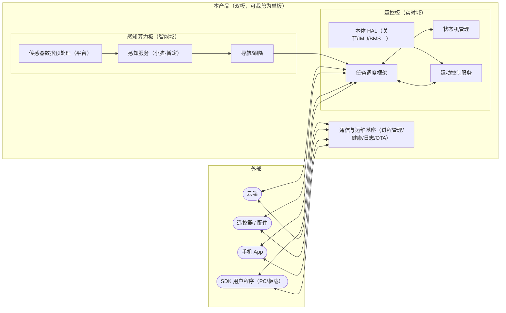

# 四足狗软件特性设计说明书（主控文档）

| 项 | 内容 |
|---|---|
| 文档编号 | QDOG-SFS-001 |
| 版本 | V0.1（草案） |
| 日期 | 2026-11-10 |
| 产品对象 | 本公司四足狗（产品代号待定，下文统称「本产品」） |
| 对标参考 | 启元 T1 Pro（双板实机逆向分析成果，见 §5 证据来源） |
| 文档状态 | 特性域 A、B 首版撰写中；其余特性域规划中 |
| 维护方式 | 每个特性域独立成章（独立文件），本文件为权威总目录与书写规范 |

---

## 目录

- [1. 书写规范](#1-书写规范)
- [2. 说明书总目录与章节状态](#2-说明书总目录与章节状态)
- [3. 产品概述与系统上下文](#3-产品概述与系统上下文)
- [4. 特性域划分与编号体系](#4-特性域划分与编号体系)
- [5. 参考资料与证据来源](#5-参考资料与证据来源)
- [6. 章节文件索引](#6-章节文件索引)

---

## 1. 书写规范

### 1.1 文档定位与读者

本文档是「软件特性设计说明书」（Feature Design Specification）：以**特性域**（feature domain）为组织单元，描述本产品软件系统「做什么、怎么设计、为什么这样设计」。它处于需求规格说明书（SRS，回答 what）与详细设计/代码（回答 how exactly）之间，回答的是 **what + which design + why**。

目标读者与用途：

| 读者 | 用途 |
|---|---|
| 系统架构师 / 模块负责人 | 设计基线、接口契约、设计决策依据 |
| 软件工程师 | 模块职责边界、接口与数据定义、扩展方式 |
| 测试工程师 | 从 FR/NFR 条目提炼验收准则 |
| 项目管理 / 技术评审 | 范围、优先级、风险与开放问题 |

本文档**不包含**：算法内部数学推导（归算法规格书）、单板硬件设计（归硬件规格书）、逐函数级详细设计（归模块详细设计文档）。

### 1.2 参照标准

本规范为以下标准的裁剪综合（按消费级机器人软件工程实践适配，不声明逐条符合）：

| 标准 | 借鉴点 |
|---|---|
| GB/T 8567-2006《计算机软件文档编制规范》 | 文档结构骨架（引言/总体描述/设计章节/验收准则）、术语与引用文件要求 |
| IEEE 830 / ISO/IEC/IEEE 29148（SRS） | 需求条目化、唯一编号、可验证表述、优先级标注 |
| ISO/IEC/IEEE 42010（架构描述） | 视图分离（逻辑视图/部署视图/接口视图）、关注点与决策的显式记录 |
| RFC 2119 | 规范性动词（必须/不得/应当/可以） |
| IPD/特性设计实践 | 以「特性域」组织设计章节、每章含价值场景与验收考虑 |

### 1.3 章节模板（每个特性域章节的固定结构）

每个特性域章节（第 5 章起）一律遵循以下小节结构，便于跨章检索与评审对照：

```text
X.1   特性域概述            范围、价值、用户场景（User Story）
X.2   概念模型与术语        本章核心概念的严格定义
X.3   需求与功能点          FR/NFR 条目表（带优先级与验收准则）
X.4   对标实证分析（T1 Pro）现状盘点 → 统一 or 分散判定 → 公共性分析
                             → 提取/不提取的权衡 → 对本产品的结论
X.5   总体设计
X.5.1   设计目标与原则
X.5.2   逻辑视图            SVG 图（figures/*.svg）：仅关键模块的上下
                             依赖分层；模块清单+依赖要点表
X.5.3   组件交互与职责矩阵  组件协作图（mermaid）+ 职责矩阵（做什么/不做什么）
X.6   关键机制设计          状态机/仲裁/场景/框架库等机制的行为规约
X.7   关键接口              关键模块间接口表（IF 条目，含「模块对」列；
                             与逻辑视图依赖边、业务流调用序列三视图互校）
X.8   支撑设计              数据与配置 / 部署与资源 / 容错安全降级 / 可配置扩展
X.9   核心业务流            每条流程=简单流程图+详细时序图；参与实体
                             ≥逻辑视图关键模块；含仲裁/门控明细与异常路径
X.10  三方依赖              基座直接复用/机制参照/工具三类清单+治理原则
X.11  功能、规格与工作量分析  功能/规格概念界定；功能-规格-参考开源实现-
                             代码量-工作量对照表（含 ×5 冰山系数）；汇总与配比
X.12  工作路标              按功能最小集叠加的阶段划分（关键路标 rowspan
                             合并；工作项与 X.11 工作量对应）
X.13  关键设计决策记录      DD 条目（ADR 风格：背景/备选/取舍/结论）
X.14  验证与测试考虑        测试层级、场景用例、验收准则映射
X.15  开放问题              待定项、风险、后续工作
X.16  对标证据引用清单      本章引用的全部 EV 条目汇总
```

前 4 章（引言、总体描述、总体架构、特性域总览）由本主控文档承载（§3/§4 即其概要，后续如需展开再独立成章）。

### 1.4 编号与命名规则

| 前缀 | 含义 | 示例 |
|---|---|---|
| `FR-<域>-<nn>` | 功能需求（nn 两位递增，全文档唯一） | `FR-TS-01` |
| `NFR-<域>-<nn>` | 非功能需求（性能/可靠性/安全…，验收准则必填） | `NFR-SP-03` |
| `IF-<域>-<nn>` | 接口条目（话题/服务/消息） | `IF-TS-05` |
| `DD-<域>-<nn>` | 设计决策记录 | `DD-TS-02` |
| `EV-T1P-<nn>` | 对标实证条目（证据见 §5 来源规则） | `EV-T1P-17` |
| `A-<n>` | 全局假设（产品/硬件层面，待产品定义确认） | `A-1` |

域码（随特性域增加而扩展）：`TS` 任务调度与状态机、`SP` 传感器预处理与感知、`MC` 运动控制服务、`VI` 语音交互与 Agent、`NV` 导航与自主任务、`OM` 运维/健康/OTA、`SEC` 安全与合规；`ARCH` 为总体架构章（第 3 章）专用前缀（仅用于 OP-ARCH-xx 开放问题等，不设 FR/NFR 特性域）。

图表编号：`图 X-n`、`表 X-n`（X 为所属章号）；每图必须有标题与编号，状态机统一用 `stateDiagram-v2`、时序用 `sequenceDiagram`、结构/数据流用 `flowchart`，保证可版本化 diff。

### 1.5 需求语句规范

- 每条 FR/NFR 一个可验证的行为，使用规范性动词：**必须**（MUST）、**不得**（MUST NOT）、**应当**（SHOULD，偏差需记录理由）、**可以**（MAY）。
- 每条需求必填字段：编号、优先级（P0 首版必须 / P1 首版应当 / P2 规划）、验收准则（可执行验证方法一句话）。
- 需求只写「外部可观察的行为」，实现手段写入 X.5 设计节。

### 1.6 对标实证引用规范

所有以启元 T1 Pro 为依据的论断必须标注 EV 条目，格式：

```text
[EV-T1P-nn] 来源类型 + 定位：
  A = docs/primebot/t1-pro-orin-rk-analysis.md（标注 §节号）
  B = 真机全盘备份 backup_20261102（标注文件路径，必要时标注行号/键名）
  C = 板上实测数据 docs/primebot/on_device_measured_data（标注 c2/c3/c4 及节号）
  D = 官方 SDK 文档 docs/primebot/sdk_t1-v1.0.0.0（标注文档与章节）
```

规则：**结论必须有实证**；推断（证据不足以定论）必须显式标注「推断」；T1 Pro 的做法 ≠ 本产品的做法，借鉴与否须经 X.4 的权衡分析给出结论。

### 1.7 版本与变更管理

- 每个章节文件头部维护自己的版本表（版本/日期/变更摘要/作者）。
- 本 README 的 §2 总目录是章节状态的唯一权威；新增特性域章节时更新 §2 与 §6。
- FR/NFR/IF/DD/EV 编号一经评审冻结不得复用，作废条目保留并标注 `[作废]`。
- 章节演进流程：草稿（Draft）→ 内部评审（Reviewed）→ 基线（Baselined，进入变更控制）。

---

## 2. 说明书总目录与章节状态

| 章号 | 章节 | 状态 | 文件 |
|---|---|---|---|
| 1 | 引言（标识/目的/范围/术语/参照标准） | 由本 README §1 承载 | 本文件 |
| 2 | 总体描述（产品定位/运行环境/约束与假设） | 由本 README §3 承载 | 本文件 |
| 3 | 系统总体架构（三大子系统职责划分 + 部署/接口视图概要） | **V0.40 草案（§3.8.1.4 补 AmCancel 结构——五粒度取消，预留条目）** | [architecture-design.md](./architecture-design.md) |
| 4 | 特性域总览与优先级 | 由本 README §4 承载 | 本文件 |
| **5** | **特性域 A：task 调度框架与状态机管理** | **V0.46 草案（状态集引言机型口径同步：四足↔双足可变形）** | [task-engine-and-state-machine.md](./task-engine-and-state-machine.md) |
| **6** | **特性域 B：传感器数据预处理与通用感知服务** | **V0.6 草案（代码量单位统一为 K LoC）** | [sensor-preprocessing-and-perception.md](./sensor-preprocessing-and-perception.md) |
| 7 | 特性域 C：运动控制服务（动作库/步态/关节伺服接口） | 规划中 | — |
| 8 | 特性域 D：语音交互与 Agent（唤醒/ASR/NLU/TTS/对话） | 规划中 | — |
| 9 | 特性域 E：导航、建图与跟随（SLAM/规划/自主任务） | 规划中 | — |
| 10 | 特性域 F：电源与能耗管理（BMS/休眠/低电策略） | 规划中 | — |
| 11 | 特性域 G：健康管理、日志与 OTA | 规划中 | — |
| 12 | 特性域 H：安全与合规（急停/权限/数据合规） | **V0.2 草案（对齐 /robot/ 接口口径与双足机型裁决；X.11/X.12 待补）** | [security-module-architecture.md](./security-module-architecture.md) |
| 13 | 特性域 I：App/云/遥控器接入与 SDK 面向开发者的对外接口 | 规划中 | — |
| 14 | 需求追踪矩阵（FR/NFR ↔ 模块 ↔ 接口 ↔ 测试用例） | 随章节累积 | — |
| 附录 A | 全局术语表 | 随章节累积 | — |
| 附录 B | 对标证据总表（EV 条目全集） | 随章节累积 | — |

---

## 3. 产品概述与系统上下文

### 3.1 产品定位

本产品为**四足狗形态的消费级/开发者级具身智能机器人**：面向家庭陪伴与开发者生态，具备语音交互、跟随、建图导航、动作表演等能力，并以 SDK 对外开放二次开发接口。软件平台在设计上要求：多入口并发控制下行为可预期、长任务可编排可仲裁、传感与感知能力可按机型裁剪扩展。

**对标对象**：启元 T1 Pro（四足↔双足可变形的具身智能机器人，rk 运控板 + orin 大脑板双板架构，ROS 2 生态）。本产品同为**四足↔双足可变形形态**（双足站立/行走＋四足，2026-11-19 产品定义确认，A-2），对标目的是**站在已量产验证的软件架构上做增量决策**，而非照搬。

### 3.2 系统上下文与总体架构（概要）



- 分层原则（对标 T1 Pro 实证借鉴，见第 5/6 章详述）：实时域与智能域物理分板；大带宽传感数据不出采集板，板间只传结果级数据；控制权/任务/系统状态三分治理。
- 职责视图（大脑 Agent 子系统 / 小脑子系统 / 软件平台子系统的职责边界与模块划分）详见第 3 章独立文件。
- 本产品通信中间件基线：ROS 2（DDS）+ 板内零拷贝 IPC（对标 T1 Pro 的 FastDDS + iceoryx 组合，详见第 6 章 DD-SP 条目）。

### 3.3 全局假设与约束

| 编号 | 假设/约束 | 状态 |
|---|---|---|
| A-1 | 双板架构（实时运控板 + 感知算力板），软件须可裁剪部署至单板入门机型 | 待产品定义确认 |
| A-2 | 可变形本体：12 个腿部关节（每腿 3 关节），CAN/EtherCAT 总线伺服；**双足站立/行走＋四足↔双足变形——双足形态下前两腿转为双臂、后两腿站立承重**（2026-11-19 产品定义确认）；形态域预留扩展（如云台） | 已确认 |
| A-3 | 传感集合（基线）：头部双目 RGB、深度/ToF ≥2 路（前/后）、躯干 IMU、关节编码器/电流、BMS、触摸、麦克风阵列、扬声器、灯效；可选：鱼眼、激光雷达、UWB 配件 | 待产品定义确认 |
| A-4 | 交互入口 ≥4 类：语音、App、遥控器、SDK；多入口可能并发，须有仲裁 | 已确认 |
| A-5 | ROS 2（Humble 及后续 LTS）为通信与节点模型基线 | 已确认 |
| A-6 | 对标证据仅来自 §5 列出的四类来源；T1 Pro 固件版本 t2-3 / JetPack 540.4.0 基线 | 已确认 |

---

## 4. 特性域划分与编号体系

| 域码 | 特性域 | 一句话范围 | 优先级 |
|---|---|---|---|
| TS | 任务调度框架与状态机管理 | 系统状态机、任务模型与仲裁、场景/资源调度、控制权仲裁的框架层 | **P0**（本章第 5 章） |
| SP | 传感器数据预处理与通用感知服务 | 传感数据从 HAL 到算法就绪输入之间的所有公共加工与感知服务；**归属拆分：预处理→平台，感知服务→小脑（暂定，OP-ARCH-05 修订）** | **P0**（本章第 6 章） |
| MC | 运动控制服务 | 动作库、步态、姿态、关节伺服接口与运动安全 | P0（规划中） |
| VI | 语音交互与 Agent | 唤醒、ASR、NLU、对话编排、TTS、表情 | P0（规划中） |
| NV | 导航、建图与跟随 | SLAM、规划、跟随、自主任务 | P1（规划中） |
| OM | 运维/健康/OTA | 进程守护、健康诊断、日志、升级 | P1（规划中） |
| SEC | 安全与合规 | 急停、权限、数据合规、安全状态 | **P0**（本章第 12 章 V0.1：安全模块架构设计） |
| — | App/云/SDK 接入 | 多端接入、鉴权、开发者接口面 | P1（规划中） |

---

## 5. 参考资料与证据来源

本说明书对标部分**只**使用以下来源（与仓库其它文档隔离，特别声明：不参考 `t1-pro-developer-sdk-analysis.md`）：

| 类型  | 来源                                                                                         | 说明                                            |
| --- | ------------------------------------------------------------------------------------------ | --------------------------------------------- |
| A   | `docs/primebot/t1-pro-orin-rk-analysis.md`                                                 | T1 Pro 双板实机分析（进程/节点/接口/资源/架构，实测基线 t2-3）       |
| B   | `/home/liqiliang/workspace/lql/projects/primebot/on_device_measured_data/backup_20261102/` | 两板全盘备份（含全部部署软件、配置、接口定义），只读                    |
| C   | `docs/primebot/on_device_measured_data/`                                                   | 板上实测数据（c2 usecase 连续采样 / c3 基线 / c4 传感器拓扑）    |
| D   | `docs/primebot/sdk_t1-v1.0.0.0/`                                                           | 官方 SDK（接口说明.md、快速入门、aimdk_msgs 消息定义、examples） |

---

## 6. 章节文件索引

| 文件 | 章 | 版本 |
|---|---|---|
| [architecture-design.md](./architecture-design.md) | 3 系统总体架构：三大子系统职责划分 | V0.40 |
| [task-engine-and-state-machine.md](./task-engine-and-state-machine.md) | 5 特性域 A：task 调度框架与状态机管理 | V0.46 |
| [sensor-preprocessing-and-perception.md](./sensor-preprocessing-and-perception.md) | 6 特性域 B：传感器数据预处理与通用感知服务 | V0.6 |
| [security-module-architecture.md](./security-module-architecture.md) | 12 特性域 H：安全与合规（安全模块架构设计） | V0.2 |

### 变更记录（本文件）

| 版本 | 日期 | 变更 | 作者 |
|---|---|---|---|
| V0.1 | 2026-11-10 | 建立书写规范、总目录、特性域 A/B 首版 | liqiliang |
| V0.2 | 2026-11-10 | 章节模板新增 X.6「功能、规格与工作量分析」；特性域 A/B 升 V0.2（新增该章） | liqiliang |
| V0.3 | 2026-11-11 | 特性域 A/B 的 X.6 对照表完善（功能名称+功能简介列、参考实现两行式并附核实仓址） | liqiliang |
| V0.4 | 2026-11-11 | 新增 X.6.5 端到端场景走查（UC-A「跳舞中被跟随抢占」，完整版在 §5.6.5，SP 视角在 §6.6.5） | liqiliang |
| V0.5 | 2026-11-11 | 第 5 章显式化调度模型：DD-TS-12 仲裁式调度（无通用任务队列）、排队语义受控局部、§5.6.5 澄清、OP-TS-08 | liqiliang |
| V0.6 | 2026-11-12 | 第 3 章独立成章：三大子系统（大脑 Agent/小脑/软件平台）职责划分与模块功能描述（subsystem-responsibilities.md V0.1，新增 EV-T1P-62~66） | liqiliang |
| V0.7 | 2026-11-12 | 第 3 章文件升 V0.2：新增第 3A 章并行原稿（对话产出原封不动收录，临时占位编号，待与第 3 章正文整合）；§1.4 补登记 ARCH 前缀 | liqiliang |
| V0.8 | 2026-11-12 | 第 3 章整合完成并升 V0.3（3A 章除去）：视觉归属裁决（交互视觉归大脑、感知视觉随小脑/平台，OP-ARCH-05 已裁决）；职责视角互补（层定位+一句话边界+业务主链路融入 §3.2.1）；三张模块表新增「T1 模块对照」列 | liqiliang |
| V0.9 | 2026-11-12 | **感知服务归属调整（暂定）：平台 → 小脑**（OP-ARCH-05 修订）：第 3 章 V0.4（§3.2 职责/图 3-1/§3.4 新增感知服务模块行/§3.7 映射拆分/§3.8.1）；第 6 章 V0.5（归属声明、FR-SP-09/10/11 主语、图 6-1/职责矩阵标注）；README §3.2/§4 同步。平台仅提供传感器数据预处理（数据就绪），不含感知服务 | liqiliang |
| V0.10 | 2026-11-12 | 第 3 章 V0.5：新增 §3.2.1「大软件逻辑视图」（图 3-1，三大子系统 × 16 模块权威清单与主数据流）；模块命名对齐——小脑感知拆「融合与感知」+「实时避障」，平台「基础 OS」→「OS 基础服务」；原 §3.2.1~3.2.3 顺延、原图 3-1 改号图 3-2 | liqiliang |
| V0.11 | 2026-11-12 | 第 3 章 V0.6：新增 §3.6「场景级模块协同（接口视角）」——「站起来」「跟我走」模块级流程图/时序图（边标注接口名/Topic·Service/关键参数，T1 Pro 实测口径）+ Topic/Service 完备接口列表（含频次实证与全参入出）；原 §3.6~3.10 顺延为 §3.7~3.11 | liqiliang |
| V0.12 | 2026-11-12 | 第 3 章 V0.7：§3.6 四图补充灯带逻辑——lumina 订阅联动（tts_status/interaction/state→灯语）入图 3-3~3-6、显式 LedStripCommand 标注实证范围（仅 UC1）、修正图 3-6 PlayTts 路由 | liqiliang |
| V0.13 | 2026-11-13 | 第 3 章 V0.8：同进程决策落档——「融合与感知（融合引擎）+实时避障」同进程实现（对标 coreon_fusion 一进程一份点云）；§3.4 边界注记三条（数据/分层/实现）、§3.9.2 注记 5（T1 避障非独立模块、与跟随不平级的实证与拆模块三理由） | liqiliang |
| V0.14 | 2026-11-13 | 第 3 章 V0.9：模块更名「融合与感知」→「感知与融合」——语序按流程主链「单源感知→多源融合」修正（数据级融合在前为特例，两类并存）；全章 24 处有效表述与四图节点更名，历史记录保留旧名；§3.4 边界注记增第 0 条命名说明 | liqiliang |
| V0.15 | 2026-11-13 | 第 3 章 V0.10：模块定名「融合感知」（行业通用叫法，最终名）——复合词规避语序歧义，与 T1 生态外部表述一致（七路融合感知，C：c4 §7）；全章有效表述更名，边界注记 0 记录命名沿革（融合与感知→感知与融合→融合感知） | liqiliang |
| V0.16 | 2026-11-13 | 第 3 章 V0.11：表 3-1 最前新增「子系统」列（大脑/小脑/软件平台），行序按子系统分组 | liqiliang |
| V0.17 | 2026-11-13 | 第 3 章 V0.12：表 3-1「子系统」列合并重复单元格（GFM 不支持 rowspan，转为内嵌 HTML 表格：大脑 5/小脑 5/软件平台 6） | liqiliang |
| V0.18 | 2026-11-13 | 第 3 章 V0.13：图 3-3/3-4 排查修正——灯带归属（hal_sensor→本体 APP，表 3-1 加注 T1 差异）、补传感器预处理 1kHz/500Hz 反馈边、tts_status 两条边标注同一话题双订阅者（TE 收尾闭环/lumina 灯语联动） | liqiliang |
| V0.19 | 2026-11-13 | 第 3 章 V0.14：表 3-2 补录 /odom/status（里程计可信度状态码——require_trusted 门控数据源、reason=66 关联、质量随流→任务门控模式实例）；图 3-5 边标签同步 | liqiliang |
| V0.20 | 2026-11-13 | 第 3 章 V0.15：图 3-5/3-6 补「实时避障不参与控制权抢占」标注——不调 SetMcInputSource、不注册源（T1 注册源表无 coreon_fusion），只叠写当前持权源指令；极端停车走急停链；边界注记 2 同步 | liqiliang |
| V0.21 | 2026-11-13 | 第 3 章 V0.16：修正 SetMcAction 标签——请求只带单一目标动作（101 四足站立），115→102 为 MC 内部自动迁移（原标签误作接口参数）；表 3-3 枚举分段写法并明示 101 四足站立 vs 201 双足站立（本产品纯四足无 201 链路） | liqiliang |
| V0.22 | 2026-11-13 | 第 3 章 V0.17 + 第 5 章 V0.6：控制权租期补「**续租窗口，非任务时长**」语义——每帧 velocity（≥10Hz）即续租、持续发布可无限期持有（跟随/遥控均此模式）；连续静默 1000ms=失联保护性释放并按优先级顺延；正常结束走显式 DELETE；表 3-2/3-3 与 §5.5.3.2 同步 | liqiliang |
| V0.23 | 2026-11-13 | 第 3 章文件更名：subsystem-responsibilities.md → **architecture-design.md**（架构设计文档，git mv 保留历史）；目录/索引链接同步，历史变更记录保留原名 | liqiliang |
| V0.24 | 2026-11-17 | **§1.3 章节模板升级**（X.1~X.15）：显式纳入逻辑视图（X.5.2，SVG）/关键接口（X.7，含模块对）/核心业务流（X.9，流程图+时序图）/三方依赖（X.10）；第 5 章按新模板完成结构重构（V0.7：新增 figures/ts-logical-view.svg、图 5-2~5-5、§5.10 依赖清单）；**第 6 章暂为旧模板，待后续按新模板重构** | liqiliang |
| V0.25 | 2026-11-17 | 第 5 章 V0.8：① §5.5.2 标题去「（SVG）」；② 图 5-1 优化——边标签细字 10px+白晕、逐条与箭头对齐（斜边改正交折线、去旋转文字）；③ **scene_engine 正名「定时任务触发器」**（T1 命名有迷惑性、实为定时触发器，EV-T1P-23）——逻辑视图 L1 新增入口框（标注 T1 名）、交互图/FR-TS-01/IF-TS-01/排队语义等全量更新 | liqiliang |
| V0.26 | 2026-11-17 | 第 5 章 V0.9：scene_engine **彻底正名**——正文与所有图表一律以「定时任务触发器」为主名（含「自主触发/自主调度」旧词全部替换），T1 原名仅保留标注位（〔T1 误名〕/T1 名）与 B 类来源文件路径；修订 8 处正文 + SVG 副题 | liqiliang |
| V0.27 | 2026-11-17 | 第 5 章 V0.10：图内（逻辑视图 SVG/组件交互 mermaid/L1 表）scene_engine 字样清零——副题与注记改功能描述，T1 名仅存正文标注位与来源路径 | liqiliang |
| V0.28 | 2026-11-17 | 第 5 章 V0.11：**scene_manager → resource_manager**（T1 无此名——资源场景功能在 sys_guard；scene- 前缀承袭 T1 场景四义混淆）——18 处正文+SVG 全量更名；IF-TS-10 接口改 `/qdog/resource/state|command`；模块中文名「资源管理（资源场景）」；概念词「资源场景」保留 | liqiliang |
| V0.29 | 2026-11-17 | 第 5 章 V0.12：① 逻辑视图 SVG 重构对齐三大子系统（底层软件平台/上左大脑/上右小脑，依赖边复核）；② 工作量 **×5 冰山系数**（涵盖需求理解/拆解/架构/开发调测/集成调测，全量 52.5~55 人月）；③ 新增 **§5.12 工作路标**（4 阶段：2026.11.30/12.31/2027.3.31/5.31，功能最小集叠加，rowspan 合并关键路标列）；模板升级 X.12 工作路标/X.16 证据清单 | liqiliang |
| V0.30 | 2026-11-17 | 第 5 章 V0.13：工作量口径统一为**代码量**——§5.11.3 删人月列（13 行）、§5.11.4 汇总与配比/前三改代码量、§5.12 路标表改代码量（与 §5.11.3 一一对应）；§5.12 精简 | liqiliang |
| V0.31 | 2026-11-17 | 第 5 章 V0.14：路标修正——任务运行时（最小版）调入阶段一（原闭环断在「受理」，task_id/执行器下发/状态广播无宿主）；阶段一=单任务端到端（85~130 K LoC），阶段二=多任务冲突与治理（运行时完整化并入仲裁行）；四阶段叙事更新 | liqiliang |
| V0.32 | 2026-11-17 | 第 5 章 V0.15：路标依赖梳理——阶段二行序调换（守护契约先于模块管理器，IF-TS-09 执行端契约先行）；注记补依赖说明（行序＝依赖序/fsm-core 蓝本策略/跨域依赖 OM·MC·小脑）；复核结论四阶段递进无倒挂 | liqiliang |
| V0.33 | 2026-11-17 | 第 5 章文件更名 **task-engine-and-state-machine.md**（git mv 保留历史）；模块正名 task_manager→**task_engine**（与 T1 同名对标）、system_manager→**state_machine**（§5.3.2 实现模块，补 SystemFSM/模块生命周期管理器/状态广播器三子模块，SVG/交互图/职责矩阵同步） | liqiliang |
| V0.34 | 2026-11-17 | 第 5 章 V0.17：逻辑视图语义修正——fsm-core（库）从依赖图移除（运行期组件与编译期依赖分离），改为宿主标注（task_engine 副标题/SystemFSM*）+图例注释；视图现仅含 3 个 TS 进程模块+运行期依赖边 | liqiliang |
| V0.35 | 2026-11-17 | 第 5 章 V0.18：state_machine 子模块重梳理（3→4）——补**审计与恢复器**（迁移事件流/jsonl 审计/快照重建，原散落机制归位），SVG/交互图/分层表/职责矩阵/§5.3.2 五处同步 | liqiliang |
| V0.36 | 2026-11-17 | 第 5 章 V0.19：§5.5.2 新增「两层状态机」分工——任务态〔TaskState〕宿主 task_engine·任务运行时（对标 T1 WorkerManager）、系统态/模块态宿主 state_machine（对标 aim_sm_app），含分工理由与 T1 两进程分层状态机树（★标注状态语义层次） | liqiliang |
| V0.37 | 2026-11-17 | 第 5 章 V0.20：① 任务运行时改 task_engine **底部通栏底座**布局（SVG+分层表，承接上层裁决驱动执行器）；② §5.5.2 新增四模块**子模块功能详表**（task_engine 4/state_machine 4/resource_manager 2/OM 2 共 12 项，功能↔FR/IF 对应） | liqiliang |
| V0.38 | 2026-11-18 | 第 5 章 V0.21：任务运行时与状态聚合**拆分两框**（运行时＝纵向持有容器/WorkerManager 对标，聚合＝横向对外翻译、输入含域状态上报）——运行时保持底部横跨底座，聚合置于两级仲裁器右侧；task_engine 子模块 4→5 | liqiliang |
| V0.39 | 2026-11-18 | 第 5 章 V0.22：状态聚合布局微调——从上层同排改为**右侧纵向框**（与两级仲裁器、任务运行时并列纵放，标注「域状态→TaskState 广播」） | liqiliang |
| V0.40 | 2026-11-18 | 第 5 章 V0.23：全文档按最新逻辑视图布局刷新——组件交互图重排/职责矩阵 5 子模块/T1 树标注/§5.11.3 两职责拆写/**§5.12 路标刷新**（阶段一工作项含运行时底座+状态聚合、阶段二完整化拆分、依赖注记补底座先于聚合） | liqiliang |
| V0.41 | 2026-11-18 | 第 5 章 V0.24：图 5-1 压盖修复——状态聚合纵框与仲裁器/运行时条互不压盖（框加高+右移）、OS 基础服务条移出平台框（间隙 14px）、依赖边几何同步、图例溢出修复；几何校验通过 | liqiliang |
| V0.42 | 2026-11-18 | 第 5 章 V0.25：图 5-1 归属修正——平台子系统框复原（重新含 OS 基础服务）；**定时任务触发器移出大脑框**（按 16 模块清单归属软件平台，改画独立入口实体框）；分层表行移至平台组 | liqiliang |
| V0.43 | 2026-11-18 | 第 5 章 V0.26：补「入口网关 vs 仲裁第一级」切分线判据（是否依赖运行态）——T1 树 RuleManager 三职责展开、子模块详表两行对称标注、验票员/调度员注记 | liqiliang |
| V0.44 | 2026-11-18 | 第 5 章 V0.27：定时任务触发器框迁入平台内 task_engine 右侧——不进 task_engine 框（独立进程语义：T1 独立 em 应用、IF-TS-01 跨进程），悬空位取消、大脑框复原 | liqiliang |
| V0.45 | 2026-11-18 | 第 5 章 V0.28：修复图 5-1 定时器框渲染丢失（上轮误插大脑组内）——移至平台区正确位置，渲染级校验通过 | liqiliang |
| V0.46 | 2026-11-18 | 第 5 章 V0.29：图 5-1 加 **TS 主体实框**（圈住 task_engine/state_machine/resource_manager 三框）；零压盖重排——OM 缩窄、rm 回第二行右段、定时器移第三行（实框外独立语义保持）、OS 条/图例下移；几何校验 11 项全过 | liqiliang |
| V0.47 | 2026-11-18 | 第 5 章 V0.30：图 5-1 **删定时任务触发器框**（入口实体非本域关键模块，分析/协议留正文）+全图排版整理回收紧凑，图例重写补实框图例项 | liqiliang |
| V0.48 | 2026-11-18 | 第 5 章 V0.31：**方向 A 落实**——resource_manager → **sys_guard（系统资源守护）**：对标 T1 sys_guard 职责收窄（cgroup/温控/磁盘），传感供电/模块启停归还 state_machine 差集动作，消除职责重叠；FR/IF/详表/工作量/路标/DD-TS-06 全链同步 | liqiliang |
| V0.49 | 2026-11-18 | 第 5 章 V0.32：逻辑视图聚焦——删 OM/sys_guard/OS 基础服务三外域框（分析/协议留正文），图 5-1 仅含 task_engine+state_machine；黑框下移避让平台标题、state_machine 居中、平台框/画布收紧 | liqiliang |
| V0.50 | 2026-11-18 | 第 5 章 V0.33：图 5-1 **整体重写**——最优比例布局：两框等宽居中 660px、流水线含段间箭头、子模块等宽 140px、图例六色块一行、入口域收窄加注记 | liqiliang |
| V0.51 | 2026-11-18 | 第 5 章 V0.34：图 5-1 边修正——task_engine→小脑方向反转（箭头应指小脑执行器）＋运行时→聚合箭头独立浅色+「任务态」标注 | liqiliang |
| V0.52 | 2026-11-18 | 第 5 章 V0.35：图 5-1 精简——删全部 IF-TS-xx 编号标注（5 处边标签保留纯语义文字）＋删图例「TS 域进程模块」与「外域协同实体」两项 | liqiliang |
| V0.53 | 2026-11-18 | 第 5 章 V0.36：图 5-1 微调——状态聚合框左缘右移 32px（648→680），箭头间隙扩至 46px，「任务态」标注从 8px 放大至 10px | liqiliang |
| V0.54 | 2026-11-18 | 第 5 章 V0.37：**按图 5-1 定稿模块划分全文档刷新**——① §5.5.2 改「两核心模块＋框外画法约定」（sys_guard＝域内 P1 框外交付，图例注记同步）；② 方向 A 边清除（分层表/交互图/流程二删 SM→sys_guard「状态动作」，传感供电/导航栈 pause 统一归 L0 差集动作——§5.2/§5.5.3/§5.6.3/§5.8.1/§5.9/职责矩阵六处）；③ 新增 IF-TS-14 域执行器契约（视图「获准任务/取消」边的接口宿主，§5.9.1 改引）；④ §5.12 路标刷新：SystemFSM 行改「SystemFSM＋状态广播器」、守护契约行含审计与恢复器最小版、模块管理器行补差集动作、sys_guard 行标注框外·P1、新增「图 5-1 模块对账」注记（九子模块全部落位）；§5.11.3 行 6 同步更名 | liqiliang |
| V0.55 | 2026-11-19 | 第 5 章 V0.38：**§5.5.2 模块表重写＋§5.12 路标重构**——① 模块表粒度改为图 5-1 每框一行（16 框行：大脑/小脑/task_engine 五框/state_machine 四框/框外 4），依赖边逐框登记；② 阶段一调整为 task_engine 框架闭环四主项（入口网关/规则引擎/两级仲裁器/任务运行时＋状态聚合；仲裁器自阶段二调入、SystemFSM 移阶段二、qdog_msgs 转随行基座）；阶段二＝state_machine 治理与跨域协同（四行）；阶段三/四同步刷新；注记区重写（qdog_msgs 随行说明、阶段一门控桩→阶段二真实源、对账注记、里程碑） | liqiliang |
| V0.57 | 2026-11-19 | 第 5 章 V0.39：**§5.12 工作项粒度对齐图框＋按优先级重排**——① §5.11.3 两合并行拆分（运行时/聚合、SystemFSM/广播器各成一行，总量不变；P0 12 行/全量 15 行）；② §5.12 工作项＝图 5-1 每框一行（阶段一五行/阶段二五行/阶段三三行/阶段四两行）；③ 优先级重排：审计与恢复器（P0 收尾）与 dry-run/历史查询（P1 增量）后置阶段三，新增「优先级排序原则」注记，对账注记改九框一一对应 | liqiliang |
| V0.58 | 2026-11-19 | 第 5 章 V0.40＋第 6 章 V0.6：**代码量单位全文统一为 K LoC**——「N~Mk 行」→「N~M K LoC」、「约 N~M 万行」→「约 N×10~M×10 K LoC」（两章及版本记录共 81 处，数值不变）；§5.11.2 补单位定义、§5.11.4 前三按拆行后数值修正 | liqiliang |
| V0.59 | 2026-11-19 | 第 5 章 V0.42：**补 set_action 动作指令面（遗漏修复）**——根因：mc 指令面被折叠为「输入源仲裁」（IF-TS-11 仅 velocity 流），T1 SetMcAction 动作面未条目化且视图边标签固化盲区、三视图互校查不出、V0.41 命名回靠无条目可同步。修复：新增 IF-TS-15（`/robot/mc/set_action`，单一目标/受理≠完成/不走租期）并全文贯通——图 5-1 加 TE→mc 边（5 条边）、§5.6.2「mc 双指令面」语义（动作型任务不经执行器直驱 mc）、UC-A 舞蹈链路改写（删舞蹈执行器与 whole_body 控制权申请）、§5.4.1.1/职责矩阵/§5.14 同步 | liqiliang |
| V0.61 | 2026-11-19 | 第 5 章 V0.43：图 5-1 指令下发箭头合并——删 TE→mc 独立 set_action 边，task_engine→执行器单箭头合并标注「获准任务/取消 · set_action」（IF-TS-14/15 双通道名并留），边数回 4 条；§5.5.2/§5.7 同步合并说明；运行期语义不变 | liqiliang |
| V0.62 | 2026-11-19 | 第 5 章 V0.44：图内接口名修正——「TaskRequest」（srv 类型名）改真实接口名 task/request：SVG 边标签/流程图边标签/模块表两行；消息结构记法与 srv 类型引用保留 | liqiliang |
| V0.63 | 2026-11-19 | 第 5 章 V0.45：图内接口名改全称——task/request→/robot/task/request（缩写易误读为 task 或 request），SVG/流程图/模块表同步；set_action 无歧义维持叶名 | liqiliang |
| V0.64 | 2026-11-19 | 第 3 章 V0.22：**新增 §3.8 巴展场景业务流分析和模块间接口**（§3.8.1 场景 A：主动迎宾、领路、站立讲解）——表 3-4 场景实体→权威模块映射、图 3-7 关键路径流程图、图 3-8 完整业务时序图（每边标注表 3-2/3-3 既有接口+关键入出参，不新增接口）、表 3-5 场景接口清单（25 项）、要点八条；领路/运镜/信标锁定/讲解为场景级新增能力＋机型假设冲突（纯四足 vs 双足变形）记 OP-ARCH-07；新增 EV-T1P-67（迎宾问候链）；原 §3.8~3.11 顺延为 §3.9~3.12（第 6 章归属声明引用同步） | liqiliang |
| V0.65 | 2026-11-19 | **机型裁决落档：双足站立＋四足↔双足变形**（产品定义确认）——README §3 对标对象段落与 A-2 假设修订（原「纯四足、不做双足变形」废除）；第 3 章 V0.23（OP-ARCH-07② 标记已裁决、§3.8.1 机型口径注记改确认态）；第 5 章 V0.46（§5.6.1 状态集引言删「裁剪适配纯四足产品」表述，状态集本身与形态无关不变）；上肢/手部能力（场景 A 讲解手势依赖）仍待产品定义（A-2 附注） | liqiliang |
| V0.66 | 2026-11-19 | **双臂能力裁决落档**：四足→双足变形时**前两腿转为双臂、后两腿站立承重**（产品定义确认）——A-2 修订（「上肢/手部待产品定义」附注关闭，预留扩展去「机械臂选配」字样）；第 3 章 V0.24（OP-ARCH-07 上肢附注移除＋②裁决内容补双臂、§3.8.1 机型口径补双臂、要点⑦ 手势注双臂来源）；场景 A 手势接口 `set_preset_motion`（左手/右手位掩码，表 3-3）与 T1 优先级阶梯「上肢动作=40」〔EV-T1P-37〕词汇均与此口径自洽，图 3-7/3-8 无需改动 | liqiliang |
| V0.67 | 2026-11-19 | 第 3 章 V0.25：**§3.8.1 场景 A 两图按评审口径重构**——语音模块去 TTS（仅唤醒+ASR），全部播报改 TE→讲解模块 `audio/play_audio_file`（file.file_name＝音频 ID，对标 T1 PlayAudioFile ★）；长程任务规划更名任务规划；意图识别（本地 NLU / 云端 LLM）唤醒后触发信标锁定；运镜退出场景 A；tts_status 改讲解模块→本体 APP；本体 APP 补音量控制（audio/set_volume 边）；task/request 仲裁响应显式回边；A4 三步显式化（变形→TE 直调导航返程→变形，删 A0 待机模块）；子系统标题加粗放大；场景描述/表 3-4/表 3-5（仍 25 项）/要点同步 | liqiliang |
| V0.68 | 2026-11-19 | 第 3 章 V0.26：**§3.8.1 场景接口清单拆分重构**——原单表拆为表 3-5 Topic 使用清单（13 项）＋表 3-6 Service 使用清单（12 项），列结构改「接口/使用阶段/场景用途/入参/出参」：入参出参各自成列、入参逐参数给出含义与场景取值（Topic 沿表 3-2 同负载口径标注订阅方，Service 出参亦逐参数释义）；总数 25 项不变、全部溯源自表 3-2/3-3 | liqiliang |
| V0.69 | 2026-11-19 | 第 3 章 V0.27：**§3.8.1 两图三项修订**——① 流程图子系统标题去 `**`（裸 Markdown 在 mermaid 标签显形＋字号放大致截断）改 style 加粗；② 两图接口名全称化（每边/消息带 `/robot/` 前缀）；③ 每边/消息新增【调用阶段】标签（前缀式单标签，规避多标签管道语法兼容性风险——部分渲染器解析失败会整图不渲染） | liqiliang |
| V0.70 | 2026-11-19 | 第 3 章 V0.28：§3.8.1 A4 阶段标签更名——「A4 步骤一/三」→「A4 变形」（含前置净空检查→「A4 变形前」）、「A4 步骤二」→「A4 导航返程」；两图＋表 3-6＋要点② 同步 | liqiliang |
| V0.71 | 2026-11-19 | 第 3 章 V0.29：§3.8.1 表 3-5/3-6 入参单元格改**逐参数一行**（`<br>` 分行，仅排版、内容零增删） | liqiliang |
| V0.72 | 2026-11-20 | 第 3 章 V0.30：**新增 §3.8.2 跨子系统接口数据结构（场景 A）**——14 项跨子系统接口（大脑↔平台 5＋平台↔小脑 9）按 T1 SDK msg/srv 给出详细数据结构：〔SDK 原文〕逐字段转录（SetMcAction/SetMcPresetMotion/PlayAudioFile 三链＋通用类型，含 McAction 枚举——变形 10/11/20/21、双足站立 201 场景取值有官方定义）、〔依 A 拟定〕SDK 未公开者（AmRequest/FollowTaskCtrl/NaviTask 等）标注建议值；标准 ROS 类型注明无自定义结构 | liqiliang |
| V0.73 | 2026-11-20 | 第 3 章 V0.31：**§3.8 小节重划（内容仅移动未改）**——§3.8.1 场景 A-流程图／§3.8.2 场景 A-时序图（要点八条随迁）／§3.8.3 场景 A-模块间的接口清单／§3.8.4 详细数据接口（跨子系统边界的接口，原 §3.8.2 改号） | liqiliang |
| V0.74 | 2026-11-20 | 第 3 章 V0.32：§3.8.4 标题改「跨子系统边界的接口的详细数据结构」；§3.8.3 表 3-5/3-6 首列对 14 项跨子系统接口加粗（子系统内部 11 项常规字体），引言加图例 | liqiliang |
| V0.75 | 2026-11-20 | 第 3 章 V0.33：**§3.8 层级重划＋证据档标注**——场景 A 升父节 §3.8.1（场景描述/前置条件随置），四交付物降为 §3.8.1.1~3.8.1.4（为场景 B/C 预留 §3.8.2+）；§3.8.1.3 清单 25 行尾标〔T1 参考〕19 项/〔T1 参考＋推断〕6 项，§3.8.1.4 数据结构 15 块各加粗档位标签（〔T1 参考〕SDK 原文/〔合理推断〕依 A 拟定） | liqiliang |
| V0.76 | 2026-11-20 | 第 3 章 V0.34：§3.8 证据标签更名〔T1 参考〕→〔参考 T1〕（36 处）；§3.8.1.4 标题改「跨子系统边界的接口的详细数据结构」 | liqiliang |
| V0.77 | 2026-11-19 | **第 12 章开篇**：新建 security-module-architecture.md V0.1（安全模块架构设计首版）——承接第 3 章注记 3 收敛决策：三分域×纵深防御概念模型、FR-SEC-01~10/NFR-SEC-01~05、T1 安全能力十载体全景对标与「双层收敛」结论（策略面收敛/反射留 MC 域）、五子模块逻辑视图与职责矩阵、七项关键机制（安全状态/急停链/门控事实面/运行监控/降级阶梯/隐私停流/配额）、IF-SEC-01~09、两条核心业务流（跌倒保护/低电阶梯）、DD-SEC-01~06、OP-SEC-01~08；X.11/X.12 留待 V0.2；新增 EV-T1P-71~74 | lichunlin |
| V0.78 | 2026-11-20 | **第 12 章 V0.2**：对齐工程合入内容——① 接口前缀 `/qdog/`→`/robot/`、qdog_msgs→robot_msgs、服务命名回靠 T1 动词语义（trigger_estop/release_estop/set_safety_limit/ctrl_permission）、进程名 qdog_safety→safety；② 隐私权限状态独立话题化 `/robot/permission_state`（接管第 3 章表 3-2 暂定名，IF-SEC-07 扩为控制服务+状态话题复合条目）、IF-SEC-08 改 `/robot/privacy/gate`（cam/tof 经 IF-SP-05 掩码执行、mic 经音频链路）；③ 机型双足/双臂裁决对齐（FR-SEC-04 形态口径与变形净空门、保护姿态补双足、跌倒判定形态自适应）；④ 第 5 章 V0.42 mc 双指令面（IF-TS-15）纳入门控事实面消费方、IF-SEC-04 补变形净空求值；⑤ EV-T1P-71~74 重排笔误善后（2 处）；⑥ §12.7 新增接口来源分类（接管/复用/新造三类溯源＋逐条来源标签） | lichunlin |
| V0.79 | 2026-11-20 | 第 3 章 V0.35：表 3-4 第一列「平台」改「软件平台」并以 rowspan 合并（转内嵌 HTML 表格，同表 3-1 做法）；§3.8.1.3 跨子系统接口行加 ★ 星标（14 行＋图例，注明与表 3-2/3-3 ★ 含义不同）——因与第 12 章 V0.77/V0.78 合入并发，本行由 V0.77 顺延改号 V0.79 | liqiliang |
| V0.80 | 2026-11-20 | 第 3 章 V0.36：§3.8.1.4 补 PoseStamped 数据结构说明——标准 ROS 类型（geometry_msgs 官方定义，非 T1 自定义非推断；T1 SetNaviTask 实测沿用），标注〔参考 T1〕档并展开 header/pose 字段（orientation＝终点朝向载体） | liqiliang |
| V0.81 | 2026-11-20 | 第 3 章 V0.37：§3.8.1.3 星标行渲染修复——`★**接口名**` 相邻致加粗失效显形 `**`，14 行去掉接口名加粗（★ 单独承担跨子系统标记，证据档标签加粗保留） | liqiliang |
| V0.82 | 2026-11-20 | 第 3 章 V0.38：§3.8.1.3 跨子系统标记 ★ 星标改 ◎ 圆标（14 行）——避免与表 3-2/3-3「T1 对标名」列 ★＝T1 SDK 官方面冲突，◎ 亦避开表 3-1 ●/○＝参与度占用，全文档无二义 | liqiliang |
| V0.83 | 2026-11-20 | 第 3 章 V0.39：token 语义澄清——task/request 出参 token（仲裁层凭据，防越权）≠ task_id（执行层任务实例标识），分层两概念不宜合并命名、命名沿用 T1；表 3-6 两行＋§3.8.1.4 注释与分层注块补全 | liqiliang |
| V0.84 | 2026-11-20 | 第 3 章 V0.40：§3.8.1.4 补 TaskCancel（AmCancel）完整结构——token（归属）＋am_mode（五粒度维度）＋cancel_target_id（目标标识）＋cancel_reason；〔合理推断〕档（依 A §5.2，SDK 官方面无此接口）；预留条目（场景 A 未触发，A 组 5＋1 项） | liqiliang |
