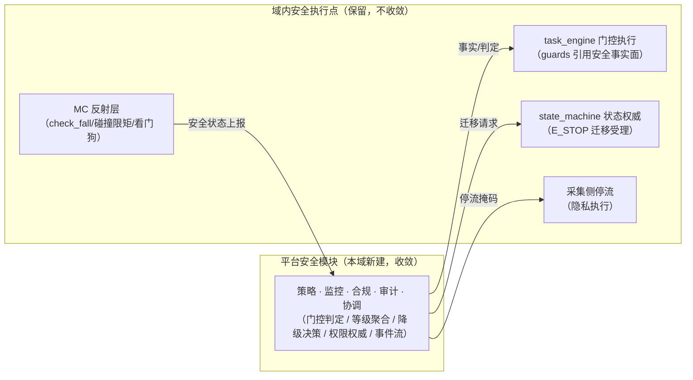
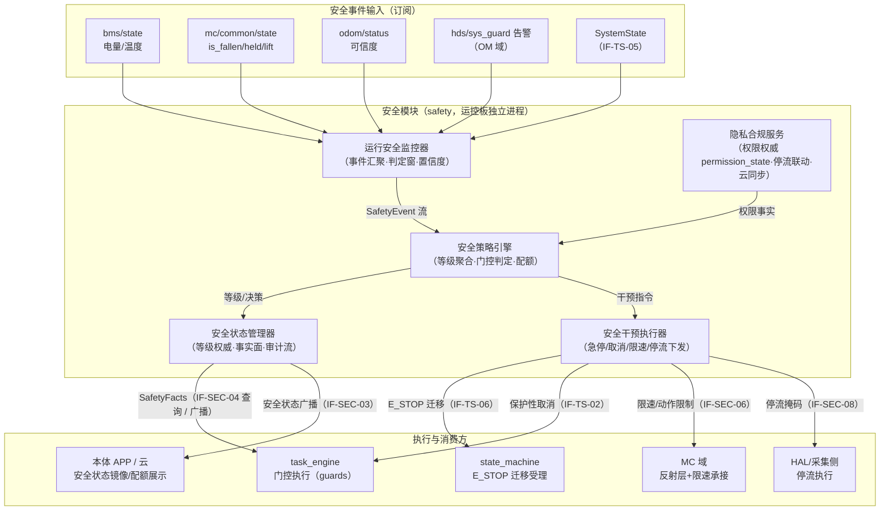
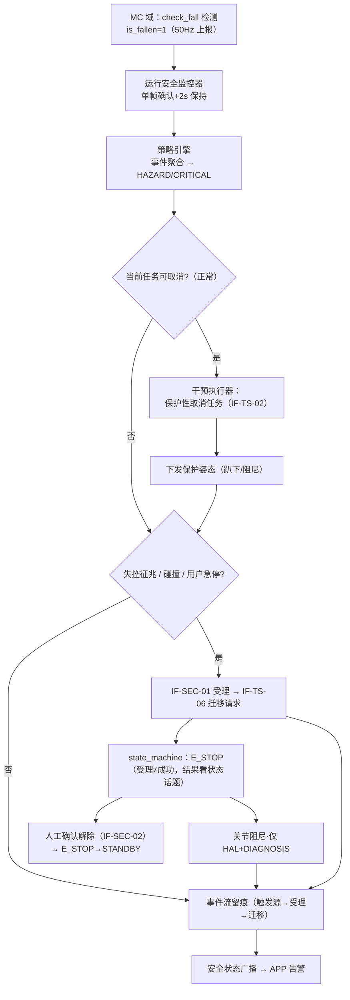
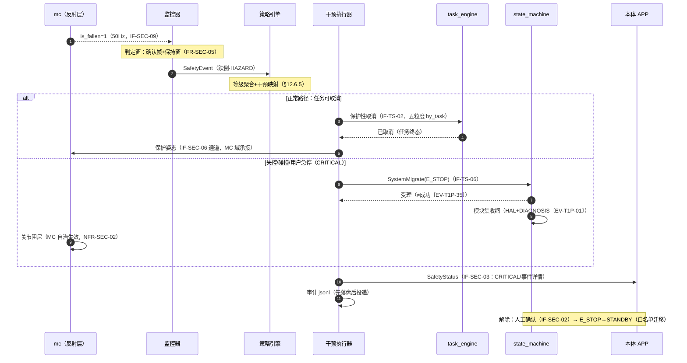
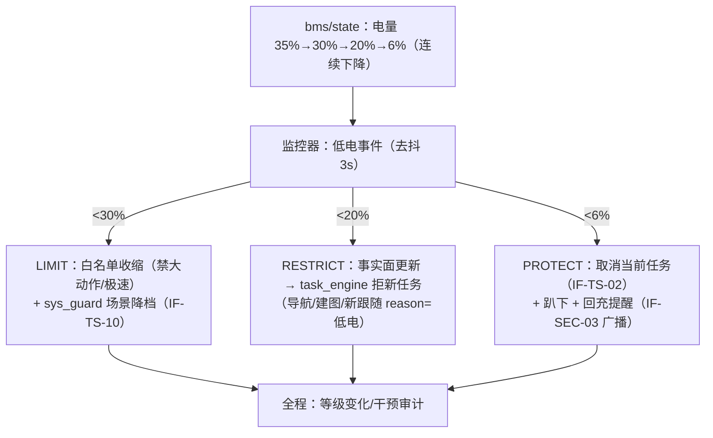
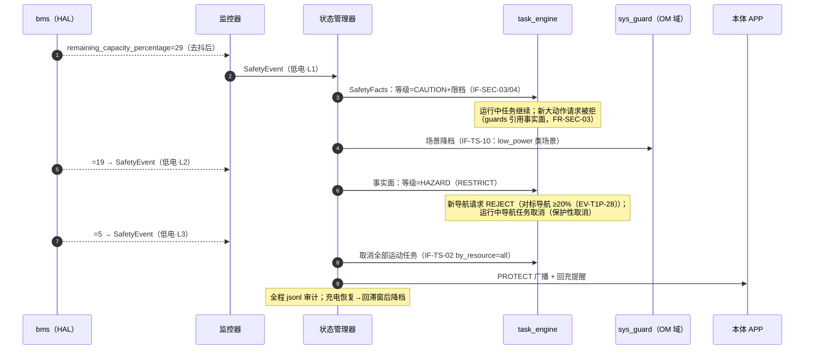

# 第 12 章 特性域 H：安全与合规——安全模块架构设计

| 项 | 内容 |
|---|---|
| 所属文档 | QDOG-SFS-001《四足狗软件特性设计说明书》（见 [README](./README.md)） |
| 章节版本 | V0.2（草案，2026-11-20） |
| 设计对象 | 软件平台子系统·**安全模块**（第 3 章 §3.2.1 权威清单 16 模块之一；SEC 特性域 H 首个专章文档，聚焦架构设计） |
| 前序依据 | 第 3 章 §3.5 安全模块职责行与 §3.9.2 注记 3（收敛决策）；第 5 章 L0 状态机 / 门控 / 控制权 / 容错机制 |
| 证据基线 | 启元 T1 Pro 固件 t2-3 / JetPack 540.4.0（EV 条目来源见 §12.16 与主控文档 §5） |
| 完成度 | X.1~X.10、X.13~X.16 为 V0.2 架构设计；**X.11 工作量分析 / X.12 工作路标待后续版本补齐**（见 §12.15 OP-SEC-08） |

## 版本表

| 版本   | 日期         | 变更摘要                                                                                                                                                                                                                                                                                                                                                                                                                                                                                                                                                                                                                                              | 作者        |
| ---- | ---------- | ------------------------------------------------------------------------------------------------------------------------------------------------------------------------------------------------------------------------------------------------------------------------------------------------------------------------------------------------------------------------------------------------------------------------------------------------------------------------------------------------------------------------------------------------------------------------------------------------------------------------------------------------- | --------- |
| V0.1 | 2026-11-19 | 首版：安全域概念模型（三分域×纵深防御）、FR/NFR-SEC 需求条目、T1 安全能力全景对标（五类载体盘点→分散判定→双层收敛结论）、五子模块总体设计（逻辑视图+职责矩阵）、七项关键机制（安全状态/急停链/准入门控/运行监控/降级阶梯/隐私停流/配额授权）、IF-SEC-01~09 接口、两条核心业务流（跌倒保护急停链/低电降级阶梯）、DD-SEC-01~06、开放问题 OP-SEC-01~08；新增 EV-T1P-71~74                                                                                                                                                                                                                                                                                                                                                                                                                         | lichunlin |
| V0.2 | 2026-11-20 | **对齐工程合入内容**（第 3/5/6 章 V0.20~V0.29 / V0.41~V0.45 / V0.7 及机型裁决）：① 接口前缀 `/qdog/`→`/robot/`、消息包 qdog_msgs→robot_msgs、服务命名回靠 T1 动词语义（trigger_estop/release_estop/set_safety_limit），进程名 qdog_safety→safety；② **隐私权限状态独立话题化**——`/robot/permission_state` 从 IF-SEC-03 拆出独立条目（接管第 3 章表 3-2 暂定名，对标 T1 permission_state），控制服务 `/robot/permission/ctrl_permission`（对标 CtrlPermission）；③ 机型裁决对齐（README V0.65/66：四足↔双足变形、双足下前两腿为双臂）——FR-SEC-04 形态口径、保护姿态补双足、跌倒判定补形态相关性、变形前净空门控入档；④ 第 5 章 V0.42 mc 双指令面（IF-TS-15 set_action）纳入门控事实面消费方；⑤ EV 编号重排善后（版本表/证据清单两处「71~70」笔误修正）；⑥ §12.7 新增**接口来源分类**（① 接管父文档暂定名 / ② 复用既有 IF 条目 / ③ 本章新造——7 条新造均带对标蓝本或缺口修复定位）＋表内逐条来源标签 | lichunlin |

---

## 12.1 特性域概述

### 12.1.1 范围

本章回答「安全模块是什么、怎么设计」。安全模块是软件平台子系统治理线的安全载体（第 3 章 §3.2.2「承载与治理」），承接第 3 章注记 3 的收敛决策：**把 T1 Pro 中分散在五类载体里的安全能力，收敛为平台统一安全治理面**。

本章覆盖三条安全线与一个横切面：

| 线 | 范围 | 不含 |
|---|---|---|
| **功能安全**（运动安全） | 准入安全门控（动作白/黑名单、形态/模式/电量约束）、极限动作授权配额、跌倒/提起/失联的干预决策 | 关节力矩限制、碰撞反射、步态稳定——归 MC 域域内自治（§12.6.2 分工） |
| **运行安全**（系统健康） | 低电/温升/磁盘/odom 可信/模块心跳的安全语义与降级阶梯决策 | 进程守护重启、cgroup/温控执行——归 OM 域与 sys_guard |
| **合规安全**（隐私权限） | 麦克风/相机/定位权限权威与停流门控、配额云端同步、合规审计 | 数据加密/传输安全——归 OS 基础服务与 App/云接入域 |
| **横切：安全审计** | 安全事件流、门控/干预留痕、trace 接入 | 一般运维日志——归 OM 域 |

### 12.1.2 价值与用户场景

| 用户/角色 | 场景 | 安全价值 |
|---|---|---|
| 家庭用户 | 狗在跳舞中失去平衡跌倒，立即停止动作进入保护姿态，App 收到告警 | 人身与机器安全、行为可预期 |
| 家庭用户 | 电量逐级下降：先限制大动作→拒绝导航→主动趴下提醒充电 | 低电不失控（对标 follow ≥6% 门槛 [EV-T1P-28]） |
| 家庭用户 | 对 App 关闭相机权限，机器人立即停止视觉出流 | 隐私可控、默认可信 |
| 开发者 | SDK 调用空翻等极限动作，受 30 天/终生配额与授权等级约束 | 高风险动作限次（[EV-T1P-72]） |
| 监管/合规 | 权限变更、急停、降级全程留痕可审计 | 事故可追溯 |
| 运维 | 磁盘写满前拦截新录像任务 | 资源耗尽不失控（对标 reason=65 [EV-T1P-31]） |

### 12.1.3 对标定位

T1 Pro **没有独立安全模块**——这是对标得到的最重要的负结论（第 3 章注记 3，[EV-T1P-01/06/28/37/44/20~22]）。安全能力按「触发源就近」分散在五类载体（§12.4.1）。本产品的决策是**双层收敛**（§12.4.5）：策略/监控/合规/审计/协调收敛为平台安全模块；毫秒级本体反射保护保留在运控域内。本章是该收敛决策的架构展开。

---

## 12.2 概念模型与术语

| 术语 | 定义 |
|---|---|
| **安全域三分** | 功能安全（物理世界人身/机器安全）、运行安全（系统资源与健康）、合规安全（隐私权限与数据合规）——三域事件统一进安全状态模型 |
| **纵深防御四层** | ① 门控（准入前拒绝）→ ② 监控（运行中检测）→ ③ 干预（降级/停任务/急停）→ ④ 审计（留痕追溯）——安全模块按此四层组织机制（§12.6） |
| **安全事件 SafetyEvent** | 一次可审计的安全事实变化：来源（传感/状态/资源/权限/入口）、类型、等级、置信度、时间戳。安全模块的原子输入 |
| **安全等级 SafetyLevel** | 全局聚合判定：`SAFE`（无事件）→ `CAUTION`（轻微，限能力）→ `HAZARD`（严重，须干预）→ `CRITICAL`（危险，立即兜底）。等级由策略引擎从事件集聚合求值，随事件恢复回滞 |
| **干预阶梯 Intervention** | 等级到动作的映射：`NONE` / `LIMIT`（限速/限动作）/ `RESTRICT`（拒新任务）/ `PROTECT`（取消任务+保护姿态）/ `ESTOP`（急停，经 L0 状态机）。升档即时、降档回滞（§12.6.5） |
| **安全事实面 SafetyFacts** | 安全模块对外提供的判定事实集：等级/电量档/姿态可信/odom 可信/权限/配额/白黑名单判定。门控执行方（task_engine 规则引擎）消费事实，不重复实现判定 |
| **策略与执行分离** | 安全模块定策略（判定与决策），执行分落三处：任务门控执行在 task_engine、状态迁移在 state_machine、毫秒级本体反射在 MC 域（DD-SEC-02） |
| **保护姿态** | 非行走的稳定姿态序列，作为干预动作的目标姿态——四足形态：趴下/阻尼/站立锁定；双足形态：安全站立/坐姿（A-2 机型口径：四足↔双足可变形）。对标 T1 关机前 15 种安全姿态白名单 [EV-T1P-73] |
| **fail-safe 保守默认** | 安全模块不可用时，下游的保守行为约定：新任务按保守规则拒绝、MC 反射层独立生效（NFR-SEC-02，DD-SEC-05） |

---

## 12.3 需求与功能点

### 12.3.1 功能需求

| 编号 | 需求 | 优先级 | 验收准则（一句话） |
|---|---|---|---|
| FR-SEC-01 | 系统必须提供统一急停入口 `/robot/safety/trigger_estop`，供 App/遥控器/语音/SDK/系统内部并发触发；受理后必须驱动 L0 迁移至 E_STOP（复用 IF-TS-06），不得在安全模块内再造第二状态权威 | P0 | 任意入口触发后 500ms 内 SystemState 广播 E_STOP |
| FR-SEC-02 | 急停解除必须经 `/robot/safety/release_estop` 且**人工确认**（App/机身按键），不得自动恢复（对标第 5 章 §5.6.1 E_STOP 解除语义） | P0 | 无确认时恢复请求被拒绝并留痕 |
| FR-SEC-03 | 安全模块必须提供**安全事实面**（等级/电量档/姿态/odom 可信/权限/配额），task_engine 门控与 precheck 必须引用该面，不得各自内嵌重复判定逻辑 | P0 | 关闭相机权限后 `/robot/task/precheck` 对依赖视觉的任务返回拒绝 |
| FR-SEC-04 | 安全模块必须对动作类请求提供统一准入判定：白名单/黑名单 × 形态（四足/双足，含四足↔双足变形链，A-2 裁决口径）× 模式（室内限动作）× 电量 × 配额 × 变形净空条件（对标 reason 4/7/21/24/30 拦截族与场景 A 变形前净空检查 [EV-T1P-25/73]） | P0 | 双足形态下请求四足专属动作被拒且 reason 可解释 |
| FR-SEC-05 | 运行安全监控必须覆盖至少八类事件源：跌倒、提起/托举、牵手、控制权失联、低电、温升、磁盘、odom 不可信；每类必须声明判定窗口与置信度策略（对标 [EV-T1P-12/29/51/22/31]） | P0 | 注入跌倒事件后监控在 2 个上报周期内升级安全等级 |
| FR-SEC-06 | 安全模块必须实现四级干预阶梯（LIMIT/RESTRICT/PROTECT/ESTOP）并支持按机型/产品阶段配置映射表；PROTECT 必须包含取消当前任务与保护姿态下发 | P0 | 低电至 6% 时跟随任务被取消且狗进入趴下 |
| FR-SEC-07 | 隐私权限（麦克风/相机/定位）必须由安全模块持有唯一权威并联动采集侧停流；权限撤销后相关数据流必须在 1s 内停止（对标 permission_state→hal 停流 [EV-T1P-71]）；权限状态必须以独立话题 `/robot/permission_state` 发布（接管第 3 章表 3-2 暂定名） | P0 | 撤销相机权限后图像话题停止发布 |
| FR-SEC-08 | 极限动作必须受授权等级 + 30 天/终生双窗口配额约束，配额必须本地持久化并支持云端同步（对标 extreme_action 语义 [EV-T1P-72]） | P1 | 超配额请求被拒且 App 可见剩余次数 |
| FR-SEC-09 | 全部安全事件（含被拒绝的请求与未执行的干预建议）必须导出统一安全事件流并持久化审计；急停/降级/权限变更必须含触发源与时间戳（对标 trace 通道 [EV-T1P-34→IF-TS-12]） | P0 | jsonl 审计可离线回放一次急停的完整因果链 |
| FR-SEC-10 | 上电后必须保持不自动进入业务态的守卫（对标 Auto_transToReady=false [EV-T1P-11]，落第 5 章 L0）；安全模块启动未就绪时必须使新业务请求按保守规则拒绝 | P1 | 安全模块未注册心跳期间任务请求全部 REJECT |

### 12.3.2 非功能需求

| 编号 | 需求 | 优先级 | 验收准则 |
|---|---|---|---|
| NFR-SEC-01 | 急停链端到端时延（入口受理→SystemState 广播 E_STOP）必须 ≤500ms；其中安全模块内部处理 ≤50ms | P0 | 注入测试 100 次 P99 达标 |
| NFR-SEC-02 | 安全模块自身故障不得削弱底座安全：MC 域反射保护（跌倒停车/碰撞限矩）必须独立于安全模块可用；安全模块崩溃期间任务门控走保守缓存（上次的等级+时长衰减策略） | P0 | kill 安全模块后注入跌倒，狗仍停 |
| NFR-SEC-03 | 安全策略（白/黑名单、电量档表、配额、等级映射）必须全部声明式配置并版本化，支持 OTA 增量（对标 T1 规则 YAML 体系 [EV-T1P-28/37]） | P0 | 改配置不改代码上线新机型动作白名单 |
| NFR-SEC-04 | 安全事件流必须先本地持久化后投递（本地 jsonl 兜底），不得因云端断链丢审计（对标本地迁移审计模式 [EV-T1P-34]） | P0 | 断网 24h 后恢复补传完整 |
| NFR-SEC-05 | 隐私权限状态变更必须在设备侧即时生效，离线时同样有效（不依赖云端）（对标 permission_state 板上闭环 [EV-T1P-71]） | P0 | 断网撤销权限后相机停流 |

---

## 12.4 对标实证分析（启元 T1 Pro）

### 12.4.1 现状盘点：T1 Pro 安全能力全景（按载体分组）

| # | 载体 | 安全能力 | 实证 |
|---|---|---|---|
| 1 | **SM（aim_sm_app）** | EStop 态（功能组=HAL+Diagnosis，可从多数业务态进入）；TriggerEStop 系统级 RPC；上电不自动激活（Auto_transToReady=false）；OpenBox 运输锁定（仅标记） | [EV-T1P-01][EV-T1P-06][EV-T1P-11] |
| 2 | **task_engine 规则门控** | 五任务族前置检查：posture（allow_held_state=false 牵手拒绝、趴下豁免低电）、follow（电量≥6%、odom require_trusted）、navigation（电量≥20、block_posture）、shutdown（allow_source 白名单）、rc_gyro（电量≥30、blocks_direct_rpc） | [EV-T1P-28][EV-T1P-37] |
| 3 | **task_engine 运行守护** | AmRequest reason 0-66 拦截族（低电 5/白名单 7/HDS 故障 8/障碍 10-14/黑名单 21/室内限制 24/跌倒守护/紧急停止/磁盘满 65/odom 66）；Orchestrator FallDownWatchdog；订阅 fall_guard/danger_regions；发布 extreme_action/status | [EV-T1P-31][EV-T1P-25][EV-T1P-65][EV-T1P-74] |
| 4 | **mc（运控域反射）** | 进程内 security_guard 线程（安全看护）；check_fall 跌倒检测；50Hz 上报 is_fallen/held_state（牵手）/lift_state（提起概率）；控制权看门狗 1000ms 静默=失联保护性释放；避障 velocity 安全叠写 | [EV-T1P-74][EV-T1P-12][EV-T1P-29][EV-T1P-30][EV-T1P-43] |
| 5 | **感知侧（coreon_fusion）** | IMU 姿态新鲜度门限 orientation_max_age=300ms（姿态数据过期不放行避障判定） | [EV-T1P-44] |
| 6 | **sys_guard 健康监控** | 温控/资源/活动场景三线；健康监控 FSM（触发窗 t_fire=5s、冷却窗 t_cool=120s）与 vitals 阈值；受 SM 就绪门控 | [EV-T1P-20][EV-T1P-22][EV-T1P-21] |
| 7 | **housekeeper 隐私权限** | permission_state（microphone/camera/location）发布 + CtrlPermission 服务（授权/撤销/查询/清除）；hal_camera/hal_rgbd 等订阅门控停流；拍照服务权限关闭时失败 | [EV-T1P-71] |
| 8 | **模式与动作限制** | SetMode（室内/户外/超能+限速）影响动作白名单（REASON_INDOOR_WHOLE_BODY、reason 24）；SetMcAction 受白名单/形态/电量门控；SetJointPower 断电前要求安全姿态；ShutdownTask 仅 15 种安全姿态白名单 | [EV-T1P-73] |
| 9 | **极限动作配额** | extreme_action/status：permission_level、speed_limit_mps、recent_30d_count/limit、lifetime_count/limit、cloud_sync_status（云端同步语义） | [EV-T1P-72] |
| 10 | **进程守护兜底** | em.service Restart=always + process_manager 按配置重启；hds+sys_guard 健康诊断兜底 | [EV-T1P-66][EV-T1P-10] |

### 12.4.2 判定：安全能力「有」但分散

T1 Pro 安全能力**完备度不低**（急停/门控/反射/监控/权限/配额六面俱到），但**没有统一的安全治理面**：

- 同一「低电」事实在规则文件（电量百分比）、reason 码（5）、sys_guard（vitals 阈值）三处各判各的；
- 同为「运行中干预」，跌倒守护在 task_engine 场景引擎内、失联在 mc 看门狗内、健康在 sys_guard FSM 内——三处独立实现「阈值+时间窗+状态机」同一模式；
- 权限权威在 housekeeper（网络/设备管理全家桶进程），与安全语义无体系归属；
- 安全事件无统一审计流：门控拒绝散在 reason 码、跌倒散在场景守护、权限变更无独立留痕面。

### 12.4.3 公共性分析：可收敛的「公共部分」

| 公共模式 | T1 中的重复实现 | 收敛收益 |
|---|---|---|
| 门控拒绝（reason 拦截族） | 规则文件 + AmRequest + SetMcAction 三处口径 | 单一判定函数 + 单一 reason 词汇 |
| 阈值+时间窗+状态机（监控判定） | sys_guard FSM / FallDownWatchdog / mc 看门狗 | 统一监控项模型（判定窗/置信度/回滞） |
| 干预动作（停流/限速/姿态/急停） | hal 停流 / mc 限速 / SM EStop | 统一干预阶梯与执行接口 |
| 声明式配置（YAML 策略） | rule/*.yaml / monitor.yaml / scene_*.yaml | 统一安全策略文件族（NFR-SEC-03） |
| 事件与审计 | trace/events + reason 码 + diagnostic_list | 统一安全事件流（FR-SEC-09） |

### 12.4.4 收敛为「独立安全模块」的权衡

**收益**：① 策略单一权威，新机型/新动作的安全评审有唯一对象；② 审计与合规（隐私、配额）有单点责任方；③ 安全等级全局可见，上游（App/云）不再拼装分散状态；④ 第 3 章「平台兜底」定位落地。

**代价与风险**：① 平台安全模块若成为运行路径上的同步依赖，则其故障即全系统故障——**不可接受**（对策：事实面+保守缓存，NFR-SEC-02）；② 毫秒级反射（碰撞、失步、check_fall 即时停车）跨进程引入时延——**不可行**（对策：反射留域内，DD-SEC-02）；③ T1「触发源就近」的分散有工程合理性（mc 看门狗必须与控制环同生死）——**部分保留**而非全收敛。

### 12.4.5 对标结论：双层收敛（本章设计总纲）

图 12-1 双层收敛总纲：策略面收敛、执行面落位（DD-SEC-01/02/03/04 的图示）。

---

## 12.5 总体设计

### 12.5.1 设计目标与原则

| # | 原则 | 落点 |
|---|---|---|
| 1 | **纵深防御**：门控→监控→干预→审计四层，不依赖单点 | §12.6 机制按层组织 |
| 2 | **策略与执行分离**：安全模块出判定，执行落 task_engine/state_machine/MC/HAL | DD-SEC-02 |
| 3 | **单一状态权威**：E_STOP 是 L0 状态，权威在 state_machine；安全模块是触发源与策略方 | DD-SEC-03（对齐第 5 章 L0 治理） |
| 4 | **fail-safe 保守默认**：安全模块失联≠放行；新任务保守拒绝、MC 反射独立生效 | DD-SEC-05、NFR-SEC-02 |
| 5 | **最小权限**：安全模块自身不持 root、不碰关节指令、不碰业务语义 | 部署 §12.8.2 |
| 6 | **一切可审计**：拒绝也要留痕；建议未采纳也留痕 | FR-SEC-09 |

### 12.5.2 逻辑视图

图 12-2 安全模块逻辑视图：五子模块、五路输入、四类执行落位。依赖边与 §12.7 接口表、§12.9 业务流调用序列三视图互校。

**子模块功能详表**（功能 ↔ FR/IF 对应，对齐第 5 章子模块详表风格）：

| 子模块 | 功能 | 对应 FR/IF |
|---|---|---|
| 运行安全监控器 | 八类事件源订阅与汇聚（FR-SEC-05）；每监控项声明判定窗/确认帧数/恢复回滞（对标 t_fire/t_cool [EV-T1P-22]、丢失防抖 [EV-T1P-28]）；产出 SafetyEvent 流 | FR-SEC-05；输入=IF-SEC-09 订阅集 |
| 安全策略引擎 | SafetyEvent→等级聚合求值；动作准入判定（白/黑×形态×模式×电量×配额，FR-SEC-04）；干预阶梯映射（FR-SEC-06）；全部声明式配置（NFR-SEC-03） | FR-SEC-04/06；IF-SEC-04 |
| 安全状态管理器 | 等级与事实的唯一权威；安全事件流导出与 jsonl 审计（FR-SEC-09）；保守缓存供下游 fail-safe（NFR-SEC-02） | FR-SEC-03/09；IF-SEC-03/05 |
| 隐私合规服务 | 权限权威（mic/cam/loc）与变更流；停流联动下发；配额本地持久化与云端同步（FR-SEC-07/08） | FR-SEC-07/08；IF-SEC-07/08 |
| 安全干预执行器 | 急停受理与 L0 迁移请求（FR-SEC-01/02）；保护性取消；限速下发；停流下发——四类动作的出站通道 | FR-SEC-01/02/06；IF-SEC-01/06 |

### 12.5.3 组件交互与职责矩阵

| 职责 | 安全模块 | task_engine | state_machine | MC 域 | HAL/SP | 本体 APP |
|---|---|---|---|---|---|---|
| 安全等级权威 | ● | ○缓存 | — | — | — | ○镜像 |
| 准入门控判定 | ● | ○执行 | — | — | — | — |
| 动作白/黑名单 | ● | ○引用 | — | ○域内约束 | — | ○展示 |
| E_STOP 状态 | ○触发 | — | ●权威 | ○执行阻尼 | — | ○告警 |
| 毫秒级反射保护 | ○消费上报 | — | — | ●自治 | — | — |
| 隐私停流 | ●策略 | — | — | — | ○执行 | ○入口 |
| 极限动作配额 | ●权威 | ○门控引用 | — | — | — | ○展示/同步 |
| 安全审计 | ● | ○埋点 | ○埋点 | ○埋点 | ○埋点 | ○埋点 |

**安全模块不做**（负面清单，对齐第 3 章 §3.2.4）：不做任务间仲裁（task_engine 的事）；不持关节/速度指令通道（MC 的事）；不造第二状态机权威（state_machine 的事）；不做进程重启/cgroup 执行（OM/sys_guard 的事）；不产出感知结果。

---

## 12.6 关键机制设计

#### 12.6.1 安全状态模型

- **输入原子**：SafetyEvent `{source, type, severity_hint, confidence, ts}`；八类事件源映射见 FR-SEC-05。
- **聚合规则**：等级 = 策略表对活跃事件集的加权求值（事件带衰减窗，恢复需回滞确认——对标遮挡诊断「确认恢复各 5 帧」[EV-T1P-44] 与健康监控冷却窗 [EV-T1P-22]）。
- **发布**：等级变化即事件级广播（IF-SEC-03）；等级不进 L0（只有 E_STOP 是 L0 状态，等级是安全模块自己的事实态——分层判据第 ①条校验：等级不拒绝业务、不跨域消费语义，故不进 L0）。

#### 12.6.2 急停链（多源触发与端到端路径）

| 属性 | 设计 |
|---|---|
| 触发源 | App/遥控器/语音（经入口→IF-SEC-01）；SDK（同一服务）；系统内部（监控器判定 CRITICAL：碰撞/失控/跌倒+任务不可取消） |
| 受理 | `/robot/safety/trigger_estop` 统一入口，幂等（重复触发不重复迁移）；受理即留痕（含触发源/位置） |
| 执行 | 安全模块→state_machine `SystemMigrate(E_STOP)`（IF-TS-06，受理≠成功语义照搬 [EV-T1P-35]）；state_machine 执行 E_STOP 模块集收缩（HAL+DIAGNOSIS）与关节阻尼（第 5 章 §5.6.1） |
| MC 独立兜底 | 失控类场景（控制环异常）由 MC 域反射层自治停车——不经平台链路（NFR-SEC-02）；MC 侧急停源 `safety/emergency` 优先级 100 租期 ∞（第 5 章表） |
| 解除 | `/robot/safety/release_estop`，人工确认语义（FR-SEC-02）；解除走 L0 迁移白名单（E_STOP→STANDBY） |
| 时延 | 端到端 ≤500ms（NFR-SEC-01），平台链路预算：入口 10ms + 安全模块 50ms + L0 迁移 + 广播 |

#### 12.6.3 准入安全门控（安全事实面）

- **事实面协议**：task_engine 规则引擎的 `guards` 中安全类条件（电量档/姿态/odom/权限/配额/白黑名单）**不得**自行实现判定，必须引用 IF-SEC-04 查询结果（本地订阅缓存 + 按需查询，模式同 IF-TS-07）。
- **消费方覆盖 mc 双指令面**（第 5 章 V0.42 口径）：连续技能任务（IF-TS-14 执行器通道）与离散动作直驱（IF-TS-15 `set_action`）**两条通道同等**消费事实面——动作型任务不经执行器直驱 mc，安全判定（白黑名单/形态/电量/配额/净空）必须在受理时完成，不留 mc 侧二次豁免。
- **变形净空门**：四足↔双足变形类动作的准入判定必须包含净空条件（消费实时避障 `obstacle_check` 结果——对标场景 A 变形前净空检查，第 3 章 §3.8.1；对标 T1 reason=30 变形条件不满足 [EV-T1P-73]）。
- **理由**：T1 的门控散在 23 个规则文件内各自写阈值 [EV-T1P-37]，本产品策略单点收敛（DD-SEC-04）；规则文件只写「引用哪个安全条件」，阈值在安全模块策略表（NFR-SEC-03）。
- **precheck 透出**：dry-run 门控评估（IF-TS-04）自动包含安全条件，供 App/SDK 预判（对标 T1 未提供预检的缺口）。
- **realtime 旁路例外**：遥控类 realtime_control 仅做电量与安全等级门控即放行（沿用第 5 章 FR-TS-09 与 rc_joystick 实证 [EV-T1P-37]）。

#### 12.6.4 运行安全监控（监控项清单）

| 监控项 | 输入 | 判定策略（默认，可配） | 对标 |
|---|---|---|---|
| 跌倒 | mc is_fallen（50Hz） | 单帧确认 + 2s 保持；**判定窗按形态自适应**（双足形态窗更短——失衡跌落更快，A-2 机型口径） | [EV-T1P-12/74] |
| 提起/托举 | mc lift_state 概率 | 概率>阈值 3 帧确认 | [EV-T1P-74] |
| 牵手 | mc held_state | 状态直接映射（门控事实，非故障） | [EV-T1P-28/74] |
| 控制权失联 | 心跳+velocity 静默 1000ms | MC 看门狗自治释放（安全模块只消费结果） | [EV-T1P-29] |
| 低电 | bms/state 电量 | 阶梯阈值（§12.6.5）+ 去抖 3s | [EV-T1P-28/31] |
| 温升/磁盘 | hds/sys_guard 告警 | 复用 OM 域判定，安全模块做语义升级（磁盘满→RESTRICT） | [EV-T1P-22/31] |
| odom 不可信 | odom/status 码 | 直接映射（质量随流→任务门控，第 3 章表 3-2 模式） | [EV-T1P-51] |
| 姿态数据过期 | IMU 新鲜度 | 数据链路自检（SP 域供事实，对标 orientation_max_age 300ms [EV-T1P-44]） | [EV-T1P-44] |

监控器不重复造采集链：全部输入消费既有状态流（HAL/SP/TS 域产物）。

#### 12.6.5 降级阶梯与恢复

| 干预级 | 触发（默认示例） | 动作 | 对标 |
|---|---|---|---|
| LIMIT | 电量<30%；温升告警 | 白名单收缩（禁大动作/极速）＋经 sys_guard 场景降算力档（IF-TS-10） | SetMode 限速 [EV-T1P-73]、热降档 [EV-T1P-20] |
| RESTRICT | 电量<20%；磁盘告警；odom 不可信 | 安全事实面更新→task_engine 拒新任务（reason 引用统一词汇） | 导航 ≥20% [EV-T1P-28]、磁盘满 65 [EV-T1P-31] |
| PROTECT | 电量<6%；跌倒；提起 | 取消当前任务（IF-TS-02）＋下发保护姿态（四足：趴下/阻尼；双足：安全站立/坐姿——按当前形态选目标姿态）＋回充提醒 | follow ≥6% [EV-T1P-28]、安全姿态白名单 [EV-T1P-73] |
| ESTOP | 碰撞/失控/用户急停/CRITICAL 级事件 | §12.6.2 急停链 | TriggerEStop [EV-T1P-06] |

- **升档即时、降档回滞**：事件恢复后经冷却窗（默认 30s，可配——对标 t_cool 120s 量级 [EV-T1P-22]）才允许降档；PROTECT/ESTOP 恢复需额外人工确认。
- **映射表可配**：等级×机型→动作表声明式（NFR-SEC-03）；入门机型可裁剪监控项。

#### 12.6.6 隐私权限与停流

- 权限权威在安全模块（区别于 T1 放在 housekeeper [EV-T1P-71]——收敛理由：权限是安全语义而非网络设备管理职责，且需进安全事实面与审计流）。
- **状态发布独立话题化**（V0.2 修订）：权限状态以 `/robot/permission_state` 独立发布（IF-SEC-07，回靠 T1 话题名并接管第 3 章表 3-2 暂定名），**不并入** safety/status——采集侧订阅门控语义与 T1 五订阅形态保持一致，事实面（IF-SEC-03/04）引用其值。
- 执行链：权限变更 → IF-SEC-07（ctrl_permission 服务）→ 状态话题广播 + 事实面更新 + ACT 下发停流掩码（IF-SEC-08）→ 采集侧停流；拍照类服务经事实面查询拒绝（对标 CaptureJpegImage 权限失败语义）。
- 离线闭环：权限变更不依赖云端（NFR-SEC-05）；云端同步为旁路（OP-SEC-03 归 App/云接入域）。

#### 12.6.7 极限动作授权与配额

- 判定因子：permission_level（授权等级）× 双窗口配额（30 天/终生）× speed_limit ——字段对标 [EV-T1P-72]。
- 配额计数在安全模块本地持久化（FR-SEC-08）；云端同步状态仅展示与对账，断云不阻塞本地判定（同 NFR-SEC-05 精神）。
- 配额变更（App 购买/管理员授予）经本体 APP→IF-SEC-07 通道，全程审计。

#### 12.6.8 安全审计与事件流

- 本地优先：`/robot/safety/events`（IF-SEC-05）+ jsonl 落盘（先持久化后投递，NFR-SEC-04）；迁移审计复用第 5 章通道（IF-TS-12 对接 `/robot/trace/state_events`）。
- 审计必含：门控拒绝（含 reason）、等级变化、干预执行、权限变更、配额变更、急停因果链（触发源→受理→迁移→解除）。
- 恢复补传：断链期间 jsonl 兜底，恢复后由 OM 域上传（对标迁移审计「本地 jsonl 兜底记录，恢复后补传」模式，第 5 章 §5.8.3）。

---

## 12.7 关键接口（关键模块间）

命名前缀 `/robot`（占位，随产品品牌定）；消息包 `robot_msgs`；服务命名回靠 T1 动词语义（第 3/5/6 章统一口径——如 trigger_estop 对标 TriggerEStop、ctrl_permission 对标 CtrlPermission）。响应复用统一模型（IF-TS-13）。

**接口来源分类（溯源口径）**——本章接口**并非全部来自父文档**，分三类：

| 来源类型 | 条目 | 说明 |
|---|---|---|
| ① **接管父文档暂定名** | IF-SEC-07 状态话题 | `/robot/permission_state` 接管第 3 章表 3-2 暂定名（第 3 章 §3.6.1 约定：未条目化者为本章暂定名，正式定名归各特性域章节） |
| ② **复用父文档既有 IF 条目**（不占 SEC 编号） | 尾注 5 条＋表内引用 4 条 | 尾注：IF-TS-02/04/06/10、IF-SP-07；表内：IF-TS-14/15（IF-SEC-04 消费方）、IF-SP-05（IF-SEC-08 执行机制）——全部存在且语义一致（V0.2 刷新时逐条核查） |
| ③ **本章新造**（对标蓝本或缺口修复） | IF-SEC-01~06、08（7 条） | 安全模块为产品新增模块（第 3 章表 3-1 无 T1 单一对应实体——T1 安全能力分散于五类载体），新模块必有新接口；每条在语义要点内标注对标蓝本或缺口修复定位。与第 5 章同构：IF-TS-01 对标 AmRequest 新造、IF-TS-04 precheck 为 T1 缺口修复 |

| 编号 | 模块对（From → To） | 接口 | 类型 | 语义要点 |
|---|---|---|---|---|
| IF-SEC-01 | 本体 APP / 遥控器 / SDK / 系统内 → **安全模块** | `/robot/safety/trigger_estop`（`TriggerEStop.srv`） | service | 【新造】统一急停入口：source/token（不得为空）；幂等受理；受理≠迁移完成（结果看 IF-SEC-03/IF-TS-05）——对标 TriggerEStop [EV-T1P-06]（T1 该 RPC 归 SM，本产品统一入口收敛至安全模块，迁移执行仍走 L0 单一权威） |
| IF-SEC-02 | 本体 APP → **安全模块** | `/robot/safety/release_estop`（`ReleaseEStop.srv`） | service | 【新造·无 T1 对标】人工确认解除（FR-SEC-02）；拒绝自动恢复（T1 无独立解除服务实证，解除走 L0 迁移白名单） |
| IF-SEC-03 | **安全模块** → 全系统（本体 APP/云/task_engine） | `/robot/safety/status`（`SafetyStatus.msg`） | topic | 【新造·无 T1 对标】安全等级 + 安全事实广播（事件触发 + 1Hz 心跳级）；上游安全镜像数据源；**不含隐私权限值**（独立话题见 IF-SEC-07） |
| IF-SEC-04 | task_engine（规则引擎）↔ **安全模块** | `/robot/safety/query`（`SafetyQuery.srv`） | service | 【新造·缺口修复】安全事实与动作准入判定查询（等级/电量档/姿态/odom/权限/配额/白黑名单/变形净空一次求值）；本地订阅缓存+按需查询（模式同 IF-TS-07）；**消费方覆盖 mc 双指令面**（IF-TS-14 执行器通道 + IF-TS-15 set_action 直驱通道，§12.6.3）——修复 T1 门控散在 23 规则文件内嵌判定的缺口（DD-SEC-04 收敛产物） |
| IF-SEC-05 | **安全模块** → 可观测性 | `/robot/safety/events`（`SafetyEvent.msg`） | topic | 【新造·参照】安全事件流（先落盘后投递）；jsonl 审计源（FR-SEC-09）——参照 T1 trace/events 统一通道 [EV-T1P-34]（彼非安全专用） |
| IF-SEC-06 | **安全模块** → MC 域（承接方） | `/robot/mc/set_safety_limit`（`SetSafetyLimit.srv`） | service | 【新造·参照】限速/动作限制档下发（LIMIT 级干预）——参照 SetMode 限速语义 [EV-T1P-73]；**协议本域定义、MC 域实现**（同 IF-TS-11 模式；与 set_input_source/set_action 并列的 mc 服务面） |
| IF-SEC-07 | 本体 APP（用户入口）↔ **安全模块**（状态发布） | `/robot/permission/ctrl_permission`（`CtrlPermission.srv`）＋ `/robot/permission_state`（`PermissionState.msg`，topic） | service+topic | 【接管＋对标】状态话题**接管第 3 章表 3-2 暂定名**（回靠 T1 permission_state，采集侧五订阅门控形态不变）；控制服务对标 CtrlPermission [EV-T1P-71]（父文档表 3-3 未收录——两场景完备清单不含权限控制） |
| IF-SEC-08 | **安全模块** → 传感器预处理/HAL | `/robot/privacy/gate`（`PrivacyGate.msg`） | topic | 【新造】停流掩码下发（mic/cam/loc → 采集侧停止出流）——T1 停流为 permission_state 隐式订阅联动、无独立掩码话题（EV-T1P-71）；cam/tof 掩码经 SP 域 IF-SP-05 流掩码机制执行、mic 经音频链路（**执行归口与 SP 域传输治理对齐**，OP-SEC-05） |
| IF-SEC-09 | 状态源（mc/bms/odom/hds）→ **安全模块**（订阅） | 既有状态话题集合 | topic | 【纯订阅集·全部来自父文档】输入订阅集：mc/common/state、bms/state、odom/status（第 3 章表 3-2）、hds 告警（OM 域）、SystemState（IF-TS-05）、模块心跳（IF-TS-08）——安全模块不新增采集接口 |

> 复用接口（不重复登记）：E_STOP 迁移=IF-TS-06（安全模块为合法 From 之一，第 5 章已预留「运维/OTA/安全 → state_machine」）；保护性取消=IF-TS-02；dry-run 透出=IF-TS-04；场景降档=IF-TS-10；变形净空查询=IF-SP-07（`/robot/perception/obstacle_check`，消费方语义见 §12.6.3）。三视图互校：§12.5.2 依赖边 ↔ 本表「模块对」↔ §12.9 调用序列。

---

## 12.8 支撑设计

### 12.8.1 数据与配置设计

| 配置/数据 | 路径（规划） | 内容 | 治理 |
|---|---|---|---|
| 安全策略表 | `cfg/safety/policy.yaml` | 等级聚合规则、干预阶梯映射（等级×机型→动作） | 评审冻结；OTA 版本化 |
| 动作策略表 | `cfg/safety/actions.yaml` | 白/黑名单 × 形态 × 模式 × 电量档 × 机型（对标 T1 23 规则文件的安全子集收敛 [EV-T1P-37]） | 与任务规则库（第 5 章）CI 一致性校验：guards 引用的安全条件必须存在于本表 |
| 监控项表 | `cfg/safety/monitors.yaml` | 八类监控项：判定窗/确认帧/回滞窗/阈值 | 机型裁剪位 |
| 权限与配额状态 | `/persist/safety/privacy.json`、`/persist/safety/quota.json` | 权限状态、配额计数（断电保持） | 只增改有审计；损坏回退保守默认 |
| 安全审计日志 | `/persist/log/safety/events.jsonl` | 全量安全事件（含拒绝与建议） | 只增不改；OM 域轮转与上传 |

### 12.8.2 部署与资源预算

| 组件 | 板位 | 进程形态 | 预算（V1 目标） | 说明 |
|---|---|---|---|---|
| safety | 运控板 | 独立进程（system.slice，非 root） | CPU ≤ 2%、RSS ≤ 60MB | 轻量策略面（对标 sys_guard ~1% [EV-T1P-22 量级] + 状态聚合负载）；最小权限原则 |
| 启动顺序 | — | 基座组1（第 5 章组1） | — | 与 state_machine 同组拉起；未就绪期间门控保守拒绝（FR-SEC-10） |
| 板级分布 | — | — | — | 策略面单实例驻运控板；停流执行在两板 HAL（掩码下发跨板经 DDS 控制面） |

### 12.8.3 容错、安全与降级（安全模块自身的容错）

| 故障场景 | 行为（必须） | 依据 |
|---|---|---|
| 安全模块崩溃 | OM 重启（上限可配）；期间：MC 反射层独立生效、task_engine 用「最后等级 + 时间衰减」保守缓存——超时后所有非 realtime 任务按保守拒绝 | NFR-SEC-02、DD-SEC-05 |
| 事实面数据过期（上游停流） | 按监控项声明的 max_age 判「不可信」，等级升 CAUTION（对标 orientation_max_age 300ms [EV-T1P-44]） | FR-SEC-05 |
| 审计落盘失败 | 内存环形缓冲兜底；磁盘满本身触发 RESTRICT（对标 reason 65 [EV-T1P-31]） | NFR-SEC-04 |
| 配额状态损坏 | 回退保守默认（配额视为 0，拒绝极限动作）并告警 | FR-SEC-08 |
| 双板断链 | 运控板侧安全模块自治（策略面在运控板的原因之一）；算力板停流执行超时上报 | A-1 双板假设 |

### 12.8.4 可配置性与可扩展性

- **新增监控项**：monitors.yaml 登记（输入话题/判定窗/等级建议）→ 策略表挂接 → 完成，框架零修改。
- **新增干预动作**：干预枚举扩展 + 执行器适配（新动作必须声明幂等与审计语义）。
- **机型裁剪**：监控项/干预映射/白黑名单按机型启用位；入门单板裁剪感知类监控项。
- **新产品线复用**：策略文件族与安全词汇（等级/reason/事件类型）作为资产跨机型继承（对标 T1 规则文件按机型目录组织 [EV-T1P-37]）。

---

## 12.9 核心业务流

### 12.9.1 流程一：运行中跌倒 → 自动保护（含急停链）

图 12-3 流程一流程图

图 12-4 流程一时序图

要点：① 跌倒的正常干预是 PROTECT（取消+趴下），**不必然急停**——急停保留给失控/碰撞/用户触发（阶梯语义，区别于 T1 跌倒守护仅拦截动作的单一形态 [EV-T1P-65]）；② MC 反射层在任意分支独立生效（NFR-SEC-02 双保险）；③ 迁移走 L0 单一权威。

### 12.9.2 流程二：低电 → 降级阶梯

图 12-5 流程二流程图

图 12-6 流程二时序图

要点：① 三级阈值全部可配（对标 T1 跟随 6%/导航 20%/体感 30% 的分散门槛 [EV-T1P-28/37] 收敛为单一策略表）；② 门控「执行」始终在 task_engine，安全模块只改事实——FR-TS/SEC 职责不交叉；③ 低电档同时联动 OM 域场景降档（跨域协同经既有 IF-TS-10）。

---

## 12.10 三方依赖

| 类别 | 项 | 用途 | 治理 |
|---|---|---|---|
| 标准参照 | ISO 13482（个人护理机器人安全）、ISO 13849（控制系统安全相关部件） | 术语与风险分级方法论参照（不声明逐条符合，OP-SEC-06） | 评审输入 |
| 机制参照 | ros2 diagnostics 体系（diagnostic_updater/aggregator） | 监控项模型（阈值/状态聚合）参照；不强制引入运行时依赖 | 自研轻量实现 |
| 机制参照 | T1 Pro 全部安全实证（§12.4.1 十载体） | 策略表/监控参数/接口形态的第一手蓝本 | EV 引用清单 §12.16 |
| 平台内依赖 | robot_msgs（IF-TS-13 统一响应）、fsm-core（安全模块内部等级判定可用 L1 库）、OM 心跳与审计上传 | 与 TS/OM 域既有资产复用 | 跨域契约对齐 |

---

## 12.11 功能、规格与工作量分析

**待补（V0.2 计划）**：功能-规格-参考实现-代码量-工作量对照表（模板同第 5 章 §5.11，单位 K LoC）。预留结论位：安全模块主体为策略/监控/审计逻辑，参考实现密度低于运动/感知域，预期 8~15 K LoC 量级（待逐功能核算后定稿）。

## 12.12 工作路标

**待补（V0.2 计划）**：阶段划分对齐第 5 章路标（阶段一「单任务端到端」需安全门控最小版：电量档+白名单；阶段二「多任务治理」需事实面全量；跌倒/急停链为 P0 收尾项；配额/云同步为 P1 增量）。

---

## 12.13 关键设计决策记录（DD）

| 编号 | 决策 | 备选与否决理由 | 依据 |
|---|---|---|---|
| DD-SEC-01 | **收敛为独立安全模块**（承接第 3 章注记 3） | 否决「维持 T1 式分散」：审计无单点、策略三处重复、权限无体系归属；否决「仅文档规范不建模块」：无执行体的规范必然漂移 | §12.4.2~12.4.4 |
| DD-SEC-02 | **策略与执行分离**：毫秒级反射保护留 MC 域内自治 | 否决「全收敛进安全模块」：跨进程时延不可接受、反射与控制环须同生死；T1 mc security_guard 就近形态是已验证工程形态 | [EV-T1P-29/74]、§12.4.4 |
| DD-SEC-03 | **E_STOP 状态权威在 state_machine**，安全模块是触发源与策略方 | 否决「安全模块自持急停状态」：违反 L0 单一状态权威（第 5 章分层判据第①条） | 第 5 章 §5.6.1/§5.8.1 |
| DD-SEC-04 | **门控判定收敛为事实面服务**（IF-SEC-04），规则文件只引用不实现 | 否决「阈值继续散在任务规则内」：T1 23 规则文件各自写阈值，机型演进成本与漂移风险高（配置与文档不同源教训 [EV-T1P-29]） | [EV-T1P-28/37] |
| DD-SEC-05 | **fail-safe 保守默认**：失联≠放行——保守缓存+时长衰减→超时拒绝新任务；MC 反射独立 | 否决「失联放行」：安全模块故障不能成为安全空窗；否决「失联全拒」：会瘫痪 realtime 遥控（遥控走旁路仅电量门控） | NFR-SEC-02、FR-TS-09 |
| DD-SEC-06 | **隐私权限权威从 housekeeper 类进程移入安全模块** | 否决「留在设备管理进程」：权限是安全语义+需进事实面/审计流；对标形态仅作职责位置参考 [EV-T1P-71] | FR-SEC-07 |

---

## 12.14 验证与测试考虑

| 层级 | 场景（示例） | 映射 |
|---|---|---|
| 单元 | 策略引擎判定表穷举（白黑名单×形态×模式×电量×配额矩阵）；等级聚合与回滞窗 | FR-SEC-04/06 |
| 集成 | 门控闭环：撤权限→precheck 拒绝→任务拒绝（三级一致）；配额边界（30 天窗口滚动） | FR-SEC-03/07/08 |
| 系统注入 | 跌倒注入（mock is_fallen）、低电阶梯（mock bms）、磁盘满、odom 不可信 | FR-SEC-05、NFR-SEC-01 时延测量 |
| 故障注入 | kill 安全模块→反射层独立停车验证；审计盘满；双板断链 | NFR-SEC-02/04 |
| 端到端 | 真机跌倒/急停遥控器/语音急停各 ≥100 次统计（P99 ≤500ms） | NFR-SEC-01 |
| 追溯 | jsonl 回放一次完整急停因果链（触发源→受理→迁移→解除） | FR-SEC-09 |

---

## 12.15 开放问题

| 编号 | 问题 | 归口 |
|---|---|---|
| OP-SEC-01 | 安全等级词汇与 SystemFSM/任务 reason 词汇的映射表（等级→reason 子集）——与 DD-TS-07 统一响应模型对齐 | 本章 V0.2 + 第 5 章 |
| OP-SEC-02 | 是否需要独立硬件急停通道（遥控器专用键直连 MC 硬件线，不经软件链路）——消费级产品惯例调研 | 产品定义 + 硬件 |
| OP-SEC-03 | 配额与权限的云端同步协议（App/云侧接口） | App/云/SDK 接入域 |
| OP-SEC-04 | 安全告警与 OM 域 hds 健康告警的分级分工（谁是权威、语义如何互转） | OM 域章节 |
| OP-SEC-05 | 停流执行接口（IF-SEC-08）与 SP 域传输治理/传感供电掩码的合并方式 | 第 6 章 |
| OP-SEC-06 | ISO 13482/13849 符合性声明范围（不声明逐条符合的边界措辞） | 产品定义 + 合规 |
| OP-SEC-07 | 室内/户外模式（SetMode 类）的归属：安全模块 or 本体 APP or 独立模式服务 | 本章 V0.2 + 第 3 章模块表 |
| OP-SEC-08 | 本章 X.11 工作量分析 / X.12 工作路标补齐（依赖第 5 章路标阶段口径） | 本章 V0.2 |

---

## 12.16 对标证据引用清单

本章新增 EV 条目（EV-T1P-71~74；其余复用第 5/6/3 章既有条目，定义见各章证据清单。编号沿革：V0.1 曾编 67~70，因第 3 章 V0.22 巴展场景 EV-T1P-67〔迎宾问候链〕先占用 67 而整体重排为 71~74——V0.2 善后）：

| 条目 | 内容 | 来源 |
|---|---|---|
| EV-T1P-71 | 隐私权限门控体系：`/aima/robot/permission_state`（PermissionState：microphone/camera/location/updated_timestamp，事件级）由 housekeeper 发布、全图 5 订阅（hal_camera/hal_rgbd 停流门控、Agent 订阅）；`CtrlPermission` 服务（operation 0 授权/1 撤销/2 查询/3 清除 × target 0 麦克风/1 相机/2 定位）；CaptureJpegImage 相机权限关闭时失败 | A：§5.1（permission_state 行）、§5.2（CtrlPermission/CaptureJpegImage 行）、§4.3（housekeeper/hal_camera 条目） |
| EV-T1P-72 | 极限动作配额：`/aima/extreme_action/status`（ExtremeActionStatus：schema_version/permission_level/speed_limit_mps/recent_30d_count+limit/lifetime_count+limit/cloud_sync_status），task_engine 发布、app_proxy 订阅（App 展示）；含云端配额同步语义 | A：§5.1（extreme_action/status 行）、§4.3（task_engine 发布清单） |
| EV-T1P-73 | 模式与动作限制体系：SetMode（室内/户外/超能 + robot_speed/change_speed 限速）影响动作白名单（REASON_INDOOR_WHOLE_BODY，reason 24 室内模式限制）；SetMcAction 受白名单（7）/黑名单（21）/形态（4）/电量（5）/机型（26）门控、不可打断返回 28；SetJointPower 断电前须确保安全姿态；ShutdownTask 仅 15 种安全姿态白名单、source 不得为空 | A：§5.2（SetMode/SetMcAction/SetJointPower/ShutdownTask 行）、§5.4（reason 枚举）；D：《接口说明.md》 |
| EV-T1P-74 | MC 本体安全守护：mc 进程内 security_guard 线程（安全看护，nice 0）与 check_fall 跌倒检测；`mc/common/state` 50Hz 负载含 is_fallen/held_state（牵手态）/lift_state（提起概率+阈值）；task_engine 订阅 fall_guard/danger_regions（危险区域）话题 | A：§2/§3（mc 线程与亲和性）、§5.1（mc/common/state 负载）、§4.3（task_engine 订阅清单）；负载实证同 EV-T1P-12 |

复用条目：EV-T1P-01/06/10/11/12/20/21/22/25/28/29/30/31/34/35/37/43/44/51/65/66（定义见第 5 章 §5.16、第 6 章 §6.10 与第 3 章 §3.11）。

---

## 变更记录

| 版本 | 日期 | 变更 | 作者 |
|---|---|---|---|
| V0.1 | 2026-11-19 | 首版（内容见版本表） | lichunlin |
| V0.2 | 2026-11-20 | 对齐工程合入内容（接口前缀 /robot/ 与 T1 动词回靠、隐私状态独立话题、机型双足裁决、mc 双指令面、EV 重排善后）——明细见版本表 | lichunlin |
