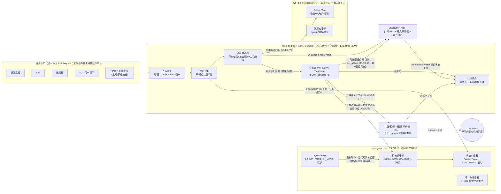
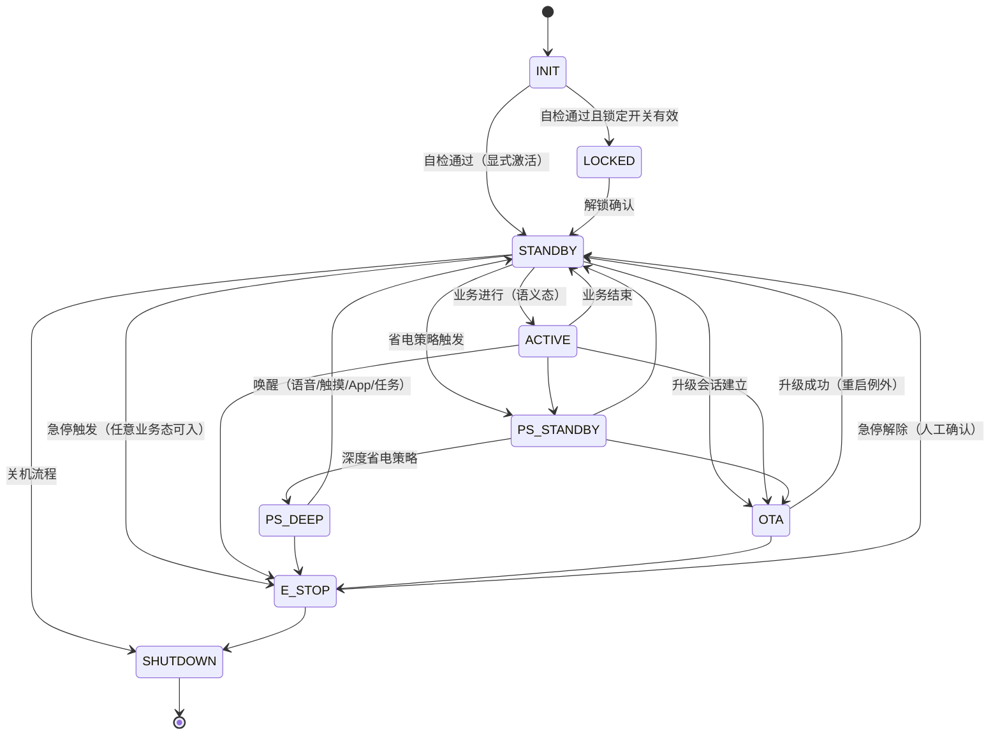
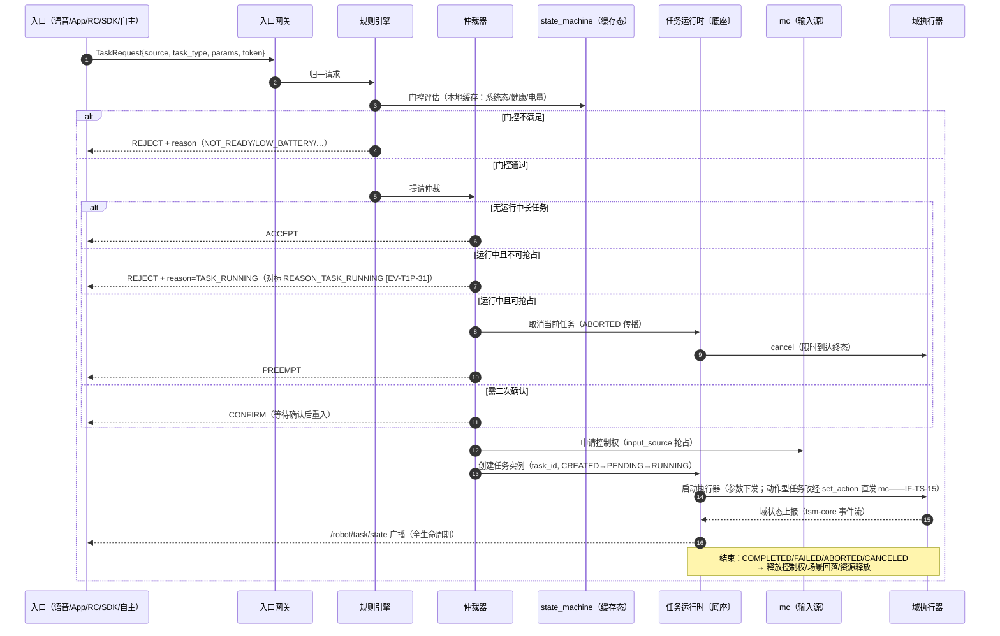
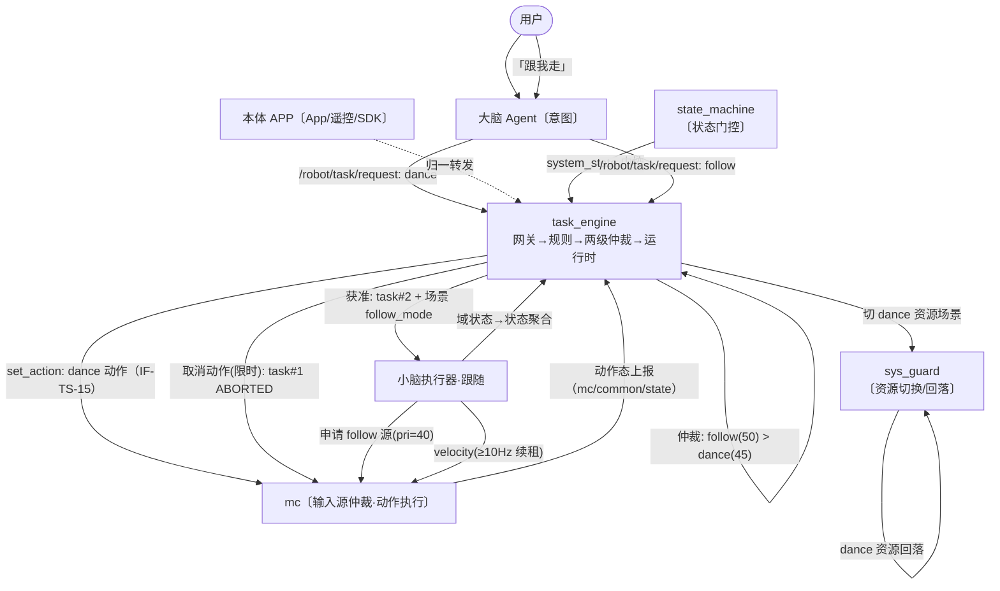
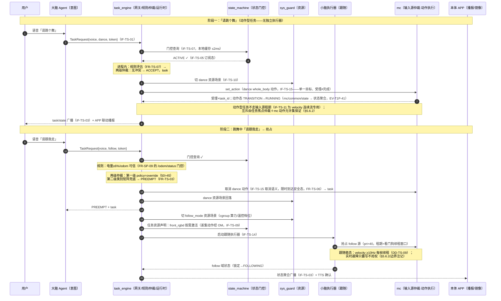
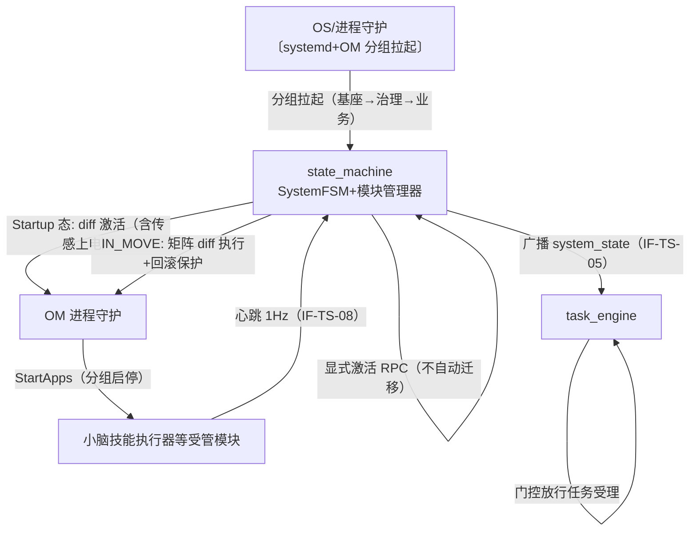
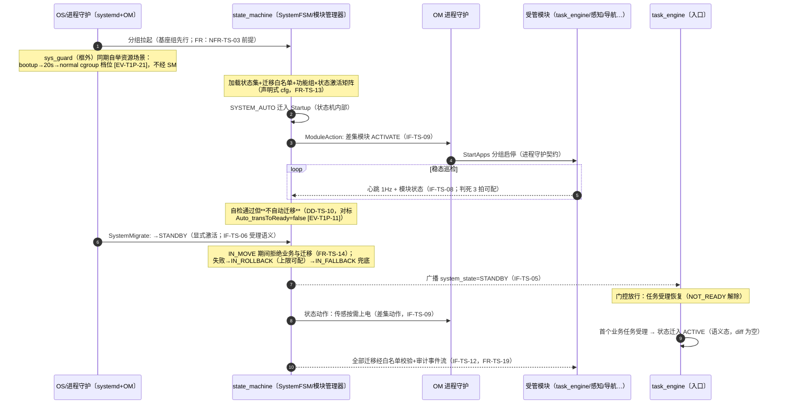

# 第 5 章 特性域 A：task 调度框架与状态机管理

| 项 | 内容 |
|---|---|
| 所属文档 | QDOG-SFS-001《四足狗软件特性设计说明书》（见 [README](./README.md)） |
| 章节版本 | V0.46（草案，2026-11-19；§5.6.1 状态集引言机型口径同步——四足↔双足可变形〔2026-11-19 产品定义确认〕，删「裁剪适配纯四足产品」表述，状态集本身不变） |
| 域码 | TS（Task scheduling & State machine） |
| 证据基线 | 启元 T1 Pro 固件 t2-3 / JetPack 540.4.0（EV 条目来源见 §5.16 与主控文档 §5） |

## 版本表

| 版本 | 日期 | 变更摘要 | 作者 |
|---|---|---|---|
| V0.1 | 2026-11-10 | 首版：需求条目、T1 Pro 对标实证分析、设计方案、设计决策、验证考虑 | liqiliang |
| V0.2 | 2026-11-10 | 新增 §5.6 功能、规格与工作量分析；原 §5.6–5.9 顺延为 §5.7–5.10 | liqiliang |
| V0.3 | 2026-11-11 | §5.6.3 对照表完善：列名「功能简称」改「功能名称」，新增「功能简介」列；参考实现列改为两行式（上行 T1 Pro 是否提供开源实现、下行业界开源实现），全部开源实现附仓库地址（地址均经在线核实） | liqiliang |
| V0.4 | 2026-11-11 | 新增 §5.6.5 端到端场景走查（UC-A「跳舞中被跟随抢占」：时序图+T0~T4 拆解+两级仲裁明细+异常路径+功能出场反向索引）；§5.8 增设对应系统级用例 | liqiliang |
| V0.5 | 2026-11-11 | 显式化调度模型：新增 DD-TS-12（仲裁式调度、不设通用任务队列）、§5.6.2 排队语义受控局部清单、§5.6.5「调度器在哪里/有没有任务队列」澄清说明、OP-TS-08（ENQUEUE 预约执行裁决预留） | liqiliang |
| V0.6 | 2026-11-13 | §5.6.2 控制权租期补「续租窗口」语义（每帧续租可无限期；静默 1000ms=失联保护释放；正常结束显式 DELETE） | liqiliang |
| V0.7 | 2026-11-17 | **结构重构（依据 README 新模板）**：① 新增 §5.5.2 逻辑视图（**SVG** figures/ts-logical-view.svg，图 5-1：4 个 TS 关键模块+5 类外域实体上下依赖分层）；② 新增 §5.9 核心业务流——流程一 UC-A 任务受理·两级仲裁·抢占（图 5-2 流程图+图 5-3 时序图，吸收原 §5.6.5 并补流程图）、流程二 系统状态迁移与模块激活（图 5-4/5-5，新增）；③ §5.7 关键接口表增「模块对」列（接口↔逻辑视图依赖边↔业务流调用序列三视图互校）；④ 新增 §5.10 三方依赖（基座复用/机制参照/工具 8 项+治理原则）；⑤ 原 5.5.3~5.5.8 → §5.6/§5.8，原 5.6→§5.11（5.6.5 并入 §5.9.1），原 5.7~5.10→§5.12~5.15；内部与跨文件引用全部同步 | liqiliang |
| V0.8 | 2026-11-17 | ① §5.5.2 标题去掉「（SVG）」后缀；② **图 5-1 SVG 优化**：边标签统一细字 10px+白晕（.lbl 样式），逐条与箭头对齐（垂直边标签贴线、斜边改正交折线、去除旋转文字），左走廊绕行 task_engine→执行器；③ **scene_engine 正名「定时任务触发器」**（T1 命名有迷惑性，EV-T1P-23）：逻辑视图 L1 增定时任务触发器框（标注 T1 名）、§5.5.3 交互图入口节点、FR-TS-01、§5.4.1.1、§5.6.2 排队语义④、IF-TS-01 模块对全量更新 | liqiliang |
| V0.9 | 2026-11-17 | **scene_engine 彻底正名**：正文与所有图表一律以「**定时任务触发器**」为主名，T1 原名仅保留在标注位（对标表〔T1 误名〕、EV-T1P-23 条目、逻辑视图/L1 表图注、mermaid 节点注记）与 B 类来源文件路径（事实性路径）；修订 8 处：§5.1 范围「自主触发」、FR-TS-01 去 T1 名、对标表行主名化、§5.4.1.1 入口句、「场景四义」②、状态词汇句、排队语义④、§5.11.3 入口网关行（含规格「语音/App/遥控/SDK/定时任务」）；SVG 副题改「T1 Pro 误名 scene_engine」 | liqiliang |
| V0.10 | 2026-11-17 | **图内 scene_engine 字样清零**：逻辑视图 SVG 副题改功能描述「定时/事件触发（schedule → Timer）」、§5.5.3 mermaid 入口节点注记改「（定时/事件触发）」、§5.5.2 L1 表 cell 去 T1 名——T1 名标注仅保留在正文标注位（对标表/EV 条目/§5.5.2 定义句）与来源路径 | liqiliang |
| V0.11 | 2026-11-17 | **scene_manager → sys_guard 全量更名（18 处正文 + SVG 3 处）**：依据——T1 Pro 无名为 scene_manager 的模块（资源场景功能全部内嵌 sys_guard，EV-T1P-20），该名系本设计自起且 scene- 前缀承袭 T1「场景四义」混淆；同步更名：IF-TS-10 接口 `/qdog/scene/*`→`/qdog/resource/*`、模块中文名「资源管理（资源场景）」、§5.6.3 节名、图内 SC 参与者/边标签（场景切换→资源切换）、§5.11.3/DD-TS-06 措辞；概念词「资源场景（Resource Scene）」保留 | liqiliang |
| V0.12 | 2026-11-17 | ① **逻辑视图重构对齐三大子系统**（architecture-design.md §3.6.1）：SVG 重画——底层软件平台（TS 4 关键模块+本体APP/OM/OS）、上左大脑（Agent+定时任务触发器）、上右小脑（技能执行器+mc 仲裁），依赖边与标注全面复核；正文分层表改按子系统组织；② **工作量 ×5 冰山系数**（§5.11.2 口径+§5.11.3 十三行+§5.11.4 汇总：全量 270~325 K LoC/52.5~55 人月）；③ **新增 §5.12 工作路标**（4 阶段 HTML 表：2026.11.30/12.31/2027.3.31/5.31，功能最小集叠加，关键路标列 rowspan 合并，工作量与 §5.11.3 对应）；原 §5.12~5.15 顺延为 §5.13~5.16 | liqiliang |
| V0.13 | 2026-11-17 | **工作量口径统一为代码量**：① §5.11.3 删除「工作量预估（人月）」列（13 行），§5.11.4 汇总去人月列（V1 约 190~240 K LoC/全量约 270~325 K LoC），配比建议/前三改为代码量表述；② §5.12 路标表「工作量」列统一改为**代码量**（与 §5.11.3 一一对应；阶段四测试行按 15~25 K LoC 拆 9~15 K LoC+6~10 K LoC）；③ §5.12 整体精简（去行号索引/冗余限定语/里程碑说明压缩为一行注记） | liqiliang |
| V0.14 | 2026-11-17 | **路标修正：任务运行时（最小版）调入阶段一**——原阶段一闭环断在「受理」（task_id 分配/执行器下发/状态广播/收尾均无宿主），不满足「基本能跑起来」；修正后阶段一=单任务端到端（受理→执行→回报→完成播报，85~130 K LoC），阶段二=多任务冲突与治理（仲裁器+控制权+模块管理+进程守护；任务运行时完整化——并行白名单/取消限时传播/多域聚合/历史查询——并入仲裁器行联调）；四阶段叙事更新：单任务端到端→多任务治理→平台化→集成达标 | liqiliang |

---

## 5.1 特性域概述

### 5.1.1 范围

本章规定本产品软件平台的两个框架级特性域：

1. **task 调度框架**：把语音、App、遥控器、SDK、定时任务触发器等多入口的异步请求，归一为统一的任务模型，完成前置门控、仲裁裁决、资源协调、生命周期管理与状态回报。覆盖：长任务（跟随、建图、导航、运镜…）、短动作（姿态切换、表演动作、移动步进）、后台任务（录音、录像、升级）。
2. **状态机管理**：定义全系统的状态分层模型——系统级状态机（整机生命周期门控）、各业务域状态机（任务态/会话态/导航态…）、资源场景（横切的资源档位），以及统一的状态协议、迁移防护与可观测性。

不在本章范围：具体任务的算法行为（跟随策略、规划算法——归 NV/MC 章）、运动控制内部实时 FSM 的算法设计（归 MC 章，本章只约束其状态语义与接口）、进程守护细节（归 OM 章，本章只定义与模块生命周期的契约）。

### 5.1.2 价值与用户场景

| 干系人 | 场景（User Story） | 价值 |
|---|---|---|
| 用户 | 「跟着我」语音发起跟随时，App 立即点播视频；机器人选择跟随并告知 App「任务冲突」 | 多入口并发下行为可预期，不会「精神分裂」 |
| 用户 | 电量 5% 时说「跳个舞」，机器人礼貌拒绝并说明原因 | 危险/不满足条件的请求被一致地拦截，且给出可读原因 |
| 用户 | 遥控器接管瞬间，导航任务自动暂停并释放控制权 | 控制权抢占安全、及时 |
| 用户 | 升级期间机器人不响应运动指令，升级失败自动回滚到可运行状态 | 全局状态门控保证升级/急停等特殊态的一致性 |
| 开发者 | 新增「巡逻」任务类型：写一个规则文件 + 一个任务执行器，不改编排/仲裁框架代码 | 任务接入成本低、协议一致 |
| 开发者/测试 | 任意时刻可查询整机状态、任务状态、历史迁移记录；离线回放状态序列排查问题 | 状态可观测、问题可定位 |
| 产品/运营 | 待机功耗达标：无任务时自动进入省电场景，关非必要传感流 | 状态-资源联动直接兑现功耗指标 |

### 5.1.3 对标定位

T1 Pro 已量产验证了「任务引擎 + 系统状态机 + 输入源仲裁」三分治理的框架形态（§5.4）。本章的对标目的：**继承其被验证的结构，修复其实证暴露的缺口**（分散状态机重复维护、状态门控覆盖不全、场景与状态两张皮等，见 §5.4.2.4）。

---

## 5.2 概念模型与术语

| 术语 | 定义 |
|---|---|
| **系统状态（System State，L0）** | 整机生命周期所在的唯一权威状态（如 INIT/STANDBY/ACTIVE/OTA/E_STOP/…），由系统状态机持有；对全部业务请求具有门控效力 |
| **状态内状态（System Status）** | 系统状态机内部的执行子状态（READY/MOVE/ROLLBACK/FALLBACK），表达「稳定驻留/正在迁移/正在回滚/异常降级」；迁移与回滚是 status 而非独立 state（对标 T1 Pro SystemStatus 五值，[EV-T1P-09]） |
| **域状态机（Domain FSM，L1）** | 各业务域自管的状态机（任务态、会话态、导航态、运动形态/动作态…），域内权威，经统一协议上报与广播 |
| **资源场景（Resource Scene，L2）** | 横切的**系统资源**档位视图（cgroup 权重/配额、内存上限、温控、磁盘），由任务资源声明与业务事件驱动切换；模块活/休眠与传感供电**不在场景内**——归 L0 状态迁移差集动作（FR-TS-13/15、DD-TS-06） |
| **长任务（Long Task）** | 占用独占资源（本体控制权、任务焦点）、持续秒级~分钟级的任务；同一时刻全局至多一个 |
| **短动作（Short Action）** | 毫秒~秒级、可快速完成的动作指令（姿态切换、步进移动、表情灯效），走快速通道，不进入长任务队列，但受同一门控 |
| **任务仲裁（Arbitration）** | 对新任务请求 vs 系统现状（当前任务/系统状态/门控条件）作出裁决：ACCEPT / REJECT / PREEMPT / CONFIRM（需二次确认）/ CANCEL |
| **控制权（Input Source / Lease）** | 向运动控制发布速度/步态指令的资格；按「源名+优先级+租期」抢占与超时释放 |
| **功能组（Function Group，FG）** | 受管模块的逻辑分组（如 HAL_CORE/PERCEPTION/NAVIGATION）；系统状态以功能组为单位声明活跃集，迁移时对差集执行激活/去激活 |
| **受管模块（Managed Module）** | 接入统一模块生命周期协议（心跳+激活/去激活+降级）的软件模块 |
| **门控（Gating）** | 请求执行前的系统级前置校验（系统状态、电量、形态、健康、障碍…）；拒绝时返回统一 NOT_READY + reason |
| **统一响应模型** | 全系统服务共用的两层判定：框架层返回码（调度成败）+ 业务层状态码（CommonState 语义）+ reason 枚举 |

**三分治理原则（本章的概念基石）**：系统状态（能不能做）／任务仲裁（做什么）／控制权（谁来做）是三个独立关注点，分别由系统状态机、任务调度框架、运动控制输入源仲裁持有，互不越权、协议协同。T1 Pro 实证了这一划分（SM/task_engine/mc 三模块分立，[EV-T1P-27][EV-T1P-29][EV-T1P-05]）。

---

## 5.3 需求与功能点

优先级：P0 首版必须 / P1 首版应当 / P2 规划。所有条目验收准则见 §5.8 映射。

### 5.3.1 功能需求（任务调度框架）

| 编号 | 需求（规范性表述） | 优先级 |
|---|---|---|
| FR-TS-01 | 系统必须提供归一的任务请求入口：语音意图、App、遥控器、SDK、定时任务触发器（定时/事件触发）提交的任务请求使用同一请求协议（源标识、任务类型、参数、token），由任务调度框架统一受理 | P0 |
| FR-TS-02 | 任务类型的行为约束（优先级、可抢占/被抢占集合、门控条件、资源需求、超时、是否需二次确认）必须以声明式规则文件表达，框架不得将任何具体任务类型写死在代码中 | P0 |
| FR-TS-03 | 框架必须维护任务焦点（本体控制/移动等独占资源）唯一性：占用任务焦点的长任务同一时刻至多一个 RUNNING，无资源冲突者（上肢/表情/灯光等）按规则声明并行；新请求经两级仲裁（逐任务策略 × 任务类别矩阵）裁决为 ACCEPT / REJECT / PREEMPT / PAUSE(挂起当前) / CONFIRM | P0 |
| FR-TS-04 | 每个任务实例必须具有统一的生命周期状态机（CREATED→PENDING→RUNNING→PAUSED→…→终态 COMPLETED/FAILED/ABORTED/CANCELED），全态可查询、可订阅 | P0 |
| FR-TS-05 | 异步任务必须以 task_id 追踪；受理响应与状态回报遵循统一响应模型（框架码 + 业务态 + reason），终态经状态话题广播 | P0 |
| FR-TS-06 | 框架必须支持对任务的取消/暂停/恢复，并保证取消语义向下游执行器传播（执行器收到取消后必须在有限时间内到达终态并释放资源） | P0 |
| FR-TS-07 | 任务受理前必须完成门控评估（系统状态、电量、形态、健康告警、环境条件如障碍/亮度），任一不满足时拒绝并返回机器可读的 reason | P0 |
| FR-TS-08 | 运动控制权必须以「输入源 + 优先级 + 租期」方式仲裁：任何模块发布速度/步态指令前必须持有控制权；高优先级可抢占，租期到期自动释放；无权源的指令必须在运动控制侧被丢弃 | P0 |
| FR-TS-09 | 短动作与实时遥控类任务（realtime 类）必须走与长任务分离的快速通道（不经排队；realtime 类仅做电量与安全门控），但受同一门控与互斥规则约束（不可打断的长任务运行期间按规则拒绝或缓存短动作） | P1 |
| FR-TS-10 | 任务启动/结束必须触发声明的资源协调：控制权申请、**系统资源档位切换**（cgroup 算力档位、温控），任务结束后必须全部释放/回落（传感供电/导航栈 pause 随状态迁移执行，FR-TS-13/15） | P1 |
| FR-TS-11 | 框架应当提供任务查询服务：当前任务、最近任务历史、指定任务类型的可执行性预检（dry-run 门控评估） | P1 |
| FR-TS-12 | 框架可以支持组合任务与独占注入：图编程任务以声明式节点 DAG 提交（动作/语音/表情/移动/等待/条件/循环/变量），按同一仲裁与生命周期语义执行；外部独占任务可注册占用声明（注册期间其他任务请求被屏蔽、注销后恢复） | P2 |

### 5.3.2 功能需求（状态机管理）

> 本节需求（FR-TS-13~20）由 **state_machine 模块**实现（含四个子模块：SystemFSM 系统状态机 / 模块生命周期管理器 / 状态广播器 / 审计与恢复器，见 §5.5.2/§5.6.1）。

| 编号 | 需求（规范性表述） | 优先级 |
|---|---|---|
| FR-TS-13 | 系统必须存在唯一权威的系统状态机服务：持有 L0 状态集与合法迁移白名单，提供查询与迁移请求服务，并以固定周期广播当前状态（状态 + 状态内状态） | P0 |
| FR-TS-14 | 系统状态必须对全部业务请求具有门控效力：非就绪状态（INIT/OTA/SHUTDOWN/迁移中/回滚中/降级中）下，业务请求统一返回 NOT_READY + reason；迁移期间必须拒绝新的迁移与业务请求 | P0 |
| FR-TS-15 | 系统状态机必须以功能组为单位管理受管模块：每个 L0 状态声明活跃功能组集，迁移时对差集模块下发激活/去激活动作；受管模块必须按协议周期上报心跳与模块状态，超时判死并按策略降级/回退 | P0 |
| FR-TS-16 | 状态语义必须全系统统一：统一响应模型（框架码/业务态/reason）、统一模块生命周期状态枚举、统一状态上报话题命名规范 | P0 |
| FR-TS-17 | 平台应当提供声明式域状态机框架库（状态/迁移/守卫/事件/导出），业务域状态机必须基于该库实现或满足其等价协议；运动控制实时 FSM 豁免（仅约束其状态语义与上报协议） | P1 |
| FR-TS-18 | 全部状态机必须可观测：状态迁移以事件流导出（trace），含迁移前后态、触发源、守卫结果；提供统一调试查询（任意域当前态与迁移历史） | P1 |
| FR-TS-19 | 一切对外状态迁移请求必须经合法迁移表校验，非法请求必须拒绝并记录（审计）；自动迁移必须可追溯触发条件 | P0 |
| FR-TS-20 | 平台可以提供跨层状态一致性监控：对已知强相关状态对（任务态↔控制权、系统态↔模块活跃集、任务态↔运控形态）做周期对账并告警 | P2 |

### 5.3.3 非功能需求

| 编号 | 需求 | 验收准则 | 优先级 |
|---|---|---|---|
| NFR-TS-01 | 任务仲裁时延：从请求受理到裁决返回，P99 ≤ 50ms（不含任务执行本身） | 注入式并发请求压测 1k 次，统计分布 | P0 |
| NFR-TS-02 | 状态门控开销：任意服务请求前的本地门控判定 ≤ 2ms（基于订阅缓存态，不做同步远端查询） | 门控路径基准测试 | P0 |
| NFR-TS-03 | 系统状态机可用性：崩溃自动重启（上限可配），重启后 3s 内重建状态（从受管模块心跳与持久化快照），重启期间运动控制实时域必须独立可用 | 故障注入（kill 系统状态机）演练 | P0 |
| NFR-TS-04 | 可测试性：域状态机框架库单测覆盖率 ≥ 85%；全部状态机支持离线事件回放重建状态序列 | CI 覆盖率报告 + 回放工具 | P1 |
| NFR-TS-05 | 可扩展性：新增任务类型/新增受管模块/新增 L0 状态动作，只改配置与规则文件，不改框架代码 | 以「新增巡逻任务」演练验证 | P1 |
| NFR-TS-06 | 实时域隔离：运动控制实时 FSM 的运行不得依赖任何跨进程同步调用（状态上报为异步单向） | 代码审查 + 实时域断网/断进程演练 | P0 |

---

## 5.4 对标实证分析（启元 T1 Pro）

> 分析路径（按主控文档 §1.6）：现状盘点 → 有无统一模块判定 → 公共性分析 → 提取/不提取权衡 → 结论。证据编号见 §5.16。

### 5.4.1 任务调度：T1 Pro 的现状

#### 5.4.1.1 现状盘点：任务调度由四个机制分担

T1 Pro 没有「一个包揽所有调度的模块」，长任务编排/仲裁集中在 **task_engine**（节点 `/task_engine`，rk 板），并与四个相邻机制协同：

| 机制 | 承载模块 | 职责 | 关键证据 |
|---|---|---|---|
| 长任务编排与仲裁 | task_engine | 统一入口 `AmRequest`：token/源/任务名/场景标签 → 仲裁裁决（0 UNKNOWN / 1 REJECTED / 2 OVERRIDE 抢占 / 3 CANCELLED / 4 SECOND_CONFIRM 二次确认 / 5 SUCCESS）+ reason 枚举 0-66 共 67 个；**两层仲裁**（RuleManager 逐任务策略 + ActionManager 类别矩阵）；规则文件体系（`rule/t1/` 23 个 + `task_rules.yaml` + `action_manager.yaml`） | [EV-T1P-27][EV-T1P-28][EV-T1P-31][EV-T1P-37][EV-T1P-38] |
| 定时任务触发 | **定时任务触发器**〔T1 误名 `scene_engine`，节点 `/task_trigger_ros2_node`，模块 TaskTriggerModule〕 | 订阅 Agent 的 schedule_task 任务操作 → 定时器到期 → 回调 Agent TaskStatus RPC 触发执行（T1 命名「scene_engine」名不符实，本产品正名「定时任务触发器」）；开箱编排由 task_engine 内置 Orchestrator 承担 | [EV-T1P-23] |
| 感知场景引擎 | coreon_fusion（orin） | 跟随/避障等**感知场景**以行为树（BT）tick 驱动（scene_following 100ms / scene_avoidance 50ms），对外提供 GetSceneList/GetSceneState/SceneCommand 场景服务——「场景」的第三种含义 | [EV-T1P-39] |
| 运动控制权仲裁与动作执行 | mc（`/mc_ros2_node`） | `SetMcInputSource`：源名+优先级 0-100+超时（默认 1s）；全图 11 个速度发布源（App/遥控/跟随/导航/运镜/Agent…）抢方向盘，MC 侧按源丢弃无权指令。`SetMcAction`/`GetMcAction`：**离散动作指令面**——姿态/舞蹈/表演类动作的执行通道（SDK 直调、task_engine 经 actions_transfer 翻译下发；受理≠完成，轮询至 TRANSITION→RUNNING；动作迁移图 action_ruler 为唯一权威） | [EV-T1P-29][EV-T1P-30][EV-T1P-41][EV-T1P-13] |
| 资源场景调度 | sys_guard | 按场景改写 cgroup 权重/配额、传感供电；场景由事件+优先级驱动 | [EV-T1P-20] |

task_engine 是全图最重的枢纽节点（发布 13 话题 / 订阅 54 路 / 服务端 31 条 func_name / 客户端 58 条；线程池 work 10 + worker 5）[EV-T1P-27]。任务入口构成：Agent 经 `/aima/agent/semantic_intent` 话题单向广播意图；**App 玩法经 app_proxy 也先过 AmRequest 仲裁**再进业务服务；遥控器走 realtime 旁路直发 velocity（source=rc）；SDK 用户程序直调服务；定时任务经定时任务触发器 [EV-T1P-27][EV-T1P-23][EV-T1P-37]。

#### 5.4.1.2 规则与仲裁语义（实证要点）

**规则文件体系（三层）** [EV-T1P-37]：

1. `rule/t1/*.yaml`（23 个，每任务类型一文件）：统一字段结构 `task_base{enable/task_name/task_type/real_task_type/behavior_kind/priority/permission_level/allow_preempt/track_running_state/timing_cycle_ms/need_confirm}` + `allow_source` + `odom_condition` + `precondition{allow_posture/block_posture/battery_min_percent/allow_charging_state/allow_held_state/check_app_conn/check_cloud_conn/check_network/check_log_sync/posture_exemptions}` + `alarm_condition` + `motion_condition` + `arbitration_policy`（对全部 ~21 个其它任务逐一声明 override/reject/parallel/interrupt）。
2. `task_rules.yaml`（10 个 App/系统侧任务清单：摇杆/体感/示教/回放/移动/跟随/画布/专座/恢复出厂）。
3. `action_manager.yaml`：「运行中任务类别 × 新请求任务类别」矩阵仲裁（parallel/override/reject），RuleManager 之下的第二层仲裁 [EV-T1P-38]。

**优先级阶梯与任务分级**（rule/t1 实测值）[EV-T1P-37]：shutdown=100 > factory_reset/openbox=90 > move=70 > 示教录制/回放=60 > 建图/定位=55 > posture/follow/navigation/set_mode/rc=50 > 运镜/全身动作=45 > 上肢动作=40 > 唤醒转向=35 > 主动交互=30 > 触摸=25 > idle=10。任务分三级：long_task / short_task / **realtime_task**（rc_joystick 摇杆：「高频实时指令，仅校验电量」）。

**门控实证**：posture（优先级 50、`allow_held_state: false` 牵手拒绝、`posture_exemptions "4": [battery, charging]` 趴下豁免低电）[EV-T1P-28]；follow（电量 ≥6%、odom `require_trusted: true`、目标丢失防抖双足 1500ms/四足室内 3000ms）；navigation（电量 ≥20、「导航期间独占移动资源」、block_posture 阻尼/趴卧系列）；shutdown（allow_source 仅 SYSTEM/APP、15 种安全姿态白名单）；rc_gyro 体感（电量 ≥30、`blocks_direct_rpc: true` 运行中屏蔽其他 AmRequest）。

**仲裁流程**（二进制符号+日志串还原）[EV-T1P-38]：入口分发 → 别名归一（function_name_aliases）→ `RuleManager::CheckTaskCanRun` 门控链（precondition → alarm → motion → odom → additional check）→ 来源校验 → 速度源防争抢（allow_velocity_source）→ `RuleManager::ArbitrateCheck` 逐任务策略 → `ActionManager::Decide` 类别矩阵（含资源优先级抢占）→ WorkerManager 执行/取消。**并行白名单**：并非绝对单任务——upper_body 允许与移动并行、interaction 与 follow/navigation 并行、localization 可与导航共存、idle 对 Time/Text/Emotion/Light 并行；独占资源（移动/全身）仍互斥并返回 `REASON_TASK_RUNNING`（reason 15）[EV-T1P-31]。

**独占与注入**：`blocks_direct_rpc: true`（体感遥控/图编程/示教运行中屏蔽其他 AmRequest）；`TaskInjection`＝外部模块注册 task_id 形成注入门（注册后普通 AmRequest/Touch 被屏蔽），为二开独占型长任务预留 [EV-T1P-40]。

**确认闭环**：`need_confirm: true` 时仲裁返回 SECOND_CONFIRM(4)，经 `/aima/agent/semantic_intent`（type=confirmation value=yes/no）回传确认后重入 [EV-T1P-41]。

**统一响应模型**：`header.code`（框架调度成败）→ `CommonState.value`（UNKNOWN…NOT_READY…RUNNING）→ `reason`（0-30 核心 + AmRequest 扩展 0-66）+ `task_id` 异步追踪 [EV-T1P-25]。

**任务类型体系**：TaskState 枚举 0-17（0 UNKNOWN；1-17 为任务类型：跟随 1/建图 6/定位 7/环绕运镜 9/图编程 11/导航 13/开机 14/关机 15/移动 16/合影 17…）+ task_stage（STARTING/RUNNING/STOPPING）+ token（source 不得为空）[EV-T1P-17]；取消粒度 am_mode 0-4（按动作/按动画/按任务名/按资源类型/全部）[EV-T1P-41]；交互长任务状态经 `/aima/interaction/state` 广播（含形态/模式 mode 0 室内/1 户外/2 超能）[EV-T1P-32]。

#### 5.4.1.3 公共性与缺口

公共部分已被 T1 Pro 抽出：统一入口协议（AmRequest）、声明式规则、统一响应模型、task_id 追踪——这正是可复用的「框架」。仍显分散/缺口的部分：

1. **入口部分归一、旁路并存**：App/SDK/系统/开箱已收敛到 AmRequest/ControlTask 服务面（App 玩法经 app_proxy 也先过 AmRequest 仲裁）；但 Agent 走单向语义意图话题（+确认专用意图）、遥控器走 realtime 旁路直发 velocity——同一「任务」概念存在服务调用/话题意图/实时旁路三种形态，各自实现「入口→仲裁」转换 [EV-T1P-23][EV-T1P-27][EV-T1P-37]。
2. **任务级 McAction 转换图双份维护**：task_engine `actions_transfer.yaml`（324 行）与 mc `action_ruler.yaml` 各自维护一张 McAction 有向迁移图，且已出现不一致并靠注释人肉修补（「STAND_UP(1007) 属 Q 系列…T1 四足下发会报 can not find action，正确目标是 101」）[EV-T1P-24]。
3. **控制权仲裁与任务仲裁割裂**：`SetMcInputSource` 在 mc 侧，任务规则里的资源需求（跟随需抢占 follow 输入源）由 task_engine 在仲裁后另行调用，协议上无「资源预留」原子性保证；且输入源配置已出现**文档漂移**（SDK 文档 app_proxy=60，真机 mc_T1.yaml=90，真机还多出 app_proxy_t_mode/insta360 两源）[EV-T1P-29][EV-T1P-41]。
4. **「场景」一词四处含义**：① task_engine Orchestrator 的开箱场景编排（orchestrator/*.yaml 步骤脚本）；② rk 的**定时任务触发器**（T1 误名 scene_engine——名为场景引擎、实为定时触发器）；③ coreon_fusion（orin）的 BT 感知场景（跟随/避障 tick 驱动 + SceneCommand 服务）；④ sys_guard 的资源场景（cgroup 档位）。四套机制各自独立、词汇冲突，联动靠隐式约定 [EV-T1P-20][EV-T1P-23][EV-T1P-39]。

### 5.4.2 状态机管理：T1 Pro 的现状

#### 5.4.2.1 判定：有统一独立的系统级状态机，但其覆盖面窄；域状态机广泛分散

**T1 Pro 存在一个统一独立的整机状态机模块：`aim_sm_app`（节点 `/sm`，rk 板，SystemManagerModule v2.2.1）**。它持有 9 个系统状态与迁移白名单，经 proto RPC 驱动受管模块，是全系统服务门控（NOT_READY 语义）的权威源 [EV-T1P-01]。

但其「统一」仅到系统级生命周期门控——**直接受 SM 管理的模块仅 7 个**（master：hds/mc/task_engine/hal_camera/audio_manager；slave0：hal_rgbd/coreon_fusion），全机 30+ 应用中的其余模块（Agent、导航栈、感知、语音、App 代理…）只受 process_manager 的启动阶段编排与进程守护，不参与状态机激活/去激活 [EV-T1P-02][EV-T1P-26]。同时，系统内广泛存在**分散的域状态机**（≥7 类）：

| # | 状态机 | 宿主模块 | 状态集（实证） | 定义载体 | 频率/传播 |
|---|---|---|---|---|---|
| 1 | 整机状态机 | aim_sm_app（/sm） | 9 态：Startup/OpenBox/Ready/Business/StandbyPowerSave/IdlePowerSave/OTA/EStop/Shutdown + SystemStatus（IN_INITIAL/READY/MOVE/ROLLBACK/RECOVERY 等） | `qy3576_t1_v2d1_2X.yaml` system_modes | 状态话题 `/aima/sm/system_state` 广播（8 订阅者）+ GetSystemState/MigrateSystemState 服务 [EV-T1P-01][EV-T1P-09] |
| 2 | 运控 FSM | mc（CPU3 独占） | fsm_state 6 态：STARTING/STABLE/MOVING/SAFE/SPECIAL/TEST；McAction 动作图 ~60 个动作节点 + 迁移边 | `qd1_t2d0/action_state.yaml`（FSM×动作允许集）、`action_ruler.yaml`（迁移图）、`action_setting.yaml`（runner 周期 2ms~50ms） | McCommonState 50Hz 发布；内部 1kHz 环 [EV-T1P-12][EV-T1P-13][EV-T1P-15] |
| 3 | 任务态 | task_engine | TaskState 18 枚举（0 UNKNOWN + 17 类任务）× task_stage（STARTING/RUNNING/STOPPING）+ token；另有 AmStatus 函数级状态 | aimdk_msgs TaskState + 规则文件 | `/aima/interaction/state` 等广播 [EV-T1P-17][EV-T1P-32] |
| 4 | 会话状态 | Agent | main_state：IDLE/LISTENING/THINKING/SPEAKING + sub_state（LISTENING 生效）：DEFAULT/IDLE/VOICE_ACTIVE/INTERRUPTED | aimdk_msgs 消息定义 | `/aima/agent/interaction_state` [EV-T1P-16] |
| 5 | 算法任务态（族） | follow/navi/map/tts/insta360/charge… ≥12 种 | FollowState 0-7、NaviState 0-8（含 LOW_POWER=7）、TtsStatus 0-7、MapBuildState… | 各自 msg 枚举 | 各自状态话题，task_engine 订阅聚合 [EV-T1P-18] |
| 6 | nav2 生命周期 | lifecycle_manager ×3 组 | 标准 lifecycle（Unconfigured/Inactive/Active） | navigation/localization/t1_perception 三组 lifecycle_manager 配置 | 标准 lifecycle 服务；低功耗=PAUSE [EV-T1P-19] |
| 7 | 资源场景 + 健康 FSM | sys_guard | 场景：bootup/normal（启用）+ 7 个已定义未启用（ai_interact/motion_active/emergency_stop/low_power/follow_mode/video_stream/ota_update）；健康监控 FSM（Normal→Suspect→…，t_fire 5s/t_cool 120s） | `t1_soc0/scene_*.yaml`、`monitor.yaml` | `/sys_guard/active_scene` 广播 [EV-T1P-20][EV-T1P-21][EV-T1P-22] |
| 8 | 模块生命周期 | SM↔各受管模块 | SmState 8 态：INITIALIZING/STARTING/INACTIVE/ACTIVATING/ACTIVE/DEACTIVATING/SHUTINGDOWN | `sm_state.proto` | 心跳通道 SmNodeStateChannel 1Hz [EV-T1P-07][EV-T1P-08] |

#### 5.4.2.2 SM 的设计要点（值得继承的部分）

1. **状态 + 白名单迁移 + 状态内状态**：9 态的 `next_mode_list` 白名单表达合法迁移；迁移中（IN_MOVE）/回滚（IN_ROLLBACK）/降级（IN_FALLBACK）用 SystemStatus 表达并在这些 status 下拒绝业务与迁移请求——「迁移/回滚不是状态而是状态内状态」避免了状态爆炸 [EV-T1P-01][EV-T1P-09]。
2. **功能组×状态激活矩阵 + 差集动作**：每状态声明 active_FG_list；迁移时对前后状态差集下发模块激活/去激活（`DIFF` 动作）。SM 层的动作**只有激活/去激活两种**（`SmAction.Type{ACTIVATE, DEACTIVATE}`），业务行为不进 SM——职责边界干净 [EV-T1P-03][EV-T1P-04]。
3. **资源动作挂接状态**：状态动作可携带资源语义（如 StandbyPowerSave 态 `resource_stream_off tof`：侧向 ToF 停流、关节保持上电；Ready 态按条件 `resource_stream_on`）——状态迁移直接兑现功耗策略 [EV-T1P-01]。
4. **心跳健康管理**：受管模块 1Hz 上报 SmNodeState（节点名+模块状态+最近动作/降级结果）；SM 周期判活打印存活/死亡名单；模块降级（Fallback）有独立协议且「必须成功」[EV-T1P-07][EV-T1P-08]。
5. **不自动激活的安全默认**：`Auto_transToReady: false`——上电自检后停在 Startup，需外部 RPC 显式激活才进 Ready（对应「一键激活」产品动作），避免上电即失控 [EV-T1P-10][EV-T1P-11]。
6. **迁移服务语义**：`MigrateSystemState` 返回「已受理」而非「已成功」，结果须以 `GetSystemState`/状态话题确认——异步迁移的正确协议 [EV-T1P-35]。
7. **受限回滚**：迁移失败回滚有上限（max_rollback_count=10），关机流程等待从板下电（3s/500ms 轮询）[EV-T1P-01]。

#### 5.4.2.3 分散状态机的共性机制（「公共部分」是什么）

对上表 8 类状态机做横向归纳，全部具备**同一组机制要素**，只是各自独立实现：

| 机制要素 | SM | mc | task_engine | 算法任务态 | nav2 lifecycle | sys_guard |
|---|---|---|---|---|---|---|
| 状态枚举定义 | ✔ yaml | ✔ yaml | ✔ msg 枚举 | ✔ msg 枚举 | 标准 | ✔ yaml |
| 合法迁移表/白名单 | ✔ next_mode_list | ✔ action_ruler 有向图 | ✔ actions_transfer.yaml | ✘（隐式） | 标准 | ✘（事件驱动） |
| 守卫/门控条件 | ✔ 状态门控 | ✔ IMU 姿态检查/白名单 | ✔ 规则文件 precondition | 部分 | ✘ | ✔ 健康阈值 |
| 迁移事件广播 | ✔ system_state | ✔ mc/common/state | ✔ interaction/state | ✔ 各自 state 话题 | ✔ transition_event | ✔ active_scene |
| 查询服务 | ✔ GetSystemState | ✔ GetMcAction | ✔ GetTaskInfo | 部分 | ✔ get_state | ✘ |
| 非法迁移拒绝 | ✔ | ✔ allow_all_switch_to | ✔ reason 返回 | ✘ | ✔ | — |
| 心跳/健康 | ✔ 1Hz | —（SM 专用线程保心跳） | — | — | ✔ bond | ✔ 自身即健康源 |

**重复实现的实证代价**（这是判断「要不要抽取」的关键证据）：

- **同一张动作迁移图维护了两份**：mc `action_ruler.yaml`（运控权威）与 task_engine `actions_transfer.yaml`（编排侧副本，324 行），且已出现漂移——T1 四足上 Q 系列 STAND_UP(1007) 不可用，靠 task_engine 侧注释人肉特判「正确目标即 101」[EV-T1P-24]。
- **状态词汇不统一**：「场景」（T1 将定时任务触发器误名 scene_engine / sys_guard 资源场景）、「状态」（system_state / task_state / fsm_state / interaction_state）多套命名并存，消费者（App/云）需要逐个适配 [EV-T1P-20][EV-T1P-23]。
- **门控实现分散**：NOT_READY 拦截、任务前置检查（电量/形态/牵手）、运控白名单（action_state IMU 检查、security_guard）三层各自实现，规则有重叠但格式不同 [EV-T1P-24][EV-T1P-28]。

#### 5.4.2.4 提取「统一独立状态机管理模块」的权衡

**方案对比**：

| 方案 | 内容 | 优点 | 缺点 | 判定 |
|---|---|---|---|---|
| A. 全集中 | 一个模块管理全系统所有状态机（含运控 FSM、任务态、会话态…），所有迁移都经过它 | 单一权威、全局视图最强 | ① 单点故障放大；② 实时域不可行——mc FSM 是 1kHz/隔离核/RR 调度的实时图执行机，依赖跨进程服务会破坏确定性（T1 Pro 专门为 SM 心跳设 RT 线程，反证此约束 [EV-T1P-33]）；③ 状态语义异质（毫秒级动作图 vs 分钟级业务态），统一抽象必然漏水；④ 每个域迁移都要 RPC，时延与耦合双输 | 否决 |
| B. 仅协议统一（T1 Pro 现状） | 各模块自建状态机，仅统一响应语义（CommonState）与关键状态话题 | 实现自由、无中心依赖 | ① 8 类状态机 8 套实现，测试/工具不可复用；② 迁移图双份维护已实际漂移 [EV-T1P-24]；③ 可观测性靠拼凑，无统一迁移审计 | 不足以支撑本产品 |
| C. 框架库 + 系统状态服务 + 统一协议（推荐） | 三件套：**fsm-core 库**（声明式状态机框架，业务域复用实现）；**系统状态机服务**（独立进程，L0 权威 + 模块生命周期 + 门控）；**统一状态协议**（状态码/上报话题/迁移事件流/审计规范） | 见下 | 需要投入框架开发与治理规范；抽象需覆盖分层/并行等形态 | **采用**（DD-TS-03） |

**方案 C 的价值量化**（相对 B / T1 Pro 现状的增量收益）：

1. **消除双份迁移图**：动作迁移图唯一权威化（运控域持有，编排侧订阅生成/引用），彻底消除 actions_transfer.yaml 类漂移——T1 Pro 已为此付出对账成本 [EV-T1P-24]。
2. **可测试性**：fsm-core 一次实现全遍历测试/回放工具，全部业务域状态机免费获得；T1 Pro 各域只能各自写测试。
3. **可观测性**：统一迁移事件流（谁、何时、何态→何态、守卫结果、触发源），故障排查从「翻 8 种日志」变为「一条 trace」；对标 T1 Pro 已有 `/robot/trace/events` 埋点通道但未覆盖状态机全貌 [EV-T1P-34]。
4. **接入一致性**：新模块按协议模板接入（心跳+状态+迁移声明），评测/测试/云监控无需为每个模块定制。
5. **门控下沉**：系统态门控在框架层统一前置（NOT_READY + reason），业务模块不再各自实现拦截——T1 Pro 的 NOT_READY 拦截实现分散在各业务二进制内 [EV-T1P-25]。

**方案 C 的边界（何时不应统一）**：

- 运动控制实时 FSM：豁免 fsm-core 强制（允许配置图表驱动实现），但**必须**满足状态语义与上报协议（状态枚举上报、迁移事件导出）——兼顾实时确定性与全局可观测（NFR-TS-06）。
- 高频算法内部状态（如跟踪器内部帧级状态）：不纳入状态管理，只要求任务级状态上报。

#### 5.4.2.5 状态覆盖面缺口的修复（T1 Pro 的第二个教训）

T1 Pro 的 SM 只管 7 个模块，感知/导航/语音等大部分模块游离于状态机之外，导致：省电只做到「ToF 停流」（StandbyPowerSave 与 IdlePowerSave 的动作列表相同 [EV-T1P-01]），导航栈的休眠靠 nav2 自己的 `start_in_low_power` 参数 [EV-T1P-19]，模块启停与状态迁移两张皮（process_manager 阶段编排无条件拉起全部 30+ 应用 [EV-T1P-26]）。

**本产品的修复**：受管模块协议全量接入（可裁剪模块按功能组声明），系统状态→模块集矩阵完整填充；进程守护（OM 域）执行启停但听命于系统状态机的激活指令（对标 T1 Pro SM→EmAppService→process_manager 的调用链 [EV-T1P-10]，但覆盖全部可选模块而非 7 个）。

---

## 5.5 设计方案

### 5.5.1 设计目标与原则

1. **三分治理**（§5.2）：系统状态（能不能做）/任务仲裁（做什么）/控制权（谁来做）三个权威，协议协同、互不越权。
2. **声明优先**：任务规则、状态迁移表、模块矩阵、场景资源全部声明式（YAML/JSON），框架代码与业务内容分离。
3. **异步与单向**：状态传播一律异步广播；迁移服务返回「受理」语义；实时域零同步依赖。
4. **统一语义**：一套响应模型、一套状态码、一套命名规范贯穿全系统。
5. **失败显式**：拒绝必有 reason；迁移必有事件流；降级必有协议。

### 5.5.2 逻辑视图

逻辑视图以**深色实框**圈出本特性域主体（**task_engine + state_machine** 两个核心进程模块——任务调度框架与两层状态机治理的框架本体）；一层划分与总体架构（architecture-design.md §3.6.1）对齐：大脑 Agent 子系统（上左）、小脑子系统（上右）、软件平台子系统（底层承载），两 TS 模块均为软件平台子系统内进程。**框外实体画法约定**：① **sys_guard**（系统资源守护）属本域交付（P1；16 模块清单中与 task_engine/state_machine 同组，architecture-design.md §3.2.1），但它是系统资源侧守护进程而非任务/状态框架本体，与核心两模块仅经 IF-TS-10 单接口协同——**不画入逻辑视图**，职责见下表与 §5.6.3；② OM 进程守护、OS 基础服务、本体 APP 为外域实体（分别经 IF-TS-09/IF-TS-01 协同）；③ 定时任务触发器（平台·独立进程）同为框外——它是任务入口之一（走 IF-TS-01，T1 实证独立 em 应用），非本域关键模块，分析见 §5.4.1.1。**fsm-core 是库（开发期构件）非运行期组件，不作为独立框画入依赖图**——以宿主标注呈现（task_engine 任务运行时、state_machine 的 SystemFSM 均基于其实现，见 §5.6.4）。大脑/小脑实体为入口与执行协同方。箭头＝依赖方向（运行期调用/数据依赖）。其中**定时任务触发器**为正名——T1 Pro 中名为 scene_engine〔节点 /task_trigger_ros2_node〕，该命名有迷惑性（名为场景引擎、实为定时触发器，见 §5.4.1.1/EV-T1P-23），本产品一律使用正名。


关键模块与依赖说明（**粒度＝图 5-1 中每个框**，按三大子系统组织；图中实线仅画跨子系统依赖 4 条——task_engine→小脑的**任务与动作指令下发合并为一支箭头**（IF-TS-14 获准任务/取消 ＋ IF-TS-15 set_action，运行期目标分别为技能执行器与 mc 动作面，见 §5.6.2「mc 双指令面」），框内流水线流向与框外协同在本表逐框登记，边↔IF 对应见 §5.7 互校注记；各框职责功能见下方子模块详表）：

| 子系统 | 图中框 | 归属 | 依赖（边）与关键接口 |
|---|---|---|---|
| 大脑 Agent 子系统 | **大脑 Agent**〔意图/语音入口〕 | 外域（大脑） | → task_engine·入口网关：/robot/task/request 归一受理（IF-TS-01） |
| 小脑子系统 | **小脑技能执行器**〔跟随/导航/运控〕 | 外域（小脑） | ← task_engine·任务运行时：获准任务/取消（IF-TS-14 域执行器契约）；→ mc 输入源仲裁：申请输入源/每帧 velocity 续租 |
| 小脑子系统 | **mc 输入源仲裁**〔优先级/租期看门狗〕 | 外域（小脑·运控） | ← 技能执行器：输入源/velocity（IF-TS-11；协议本域定义、MC 域实现，DD-TS-05/09）；← task_engine·任务运行时：set_action 离散动作指令（IF-TS-15——动作执行面与输入源仲裁同属 mc 进程，图中不单独画边、并入 task_engine→执行器下发箭头标注）；无权源指令在 MC 侧丢弃 |
| 软件平台·task_engine（TS 主体框上半） | **入口网关** | **TS 域** | ← 大脑 Agent／本体 APP／定时任务触发器等五入口（IF-TS-01 归一受理；token/幂等/来源白名单）；→ 规则引擎（进程内流水线） |
| 软件平台·task_engine（TS 主体框上半） | **规则引擎** | **TS 域** | ← 入口网关；↔ state_machine·状态广播器：系统态/健康订阅缓存（IF-TS-05/07）；→ 两级仲裁器 |
| 软件平台·task_engine（TS 主体框上半） | **两级仲裁器** | **TS 域** | ← 规则引擎（门控通过后提请）；→ 任务运行时（裁决落入实例）；资源协调外呼：sys_guard 档位切换（IF-TS-10）、控制权申请（IF-TS-11） |
| 软件平台·task_engine（TS 主体框上半） | **状态聚合**〔右侧纵框〕 | **TS 域** | ← 任务运行时（任务态）＋各域执行器域状态上报；→ 全系统：统一 TaskState 广播（IF-TS-03）；常驻订阅 |
| 软件平台·task_engine（TS 主体框上半） | **任务运行时**〔底部底座〕 | **TS 域** | ← 两级仲裁器；→ 域执行器：获准任务/取消（IF-TS-14，连续技能任务）；→ mc 动作执行面：动作型任务/短动作 set_action（IF-TS-15——单一动作出口，取消传播与审计单点）；任务态 → 状态聚合；TaskState 宿主（fsm-core 实现，图例注记）；→ state_machine·模块生命周期管理器：任务资源声明→按需激活 |
| 软件平台·state_machine（TS 主体框下半） | **SystemFSM** | **TS 域** | 9 态+迁移白名单+IN_MOVE/回滚保护（§5.6.1）；→ 模块生命周期管理器：差集动作 |
| 软件平台·state_machine（TS 主体框下半） | **模块生命周期管理器** | **TS 域** | ← SystemFSM 差集动作（功能组激活矩阵＋传感供电/导航栈 pause）；→ OM 进程守护：启停指令（IF-TS-09）；← task_engine·任务运行时：按需激活声明 |
| 软件平台·state_machine（TS 主体框下半） | **状态广播器** | **TS 域** | ← SystemFSM；→ 全系统：system/state 周期+事件广播、NOT_READY 门控语义源（IF-TS-05）；→ task_engine·规则引擎（门控缓存源） |
| 软件平台·state_machine（TS 主体框下半） | **审计与恢复器** | **TS 域** | ← SystemFSM 迁移事件：trace 事件流（IF-TS-12）＋jsonl 审计（含被拒非法请求）；崩溃后心跳+快照重建（NFR-TS-03） |
| 软件平台（框外） | **sys_guard** | TS 域（框外·P1） | ← task_engine·两级仲裁器：资源档位切换（IF-TS-10）；→ OS 基础服务：cgroup/温控落盘（经 systemd）；传感供电/模块启停不在本模块（归模块生命周期管理器差集动作）；不画入图（见开头段画法约定） |
| 软件平台（框外） | **定时任务触发器／本体 APP** | 外域（平台） | → task_engine·入口网关：/robot/task/request 归一入网（IF-TS-01） |
| 软件平台（框外） | **OM 进程守护** | 外域（OM 域） | ← state_machine·模块生命周期管理器：激活/去激活动作（IF-TS-09）；崩溃检测与重启策略回报 |
| 软件平台（框外） | **OS 基础服务** | 外域（平台） | 全系统底座：ROS 2·零拷贝 IPC·进程编排·时钟同步（依赖清单见 §5.10） |

**「两层状态机」分工**（任务态与系统态分属两个模块，与 T1 同构）：

| 层 | 状态机 | 管理对象 | 宿主模块 | T1 对标 |
|---|---|---|---|---|
| 任务态（业务层） | TaskState（CREATED→PENDING→RUNNING→PAUSED→终态 COMPLETED/FAILED/ABORTED/CANCELED） | **任务实例**——create/running/destroy 级生命周期，随仲裁裁决与取消传播迁移，高频且业务耦合 | **task_engine·任务运行时**（进程内零 RPC；状态聚合为其对外广播口 IF-TS-03） | task_engine 内嵌 **WorkerManager**（GenerateTask/ExecTaskDetailed/CancelActiveFunctionTasks，EV-T1P-38） |
| 系统态（治理层） | SystemFSM（9 态+白名单）＋SmState（模块 8 态） | **整机**生命周期与**受管模块进程**——低频、全局门控 | **state_machine**（SystemFSM/模块生命周期管理器/状态广播器/审计与恢复器四子模块） | aim_sm_app（system_modes 联动 SmNodeService，EV-T1P-01/03/08） |

分工理由：① 任务态迁移是 task_engine 自身仲裁决策的结果，进程内闭环零开销；② state_machine 保持极简高可用（CPU ≤2%，NFR-TS-03 的 3s 重建），不因任务高频迁移劣化；③ 两层状态机共享 **fsm-core** 同一实现底座——语义统一靠库而非同宿主。**勿把任务态塞进 state_machine**（每次 CREATED→RUNNING 都要跨进程调用，可用性代价不值；T1 亦如此分工——其 SM 从不管理任务状态）。

T1 Pro 两进程内的分层状态机（树状）——本产品与之同构（模块名右注）：

```text
T1 task_engine 进程（rk 板）                    ← 本产品 task_engine
├── RuleManager（任务级仲裁）                    ← 横跨三职责，见下方注
│   ├── 入口杂务：alias 别名归一/来源校验         ← 入口网关（受理层）
│   ├── CheckTaskCanRun 门控链（precondition→    ← 规则引擎（声明式门控）
│   │   alarm→motion→odom）
│       └── ArbitrateCheck（逐任务 override/     ← 两级仲裁器·第一级
│           reject/parallel/interrupt）            （运行态冲突裁决）
├── ActionManager（类别矩阵仲裁）                ← 两级仲裁器·第二级
│   └── Decide（running_category × incoming_category）
├── WorkerManager（任务实例生命周期）★任务态     ← 任务运行时（底座）
│                                                    （状态聚合＝运行时对外广播口）
│   ├── GenerateTask / ExecTaskDetailed（创建→执行）
│   ├── CancelActiveFunctionTasks / GracefulExitWorker（取消/收尾）
│   └── 每任务实例一个 TaskState FSM
│       └── task_stage（STARTING→RUNNING→STOPING，TaskState.msg）
├── AmRequestServicePlugin（入口/别名归一）      ← 入口网关
└── SemanticIntentPlugin（意图订阅）             ← 入口网关（语音入口）
```

```text
T1 aim_sm_app 进程（rk 板，/sm）                ← 本产品 state_machine
├── SystemManagerModule（整机状态机）★系统态     ← SystemFSM 子模块
│   ├── system_modes 9 态（Startup/OpenBox/Ready/Business/…，白名单迁移）
│   └── SystemStatus（IN_INITIAL/IN_READY/IN_MOVE/IN_ROLLBACK/IN_RECOVERY）
├── 模块管理（心跳与激活）★模块态                ← 模块生命周期管理器子模块
│   ├── SmNodeStateChannel 订阅（1Hz 心跳收集）
│   │   └── SmState 8 态（INITIALIZING→ACTIVE→…）
│   ├── Heartbeat survival/dead 判活
│   └── EmAppService StartApps/StopApps（经 EM HTTP 50081 拉起模块）
├── SmNodeService ExecuteAction/Fallback         ←（IF-TS-09 对标）
│   └── 差集激活：前后状态 active_FG_list 的 ACTIVATE/DEACTIVATE
└── SmSystemStateChannel（/aima/sm/system_state 周期广播）← 状态广播器子模块
```

（★ 标注三层状态语义：任务态只在 task_engine；aim_sm_app 只含系统态与模块态、**从不管理任务状态**——树中无任务态节点即为明证。）

> **入口网关 vs 仲裁第一级的切分线判据**：T1 的 RuleManager 横跨「入口杂务+门控+仲裁」三职责，本产品拆为三段——判据是**「是否依赖运行态」**：入口网关只看请求自身（token 非空/类型合法/别名归一/来源白名单/幂等，T1 实证＝AmRequestServicePlugin 的 OnService→am_mode 分发），**不依赖**当前运行中任务；仲裁第一级必须**比对运行态**（T1 实证＝ArbitrateCheck 签名含 running_task_type）。T1 的 precondition 门控混在 RuleManager 内，本产品独立为规则引擎——三段划分比 T1 两段更干净，但需记住此映射差异：**验票员（网关）不看台上演到哪一场，调度员（仲裁）必须看**。

注：**fsm-core（库）**为 TS 域第 4 个关键交付物（40~60 K LoC，§5.11.3/§5.12 阶段三）——开发期构件，编译链接于 task_engine（任务状态机）、state_machine（SystemFSM）及各域状态机进程内，**无独立进程/接口/资源，不作为运行期组件出现在逻辑视图依赖图中**。

**关键模块子模块功能详表**（图 5-1 两视图模块 task_engine/state_machine ＋框外协同模块 sys_guard/OM 内部展开）：

| 模块 | 子模块 | 功能 |
|---|---|---|
| **task_engine** | 入口网关 | 五入口（语音/App/遥控/SDK/定时）TaskRequest 归一受理；token 非空校验+幂等；来源白名单；二次确认意图回传闭环（FR-TS-01）。**切分线：不依赖运行态**——只验证请求自身合法性（对标 T1 AmRequestServicePlugin 分发/alias 归一层），运行中任务冲突一律归两级仲裁器第一级裁决 |
| | 规则引擎 | 声明式 YAML 规则加载与校验；≥10 维门控评估（电量/形态/系统态/健康/odom/网络/牵手/障碍/充电/来源）；dry-run 预检（FR-TS-02/07/11） |
| | 两级仲裁器 | 第一级逐任务策略（override/reject/parallel/interrupt）+第二级类别矩阵兜底；任务焦点唯一+并行白名单；PREEMPT/CONFIRM 裁决（FR-TS-03）。**切分线：依赖运行态**——必须比对当前 RUNNING 任务与策略表（对标 T1 RuleManager::ArbitrateCheck，签名含 running_task_type） |
| | 任务运行时（底座） | 任务状态机宿主：TaskState 全生命周期（CREATED→PENDING→RUNNING→PAUSED→终态）；task_id 分配；取消限时传播；承接仲裁裁决并驱动执行器（连续技能经 IF-TS-14；动作型任务/短动作经 set_action 直驱 mc，IF-TS-15）；对标 T1 WorkerManager |
| | 状态聚合 | 收集任务运行时任务态＋各域执行器状态上报（mc/common/state、follow/state 等域状态），翻译为统一 TaskState 对外广播（IF-TS-03）；常驻（无任务时亦订阅域状态） |
| **state_machine** | SystemFSM | 整机 L0 状态集（9 态）+迁移白名单+IN_MOVE/IN_ROLLBACK/IN_FALLBACK 保护+自动迁移守卫+状态迁移差集动作（传感供电掩码/导航栈 pause——对标 resource_stream_off tof，FR-TS-13/14/19） |
| | 模块生命周期管理器 | 功能组×状态激活矩阵与差集执行（含传感供电掩码/导航栈 pause 资源语义动作——对标 SmAction+resource_stream）；1Hz 心跳判死（3 拍可配）；FALLBACK 降级（FR-TS-15，IF-TS-08/09） |
| | 状态广播器 | `/robot/system/state` 周期+事件广播（state/status/活跃功能组）；NOT_READY 门控语义源（IF-TS-05，FR-TS-14/16） |
| | 审计与恢复器 | 迁移事件流导出（IF-TS-12 含被拒非法请求）；jsonl 审计日志；崩溃后心跳+快照重建（NFR-TS-03） |
| **sys_guard**（框外·P1） | 资源场景 FSM | 系统资源场景状态机：场景库（performance/normal/powersave/thermalthrottle…）+优先级（0-7）+事件触发+fallback 回落 |
| | 资源执行器 | 场景指令落盘：cgroup v2 权重/配额/内存上限下发（经 systemd dbus）、温控降频、磁盘清理；一致性守卫（FR-TS-10）——不含传感供电/模块启停 |
| **OM 进程守护**（外域） | 启停执行器 | 执行 state_machine 的模块激活/去激活指令（IF-TS-09），分组启停（对标 EM StartApps/StopApps） |
| | 重启策略器 | 崩溃检测与自动重启（上限可配）；超阈值上报 state_machine 进入降级评估（对标 sm restart max 5） |

依赖要点：① task_engine 不直接操作硬件与 cgroup（治理动作经 state_machine/sys_guard/OM 分发）；② fsm-core 是库不是进程（图中以宿主标注呈现）；③ 实时域（mc）不被本域同步依赖（NFR-TS-06，状态上报单向异步）；④ 大脑/小脑实体为协议协同方，非本域管理对象；⑤ **三大子系统堆叠**：大脑（上左）/小脑（上右）运行于软件平台（底层承载）之上——承载关系图中未画线。

### 5.5.3 组件交互与职责矩阵



职责矩阵：

| 组件 | 职责 | 不做 |
|---|---|---|
| task_engine | 入口归一、门控评估、两级仲裁、任务生命周期（运行时底座）、资源协调编排、状态聚合广播。子模块：入口网关／规则引擎／两级仲裁器／任务运行时（底座）／状态聚合 | 不执行业务算法；不直接操作硬件 |
| state_machine | L0 状态权威、迁移白名单与执行、受管模块激活/去激活与心跳健康、NOT_READY 门控语义源、状态迁移事件流。子模块：SystemFSM（状态集+白名单+IN_MOVE/回滚保护+迁移守卫）／模块生命周期管理器（功能组激活矩阵+心跳判死+FALLBACK）／状态广播器（system/state 广播+NOT_READY 语义）／审计与恢复器（迁移事件流+jsonl 审计+快照重建） | 不管任务内容；不做 cgroup 细节调优（委托 sys_guard） |
| sys_guard（框外·P1） | 场景 FSM（优先级+事件）、系统资源档位执行（cgroup/温控/磁盘） | 不定义系统状态；不触碰模块启停/传感供电（归 state_machine）；场景不得与当前系统状态冲突 |
| fsm-core | 声明式状态机库（状态/迁移/守卫/事件/trace 导出） | 不含任何业务语义；不管理跨进程状态 |
| mc 输入源仲裁与动作执行 | 控制权登记/抢占/超时释放、无权指令丢弃；动作执行（set_action 受理/合法迁移校验/动作态上报，action 允许集） | 不评估任务合法性（门控与仲裁在 task_engine） |

## 5.6 关键机制设计

#### 5.6.1 系统状态机（L0）

**状态集**（对标 T1 Pro 9 态裁剪适配——机型口径：四足↔双足可变形〔2026-11-19 产品定义确认，README §3.3 A-2；第 3 章 OP-ARCH-07② 已裁决〕；LOCKED 对标 OpenBox 的「运输/维护锁定」语义）：



| 状态 | 语义 | 活跃功能组（示例矩阵，模块清单见 §5.8.1 配置设计） | 进入动作（资源侧） |
|---|---|---|---|
| INIT | 上电引导+自检；进程编排（组1：基座+HAL+实时域） | BASE, HAL_CORE, DIAGNOSIS | 无（传感未上电） |
| LOCKED | 运输/维护锁定（可选配置；对标 OpenBox「仅标记，不执行应用操作」[EV-T1P-01]） | BASE, DIAGNOSIS | 关节保持阻尼/下电 |
| STANDBY | 就绪待命，业务可受理 | BASE, HAL_CORE, DIAGNOSIS, INTERACTION, BUSINESS, CONNECTIVITY, PERCEPTION(按需) | 传感按需上电 |
| ACTIVE | 业务进行中（与 STANDBY 模块集相同，diff 为空——语义态，供观测/统计/计费口径，借鉴 T1 Pro Business 注释 [EV-T1P-01]） | 同 STANDBY + NAVIGATION(按需) | 无 |
| PS_STANDBY | 轻省电（无任务 N 分钟） | BASE, HAL_CORE, DIAGNOSIS, INTERACTION(低功耗) | 侧向/后向传感停流（对标 resource_stream_off tof [EV-T1P-01]） |
| PS_DEEP | 深省电 | BASE, HAL_CORE, DIAGNOSIS, INTERACTION(仅语音唤醒) | 感知栈 pause+导航栈 pause（对标 nav2 start_in_low_power [EV-T1P-19]）、可选感知板休眠 |
| OTA | 升级中 | BASE, DIAGNOSIS, OTA | 业务全停 |
| E_STOP | 急停 | BASE, HAL_CORE, DIAGNOSIS（对标 EStop FG=HAL+Diagnosis [EV-T1P-01]） | 关节阻尼、运动停止 |
| SHUTDOWN | 关机流程（终态） | BASE, HAL_CORE, POWEROFF | 等待从板下电（对标 shutdown_wait_ms [EV-T1P-01]） |

**迁移机制**：

- 迁移请求（服务 `SystemMigrate`）：仅迁移白名单内的目标受理；受理≠成功，结果以状态话题/查询确认（对标 MigrateSystemState 语义 [EV-T1P-35]）。
- 迁移执行：`IN_MOVE` 期间拒绝新迁移与业务请求；差集模块逐个下发 ACTIVATE/DEACTIVATE（带超时与重试，对标 SmNodeService 异步语义与「降级必须成功」约定 [EV-T1P-03]）；全部确认后状态生效并广播；任一失败进入 `IN_ROLLBACK`（回滚上限可配，对标 max_rollback_count [EV-T1P-01]），回滚失败进入 `IN_FALLBACK`（降级：接受迁移请求以尽快恢复 [EV-T1P-09]）。
- 自动迁移守卫：`INIT→STANDBY` **不得自动**执行，必须显式激活（对标 Auto_transToReady=false [EV-T1P-11]）；其余自动迁移（省电/唤醒/急停）须声明触发条件并在事件流留痕（FR-TS-19）。
- 急停优先：任意业务态 → E_STOP 白名单直通（对标 EStop 可从多数状态进入 [EV-T1P-01]）；E_STOP 解除需人工确认。

**模块生命周期与健康管理**：

- 受管模块协议：注册（模块名/功能组/能力声明）→ 心跳 1Hz 上报模块状态（8 态枚举：INITIALIZING/STARTING/INACTIVE/ACTIVATING/ACTIVE/DEACTIVATING/SHUTTINGDOWN——对标 SmState [EV-T1P-08]）→ 接收 ACTIVATE/DEACTIVATE/FALLBACK 指令并回报结果。
- 判死：心跳丢失 N 拍（默认 3 拍/3s，可配）标记 DEAD，按模块声明策略处置（重启/降级/仅告警）；T1 Pro 未公开判死阈值，本产品显式定义（开放问题 OP-TS-04 校准）。
- 与进程守护（OM 域）契约：state_machine 下发启停指令，OM 执行并回报；模块崩溃由 OM 先按重启策略拉起，超过阈值上报 state_machine 进入降级评估（对标 SM→EM(50081)→process_manager 调用链与 sm restart max 5 配置 [EV-T1P-10][EV-T1P-26]）。

#### 5.6.2 任务调度框架

**任务模型（TaskDescriptor，声明式规则文件）**：

```yaml
# rule/tasks/follow.yaml —— 示例：跟随任务
task_type: follow
class: long_task            # long_task | short_action | realtime_control | background
priority: 50                # 对标 T1 优先级阶梯 10~100（shutdown 100/move 70/posture·follow 50/touch 25/idle 10）
guards:                     # 门控（FR-TS-07）：全部声明式
  system_state: [STANDBY, ACTIVE]
  min_battery_percent: 6
  forms: [quadruped]        # 形态约束
  allow_held: false         # 牵手/托举时拒绝（对标 allow_held_state [EV-T1P-28]）
  odom_trusted: true
  health: {max_alert_level: warn}
preempt:
  can_preempt: [move, posture, photo]      # 可抢占这些任务
  preemptible_by: [estop, manual_control]  # 被这些抢占
confirm:                    # 二次确认（对标 RESULT_SECOND_CONFIRM=4 [EV-T1P-41]）
  needed_when: "target_ambiguous"
resources:
  input_source: {name: follow, priority: 40, lease_ms: 1000}   # 控制权
  scene: follow_mode        # 资源场景联动（FR-TS-10）
  sensors: [front_rgbd]
timeout: {start_ms: 10000, max_ms: 1800000}
report: {state_topic: /robot/task/state, progress: true}
```

**仲裁流程（时序）**：



**关键语义**：

- **任务焦点唯一 + 并行白名单**（FR-TS-03）：占用任务焦点（本体控制/移动资源）的长任务全局唯一；无资源冲突任务（上肢/表情/灯光/闲时）经规则 `parallel` 白名单并行（对标 T1 upper_body 与移动并行、interaction 与 follow 并行 [EV-T1P-37]）。
- **两级仲裁**（FR-TS-03）：第一级逐任务策略（规则文件对其它任务逐一声明 override/reject/parallel/interrupt），第二级任务类别矩阵（类别间兜底裁决）——对标 T1 RuleManager + ActionManager 双层 [EV-T1P-38]。
- **realtime 旁路**（FR-TS-09）：遥控器/体感类 realtime_control 任务仅做电量与安全门控即放行，直通运动控制输入源（对标 rc_joystick realtime_task「高频实时指令，仅校验电量」[EV-T1P-37]）。
- **mc 双指令面**：连续流（velocity——须持控制权，IF-TS-11，租期看门狗续租）与离散动作（**set_action**，IF-TS-15——单一目标动作、受理≠完成、状态经 get_action 轮询/动作态上报 [EV-T1P-41]；链式中间迁移由 MC 内部状态机自动完成〔115 预备→101→102 行走，EV-T1P-14/36〕，不作为接口参数）。**动作型任务（姿态/舞蹈/表演——whole_body、posture 类）不设独立域执行器**：任务运行时经 set_action 直接驱动 mc，动作态经 `mc/common/state` 回流状态聚合；连续技能任务（跟随/导航/运镜）经 IF-TS-14 域执行器以 velocity 驱动。短动作快速通道（FR-TS-09）的最终落点即 set_action——动作迁移图唯一权威在运控域，编排侧订阅生成/引用（修复 T1 双份维护漂移 [EV-T1P-24]，§5.4.2.4）。
- **token 与幂等**：入口携带 token（source 不得为空——对标 ShutdownTask 拒绝空 source [EV-T1P-41]），同一 token 的重复请求幂等受理；task_id 全局单调分配。
- **取消传播**（FR-TS-06）：取消指令带 cancel_target 五粒度（按动作/按动画/按任务/按资源类型/全部——对标 AmCancel am_mode 0-4 [EV-T1P-41]）；执行器必须在声明时限内到达终态，超时按失败处理并强制释放资源。
- **确认闭环**：CONFIRM 裁决经统一确认意图通道（语音/App 均可确认）回传后重入仲裁（对标 need_confirm × semantic_intent confirmation [EV-T1P-41]）。
- **仲裁式调度、无通用任务队列**（DD-TS-12）：每个新请求与当前运行态**即时裁决**（ACCEPT/PREEMPT/REJECT/CONFIRM），当场反馈，不设用户任务 FIFO。排队语义只存在于受控局部：①编排任务的步骤队列（FR-TS-12 DAG 内部）；②PENDING 资源就绪等待（执行器启动中等）；③短动作缓存窗口（FR-TS-09「拒绝或缓存」）；④定时任务表（**定时任务触发器**维护，对标 T1 的 TimerEvent 机制〔其模块误名 scene_engine〕）。用户的**顺序意图**（「跳完舞**然后**跟我走」）由编排任务显式表达（一个任务内的步骤队列），与「先后说出的两个独立任务→即时仲裁」是两种不同入口语义。
- **状态聚合**（task_engine 右侧纵框子模块）：收集任务运行时的任务态＋各域执行器域状态上报（fsm-core 事件流），翻译映射为统一 TaskState 广播——上游（App/云/语音）只面对一套任务状态词汇（修复 T1 Pro 上游需适配 12+ 种状态话题的分散现状 [EV-T1P-18]）；常驻（无任务时亦订阅域状态）。

**控制权（输入源）仲裁**（FR-TS-08，机制落位运动控制域，协议在本域定义）：

| 源 | 默认优先级 | 默认租期 | 说明 |
|---|---|---|---|
| safety/emergency | 100 | ∞ | 急停与安全接管 |
| remote_control（遥控器） | 80 | 1000ms | 物理遥控最高业务优先 |
| app_manual（App 摇杆） | 70 | 1000ms | |
| sdk | 60 | 1000ms | |
| task/follow | 40 | 1000ms | 任务执行器 |
| task/navigation | 40 | 1000ms | |
| task/cinematic | 40 | 1000ms | |

规则：发速度/步态指令前必须持有控制权（MC 侧对无权/过期源指令直接丢弃——对标 mc 网关按输入源仲裁 [EV-T1P-30]）；高优先级绝对抢占、**等优先级先入为主互斥**、租期看门狗到期后按优先级顺延（对标 mc 仲裁三准则 [EV-T1P-29]）。**动作型指令（set_action）不经输入源租期**——离散动作非连续流：其互斥由任务焦点仲裁（FR-TS-03）与 mc 动作允许集（action_state 等价）双重保证。**租期为「无续约静默窗口」而非任务时长**：每帧 velocity（≥10Hz）即续租，持续发布可无限期持有（跟随/遥控均此模式）；连续静默 1000ms 判定持权方失联、保护性释放并顺延——故障兜底语义（DD-TS-09），正常结束走显式 DELETE。优先级与租期按产品阶段配置、修改仅存内存并以查询服务为准。T1 Pro 真机源表：rc=80 / vr=70 / app_proxy=90 / interaction=80 / pnc=80 / 配件源=90，全部 timeout 1000ms（SDK 文档滞后写 app_proxy=60——配置漂移教训：本产品要求**配置与文档同源生成** [EV-T1P-29][EV-T1P-41]）。

#### 5.6.3 资源管理（资源场景，L2）

> 承载模块＝sys_guard（框外·P1，不画入图 5-1——见 §5.5.2 画法约定）；任务侧联动入口＝IF-TS-10。

- 场景 = 系统资源档位命名集合（对标 sys_guard scene 体系 [EV-T1P-20]）：`bootup`（开机优先交互/实时）、`normal`、`follow_mode`、`mapping`、`video_stream`、`ota`、`low_power`…每场景声明 cgroup 权重/配额、内存上限、温控与磁盘策略；**传感供电掩码与导航栈 pause 不在场景内**——归 state_machine 状态迁移差集动作（方向 A，DD-TS-06）。
- 触发：任务资源声明（任务启动/结束切换/回落，IF-TS-10）+ 事件（App 拉流→video_stream、温度→热降档；bootup 场景开机自举、20s 超时回落 normal，对标 [EV-T1P-21]）。系统状态迁移**不**直接驱动场景（方向 A 删 SM→sys_guard 边——模块集与传感资源随 L0 差集动作执行）。
- 约束：场景只调系统资源参数、不触碰模块启停——模块活跃集唯一权威在 state_machine；场景切换须与当前系统状态一致（如 OTA 态不得升高性能档，一致性守卫；修复 T1 Pro 三套场景词汇并存的缺口 [EV-T1P-20][EV-T1P-23]）。
- 竞争：场景带优先级（对标 scene priority 0-7 [EV-T1P-20]）；高优先级场景退出后回落到 fallback 场景（normal）。

#### 5.6.4 fsm-core 域状态机框架库（L1）

- 形态：C++/Python 双语言库 + YAML 状态定义（状态/迁移/守卫/动作/超时），支持分层状态（substate）与并行区域（可选启用）。
- 内建：非法迁移拒绝与审计、迁移事件导出（接入统一 trace 通道——对标 /robot/trace/events [EV-T1P-34]）、离线回放（事件流→状态序列重建，支撑 NFR-TS-04）。
- 接入要求（FR-TS-17）：任务/会话/导航/建图等业务域状态机必须基于 fsm-core；运动控制实时域豁免库强制，但必须满足「状态语义协议」（状态枚举上报 + 迁移事件导出 + 非法迁移拒绝）。
- 治理规范（§5.8.1）：哪些状态进哪一层的判据——涉及全局门控或跨域消费 → L0/L2；域内行为 → L1；毫秒级实时 → 域内自管（协议约束）。

## 5.7 关键接口（关键模块间）

命名前缀 `/robot`（原 `/qdog`，占位随产品品牌定）；消息包 `robot_msgs`；服务命名保留对标 T1 的动词语义（Set/Get/Migrate 等，如 `/robot/mc/set_input_source` 对标 SetMcInputSource）。所有服务使用统一响应模型（DD-TS-07（§5.13））。

| 编号 | 模块对（From → To） | 接口 | 类型 | 语义要点 |
|---|---|---|---|---|
| IF-TS-01 | 大脑 Agent / 定时任务触发器 / 本体 APP → **task_engine** | `/robot/task/request`（`TaskRequest.srv`） | service | 归一入口：source/token/task_type/params；响应=受理裁决（ACCEPT/REJECT/PREEMPT/CONFIRM）+ task_id + reason |
| IF-TS-02 | 大脑 Agent / 本体 APP → **task_engine** | `/robot/task/control`（`TaskControl.srv`） | service | pause/resume/cancel；取消粒度：by_task/by_resource/all（对标 AmCancel [EV-T1P-27]） |
| IF-TS-03 | **task_engine** → 全系统（本体 APP/大脑） | `/robot/task/state`（`TaskState.msg`） | topic | 任务全生命周期广播：task_id/type/stage/progress/error |
| IF-TS-04 | 任意 → **task_engine** | `/robot/task/list`、`/robot/task/precheck` | service | 当前/历史任务查询；dry-run 门控评估（FR-TS-11） |
| IF-TS-05 | **state_machine** → 全系统 | `/robot/system/state`（`SystemState.msg`） | topic | state + status(IN_MOVE/…) + 活跃功能组；1Hz 心跳级 + 事件触发即时 |
| IF-TS-06 | 运维/OTA/安全 → **state_machine** | `/robot/system/migrate`（`SystemMigrate.srv`） | service | 受理语义，结果看状态话题（对标 [EV-T1P-35]） |
| IF-TS-07 | **task_engine**（规则引擎）↔ **state_machine** | `/robot/system/query`（`SystemQuery.srv`） | service | 门控评估用：当前态/模块健康/迁移历史（本地订阅缓存+按需查询） |
| IF-TS-08 | 受管模块 → **state_machine** | `/robot/system/module/heartbeat`（`ModuleHeartbeat.msg`） | topic | 1Hz；模块状态 8 态枚举（对标 [EV-T1P-08]） |
| IF-TS-09 | **state_machine** → OM 进程守护/受管模块 | `/robot/system/module/action`（`ModuleAction.srv`） | service | ACTIVATE/DEACTIVATE/FALLBACK 下发与结果回报（对标 SmNodeService [EV-T1P-03]） |
| IF-TS-10 | **task_engine** → **sys_guard** | `/robot/resource/state`、`/robot/resource/command` | topic/service | 当前系统资源档位广播；档位切换指令（经一致性守卫；sys_guard→OS 为 cgroup/温控下发） |
| IF-TS-11 | 小脑技能执行器 → **mc 输入源仲裁**（MC 域承接） | `/robot/mc/set_input_source`（`SetInputSource.srv`） | service | 控制权申请/释放/查询；租期=看门狗续租窗口（对标 [EV-T1P-29]，协议本域定义、MC 域实现） |
| IF-TS-12 | 各状态机（task_engine/state_machine/域执行器）→ 可观测性 | `/robot/trace/state_events`（`StateTransitionEvent.msg`） | topic | 统一迁移事件流：owner/from/to/trigger/guard_results/timestamp（FR-TS-18） |
| IF-TS-13 | 全系统（公共消息） | `robot_msgs/CommonResponse`、`CommonState`、`CommonTaskResponse` | 消息 | 统一响应模型（对标 [EV-T1P-25]），枚举语义见 DD-TS-07 |
| IF-TS-14 | **task_engine**（任务运行时）→ 域执行器（小脑技能执行器等） | `/robot/task/executor/ctl`（`ExecutorCtl.srv`）＋域状态上报话题 | service+topic | 域执行器契约：start/pause/resume/cancel（取消限时到达终态，FR-TS-06）；域状态回报汇入状态聚合（IF-TS-03 上游）——本域定义契约，各业务域实现；适用于**连续技能任务**（跟随/导航/运镜） |
| IF-TS-15 | **task_engine**（任务运行时）→ **mc（动作执行面，MC 域承接）** | `/robot/mc/set_action`（`SetMcAction.srv`）＋`/robot/mc/get_action` 查询＋`mc/common/state` 动作态上报 | service+topic | **离散动作指令面**（对标 T1 SetMcAction [EV-T1P-41]）：动作型任务（姿态/舞蹈/表演）与短动作快速通道（FR-TS-09）的执行通道；请求只带**单一目标动作**（链式中间迁移由 MC 内部状态机自动 [EV-T1P-14/36]）；受理≠完成——状态轮询/订阅至 TRANSITION→RUNNING→终态；取消经取消语义限时到达安全态（FR-TS-06）；不走输入源租期（§5.6.2）；动作迁移图唯一权威在运控域 |

> 接口表与逻辑视图（§5.5.2）依赖边对应（图中 4 条边：大脑→task_engine＝IF-TS-01；task_engine→技能执行器＝**IF-TS-14＋IF-TS-15 合并标注**——set_action 运行期直达 mc 动作面，图中不单独画边；技能执行器→mc 仲裁＝IF-TS-11；task_engine→state_machine＝IF-TS-05/07）；框外协同实体（sys_guard/OM/定时任务触发器等不画入图的模块）以「模块对」列显式登记；与核心业务流（§5.9）中的调用序列一一对应——三视图互校是评审检查点（§5.14）。

## 5.8 支撑设计

### 5.8.1 数据与配置设计

| 配置/数据 | 路径（规划） | 内容 | 治理 |
|---|---|---|---|
| 系统状态机定义 | `cfg/system/system_modes.yaml` | 状态集、迁移白名单、功能组×状态矩阵、状态动作、回滚/关机参数 | 评审冻结；变更走版本化发布 |
| 受管模块清单 | `cfg/system/modules.yaml` | 模块→功能组、心跳策略、降级策略、启动依赖 | 新模块接入模板 |
| 任务规则库 | `cfg/tasks/rule/*.yaml` | TaskDescriptor 全集（§5.6.2 示例） | 每任务类型一文件；支持 OTA 增量 |
| 场景库 | `cfg/scene/*.yaml` | 场景→系统资源档位（cgroup 权重/配额/内存上限/温控/磁盘）、优先级、fallback（传感掩码/导航 pause 归 system_modes.yaml 状态动作） | 与系统状态一致性 CI 校验 |
| 控制权默认表 | `cfg/mc/input_sources.yaml` | 源→优先级/租期 | 产品阶段可调 |
| 迁移审计日志 | `/persist/log/system/transitions.jsonl` | 全部迁移事件（含被拒绝的非法请求） | 只增不改；上传云端（OM 域） |

**分层判据（状态治理规范）**：① 拒绝业务/跨域消费/影响安全 → 必须进 L0 或以 L0 门控表达；② 资源档位变化 → L2 场景；③ 域内行为且外部仅需订阅 → L1 域状态机；④ 毫秒级实时控制 → 域内自管（协议约束上报）。

### 5.8.2 部署与资源预算

| 组件 | 板位 | 进程形态 | 预算（V1 目标） | 说明 |
|---|---|---|---|---|
| state_machine | 运控板 | 独立进程（system.slice） | CPU ≤ 2%（单核口径）、RSS ≤ 80MB | 对标 aim_sm_app 轻量形态（SM 仅管状态与 7 模块心跳，负载极低 [EV-T1P-01]） |
| task_engine | 运控板 | 独立进程（interaction.slice） | CPU ≤ 5%、RSS ≤ 150MB | 对标 task_engine 为全图最重节点（31 服务端/58 客户端 [EV-T1P-27]），本设计以规则引擎+聚合器收敛复杂度 |
| sys_guard | 运控板 | 独立进程（system.slice） | CPU ≤ 1%、RSS ≤ 50MB | 对标 sys_guard 场景职责 [EV-T1P-20] |
| fsm-core | 随宿主 | 库 | 零常驻开销 | — |
| 启动顺序 | — | — | — | 基座（进程管理/系统状态机/健康）组1 → 实时域/HAL 组1 → 业务/交互 组2 → 感知/导航 组3（低功耗起步，对标 orin 组2 delay 8s + start_in_low_power [EV-T1P-19][EV-T1P-26]） |

### 5.8.3 容错、安全与降级

| 故障场景 | 行为（必须） | 对标依据 |
|---|---|---|
| state_machine 崩溃 | OM 自动重启（上限可配）；重启后由心跳+持久化快照重建状态；期间运动控制独立可用、新业务按 NOT_READY 拒绝（入口网关本地缓存上次有效态+保守拒绝） | 对标 sm restart max 5 [EV-T1P-26]；NFR-TS-03 |
| 受管模块心跳丢失 | 判死（3 拍）→ 按模块策略：重启 / 降级（FALLBACK 协议必须成功）/ 仅告警；连续判死升级 HDS 告警 | 对标 Heartbeat dead 机制 [EV-T1P-07] |
| 状态迁移中失败 | IN_ROLLBACK 回滚（上限 10 次）；回滚失败 IN_FALLBACK 接受迁移尽快恢复 | 对标 [EV-T1P-01][EV-T1P-09] |
| 任务执行器无响应 | 启动超时/取消超时 → 任务 FAILED、资源强制释放（控制权/场景回落） | 修复 T1 Pro 无显式原子释放的缺口（§5.4.1.3-3） |
| 控制权源异常 | 租期到期自动释放；持权模块崩溃由 MC 侧超时回收 | 对标 input_source timeout 自动回落 [EV-T1P-29] |
| 急停 | 任意业务态直达 E_STOP；仅保留 HAL_CORE+DIAGNOSIS；解除需人工确认 | 对标 EStop FG [EV-T1P-01] |
| 迁移审计不可用 | 本地 jsonl 兜底记录，恢复后补传 | — |

### 5.8.4 可配置性与可扩展性

- **新增任务类型**（NFR-TS-05 演练项）：写 `cfg/tasks/rule/<type>.yaml` + 实现域执行器（继承执行器接口：start/pause/resume/cancel + 域状态上报）→ 注册进 modules.yaml → 完成。框架代码零修改。
- **新增受管模块**：modules.yaml 登记（功能组/心跳/降级策略）→ 实现 IF-TS-08/09 协议 → 进入功能组矩阵。
- **新增 L0 状态**：system_modes.yaml 增加状态（迁移白名单/活跃矩阵/动作）→ CI 一致性校验（矩阵×场景约束）。
- **机型裁剪**：功能组按机型启用（入门单板：PERCEPTION 组裁剪，矩阵自动收缩）；LOCKED/PS_DEEP 等状态可按产品线配置启停。

---

## 5.9 核心业务流

本节以两条核心业务流贯通逻辑视图（§5.5.2）的全部关键模块：**流程一**覆盖任务侧（受理→门控→两级仲裁→抢占→状态聚合），**流程二**覆盖状态侧（冷启动→模块激活→就绪→业务态）。每条流程均给出**简单流程图**（控制流骨架）与**详细时序图**（接口级交互）；参与实体≥逻辑视图关键模块（外域实体按需出场）。

### 5.9.1 流程一：任务受理·两级仲裁·抢占（UC-A「跳舞中被跟随抢占」）

**场景定义**：用户说「请跳个舞」；舞蹈执行中，用户再说「请跟我走」。

图 5-2 流程一·简单流程图（控制流骨架）



图 5-3 流程一·详细时序图（接口级）



两级仲裁明细（阶段二核心裁决）：

| 仲裁层 | 判定 | 依据 |
|---|---|---|
| 第一级：逐任务策略 | follow 规则对 `whole_body`（舞蹈）声明 policy = **override** | 优先级 50 > 45（阶梯对标 T1 [EV-T1P-37]） |
| 第二级：类别矩阵 | long_task vs whole_body_action → 抢占 | 兜底裁决（对标 [EV-T1P-38]） |

若舞蹈声明不可打断 → 当场 REJECT+`NOT_INTERRUPTIBLE`（「等我跳完」），同样不排队（DD-TS-12：仲裁式调度、无通用任务队列——排队语义仅在编排 DAG/PENDING/短动作缓存/定时表四个受控局部）。

异常路径速查：目标丢失（3s 防抖→停步不取消）/ 过暗（质量随流门控）/ 抱起（held_state→ABORTED）/ 遥控接管（rc=80 抢 follow=40）/ 急停（任意态→E_STOP，仅留 HAL_CORE+DIAGNOSIS）。

> **「调度器」在哪里**：无单一调度器部件——规则引擎（能不能做）→ 两级仲裁器（先做哪件）→ 任务运行时（持有与执行）＋资源侧控制权仲裁/sys_guard 协同。

### 5.9.2 流程二：系统状态迁移与模块激活（冷启动→就绪→业务）

**场景定义**：整机上电 → 自检 → 激活就绪（STANDBY）→ 进入业务（ACTIVE）。

图 5-4 流程二·简单流程图



图 5-5 流程二·详细时序图（接口级；冷启动链对标 T1 sm.log 实测 [EV-T1P-10]）



要点：① 迁移服务返回「受理≠成功」，结果以 system_state/查询确认（对标 [EV-T1P-35]）；② 心跳判死→按模块策略重启/降级（FALLBACK 协议必须成功，对标 [EV-T1P-03/07]）；③ state_machine 崩溃由 OM 重启并 3s 内重建状态（NFR-TS-03），期间 mc 实时域独立可用。

---

## 5.10 三方依赖

本域（TS）对外部组件的依赖清单——**基座直接复用**（T1 实用同款开源件）与**机制参照**（对标形态，非代码依赖）两类；均为 §5.11.3 参考实现收敛的结果：

| 依赖 | 类别 | 用途（引入位置） | T1 Pro 实用情况 | 许可 |
|---|---|---|---|---|
| **AimRT**（github.com/AimRT/AimRT） | 基座·直接复用 | 应用运行时框架：RPC/通道/线程池/插件（task_engine 与 state_machine 的进程基座） | T1 全部 em 应用的运行时（aimrte 增强层闭源）〔EV-T1P-60〕 | Apache-2.0 |
| **ROS 2（rclcpp/rclcpp_action/rclcpp_lifecycle）** | 基座·直接复用 | 节点模型/服务/话题/QoS；action 目标句柄语义（任务运行时范本）；lifecycle 状态机底座（SystemFSM） | T1 实用 Humble〔EV-T1P-60〕 | Apache-2.0 |
| **Fast DDS + iceoryx** | 基座·直接复用 | 跨板 DDS 通信与板内零拷贝（状态广播/心跳/任务通道的传输层） | T1 实用 2.6.12/2.95〔EV-T1P-57/60〕 | Apache-2.0 |
| **nav2 lifecycle_manager + bond_core** | 机制参照 | 受管节点组启停+bond 心跳模式（模块管理器对标，FR-TS-15） | T1 板上实跑 nav2〔EV-T1P-19〕 | Apache-2.0/BSD-3 |
| **systemd（cgroup v2/dbus）** | 基座·直接复用 | sys_guard 系统资源档位下发的执行后端（§5.6.3） | T1 sys_guard 同路径〔EV-T1P-20〕 | LGPL-2.1 |
| **ros2_tracing / rosbag2** | 工具·直接复用 | 状态迁移事件流导出与回放（FR-TS-18，§5.6.4） | T1 有 /robot/trace/events 雏形〔EV-T1P-34〕 | Apache-2.0 |
| **twist_mux**（ros-teleop） | 机制参照 | 输入源「优先级+超时复用」仲裁模式（mc 输入源仲裁对标，IF-TS-11；本域不实现，归 MC 域） | T1 mc 自研同机制〔EV-T1P-29〕 | BSD-3 |
| **micro-ROS/system_modes** | 机制参照 | 系统模式（mode/transition）管理模式（SystemFSM 对标；上游已停维护，仅借鉴） | T1 SM 闭源自研〔EV-T1P-01〕 | Apache-2.0 |

依赖治理原则：① 基座类锁定版本随 OS 基础服务统一管理（勿逐模块自带副本——T1 20+ 份冗余交付物教训〔EV-T1P-57〕）；② 机制参照类不引入代码依赖，仅指导接口与测试设计；③ 新增依赖须经本章登记与许可审查（联动 OP-SP-07 模式）。

---

## 5.11 功能、规格与工作量分析

### 5.11.1 概念界定：软件功能 vs 软件规格

特性设计中「功能」与「规格」是两个层面的问题，估算工作量前必须先分清：

| 维度 | 软件功能（Function） | 软件规格（Specification） |
|---|---|---|
| 回答的问题 | 系统**能做什么**（WHAT） | 做到**什么程度、什么条件下成立**（HOW WELL / HOW MUCH） |
| 表述形态 | 「动词 + 对象」的能力单元，如「任务仲裁」「状态门控」 | 量化参数与约束：范围、性能、容量、精度、状态数、时序、兼容性 |
| 判断口径 | 有无——能否演示 | 优劣——能否验收（每条规格应能映射出至少一个测试用例） |
| 在本说明书中的载体 | FR 条目的行为表述（§5.3.1/5.3.2） | FR 内嵌量化约束 + NFR 全部（§5.3.3） |
| 与工作量的关系 | 决定「骨架」：模块有无、接口多少 | 决定「体量与风险」：同一功能规格翻倍，工作量可翻数倍 |

使用规则：

1. **先功能后规格**：功能集冻结范围；规格把功能从「可演示」变成「可验收」。规格未定的功能不具备估算条件。
2. **规格是工作量的主驱动**：同为「任务仲裁」功能，规格从「2 类任务×3 个门控」到「20 类任务×两级仲裁×5 种裁决×70 种 reason×P99≤50ms」，工作量相差 3~5 倍。
3. **参考实现决定起点**：功能与规格相同，有开源实现可复用（集成/移植）与从零实现，工作量相差可达一个数量级——这正是下表「参考开源仓」列存在的意义。

### 5.11.2 估算口径与假设

- **代码量**：交付源代码行数（含必要注释；不含第三方开源库本体、消息生成代码与构建脚本）；**单位统一为 K LoC（千行代码，Kilo Lines of Code）**，全文一致。
- **参考优先序**（按 §6.1 实证）：① T1 Pro **实用**的开源基座（AimRT、ROS 2、iceoryx、Fast DDS、nav2 生命周期体系，EV-T1P-60）——直接复用；② T1 闭源模块的**开源近亲**（aimrt_process_manager 等）——对标移植；③ 社区同类最佳实现——机制借鉴。**T1 Pro 的业务模块（task_engine/SM/sys_guard/mc 输入源仲裁等）经核实闭源无公开仓（EV-T1P-60）**，只能作架构与参数参照（全盘备份实证），不能作代码来源。
- 含硬件/系统联调（cgroup、进程编排、性能达标）的行已计入联调系数。
- **×5 冰山系数（V0.12 起）**：表中代码量 = 纯开发估算 ×5，放大系数涵盖隐含的「冰山之下」工作量——需求理解、工作任务拆解、架构设计、开发与调测、集成调测等；因此数字可直接作为排期依据（工作路标 §5.12 即基于此口径）。

### 5.11.3 功能-规格-参考实现-工作量对照表

> 参考实现列约定：**上行**＝启元 T1 Pro 是否提供对应的开源实现（基座/近亲/SDK 附带物，附仓址）；**下行**＝业界能提供类似功能的开源实现（附仓址）。

| 功能名称 | 功能简介 | 规格（量化要点，对应 FR/NFR） | 可参考的开源代码仓与对应实现目录 | 代码量预估 |
|---|---|---|---|---|
| 任务入口网关（P0） | 把语音、App、遥控器、SDK、定时任务触发器等异构入口的请求归一为统一 TaskRequest 协议并受理，含 token 校验、幂等与二次确认意图回传 | ≥5 入口（语音/App/遥控/SDK/定时任务）归一 TaskRequest；token 非空校验+幂等；确认意图回传闭环（FR-TS-01） | **T1 Pro：提供基座**——AimRT https://github.com/AimRT/AimRT（智元开源，T1 全部应用的运行时框架，`src/aimrt_rpc`、`src/plugins/ros2_plugin` 服务/通道封装可复用；入口业务层 task_engine 闭源）<br>**业界开源**：ros2/rclcpp https://github.com/ros2/rclcpp（`rclcpp_action/include/rclcpp_action`——goal/确认/取消句柄语义） | 20~30 K LoC |
| 声明式规则引擎（P0） | 以 YAML 规则文件驱动各类任务的前置门控评估与预检（dry-run），框架不写死任何任务类型 | ≥20 类任务规则文件；门控维度 ≥10（电量/形态/系统态/健康/odom/网络/牵手/障碍/充电/来源）；YAML 加载+校验+dry-run 预检（FR-TS-02/07/11） | **T1 Pro：未提供**（task_engine 闭源；`rule/*.yaml` 格式有全盘备份实证可照抄 EV-T1P-37）<br>**业界开源**：BehaviorTree.CPP https://github.com/BehaviorTree/BehaviorTree.CPP（`src/conditions`——条件节点+黑板）；PlanSys2 https://github.com/IntelligentRoboticsLabs/PlanSys2（`plansys2_core`——domain 条件求值） | 15~25 K LoC |
| 两级仲裁器（P0） | 对新任务请求与运行中任务作出裁决（接受/拒绝/抢占/挂起/需确认），维护任务焦点唯一性与并行白名单 | long/short/realtime 三级；优先级 0-100；5 种裁决+reason ≥70；并行白名单；P99≤50ms（FR-TS-03、NFR-TS-01） | **T1 Pro：未提供**（RuleManager+ActionManager 双层闭源实证 EV-T1P-38）<br>**业界开源**：ros2/rclcpp https://github.com/ros2/rclcpp（`rclcpp_action/src/server_goal_handle.cpp`——异步目标抢占/取消状态机）；PlanSys2 https://github.com/IntelligentRoboticsLabs/PlanSys2（`plansys2_executor`——执行编排） | 25~40 K LoC |
| 任务运行时（底座，P0） | 任务实例全生命周期容器（TaskState 状态机宿主，对标 T1 WorkerManager）：task_id/token 分配、执行器下发与取消限时传播、并行白名单执行 | TaskState 全生命周期（含 PAUSED/确认）；task_id 全局单调；取消限时传播（FR-TS-04/05/06） | **T1 Pro：提供基座**——AimRT https://github.com/AimRT/AimRT（executor——线程池可复用；任务运行时业务闭源）<br>**业界开源**：ros2/rclcpp https://github.com/ros2/rclcpp（`rclcpp_action/src/server_goal_handle.cpp`——异步目标生命周期范本） | 15~22 K LoC |
| 状态聚合（P0） | 收集运行时任务态＋各域执行器状态上报，翻译为统一 TaskState 对外广播与查询（IF-TS-03 出口，常驻订阅） | 状态广播 ≥10Hz；多域状态接入；历史 ≥100 条（FR-TS-05/11） | **T1 Pro：提供基座**——AimRT https://github.com/AimRT/AimRT（`src/aimrt_channel`——通道复用；聚合业务闭源）<br>**业界开源**：ros2/rclcpp https://github.com/ros2/rclcpp（话题/QoS 广播与订阅缓存范式） | 10~13 K LoC |
| 控制权（输入源）仲裁（P0） | 以「源+优先级+租期」管理运动控制指令权：登记、抢占、超时自动释放与无权指令丢弃 | 源注册 ≥8；优先级抢占+等优先级先入为主+1000ms 租期看门狗；无权指令丢弃（FR-TS-08、DD-TS-09） | **T1 Pro：未提供**（mc 闭源；真机源表实证 EV-T1P-29）<br>**业界开源**：twist_mux https://github.com/ros-teleop/twist_mux（多路速度指令按优先级+超时复用，ROS2 已发布）；ros2_control https://github.com/ros-controls/ros2_control（`controller_manager/src/controller_manager.cpp`——硬件接口 claim/互斥） | 10~15 K LoC |
| 系统状态机 SystemFSM（P0） | 持有整机 L0 生命周期状态与迁移白名单，对全系统业务请求做就绪门控（迁移受理、守卫与回滚） | 9 态+迁移白名单；status 5 态（IN_MOVE/ROLLBACK/FALLBACK…）；门控判定 ≤2ms；MigrateSystemState 受理语义；自动迁移守卫（FR-TS-13/14/19、NFR-TS-02） | **T1 Pro：未提供**（SM 闭源，9 态迁移表实证 EV-T1P-01）<br>**业界开源**：system_modes https://github.com/micro-ROS/system_modes（`system_modes/src`——mode/transition 管理；上游已声明停止维护，仅作机制参考）；ros2/rclcpp https://github.com/ros2/rclcpp（`rclcpp_lifecycle/src/rclcpp_lifecycle/state_machine.cpp`——状态机底座） | 15~22 K LoC |
| 状态广播器（P0） | system/state 周期+事件广播与 NOT_READY 门控语义源（IF-TS-05 出口），供 task_engine 等订阅缓存 | 1Hz 心跳级+事件触发即时广播；state/status/活跃功能组；订阅缓存（FR-TS-14/16、NFR-TS-02） | **T1 Pro：未提供**（SmSystemStateChannel 广播闭源实证 EV-T1P-01）<br>**业界开源**：ros2/rclcpp https://github.com/ros2/rclcpp（话题与生命周期事件发布范式） | 5~8 K LoC |
| 模块生命周期管理器（P0） | 按功能组×状态激活矩阵驱动受管模块启停，含心跳判死、降级回退与激活差集执行 | 受管模块 ≥30；心跳 1Hz；判死 3 拍可配；ACTIVATE/DEACTIVATE/FALLBACK 协议+超时重试；激活矩阵 diff 执行（FR-TS-15） | **T1 Pro：未提供**（SmNodeService 闭源 EV-T1P-03/07；但 T1 板上实跑的开源 nav2 提供完整同类机制 EV-T1P-19）<br>**业界开源**：navigation2 https://github.com/ros-navigation/navigation2（`nav2_lifecycle_manager/src/lifecycle_manager.cpp`——受管节点组启停+bond 心跳）；bond_core https://github.com/ros/bond_core（`bondcpp`——两进程心跳与超时判定） | 20~30 K LoC |
| 进程守护契约（P0，与 OM 域协同） | 定义 state_machine 与进程守护间的启停指令、执行回报与崩溃重启策略协议（重启后重建由审计与恢复器承担） | 启停指令执行+回报；崩溃重启策略（上限可配）；与激活矩阵一致 | **T1 Pro：提供（近亲）**——aimrt_process_manager https://github.com/Link-U-OS/aimrt_process_manager（智元系灵渠OS 组件，对应板上 em/process_manager 体系，yaml 应用编排/守护/环境注入可直接对标，EV-T1P-60）<br>**业界开源**：systemd https://github.com/systemd/systemd（`src/core`——单元生命周期与 cgroup 执行后端） | 10~20 K LoC |
| 统一消息与响应模型 robot_msgs（P0） | 定义全系统统一的服务响应语义（框架码/业务态/reason/task_id）与公共消息类型包 | CommonState 11 值+reason ≥70；SensorHeader/组织点云等 ≥40 消息；C++/Python 生成；文档与配置同源（FR-TS-16、DD-TS-07） | **T1 Pro：提供（SDK 附消息定义源码）**——aimdk_msgs 完整 .msg/.srv（本仓 `docs/primebot/sdk_t1-v1.0.0.0/aimdk_msgs/`，结构对标 EV-T1P-25/45）<br>**业界开源**：common_interfaces https://github.com/ros2/common_interfaces（ROS 2 标准消息包组织与生成范式） | 5~10 K LoC |
| 系统集成测试与联调（P0） | 跨组件用例族（仲裁全矩阵/迁移矩阵/故障注入/性能压测）的构建与达标验证 | §5.14 用例族全通过：仲裁全矩阵/迁移全矩阵/心跳判死注入/state_machine kill 演练/性能压测 | **T1 Pro：未提供**<br>**业界开源**：navigation2 https://github.com/ros-navigation/navigation2（`nav2_system_tests`——系统级测试组织范式）；rosbag2 https://github.com/ros2/rosbag2（用例录制回放） | 15~25 K LoC（测试代码） |
| 系统资源守护 sys_guard（P1） | 对标 T1 sys_guard 场景功能：按场景下发 cgroup 档位（CPU/内存）、温控降频、磁盘清理，随任务/负载联动切换并保证一致性 | 场景 ≥10、优先级 0-7；cgroup v2 权重/配额/内存上限下发；温控/磁盘联动；一致性守卫；切换 ≤500ms（FR-TS-10、DD-TS-06） | **T1 Pro：未提供**（sys_guard 闭源；场景 cgroup 参数全盘实证 EV-T1P-20）<br>**业界开源**：systemd https://github.com/systemd/systemd（`src/core/cgroup.c`——cgroup v2 属性 API；ROS 生态无直接等价，自研薄层封装） | 15~25 K LoC |
| fsm-core 状态机框架库（P1） | 声明式状态机公共库（状态/迁移/守卫/事件/超时），供业务域状态机复用，导出迁移事件并支持离线回放 | 分层/并行状态机；守卫/动作/超时；迁移事件导出（trace 主题）；离线回放；C++/Python 绑定；单测覆盖 ≥85%（FR-TS-17/18、NFR-TS-04/06） | **T1 Pro：未提供**（各域状态机自研闭源）<br>**业界开源**：py_trees https://github.com/py-trees/py_trees（行为/状态树抽象）；boost-sml https://github.com/boost-ext/sml（header-only FSM，迁移表表达）；SMACC2 https://github.com/robosoft-ai/SMACC2（`smacc2`——ROS2 事件驱动状态机库） | 40~60 K LoC |
| 状态审计与回放工具（P1，审计与恢复器完整交付） | 审计与恢复器宿主：记录全部状态迁移事件（含被拒非法请求）与崩溃快照重建，提供命令行查询与离线回放 | 迁移 jsonl 审计（含被拒非法请求）；崩溃后心跳+快照重建 ≤3s（NFR-TS-03，P0 收尾）；CLI 查询任意域状态/历史；事件流回放重建（FR-TS-18/19） | **T1 Pro：未提供**（trace 埋点通道存在但闭源 EV-T1P-34）<br>**业界开源**：ros2_tracing https://github.com/ros2/ros2_tracing（`tracetools`——统一 trace 事件基础设施）；rosbag2 https://github.com/ros2/rosbag2（录制回放） | 10~15 K LoC |

### 5.11.4 汇总与配比建议

| 范围 | 代码量 |
|---|---|
| V1（P0 全部，12 行） | 约 190~240 K LoC |
| 全量（P0+P1，15 行） | 约 270~325 K LoC |

- **配比建议**：2 名工程师并行（1 名资深负责 fsm-core + state_machine 骨架〔DD-TS-03 框架先行〕，1 名负责 task_engine + 集成测试）；阶段划分见 §5.12 工作路标。
- **代码量前三**：fsm-core（40~60 K LoC）、两级仲裁器（25~40 K LoC）、模块生命周期管理器（20~30 K LoC；任务运行时拆分后 15~22 K LoC 紧随其后）——框架先行可摊薄后续每个业务域的接入成本，与 DD-TS-03/11 的次序一致。
- **复用率判断**：本域可直接复用的开源部分主要是**基座**（AimRT 的 RPC/通道/线程池、ROS 2 action 与生命周期语义、nav2 lifecycle_manager 模式、bond 心跳）；规则/仲裁/状态定义等业务逻辑为自研，T1 Pro 提供的是**参数级参照**（23 个规则文件、67 个 reason、9 态迁移表均已实证，EV-T1P-01/37/41），不是代码来源。
- **联动**：OP-TS-03（抢占矩阵默认值）与 OP-TS-04（判死阈值）的实机校准计入「系统集成测试」行，不单列。

## 5.12 工作路标

按**功能最小集逐阶段叠加**划分 4 个阶段（代码量口径 = §5.11.3 ×5 含冰山系数，逐项一一对应；阶段间叠加即 §5.11.4 全量约 270~325 K LoC）。**工作项粒度＝图 5-1 中的每个框**（task_engine 五框、state_machine 四框逐一成行；框外/库/跨域项单列）；**优先级排序原则**：P0 主干（基础功能打通：任务闭环＋状态门控＋运动任务跨域协同）→ 阶段一/二，P1 与稳健性收尾（不影响基础功能打通——审计恢复、资源档位、框架库）→ 阶段三，全量达标验证 → 阶段四：

<table>
  <thead>
    <tr><th>关键路标</th><th>主要工作项</th><th>工作项描述</th><th>代码量</th></tr>
  </thead>
  <tbody>
    <tr>
      <td rowspan="5"><b>阶段一</b><br/>2026.11.30<br/>task_engine 框架闭环<br/>（图上半框五框·<br/>单任务端到端含两级仲裁）</td>
      <td>入口网关</td>
      <td>五入口（语音/App/遥控/SDK/定时）TaskRequest 归一 + token 非空/幂等/来源白名单 + 二次确认意图回传闭环（FR-TS-01）；随行冻结 robot_msgs v1 语义（消息基座随首个消费方先行，非独立里程碑行）</td>
      <td>20~30 K LoC</td>
    </tr>
    <tr>
      <td>规则引擎</td>
      <td>YAML 规则加载/校验 + ≥10 维基础门控评估（电量/形态/系统态/健康/odom 等，FR-TS-02/07）；系统态门控以 SystemState 订阅缓存+本地桩接入（阶段二切真实源，IF-TS-05/07 不变）；dry-run 预检与任务/历史查询（FR-TS-11，P1 增量）后置阶段三收口</td>
      <td>15~25 K LoC</td>
    </tr>
    <tr>
      <td>两级仲裁器</td>
      <td>第一级逐任务策略 + 第二级类别矩阵（ACCEPT/REJECT/PREEMPT/CONFIRM）+ 优先级阶梯 + P99≤50ms（FR-TS-03、NFR-TS-01）</td>
      <td>25~40 K LoC</td>
    </tr>
    <tr>
      <td>任务运行时（底座）</td>
      <td>TaskState 全生命周期（CREATED→PENDING→RUNNING→终态）+ task_id 分配 + 执行器下发/收尾（IF-TS-14）+ 并行白名单执行/取消限时传播（FR-TS-04/05/06）</td>
      <td>15~22 K LoC</td>
    </tr>
    <tr>
      <td>状态聚合</td>
      <td>任务态+域状态翻译为统一 TaskState 广播（IF-TS-03，≥10Hz）；阶段一打通单任务广播闭环，多域状态接入随阶段二真实执行器联调</td>
      <td>10~13 K LoC</td>
    </tr>
    <tr>
      <td rowspan="5"><b>阶段二</b><br/>2026.12.31<br/>state_machine 治理<br/>与跨域协同<br/>（图下半框三框＋两跨域项）</td>
      <td>SystemFSM</td>
      <td>9 态迁移白名单 + IN_MOVE/回滚保护 + 自动迁移守卫（INIT→STANDBY 不自动激活，DD-TS-10；FR-TS-13/14/19）——就位后替换阶段一门控桩</td>
      <td>15~22 K LoC</td>
    </tr>
    <tr>
      <td>状态广播器</td>
      <td>system/state 周期+事件广播、NOT_READY 门控语义源与订阅缓存（IF-TS-05；FR-TS-14/16）</td>
      <td>5~8 K LoC</td>
    </tr>
    <tr>
      <td>控制权（输入源）仲裁</td>
      <td>租期看门狗续租 + 等优先级先入为主 + 无权丢弃（FR-TS-08/DD-TS-09，与 MC 域联调）——运动类任务（跟随/导航/遥控接管）的基础前提，抢占后控制权移交流程合龙</td>
      <td>10~15 K LoC</td>
    </tr>
    <tr>
      <td>进程守护契约</td>
      <td>与 OM 域联调启停/回报/重启策略——契约先行，为模块管理器提供 IF-TS-09 执行端</td>
      <td>10~20 K LoC</td>
    </tr>
    <tr>
      <td>模块生命周期管理器</td>
      <td>功能组激活矩阵与差集动作（含传感供电掩码/导航栈 pause——方向 A 归还项）+ 1Hz 心跳判死 + FALLBACK 降级（FR-TS-15/DD-TS-06）——依赖守护契约执行端</td>
      <td>20~30 K LoC</td>
    </tr>
    <tr>
      <td rowspan="3"><b>阶段三</b><br/>2027.3.31<br/>平台化与收尾<br/>（框外/库/P1 增量）</td>
      <td>fsm-core 状态机框架库</td>
      <td>声明式状态机 + trace 导出 + 离线回放 + 双语言绑定；迁移阶段一 TaskState/阶段二 SystemFSM 手写实现至库（FR-TS-17/18）</td>
      <td>40~60 K LoC</td>
    </tr>
    <tr>
      <td>sys_guard 系统资源守护（框外·P1）</td>
      <td>资源场景库 + cgroup/温控/磁盘下发 + 一致性守卫（FR-TS-10/DD-TS-06，对标 T1 sys_guard；不画入图 5-1——§5.5.2 画法约定）</td>
      <td>15~25 K LoC</td>
    </tr>
    <tr>
      <td>状态审计与回放工具（审计与恢复器完整交付）</td>
      <td>jsonl 迁移审计+崩溃快照重建 ≤3s（FR-TS-19/NFR-TS-03，P0 收尾——按优先级自阶段二后置，不影响基础功能打通）+ trace 导出（消费 fsm-core，IF-TS-12）+ CLI 查询/回放与 dry-run/历史查询收口（FR-TS-18/11）</td>
      <td>10~15 K LoC</td>
    </tr>
    <tr>
      <td rowspan="2"><b>阶段四</b><br/>2027.5.31<br/>集成达标</td>
      <td>系统级用例族联调</td>
      <td>仲裁全矩阵/迁移全矩阵/UC-A 端到端（真实门控源+控制权）/多入口并发（§5.14 用例族前半）</td>
      <td>9~15 K LoC</td>
    </tr>
    <tr>
      <td>性能达标与故障注入</td>
      <td>NFR 压测 + kill/心跳判死演练 + 回放一致性（§5.14 用例族后半）</td>
      <td>6~10 K LoC</td>
    </tr>
  </tbody>
</table>

> **行序＝阶段内依赖顺序**：阶段一按流水线序——入口网关→规则引擎→两级仲裁器→任务运行时（底座）→状态聚合（对外广播口）；阶段二——SystemFSM→状态广播器，控制权仲裁（MC 域联调）可并行→进程守护契约→模块生命周期管理器（依赖契约执行端）；阶段三——fsm-core→sys_guard（并行）→审计回放〔消费 fsm-core trace〕。运行时为底座：先于聚合落地、承载上层全部裁决（V0.21 布局）。
>
> **优先级排序原则**：阶段一/二＝P0 主干——基础功能打通的最小集（任务受理-仲裁-执行-回报闭环＋系统状态门控＋运动任务所需控制权/守护契约两项跨域协同）；阶段三＝不影响基础功能打通的稳健性与平台化项按优先级后置——审计与恢复器（jsonl/快照重建，P0 收尾）、sys_guard（P1）、fsm-core（P1）、dry-run/历史查询（FR-TS-11 P1 增量）随本阶段收口；阶段四＝全量达标验证。
>
> **robot_msgs 消息基座**（§5.11.3，5~10 K LoC）：随阶段一先行——v1 语义（CommonState/reason/task_id/SystemState 等）冻结为网关与规则引擎的开发前置，随首个消费方交付、不单列里程碑行；阶段二 SystemFSM 就位即消费同版消息（接口不变）。
>
> **图 5-1 模块对账**（九框→路标行，一一对应）：task_engine 五框**全部在阶段一**（入口网关／规则引擎／两级仲裁器／任务运行时／状态聚合，五行）；state_machine 三框在**阶段二**（SystemFSM／状态广播器／模块生命周期管理器），第四框**审计与恢复器**按优先级后置至阶段三工具行完整交付；跨域/框外/库项——控制权仲裁与进程守护契约（阶段二，MC/OM 域协同）／sys_guard（阶段三，框外·P1）／fsm-core（阶段三，库）／robot_msgs（阶段一随行基座）。
>
> **fsm-core 蓝本策略**（阶段三，非依赖倒挂）：阶段一的手写 TaskState 与阶段二的手写 SystemFSM 是 fsm-core API 设计的需求输入（从真实用例提炼，避免闭门造车）；对本域＝先跑通后抽取（迁移成本已计入 fsm-core 代码量），对后续业务域（VI/MC/NV）＝框架先行（阶段三交付后直接复用）——与 DD-TS-03 不矛盾。
>
> **跨域依赖**：进程守护契约↔OM 域、控制权仲裁联调↔MC 域、执行器下发↔小脑技能执行器——阶段里程碑依赖对应域并行进度；阶段一端到端演示允许最小执行器桩，阶段二起替换真实域执行器。
>
> 每阶段末以可演示里程碑验收：**阶段一＝task_engine 单任务端到端**（语音「站起来」→入口网关→规则门控〔桩〕→两级仲裁→任务运行时→执行器→状态聚合广播→完成播报）；**阶段二＝UC-A 双任务抢占全链路＋系统状态迁移闭环**（真实门控源+控制权抢占+模块激活）；**阶段三＝fsm-core 迁移＋资源场景联动＋审计回放收口**；**阶段四＝NFR 全达标**。

---

## 5.13 关键设计决策记录（DD）

| 编号 | 决策 | 备选与取舍 | 结论依据 |
|---|---|---|---|
| DD-TS-01 | 采用「系统状态（L0）/域状态机（L1）/资源场景（L2）」三层模型，而非单一集中式状态管理 | 全集中（方案 A）被否决：实时域不可行、单点放大、异质抽象漏水 | §5.4.2.4；T1 Pro 实证三分事实 [EV-T1P-01/27/29] |
| DD-TS-02 | 系统状态机独立为 state_machine 服务；状态与状态内状态（READY/MOVE/ROLLBACK/FALLBACK）分离 | 迁移/回滚做成独立状态（否决：状态爆炸）；只做 status 不做白名单（否决：失去防护） | 继承 T1 Pro SystemStatus 设计 [EV-T1P-09] |
| DD-TS-03 | 提取 fsm-core 声明式状态机框架库：业务域强制复用、实时域豁免（协议约束） | 仅协议统一（T1 Pro 现状，方案 B）：重复实现与双份迁移图漂移已实证 [EV-T1P-24] | §5.4.2.4 方案 C 价值量化 |
| DD-TS-04 | 任务仲裁 = 全局单长任务 + 声明式规则 + 抢占矩阵 + 二次确认 | 多长任务并行+资源锁（否决 V1：消费级场景复杂度收益低、仲裁可解释性差）；纯先来后到（否决：无法表达安全抢占） | 对标 AmRequest 实证形态 [EV-T1P-27/31]，简化并显式化 |
| DD-TS-05 | 控制权仲裁位于运动控制域（mc），任务框架经协议申请/释放 | 仲裁上收到 task_engine（否决：引入任务框架与运动控制的同步依赖，实时域风险） | 对标 SetMcInputSource 位置 [EV-T1P-29]；NFR-TS-06 |
| DD-TS-06 | **系统资源档位独立 sys_guard**（对标 T1 sys_guard：cgroup/温控/磁盘），受一致性守卫约束；**传感供电/模块启停归还 state_machine 差集动作**（对标 SmAction+resource_stream） | 并入 state_machine（否决：T1 实证独立进程、职责节奏不同）；并入 task_engine（否决：档位还有非任务触发源） | T1 双链实证 [EV-T1P-20/01/10/26] |
| DD-TS-07 | 全系统统一响应模型：框架码（0/1）+ CommonState（11 值）+ reason 枚举 + task_id | 各模块自定义错误码（否决：上游适配成本、测试不可枚举） | 直接继承 T1 Pro CommonState（已量产验证且 SDK 已教育用户 [EV-T1P-25]） |
| DD-TS-08 | 二次确认为仲裁裁决的一种（CONFIRM），确认后重入仲裁 | 确认环节做在入口（否决：多入口各自实现不一致） | 对标 arbitration_result=3 [EV-T1P-27] |
| DD-TS-09 | 控制权=带租期的租约（lease）：优先级抢占+到期自动释放 | 无租约的显式申请/释放（否决：持权方崩溃即死锁） | 对标 timeout 自动回落机制 [EV-T1P-29] |
| DD-TS-10 | INIT→STANDBY 不自动迁移，须显式激活 | 上电自动就绪（否决：上电即失控风险） | 对标 Auto_transToReady=false [EV-T1P-11] |
| DD-TS-11 | 受管模块协议全量接入（含感知/导航/语音），进程守护听命于状态机 | 维持 T1 Pro 式窄覆盖（7 模块）（否决：省电与一致性受限，实证缺口 §5.4.2.5） | 修复实证缺口 [EV-T1P-01/19/26] |
| DD-TS-12 | 采用**仲裁式调度**，不设通用用户任务队列：新请求与当前运行态即时裁决（ACCEPT/PREEMPT/REJECT/CONFIRM），当场反馈 | 队列式 FIFO（否决：①出队时门控前提大概率已失效，须全量重仲裁——等于把仲裁推迟还多付队列状态管理〔过期/取消/失效清理〕；②实体机器人「稍后自动执行」行为不可预期；③T1 Pro 量产实证即无排队语义——冲突即拒绝或抢占 [EV-T1P-31/38]）。顺序意图由编排任务表达（FR-TS-12）；预约类需求以 ENQUEUE 裁决扩展（OP-TS-08），不建常驻队列 | §5.6.2 关键语义；[EV-T1P-31/38] |

---

## 5.14 验证与测试考虑

| 层级 | 用例族 | 覆盖需求 |
|---|---|---|
| 单元 | fsm-core：全遍历迁移测试、非法迁移拒绝、守卫求值、事件导出/回放一致性 | FR-TS-17/18/19、NFR-TS-04 |
| 单元 | 规则引擎：表驱动门控评估（电量边界/形态矩阵/系统态组合） | FR-TS-02/07 |
| 集成 | 仲裁矩阵：多入口并发请求 × 当前任务状态全组合（含抢占/取消传播/二次确认） | FR-TS-01/03/06、NFR-TS-01 |
| 集成 | 系统状态全迁移矩阵：合法/非法迁移、迁移中拒绝、回滚/降级路径 | FR-TS-13/14/19 |
| 集成 | 模块生命周期：心跳判死→降级→恢复；state_machine kill 演练 | FR-TS-15、NFR-TS-03 |
| 集成 | 控制权与动作面：多源并发抢占/租期到期/无权指令丢弃；set_action 受理/单一目标/状态轮询/非法动作迁移拒绝 | FR-TS-08/09、DD-TS-09（对标 [EV-T1P-41/36]） |
| 系统（仿真） | 事件流回放：录制任务序列→离线重建状态机轨迹与审计比对 | FR-TS-18/20、NFR-TS-04 |
| 系统（实机） | 对标复现 T1 Pro use case：姿态切换链（躺→站）双入口冲突；升级中拒绝运动；急停抢占一切 | FR-TS-03/07/08/14；对标 [EV-T1P-14] |
| 系统（仿真/实机） | UC-A 端到端走查（§5.9）：舞蹈→跟随抢占全链路；异常注入（目标丢失/抱起/遥控接管/过暗） | FR-TS-01/03/04/06/08/10；跨域 FR-SP-07/10 |
| 性能 | NFR-TS-01/02 压测；启动时间（基座组→业务可受理） | NFR-TS-01/02 |

---

## 5.15 开放问题

| 编号 | 问题 | 影响 | 建议 |
|---|---|---|---|
| OP-TS-01 | ACTIVE 与 STANDBY 是否合并（T1 Pro Business 与 Ready diff 为空，仅语义区分） | 状态集简洁性 vs 观测口径 | V1 保留 ACTIVE 语义态（App/云需要「忙碌」口径），评审后可裁剪 |
| OP-TS-02 | LOCKED（开箱/运输锁定）是否适用于本产品包装与开箱体验 | L0 状态集 | 产品定义确认；机制保留、配置启停 |
| OP-TS-03 | 抢占矩阵默认值（哪些任务可被语音打断） | 体验 | 交互走查后冻结 V1 默认表 |
| OP-TS-04 | 心跳判死阈值（默认 3s/3 拍）与降级策略分模块细化 | 可用性 vs 误判 | 实机长测数据校准 |
| OP-TS-05 | PS_DEEP 下语音唤醒与感知下电的产品权衡（保留哪路传感） | 功耗指标 | 与功耗联合实测后定 |
| OP-TS-06 | 深省电是否引入感知算力板休眠（T1 Pro 实测大脑板空闲 7.9W，休眠收益需量化） | 功耗 | 引用电源管理特性域（第 10 章，规划中）结论 |
| OP-TS-07 | 组合任务/编排注入（FR-TS-12）V1 是否随 SDK 首发开放 | 范围 | 建议 P2 延后，先稳定单任务语义 |
| OP-TS-08 | 是否需要「预约执行」语义（App 侧「等当前任务结束后执行」）：候选方案为第五种裁决 ENQUEUE——带过期时间、出队时全量重仲裁，而非常驻队列 | 仲裁器复杂度 / 交互体验 | V1 不做；App 需求明确后再评估（DD-TS-12） |

---

## 5.16 对标证据引用清单

| 证据 | 内容 | 来源 |
|---|---|---|
| EV-T1P-01 | SM 9 态/迁移白名单/功能组×状态矩阵/状态动作（resource_stream_off tof 等）/回滚与关机参数 | B：`rk_full/robot/software/sm/bin/cfg/qy3576_t1_v2d1_2X.yaml:98-165`（`:72-93` 功能组；`:18-29` 参数） |
| EV-T1P-02 | SM 直接拉起的受管模块仅 7 个（master 5 + slave0 2）；`low_level_dev_excluded_modules: [mc]` | B：同上 `:63-70`、dump `:405-411` |
| EV-T1P-03 | SmNodeService ExecuteAction/ExecuteFallback 异步语义、「降级必须成功」 | B：`connx/share/protocol/proto/aimdk/protocol/sm/sm_service.proto:43-57` |
| EV-T1P-04 | SmAction 仅有 ACTIVATE/DEACTIVATE 两类；DIFF=前后状态功能组差集 | B：`sm/sm_internal.proto:7-26` |
| EV-T1P-05 | 三分治理结构（SM/task_engine/mc 分立）与接口关系 | A：§7.4 模块接口关系图、§7.3 模块清单 |
| EV-T1P-06 | 系统级 RPC：MigrateSystemState/TriggerEStop/GetSystemState/SetChildState 等 | B：`sm/sm_rpc.proto:10-49`、`sm_api.proto:66-81` |
| EV-T1P-07 | 心跳机制：nsm_plugin 1Hz 上报；SM 周期打印存活/死亡名单 | B：`sm_channel.proto:8-15`、sm dump `:52-60`、`sm.log:1-2`、`agent.yaml:48-56` |
| EV-T1P-08 | SmState 模块状态 8 枚举；SmNodeState/SmModuleState 结构 | B：`sm_state.proto:8-31` |
| EV-T1P-09 | SystemStatus：IN_INITIAL/IN_READY/IN_MOVE（拒业务）/IN_ROLLBACK（拒）/IN_FALLBACK（收迁移） | B：`SystemStatus.msg:3-7`、`sm_api.proto:33-39`、`SmSystemState.msg:7-8` |
| EV-T1P-10 | 冷启动链：Startup 态经 EM HTTP(50081) 拉起模块→RPC 激活进 Ready | B：`sm.log_3:55905-55947` |
| EV-T1P-11 | `Auto_transToReady: false / Auto_transToManual: false`（不自动激活） | B：`qy3576_t1_v2d1_2X.yaml:163-165` |
| EV-T1P-12 | mc fsm_state 6 态枚举；McCommonState 50Hz 发布 | B：`interface/aimdk_msgs/.../common/McFsmState.msg:5-26`、`mc/bin/cfg/mc_T1.yaml:185-189` |
| EV-T1P-13 | McAction 全集与 FSM×动作允许集/迁移图/runner 调度（action_state/action_ruler/action_setting） | B：`mc/bin/cfg/robot/qd1_t2d0/action_state.yaml:1-151`、`action_ruler.yaml`、`action_setting.yaml` |
| EV-T1P-14 | 起立链真机波形 110→115→101→102（躺→站） | C：`c2_events.log:113150-114376`（marker `c2_markers.log:4-5`） |
| EV-T1P-15 | action_info/switch_ready/McActionStatus（IDLE/RUNNING/TRANSITION）语义 | B：`McActionInfo.idl:12-30`、`McActionStatus.idl:8-18` |
| EV-T1P-16 | Agent 会话 main_state（IDLE/LISTENING/THINKING/SPEAKING）+sub_state | B：`AgentConversationMainState.msg:5-17`、`AgentConversationSubState.msg:5-17` |
| EV-T1P-17 | TaskState 枚举 0-17（0 UNKNOWN + 17 类任务：FOLLOW=1/BUILD_MAP=6/LOCALIZATION=7/ONE_SHOT=9/GRAPH_FLOW=11/NAVIGATION=13/START_UP=14/SHUTDOWN=15/MOVE=16/GROUP_PHOTO=17）+ task_stage + token | B：`interface/aimdk_msgs/.../msg/TaskState.msg:8-32` |
| EV-T1P-18 | 算法任务态族（FollowState 0-7/NaviState 0-8/TtsStatus 0-7 等 ≥12 种）各自话题 | B：`aimdk_msgs/msg/FollowState.msg`、`NaviState.msg` 等；A：§5.1 各表 |
| EV-T1P-19 | nav2 生命周期三组受管 + `start_in_low_power: true`（低功耗=PAUSE）+ lifecycle_manager_service | B：`nav2_bringup/.../navigation_launch.py:45-53`、`nav2_t1_dog.yaml:412-421` |
| EV-T1P-20 | sys_guard 场景体系：bootup/normal 启用、7 场景已定义未启用、cgroup 权重/配额、优先级 0-7 | B：`sys_guard/bin/cfg/t1_soc0/scene_*.yaml`、`sys_guard_app.yaml:43-50` |
| EV-T1P-21 | 场景运行时序：bootup→20s 超时→normal；active_scene 广播 | B：`sys_guard.log_61:48446-49458` |
| EV-T1P-22 | 健康监控 FSM 参数（t_fire 5s/t_cool 120s）与 vitals 阈值；受 SM 就绪门控 | B：`sys_guard/bin/cfg/t1_soc0/monitor.yaml`、`sys_guard.log_61:19287` |
| EV-T1P-23 | **定时任务触发器**（T1 误名 scene_engine(rk)，模块 TaskTriggerModule）：订阅 /agent/task_operation 的 schedule_task（trigger type=time_condition）→ TimerEvent → 回调 Agent TaskStatus RPC；task_list.jsonl 为空；开箱编排实为 task_engine 内置 Orchestrator（orchestrator/*.yaml 步骤脚本） | B：`scene_engine/bin/cfg/scene_engine_config.yaml`、libtask_trigger_module.so strings、`task_engine/bin/cfg/orchestrator/`、`task_engine/bin/cfg/rule/t1/openbox.yaml:1-2` |
| EV-T1P-24 | task_engine `actions_transfer.yaml`（324 行）与 mc `action_ruler.yaml` 双份维护 McAction 迁移图，存在不一致人肉特判（1007 vs 101） | B：`task_engine/bin/cfg/t1/actions_transfer.yaml:135-142,268-272`；`mc/.../action_ruler.yaml` |
| EV-T1P-25 | 统一响应模型 CommonState（11 值）+ reason（0-30 核心/66 扩展）+ 判定准则；McActionStatus 100=RUNNING 特例 | D：`接口说明.md`「接口公共说明」；A：§5.4 |
| EV-T1P-26 | 启动阶段编排：rk 4 组（含 sm/hds 组1、业务组2 delay 5s、cloud delay 8s）、orin 2 组（导航 delay 8s）；sm restart max 5 | B：`process_manager/bin/cfg/t1_v2d0_soc0_config.yaml:23-87,273-279`、`t1_v2d0_soc1_config.yaml:19-92` |
| EV-T1P-27 | task_engine 枢纽规模（发布 13 话题/订阅 54/服务端 31 条 func_name/客户端 58 条；线程池 work 10 + worker 5）与 AmRequest/AmCancel/ControlTask 服务族；App 玩法先过 AmRequest（app_proxy B 表） | B：`task_engine/bin/cfg/tmp/tmp0.yaml:95-604`、`app_proxy_cfg.yaml:194-239`；A：§4.1、§5.2.3 |
| EV-T1P-28 | 任务规则文件：posture.yaml（pri 50、allow_held_state: false、posture_exemptions）、follow.yaml（电量 ≥6%、odom 可信） | A：§6.2.2/§6.2.3 门控要点 |
| EV-T1P-29 | SetMcInputSource：优先级 0-100、timeout 1000ms、高优先级绝对抢占/等优先级先入为主/看门狗到期顺延、修改仅存 RAM；真机源表 rc=80/vr=70/app_proxy=90/interaction=80/pnc=80/app_proxy_t_mode=90/insta360=90（SDK 文档 app_proxy=60 已滞后） | B：`mc/bin/cfg/mc_T1.yaml:264-286`；D：接口说明.md:1004-1083 |
| EV-T1P-30 | velocity 多源：11 个发布者汇聚、MC 按源仲裁丢弃 | A：§5.1.1、§7.5 校验 2 |
| EV-T1P-31 | ArbitrationResult 0-5（0 UNKNOWN/1 REJECTED/2 OVERRIDE/3 CANCELLED/4 SECOND_CONFIRM/5 SUCCESS）；reason 枚举 0-66 共 67 个（TASK_RUNNING=15/HELD=41/LIGHT_NESS=43/DISK_NO_SPACE=65/ODOM_STATUS_BLOCKED=66…）；独占资源互斥 + 并行白名单例外 | B：`interface/aimdk_msgs/.../srv/AmRequest.srv:58-160`；A：§5.2.3 |
| EV-T1P-32 | `/aima/interaction/state`：任务态+形态+mode（0 室内/1 户外/2 超能）联合广播 | A：§5.1.2 |
| EV-T1P-33 | mc SM 心跳专用线程（mc_sm_thread 绑 CPU3 + RT 优先级）——实时域与状态管理的隔离实证 | B：`mc_T1.yaml:48-53`、scene yaml 线程 RT 配置 |
| EV-T1P-34 | `/robot/trace/events` 全链路埋点通道（9 模块）——统一可观测性雏形 | A：§5.1.7 |
| EV-T1P-35 | MigrateSystemState「受理≠成功，需 GetSystemState 确认」；迁移规则在配置文件 | B：`sm_rpc.proto:13-17` |
| EV-T1P-36 | SDK 官方 McStateTransition 状态图（实线可设/虚线自动切换） | D：`接口说明.md:306-430` |
| EV-T1P-37 | 规则文件三层体系（rule/t1 23 个 + task_rules.yaml 10 + action_manager.yaml 矩阵）；优先级阶梯 shutdown=100/factory_reset·openbox=90/move=70/示教回放=60/建图定位=55/posture·follow·导航=50/运镜·全身=45/上肢=40/唤醒转向=35/交互=30/触摸=25/idle=10；任务分级 long/short/realtime_task（rc_joystick「高频实时指令，仅校验电量」）；rc_gyro blocks_direct_rpc；T1 上建图/定位/导航/开箱/闲时功能开关默认关闭 | B：`task_engine/bin/cfg/rule/t1/*.yaml`、`task_rules.yaml`、`cfg/action_manager.yaml`、`cfg/t1/t1_cfg.yaml:14-42` |
| EV-T1P-38 | 两层仲裁：RuleManager::ArbitrateCheck（逐任务 arbitration_policy override/reject/parallel/interrupt）→ ActionManager::Decide（running_category × incoming_category 矩阵，含资源优先级抢占）；门控链 precondition→alarm→motion→odom→additional；别名归一；移动判定阈值 0.05m/s、acquire 300ms/release 500ms | B：task_engine 二进制符号与日志串、`cfg/action_manager.yaml`、`cfg/t1/t1_cfg.yaml:107-125` |
| EV-T1P-39 | 感知场景引擎在 orin coreon_fusion：BT 场景 tick（scene_following 100ms/scene_avoidance 50ms）；GetSceneList/GetSceneState/SceneCommand 实现类符号（CoreFusionRpc*ServiceImpl）；scene_status 0-5 + tick_count/last_tick_duration_ms；sensors.auto_inject_to_scene: true | B：`orin_full/robot/software/coreon_fusion/lib/libcoreon_fusion_module.so` strings、`bin/cfg/scenes/*.yaml` |
| EV-T1P-40 | TaskInjection 注入门控（registered task_id → AmRequest/Touch 屏蔽，二开独占预留）；AgentFlow 图编程节点族（sound/motion/emotion/move/wait/if/repeat/break/variable + breakpoint_steps/单步调试）；运行态由 AgentFlowTaskCtrl 启停时注册、AmRequest 仅前置仲裁 | B：`srv/TaskInjection.srv`、`srv/AgentFlowTaskCtrl.srv`、task_engine 二进制符号（injected_task_gate.cpp、AgentFlow 解析器键名）、`task_rules.yaml:288` 注释 |
| EV-T1P-41 | SDK 任务调用模式：SetMcAction 受理后轮询 GetMcAction 至 TRANSITION(200)→RUNNING(100)；业务码 -1001~-1007/-10001（500ms 限频）/-10002（source 空）；首次调用可能丢包→长连接+200ms 延时；need_confirm × semantic_intent(type=confirmation yes/no) 确认闭环；AmCancel am_mode 0-4（按动作/动画/任务名/资源类型/全部） | D：`接口说明.md:504-589、:275-282`；B：`srv/AmCancel.srv`、`msg/TaskOperation.msg:22-38` |
| EV-T1P-60 | T1 Pro 开源生态边界（2026-10-30 核实）：运行时框架 **AimRT 开源**（github.com/AimRT/AimRT，智元）+ 内部增强层 aimrte 闭源；**task_engine 无公开仓**（AgibotTech 26 仓 / Link-U-OS 16 仓均无）——闭源自研；公开近亲 **aimrt_process_manager**（github.com/Link-U-OS/aimrt_process_manager，灵渠OS，对应板上 em/process_manager）；板上实装开源件：ROS 2 Humble、Fast DDS 2.6.12、iceoryx 2.95.4.2、OpenCV 4.5.4/4.8、linuxptp 3.1.1、chrony 4.2、PipeWire、flutter-pi | A：§6.1.1、§6.1.4 |

---

## 变更记录

| 版本 | 日期 | 变更 | 作者 |
|---|---|---|---|
| V0.1 | 2026-11-10 | 首版 | liqiliang |
| V0.7 | 2026-11-17 | 结构重构：显式四部分（逻辑视图 SVG/核心业务流/关键接口/三方依赖），目录 §5.1~5.15 | liqiliang |
| V0.8 | 2026-11-17 | 逻辑视图标题/图形优化（标签贴箭头+细字白晕）；scene_engine 正名「定时任务触发器」（含逻辑视图入口框，标注 T1 名） | liqiliang |
| V0.9 | 2026-11-17 | scene_engine 彻底正名：正文与图表一律以「定时任务触发器」为主名，T1 原名仅存标注位与来源路径 | liqiliang |
| V0.10 | 2026-11-17 | 图内（SVG/mermaid）scene_engine 字样清零，T1 名仅存正文标注位 | liqiliang |
| V0.11 | 2026-11-17 | scene_manager 更名 sys_guard（T1 无此名；IF-TS-10 接口改 /qdog/resource/*；概念词「资源场景」保留） | liqiliang |
| V0.12 | 2026-11-17 | 逻辑视图对齐三大子系统；工作量×5 冰山系数；新增 §5.12 工作路标（4 阶段）；章节顺延至 §5.16 | liqiliang |
| V0.13 | 2026-11-17 | 工作量口径统一为代码量（§5.11.3/§5.11.4/§5.12 去人月）；§5.12 精简 | liqiliang |
| V0.14 | 2026-11-17 | 路标修正：任务运行时（最小版）调入阶段一，闭环补全为单任务端到端 | liqiliang |
| V0.15 | 2026-11-17 | **路标依赖梳理**：① 阶段二行序调换——进程守护契约移至模块生命周期管理器之前（IF-TS-09 执行端契约先行）；② 注记区补三条依赖说明（行序＝阶段内依赖序 / fsm-core 蓝本策略：本域先跑通后抽取、他域框架先行，与 DD-TS-03 不矛盾 / 跨域依赖：OM/MC/小脑）；③ 复核结论：四阶段递进无依赖倒挂（能跑→不打架→可复用可观测→达标） | liqiliang |
| V0.16 | 2026-11-17 | **模块正名与文件更名**：① task_manager → **task_engine**（与 T1 Pro 同名同职责模块对标更直接）；② system_manager → **state_machine**（即 §5.3.2 状态机管理需求的实现模块），并在逻辑视图 SVG/组件交互图/职责矩阵/分层表中补**三个子模块**（SystemFSM 系统状态机、模块生命周期管理器、状态广播器——与 §5.6.1/IF-TS-05/09 分析一一对应）；③ 文件更名 task-scheduling-and-state-machine.md → task-engine-and-state-machine.md（git mv 保留历史），README 链接同步 | liqiliang |
| V0.17 | 2026-11-17 | **逻辑视图语义修正**：fsm-core（库＝开发期构件）不再作为独立框/虚线边出现在依赖图（同层并列误导可部署性、位置语义错、运行期/编译期依赖混用）——改为宿主标注（task_engine 副标题＋SystemFSM* 子框）＋图例注释＋表格注记；逻辑视图现仅含 3 个 TS 进程模块＋运行期依赖边 | liqiliang |
| V0.18 | 2026-11-17 | **state_machine 子模块重梳理（3→4）**：补**审计与恢复器**（迁移事件流 IF-TS-12+jsonl+快照重建 NFR-TS-03——原散落机制归位），SVG/交互图/§5.5.2 表/职责矩阵/§5.3.2 五处同步 | liqiliang |
| V0.19 | 2026-11-17 | **新增「两层状态机」分工（§5.5.2）**：任务态〔TaskState〕宿主＝task_engine·任务运行时〔对标 T1 WorkerManager〕，系统态/模块态宿主＝state_machine〔对标 aim_sm_app〕——与 T1 同构；含分工表/理由三条/T1 两进程分层状态机树（★标注状态语义层次） | liqiliang |
| V0.20 | 2026-11-17 | **任务运行时布局修正+子模块详表**：① SVG 中任务运行时从与入口网关/规则引擎/仲裁器并列改为 **task_engine 底部通栏底座**（承接上层裁决、驱动执行器——与两层状态机分工呼应）；② §5.5.2 新增**四模块子模块功能详表**（task_engine 4/state_machine 4/sys_guard 2/OM 2 共 12 子模块，功能与 FR/IF 对应） | liqiliang |
| V0.21 | 2026-11-18 | **任务运行时与状态聚合拆分**：二者职责不同（运行时＝纵向持有容器，对标 WorkerManager；聚合＝横向对外翻译，输入含各域状态上报而非仅运行时）——合并框会遮蔽「域执行器→聚合」依赖。SVG：运行时保持底部横跨底座，状态聚合置于两级仲裁器右侧；分层表/子模块详表（task_engine 4→5 子模块）/两层状态机分工表同步 | liqiliang |
| V0.22 | 2026-11-18 | **状态聚合布局微调**：从上层与仲裁器同排改为**右侧纵向框**（与两级仲裁器、任务运行时两框并列纵放，标注「域状态→TaskState 广播」）——纵向位置同时表达其与运行时（输入源）和对外广播（输出口）的相邻关系；上层流水线三段等宽重排 | liqiliang |
| V0.23 | 2026-11-18 | **全文档按最新布局刷新**：① §5.5.3 组件交互图重排（上层流水线/右侧聚合/底座运行时+边语义更新：ARB→RT「裁决落入实例」、RT→AGG「任务态」）；② 职责矩阵补 5 子模块清单；③ T1 树 WorkerManager 行补「状态聚合＝运行时对外广播口」；④ §5.6.2 状态聚合要点改为子模块化表述；⑤ §5.11.3 运行时+聚合行按两职责拆写；⑥ **§5.12 路标刷新**：阶段一工作项改「任务运行时（底座·最小版）+ 状态聚合」（含 IF-TS-03 广播）、里程碑补状态聚合广播、阶段二完整化拆为运行时（并行白名单/取消传播）+聚合（多域接入/历史查询）、依赖注记补底座先于聚合 | liqiliang |
| V0.2 | 2026-11-10 | 新增 §5.6 功能、规格与工作量分析（含功能/规格概念界定、参考开源实现对照、代码量与工作量估算）；原 §5.6–5.9 顺延为 §5.7–5.10；新增 EV-T1P-60 | liqiliang |
| V0.3 | 2026-11-11 | §5.6.3 对照表：功能简称→功能名称、新增功能简介列、参考实现列两行式并附核实仓址 | liqiliang |
| V0.4 | 2026-11-11 | 新增 §5.6.5 端到端场景走查（UC-A）；§5.8 增设 UC-A 用例 | liqiliang |
| V0.5 | 2026-11-11 | 显式化调度模型：DD-TS-12 仲裁式调度（无通用任务队列）+ 排队语义受控局部清单 + §5.6.5 澄清 + OP-TS-08 | liqiliang |
| V0.6 | 2026-11-13 | §5.6.2 控制权机制段补「**租期＝无续约静默窗口，非任务时长**」：每帧 velocity（≥10Hz）续租、可无限期持有；静默 1000ms=失联保护性释放；正常结束走显式 DELETE（与第 3 章表 3-2/3-3 注记同步） | liqiliang |
| V0.7 | 2026-11-17 | 结构重构：显式四部分（逻辑视图 SVG/核心业务流/关键接口/三方依赖），目录 §5.1~5.15 | liqiliang |
| V0.8~V0.10 | 2026-11-17 | 定时任务触发器正名（scene_engine 全量清除）；逻辑视图标签对齐优化 | liqiliang |
| V0.11 | 2026-11-17 | scene_manager → sys_guard（T1 无此名，功能在 sys_guard） | liqiliang |
| V0.12 | 2026-11-17 | 逻辑视图对齐三大子系统；工作量 ×5 冰山系数；新增 §5.12 工作路标；章节顺延至 §5.16 | liqiliang |
| V0.13 | 2026-11-17 | 工作量口径统一为代码量（去人月）；§5.12 精简 | liqiliang |
| V0.14 | 2026-11-17 | 路标修正：任务运行时（最小版）调入阶段一（单任务端到端） | liqiliang |
| V0.15 | 2026-11-17 | 路标依赖梳理：行序即依赖序+契约先行+fsm-core 蓝本策略注记 | liqiliang |
| V0.16 | 2026-11-17 | task_engine/state_machine 正名+子模块补充；文件更名 task-engine-and-state-machine.md | liqiliang |
| V0.17 | 2026-11-17 | 逻辑视图语义修正：fsm-core 库改宿主标注（不作为组件框） | liqiliang |
| V0.18 | 2026-11-17 | **state_machine 子模块重梳理（3→4）**：发现迁移事件流（IF-TS-12）/jsonl 审计/快照重建（NFR-TS-03）三项机制原散落无子模块宿主——新增**审计与恢复器**子模块（SVG/组件交互图/§5.5.2 表/职责矩阵/§5.3.2 声明五处同步）；SVG 子框标签因空间精简为「模块管理器」（正文全称不变） | liqiliang |
| V0.19 | 2026-11-17 | 新增「两层状态机」分工表+T1 两进程状态机树（任务态在 task_engine 对标 WorkerManager；系统态/模块态在 state_machine 对标 aim_sm_app） | liqiliang |
| V0.20 | 2026-11-17 | 任务运行时改 task_engine 底座布局（SVG）；新增四模块子模块功能详表（12 子模块） | liqiliang |
| V0.21 | 2026-11-18 | 任务运行时与状态聚合拆分两框（运行时底部横跨，聚合在两级仲裁器右侧）；task_engine 子模块 4→5 | liqiliang |
| V0.22 | 2026-11-18 | 状态聚合改右侧纵向框（与仲裁器/运行时并列纵放） | liqiliang |
| V0.23 | 2026-11-18 | 全文档按最新布局刷新（组件交互图/职责矩阵/T1 树/§5.6.2/§5.11.3/§5.12 路标） | liqiliang |
| V0.24 | 2026-11-18 | 图 5-1 压盖修复：① task_engine 框加高（84→96），状态聚合右移（x614→620/宽 84）与两级仲裁器（右缘 606）、运行时条（右缘 606）互不压盖；② 平台子系统框收窄（h372→300，底缘 512），OS 基础服务条下移出框（y508→526，间隙 14px）；③ 相关依赖边几何同步（运行时条下移致三条边起点/绕行边 y 更新）；④ 图例底框加高 96px 消除色块溢出；几何校验脚本全过 | liqiliang |
| V0.25 | 2026-11-18 | 平台框复原含 OS；定时任务触发器移出大脑（归属平台，独立入口框） | liqiliang |
| V0.26 | 2026-11-18 | 补入口网关 vs 仲裁第一级切分线判据（是否依赖运行态）；T1 树 RuleManager 三职责展开 | liqiliang |
| V0.27 | 2026-11-18 | 定时任务触发器框迁入平台内 task_engine 右侧（独立进程语义保持） | liqiliang |
| V0.28 | 2026-11-18 | 修复：定时器框在上轮替换时误插入大脑子系统 `<g>` 组内（渲染丢失/异常）——移至平台区正确位置（state_machine 行注释前）；渲染级校验（框内 4 文本坐标、单一定义、g 组配对 4/4、XML 有效）全过 | liqiliang |
| V0.29 | 2026-11-18 | **图 5-1 加 TS 主体实框**（(238,238)~(936,456)，深色 2.2px，标签「TS 特性域主体：task 调度框架 + 状态机管理」）：圈住 task_engine/state_machine/**sys_guard** 三框——含 P1 亦属本域交付；为腾位零压盖：OM 缩窄至 162、sys_guard 移回第二行右段（658~936）、**定时任务触发器移至第三行右段（rm 下方，744~936×466~518，保持实框外独立进程语义）**、OS 条/图例下移、平台框加高 394；全部依赖边几何同步（定时器→task_engine 改绕实框右缘外侧上行）；几何校验 11 项全过（三框含入/五向净空/平台全含） | liqiliang |
| V0.30 | 2026-11-18 | **图 5-1 删定时任务触发器框 + 排版整理**：① 定时器框与其边删除（理由：入口实体非本域关键模块，逻辑视图聚焦交付边界——定时任务分析留 §5.4.1.1、协议留 IF-TS-01，正文开头段与分层表行同步删除）；② 版图回收紧凑——平台框 394→372、OS 条回 y508、图例回 y604 并整体重写（补「深色实框＝TS 特性域主体」图例项，蓝框说明改 3 个进程模块）；③ 几何终检全过：三框含入实框/兄弟框零压盖/OS 在平台内/图例净空 52px | liqiliang |
| V0.31 | 2026-11-18 | **方向 A 落实**（T1 两类资源两模块实情）：resource_manager → **sys_guard（系统资源守护）** 全量更名并收窄（cgroup/温控/磁盘）；传感供电/导航栈 pause/模块启停**归还 state_machine 差集动作**；删 SM→sys_guard「状态动作」边；FR-TS-10/IF-TS-10/子模块详表/§5.11.3/路标/DD-TS-06 同步收窄 | liqiliang |
| V0.32 | 2026-11-18 | **逻辑视图聚焦（删 3 外域框）**：OM 进程守护、sys_guard、OS 基础服务条删除（外域实体非本域关键模块——分析/协议留正文 IF-TS-09/IF-TS-10/§5.10）；图 5-1 现仅含 task_engine+state_machine 两 TS 进程模块（TS 黑框收窄）；黑框整体下移 24px 避让平台标题（净空 22px）；state_machine 居中；相关 4 条边删除；平台框收高 284、图例上移、画布 700 | liqiliang |
| V0.33 | 2026-11-18 | **图 5-1 整体重写（最优比例）**：① task_engine/state_machine 两框**等宽对齐**（660px）且在 TS 黑框内**居中**，消除右侧大量留白；② 流水线三段等宽 140px＋段间小箭头（网关→规则→仲裁→聚合流向可视化）；③ 状态聚合纵框加宽 160px，标注 IF-TS-03；④ 运行时底座通栏标注补「对标 T1 WorkerManager」；⑤ state_machine 四子模块等宽 140px（副题注明子模块职责关键词）；⑥ 图例精简一行六色块；⑦ 入口框收窄，大脑域内加「其余入口见 §5.5.2 表」注记；⑧ 子系统标题精简去副题 | liqiliang |
| V0.34 | 2026-11-18 | **图 5-1 边修正**：task_engine→小脑方向反转（箭头应指小脑）；运行时→聚合箭头独立浅色+「任务态」标注 | liqiliang |
| V0.35 | 2026-11-18 | 图 5-1 精简：删全部 IF-TS-xx 编号（5 处边标签留纯语义文字）＋删图例「TS 域进程模块」「外域协同实体」两项 | liqiliang |
| V0.36 | 2026-11-18 | 图 5-1 微调：状态聚合框左缘右移（648→680，宽 160→128），运行时→聚合箭头间隙 46px，「任务态」标注放大至 10px | liqiliang |
| V0.25 | 2026-11-18 | 图 5-1 归属修正：① **平台子系统大框复原**（h300→372 重新含 OS 基础服务条——平台承载 OS 语义回归，OS 条回框内 y508）；② **定时任务触发器移出大脑框**（按 16 模块清单归属软件平台，图中改画大脑/平台交界独立入口实体框〔452,98〕，大脑框缩窄 400px，边折线重排）；③ 分层表行移至平台组标注「不属大脑」；§5.5.2 开头段与组件交互图注记同步 | liqiliang |
| V0.26 | 2026-11-18 | **补「入口网关 vs 仲裁第一级」切分线判据**（是否依赖运行态）：T1 树 RuleManager 节点展开为三职责（入口杂务→入口网关 / 门控链→规则引擎 / ArbitrateCheck→仲裁第一级）；树末注记补「验票员/调度员」判据与映射差异说明；子模块详表入口网关行（补来源白名单+不依赖运行态）与两级仲裁器行（补依赖运行态+ArbitrateCheck 签名证据）对称标注 | liqiliang |
| V0.27 | 2026-11-18 | **定时任务触发器框定位修正**：不应画入 task_engine（独立进程——T1 实证独立 em 应用，IF-TS-01 为跨进程接口；入框会屏蔽进程边界与裁剪可能）；从大脑/平台交界悬空位迁至**平台内 task_engine 右侧**（原 fsm-core 空位，28px 间隙，标注「到期→TaskRequest 提交」）；大脑框恢复 436px；§5.5.2 开头段与分层表行同步「独立进程」表述 | liqiliang |
| V0.37 | 2026-11-18 | **按图 5-1 定稿模块划分全文档刷新**：① §5.5.2 开头段改「两核心模块＋框外画法约定」（sys_guard＝域内 P1 框外交付；OM/OS/定时任务触发器＝外域）——原「3 个进程模块入框」系 V0.32 删框前旧口径；分层表 state_machine 行删「→sys_guard 状态动作」（方向 A）、sys_guard 行改框外行（←task_engine IF-TS-10）；子模块详表表头改两视图模块+框外协同、sys_guard 块标注框外·P1；② §5.5.3 交互图：sys_guard 子图改「框外·P1／cgroup·温控·磁盘」、删 SFSM→资源执行器边（方向 A）、SFSM→SUP 边补差集动作语义、RT→SUP 边改「任务资源声明→按需激活」、RT→DOM 边补 IF-TS-14；职责矩阵 sys_guard 行同步收窄；③ §5.2 资源场景概念、§5.6.3、§5.8.1 场景库收窄为纯系统资源档位（传感供电/导航栈 pause 归 L0 差集动作；触发源删「系统状态动作」改任务声明+事件自举）；④ §5.7 新增 **IF-TS-14 域执行器契约**（补视图「获准任务/取消」边的接口宿主）、互校注记改「4 边+框外模块对」口径；⑤ §5.9.1 启动执行器改引 IF-TS-14、follow 场景标注改 cgroup/温控、补 front_rgbd 按需激活线；§5.9.2 删 SM→sys_guard 两处边与 SC 参与者、传感上电改经 OM 差集动作、补 sys_guard 自举注记（EV-T1P-21）；⑥ **§5.12 路标刷新**：SystemFSM 行改「SystemFSM＋状态广播器」、进程守护契约行含审计与恢复器最小版、模块管理器行补差集动作（方向 A 归还项）、sys_guard 行标注框外·P1、新增「图 5-1 模块对账」注记（九子模块全部落位）；⑦ §5.11.3 行 6 同步更名「SystemFSM＋状态广播器」 | liqiliang |
| V0.38 | 2026-11-19 | **§5.5.2 模块表重写＋§5.12 路标重构**：① §5.5.2「关键模块与依赖说明」表粒度改为**图 5-1 每框一行**（16 框行：大脑 1/小脑 2/task_engine 五框/state_machine 四框/框外 4），task_engine/state_machine 两行巨块拆散，依赖边逐框登记（含进程内流水线流向与框外协同），表头补「图中实线仅画跨子系统依赖 4 条」说明；② **§5.12 阶段重排**——阶段一＝**task_engine 框架闭环**（四主项：入口网关/规则引擎/两级仲裁器/任务运行时＋状态聚合——原阶段二仲裁器调入，运行时一步到位含并行白名单/取消传播/多域接入；SystemFSM 移阶段二、qdog_msgs 转随行基座注记）；阶段二＝**state_machine 治理与跨域协同**（SystemFSM＋状态广播器/控制权仲裁/进程守护契约/模块生命周期管理器）；阶段三/四刷新（fsm-core 行补「迁移阶段一二手写实现」、审计行标注完整版、用例族行补真实门控源回归）；③ 注记区重写：行序按新阶段、新增 qdog_msgs 随行交付说明与阶段一门控桩→阶段二切真实源口径、对账注记改「五框四行/四子模块全在阶段二」、里程碑改阶段一＝task_engine 单任务端到端含两级仲裁、阶段二＝UC-A 抢占全链路＋状态迁移闭环 | liqiliang |
| V0.39 | 2026-11-19 | **§5.12 工作项粒度对齐图框＋按优先级重排**：① §5.11.3 两合并行拆分（任务运行时与状态聚合→两行 15~22 K LoC/10~13 K LoC；SystemFSM＋状态广播器→两行 15~22 K LoC/5~8 K LoC，总量不变；进程守护契约行剥离审计恢复器，审计行改「审计与恢复器完整交付」含快照重建 ≤3s；P0 10→12 行、全量 13→15 行，汇总数值不变）；② §5.12 工作项改为**图 5-1 每框一行**——阶段一五行（入口网关/规则引擎/两级仲裁器/任务运行时/状态聚合）、阶段二五行（SystemFSM/状态广播器/控制权仲裁/进程守护契约/模块生命周期管理器）、阶段三/四刷新；③ **按优先级重排**——审计与恢复器（jsonl 审计+快照重建，P0 收尾）自阶段二后置阶段三工具行、dry-run 与任务/历史查询（FR-TS-11 P1 增量）自阶段一规则引擎后置阶段三收口，新增「优先级排序原则」注记（P0 主干→一二阶段；不影响基础功能打通的稳健性/平台化项→阶段三；达标验证→阶段四）；对账注记改「九框一一对应、审计与恢复器后置」；里程碑阶段三补审计回放收口 | liqiliang |
| V0.40 | 2026-11-19 | **代码量单位统一为 K LoC**（全文）：① 「N~Mk 行」→「N~M K LoC」、「约 N~M 万行」→「约 N×10~M×10 K LoC」（§5.11.2/§5.11.3/§5.11.4/§5.12 及历史版本记录共 61 处，第 6 章同步 20 处）；② §5.11.2 估算口径补单位定义（K LoC＝千行代码）；③ §5.11.4「代码量前三」按 V0.39 拆行后数值修正（模块生命周期管理器 20~30、任务运行时 15~22 K LoC） | liqiliang |
| V0.41 | 2026-11-19 | **接口前缀改 `/robot/` 并回靠 T1 命名（与第 3 章 V0.20 同步）**：① §5.7 命名政策行改 `/robot` 前缀＋`robot_msgs` 消息包、补「服务名保留 T1 动词语义」原则；② §5.7 IF 表 14 条目 `/qdog/`→`/robot/`，其中 **IF-TS-11 恢复 T1 Set 动词语义**——`/qdog/mc/input_source`→`/robot/mc/set_input_source`（对标 SetMcInputSource；srv 名 `SetInputSource.srv` 本就含 Set）；IF-TS-13 消息包 qdog_msgs→robot_msgs；③ 正文引用同步（§5.5.1 状态广播器、§5.6.3 yaml 示例、§5.6.5 时序图、§5.11/§5.12 qdog_msgs 表述）；④ 版本历史与 EV 证据引用按原文不改 | liqiliang |
| V0.42 | 2026-11-19 | **补 set_action 动作指令面（遗漏修复）**：**根因**——设计抽象时把 mc 指令面折叠为「输入源仲裁」（IF-TS-11 仅覆盖 velocity 连续流），T1 的离散动作指令面 SetMcAction（姿态/舞蹈/表演类任务执行通道，EV-T1P-41）未条目化；图 5-1 执行器→mc 边标签「输入源/velocity」固化单通道盲区，三视图互校以视图边为基准故查不出；V0.41/第 3 章 V0.20 命名回靠只重命名既有 IF 条目，set_action 在第 3 章表 3-3/图 3-3 已存在而第 5 章无条目可同步。**修复**：① §5.7 新增 **IF-TS-15**（`/robot/mc/set_action`＋get_action 查询＋动作态上报；单一目标动作、受理≠完成、不走输入源租期），互校注记改「5 条边」；② §5.6.2 新增「mc 双指令面」关键语义（动作型任务不设独立域执行器——运行时 set_action 直驱 mc、动作态回流状态聚合；动作不经租期——互斥＝任务焦点仲裁＋mc 动作允许集）；控制权规则段与通用时序图同步；③ 图 5-1 SVG 加 task_engine→mc「set_action」边（第 5 条跨子系统依赖）；§5.5.2 模块表/子模块详表/§5.5.3 交互图/职责矩阵 mc 行改「输入源仲裁与动作执行」；④ **UC-A 舞蹈链路改写**——删「小脑执行器·舞蹈」与「申请 whole_body 控制权」（动作型任务语义修正）：运行时经 set_action 直驱 mc、取消走 IF-TS-15 取消语义、动作态经 mc/common/state 回流；跟随链路补 IF-TS-14 标注；⑤ §5.4.1.1 现状盘点 mc 行补 SetMcAction/GetMcAction（T1 事实）；⑥ §5.14 控制权用例族扩为「控制权与动作面」 | liqiliang |
| V0.43 | 2026-11-19 | **图 5-1 指令下发箭头合并**：删 task_engine→mc 独立 set_action 边——与「获准任务/取消」同为 task_engine→小脑侧指令下发，逻辑视图抽象层级合并为一支箭头，标注「获准任务/取消 · set_action」（保留双通道名：仅标 set_action 会误示跟随类任务下发亦走动作指令）；§5.5.2 表头/互校注记改回 4 条边＋合并说明，mc 行注记「不单独画边、并入下发箭头标注」；运行期语义不变（IF-TS-14→执行器、IF-TS-15→mc 动作面，§5.6.2/§5.7/§5.9 不受影响） | liqiliang |
| V0.44 | 2026-11-19 | **图内接口名修正**：TaskRequest 系 srv 消息类型名（IF-TS-01 的 `TaskRequest.srv`）而非接口名——图上标签统一改真实服务路径叶名 **task/request**（与 set_action 同风格）：图 5-1 SVG 大脑→task_engine 边标签、§5.9.1 流程图两处边标签、§5.5.2 模块表大脑/定时任务触发器两行；正文 `TaskRequest{...}` 消息结构记法与 `TaskRequest.srv` 类型引用保留不动 | liqiliang |
| V0.45 | 2026-11-19 | 图内接口名改**全称**：task/request 叶名缩写易误读为 task 或 request——SVG 边标签（x 坐标左移适配加长）、§5.9.1 流程图两处边标签、§5.5.2 模块表两行统一改 `/robot/task/request` 全称；set_action 为单词叶名无歧义，维持不变 | liqiliang |
| V0.46 | 2026-11-19 | §5.6.1 状态集引言**机型口径同步**：删「裁剪适配纯四足产品」表述，改「四足↔双足可变形机型（2026-11-19 产品定义确认，README §3.3 A-2；第 3 章 OP-ARCH-07② 已裁决）」——L0 系统状态集与形态无关，图与状态定义不变 | liqiliang |
