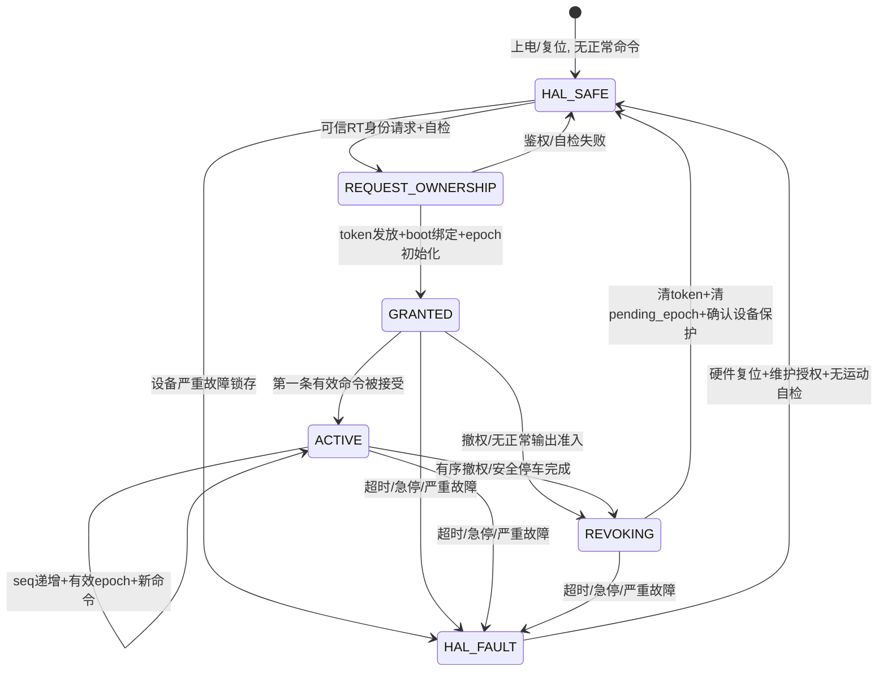
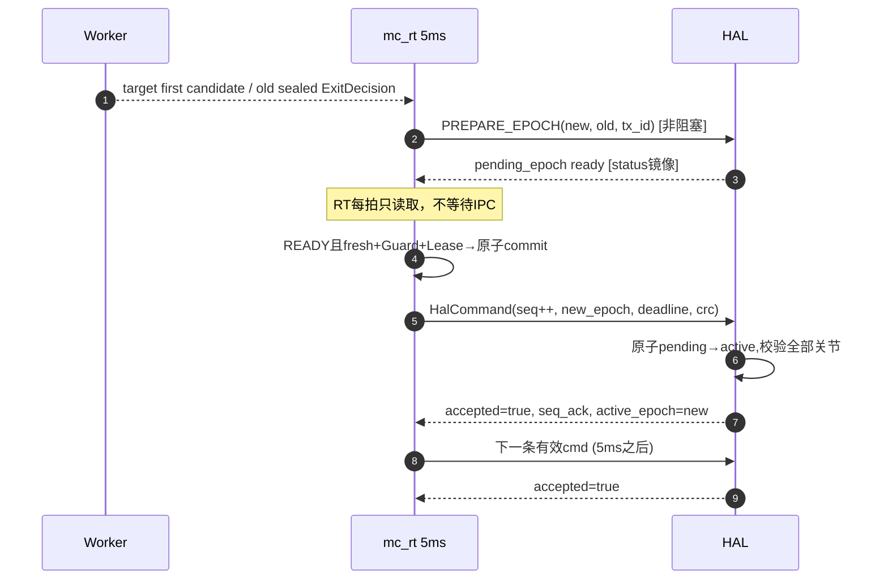
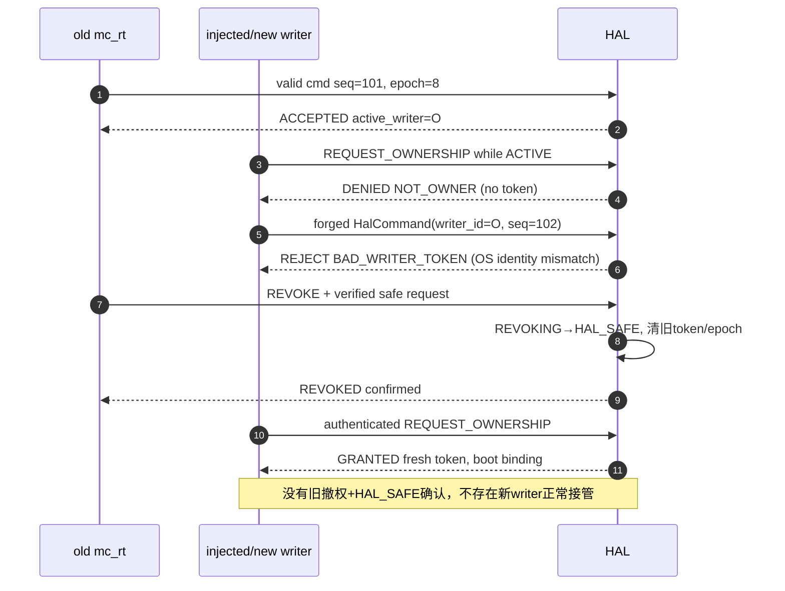
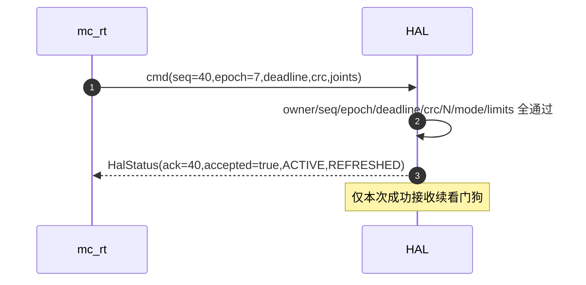
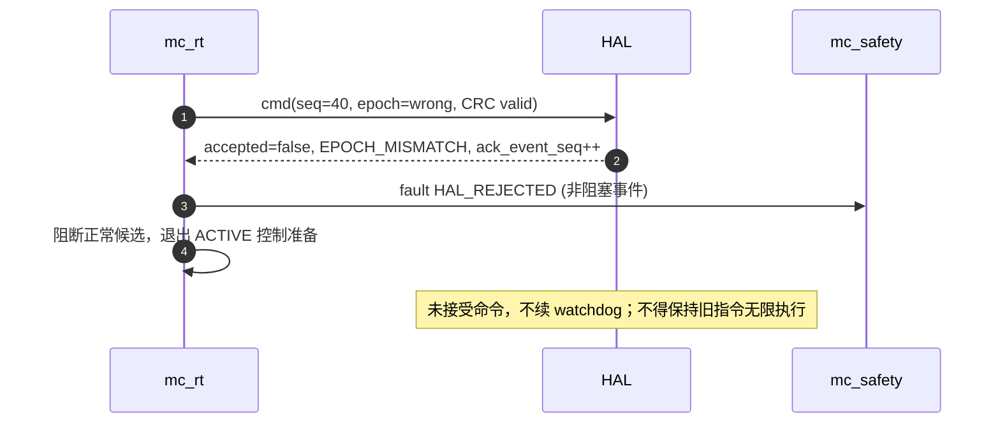
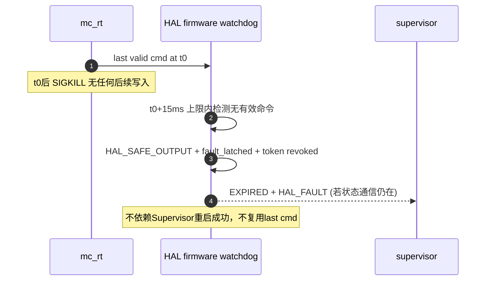
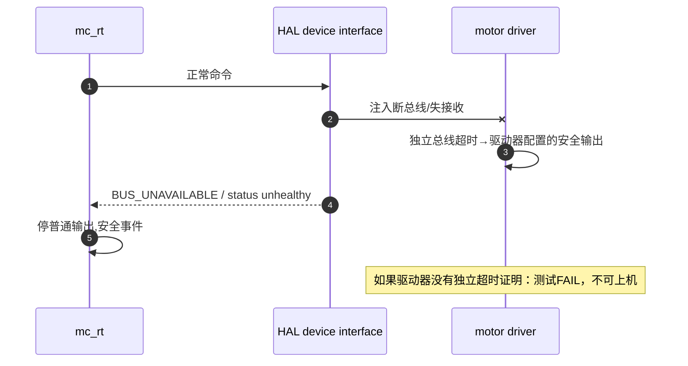

# HAL_CONTRACT.md — Collie MC V1.1 关节唯一出口与 HAL 握手合同

> 归属章节：D6.8（新增），交叉覆盖 D1.2/D1.4、D5.6、D6.1/D6.2、D7.3/D7.6、D8.1/D8.2/D8.5、D11.2。状态：【软件协议设计可编码；硬件支持、保护模式和端到端时序未验证】。本合同定义必须由 HAL/固件实现或通过明确的受信任设备代理实现的能力；**不代表 Collie 已具备这些能力**。

## 1. 唯一正常写者及三种不同权限

1. **正常运动命令**：仅 `mc_rt` 拥有 HAL normal writer lease。任何 Runner、Gateway、DDS Bridge、`mc_safety` 都不能直接下发普通 `JointTargetArray`。
2. **保护权限**：HAL/驱动器能**自主**拒收、撤权、超时保护；物理急停直接进入经电气设计定义的停止链。`mc_safety` 的 REVOKE/ESTOP 是单向收紧许可，**不是第二个正常关节 writer**。
3. **硬件输出事实**：HAL 是否具有独立 MCU/驱动级命令看门狗、是否能可控阻尼、断电时是否可能倾倒，均为【待定】。软件协议无法凭自身证明硬件电气安全。

### 1.1 字段与单位

```cpp
// 设计用 C++20 伪代码，生产序列化由 proto 生成并固定最大容量。
enum class HalRejectReason : uint16_t {
    NONE, NOT_OWNER, BAD_WRITER_TOKEN, WRONG_BOOT_ID, STALE_SEQ,
    EPOCH_MISMATCH, EPOCH_NOT_PREPARED, DEADLINE_EXPIRED, CLOCK_INVALID,
    CRC_MISMATCH, JOINT_COUNT_MISMATCH, JOINT_INDEX_MISMATCH,
    UNSUPPORTED_MODE, NONFINITE, LIMIT_VIOLATION, HAL_NOT_ACTIVE,
    FAULT_LATCHED, BUS_UNAVAILABLE, MODE_NOT_PREPARED
};
enum class HalState : uint8_t {
    HAL_SAFE, REQUEST_OWNERSHIP, GRANTED, ACTIVE, REVOKING, HAL_FAULT, HAL_UNKNOWN
};
enum class HalWatchdogState : uint8_t { ARMED, REFRESHED, EXPIRED, UNAVAILABLE };
struct HalJoint { uint16_t index; JointName name; ControlMode mode;
    float q_rad, dq_radps, tau_nm, kp, kd; bool enabled; };
struct HalCommand { Uuid boot_id; uint64_t writer_id; uint64_t seq;
    uint64_t action_epoch; uint64_t deadline_ns; uint32_t payload_crc;
    uint16_t joint_count; FixedArray<HalJoint, MAX_JOINTS> joints;
    uint64_t mode_plan_id; /*0 = no mode change*/ };
struct HalStatus { uint64_t ack_event_seq; uint64_t seq_ack;
    bool accepted; HalRejectReason reject_reason;
    HalWatchdogState watchdog_state; uint64_t active_writer;
    HalState hal_state; uint64_t fault_bits;
    uint64_t active_epoch; uint64_t last_accepted_seq;
    uint64_t last_accept_mono_ns;
    uint64_t prepared_mode_plan_id; bool mode_plan_ready;
    Uuid boot_id; uint64_t status_stamp_mono_ns, last_ack_mono_ns;
    uint64_t pending_epoch; bool epoch_prepared; Uuid epoch_prepare_tx_id; };
```

| 字段 | 生成/校验者 | 单位与合法性 | 非法行为 |
|---|---|---|---|
| `boot_id` | RT 启动生成；HAL 验证 | 本次受信任启动 UUID；重启更换 | `WRONG_BOOT_ID` 并拒收 |
| `writer_id` | HAL 注册身份 | uint64 标识，**不是安全凭证** | 未授权 `NOT_OWNER`；还需 OS 身份+会话能力 |
| `seq` | RT 每次试图写命令单调 +1 | uint64 同一 writer 授权期内不回绕 | `seq≤last_accepted_seq` → `STALE_SEQ`；拒收不能续狗 |
| `action_epoch` | RT SwitchCoordinator | uint64 单调，仅当前 epoch 或预备的下一 epoch | `EPOCH_MISMATCH` / `EPOCH_NOT_PREPARED` |
| `deadline_ns` | RT | 与 HAL 可比较的单调时钟绝对 ns；必须未来且不超允许窗口 | 过期 `DEADLINE_EXPIRED`；时钟映射不可用 `CLOCK_INVALID` |
| `payload_crc` | RT/ HAL | 对规范序列化中的全部字段**除 crc 自身**计算 CRC32C | `CRC_MISMATCH`；只做完整性，不做鉴权 |
| `joint_count` | RT / HAL | 必须等于已冻结拓扑 N 且 N≤MAX_JOINTS | `JOINT_COUNT_MISMATCH` |
| `joints[]` | RT / HAL | 固定规范 index 顺序，name/index/mode/单位/finite/gain/limit | `JOINT_INDEX_MISMATCH`、`UNSUPPORTED_MODE`、`NONFINITE`、`LIMIT_VIOLATION` |
| `mode_plan_id` | RT / HAL | 0 表示无模式变更；非零必须匹配已准备且未过期的 ModeTransitionPlan | `MODE_NOT_PREPARED`，不得按未知模式自动交接 |
| `enabled` | RT / HAL | false=不给正常控制输出，**不是**已验证受控卸力 | 状态不允许时 HAL 仍按硬件安全态执行 |
| `status_stamp_mono_ns/last_ack_mono_ns` | HAL | 单调时间 ns，含健康心跳与最新命令处理时间；ACTIVE期间每5ms产生命令处理ACK与状态版本（≥200Hz）【建议】；非ACTIVE期间设备健康状态也每5ms更新【建议】；RT保护用状态新鲜度门槛10ms【建议】 | RT 超时按 HAL 离线，禁止正常输出 |
| `pending_epoch/epoch_prepared/epoch_prepare_tx_id` | HAL | PREPARE_EPOCH 的异步 ACK，必须精确匹配新epoch和事务ID；准备过期自动清除 | 未匹配一律不提交新Epoch |
| `seq_ack` | HAL | 最近一个被处理的命令 seq（接受或拒收） | RT 按 `ack_event_seq` 识别新的拒收事件，不能假设 `seq_ack` 永远递增 |
| `accepted/reject_reason` | HAL | 每次命令的接受/拒绝原因 | 任一拒收不得作为续狗成功；RT 保护升级 |
| `active_writer/hal_state` | HAL | 当前 writer、握手/设备阶段 | owner 改变或非 ACTIVE → RT 禁止正常运动 |
| `watchdog_state/fault_bits` | HAL | 设备级故障、看门狗状态 | fault 非零或 expired → 严重事件，触发保护锁存 |

**帧校验顺序（首个命中即拒收）**：状态/急停 → OS 身份和 token → boot/writer → seq → epoch → deadline/时钟 → CRC → topology/index → mode/limits/finite/模式准备令牌 → 设备总线是否就绪。每条接受/拒收生成可观测的 `ack_event_seq`。即使尚未实现完整 RT 统计，也不能静默吞掉拒收。

## 2. 写权限握手与 Epoch 两阶段提交

**默认只允许一个正常 writer，且不允许不停机热换 writer。** 能力由 HAL 经本机受限 Unix Socket（SO_PEERCRED + 白名单）或设备驱动特权 ioctl 发放；共享内存的数值 `writer_id` 不能代替内核权限。会话能力令牌只保存在受保护的握手通道，不写日志、不允许任何其他进程 mmap 出来。若目标 HAL 是独立硬件且没有 OS 身份，则必须使用带双向认证的可信设备代理并证明代理失败时设备看门狗仍有效，否则关节写权限测试不通过。



`HAL_FAULT` 的设备物理输出遵守 HAL 安全能力表，不等于逻辑 `SAFE_HOLD`。**上电和所有急停复位之后，MC SafetyState 为 `INIT`，Form=UNKNOWN，HAL 为 `HAL_SAFE`；没有授权前不能进入 `ACTIVE`。**

### 2.1 既有 writer 下的 Epoch 交接（RT 不等待）

1. PolicyManager 准备目标 Action 和首拍候选，Worker 完成 `enter`，旧 Action 仍是活动 Epoch；Worker 已封存可退出判据。
2. `mc_rt` 用**非阻塞控制邮箱**发送 `HalEpochPrepare{boot_id,writer_id,expected_old_epoch,new_epoch,switch_tx_id,expires_mono_ns}` 给 HAL；HAL 保留 `pending_epoch=new_epoch`，返回只读 `HalStatus{epoch_prepared=true,pending_epoch=new_epoch,epoch_prepare_tx_id=switch_tx_id}`。阶段内依旧接受旧 Epoch 的有效新 seq 命令。`PREPARE_EPOCH` 必须严格保证 `new_epoch=old_epoch+1`、来源是当前 writer。
3. RT 每 5 ms 拍检查新鲜 sealed ExitDecision、SafetyLease、目标首拍 Guard、HAL `epoch_prepared/pending_epoch/tx_id` 三字段准备结果。**没有全部条件就继续旧动作或按超时保护；绝不等待 HAL 回复。**
4. 全部通过时 RT 在本地一次写入 `ActiveExecution`（含 new epoch、owner mask、Runner 实例、ModeTransition 状态），发送第一条 `new_epoch` HalCommand。HAL 对该有效帧执行一次原子 `pending_epoch→active_epoch`，从此拒收旧 epoch。旧 epoch 的正在排队命令必须清空。
5. 由于物理 HAL 接受发生在 RT 本地提交之后，RT 不得在发出新 Epoch 后以普通方式回到旧策略；若新 Epoch 命令被拒、ack 超期或 HAL 非 ACTIVE，**只允许本地保护/撤权**。这是非阻塞架构下的明确失败语义，而不是跨进程“全局原子同时成功”的不真实承诺。
6. `PREPARE_EPOCH` 到期或取消时清除 pending，原活动 Epoch 不变；不得通过准备阶段抢占旧 epoch 正常运动。HAL 驱动层必须区分普通命令与保护撤权事件。



### 2.2 控制模式切换：异步 PREPARE_MODE，不增加 RT 同步等待

`ModeTransitionEngine` 先在旧控制模式下发送一次 `HalModePrepare{boot_id,writer_id,action_epoch,mode_plan_id,joint_indices,from_modes,to_modes,deadline_ns,payload_crc,switch_tx_id}`；HAL 校验当前独占写者、Epoch、设备模式能力、关节索引与合同有效期；`action_epoch` 可为当前 `active_epoch`，或者为**已被 `HalEpochPrepare` 准备的 `pending_epoch` 且 `switch_tx_id` 精确匹配**，把可用 `prepared_mode_plan_id` 和 `mode_plan_ready` 写进只读 `HalStatus`。任何拒绝清除准备态，并报告 `UNSUPPORTED_MODE/MODE_NOT_PREPARED/DEADLINE_EXPIRED`。RT **只读状态，不阻塞**；未获 `mode_plan_ready` 时继续旧模式的受限命令或进入保护。执行 `NEUTRAL_TRANSFER` 的首条新模式 `HalCommand` 必须携带同一个非零 `mode_plan_id`；HAL 检查所有目标后**一次原子接受该模式变更和新目标**并清准备标记，ACK 的 `accepted=true` 才允许 RT 从 `NEUTRAL_TRANSFER` 进入 `RAMP_UP/VERIFY`。若 ACK 失败、时效到期或支撑发生变化，禁止假设模式已经切换；由 HAL 当前接受的模式状态与故障合同决定回退或保护。每一计划只能使用一次，不同 `action_epoch` 不可复用。若跨 Action 首帧需要改变 mode，**必须**在旧 Epoch 有效输出期间完成 RAMP_DOWN，并把 pending epoch 与 pending mode plan 都准备好，RT 才允许同一条首个新 Epoch 命令原子交接；否则在 PREPARING/WAIT_EXIT 留在旧合法控制或进安全，不得先切 Epoch 再临时猜测控制模式。

```mermaid
sequenceDiagram
 autonumber
 participant M as RT ModeTransition
 participant H as HAL
 M->>H: PREPARE_MODE(plan_id,old/new modes,epoch,deadline) [非阻塞]
 H-->>M: HalStatus(mode_plan_ready=true,prepared_mode_plan_id) [镜像]
 M->>M: RAMP_DOWN并验证实际扭矩/速度
 M->>H: HalCommand(mode=NEW,mode_plan_id,seq++,crc)
 H->>H: 一次校验后切mode+接受target;清除准备
 H-->>M: accepted=true / reject MODE_NOT_PREPARED
 M->>M: 只有ACK后进入RAMP_UP/VERIFY；未确认则保持旧安全模式或保护
```

## 3. HAL watchdog 与安全输出

| 条件 | 设备执行行为 | 可观测结果与软件动作 |
|---|---|---|
| 正常命令间隔 | 200 Hz 即 5 ms（【建议】）；`HAL.max_accepted_interval_ms=15`（【待定】，**必须硬件侧验证**） | HAL 只在**成功接受**有效命令后重置看门狗 |
| HAL 已 ACTIVE，但 15 ms 未收到有效命令 | **默认不保持最后正常位置/力矩/速度命令**；执行已验证的 `HAL_SAFE_OUTPUT`（按 HAL 能力：驱动安全阻尼或切断正常使能） | `watchdog_state=EXPIRED`，`fault_bits` 对应位锁存，`hal_state=HAL_FAULT`；撤权清 token |
| 命令 deadline 过期、CRC/seq/epoch/mode_plan 错 | 丢弃，不更新 last_accept；继续计时 | 对应 `reject_reason`，如果因此失联直到 15 ms，进入设备保护 |
| 总线丢失 | HAL 总线/驱动器有**自身**设备侧通信失联检测，按能力表保护；不能依赖 MC 收到 ack | `BUS_UNAVAILABLE`/设备失联 bit；MC 上报、RT 停正常发布 |
| 上电、未知形态/支撑、硬件急停复位 | `HAL_SAFE_OUTPUT`：默认正常控制 `enabled=false`；若有**已验证**独立阻尼可选择阻尼；禁止未知支撑下位置保持 | `hal_state=HAL_SAFE`，不接收 NORMAL Action；MC 为 `INIT` |
| 无法证明切断使能/阻尼不会导致跌倒 | 标记残余跌倒风险；要求额外机械支撑/围栏与硬件风险处置 | **不得**以软件 `SAFE_HOLD` 替代设备证明 |

`HAL_UNKNOWN` 仅供状态桥接表示设备失联，不是可进入的真实设备运行态；RT 看到它必须停止正常命令。

`HalOwnershipRequest/ HalEpochPrepare/ HalModePrepare/ HalRevokeRequest` 由 `proto/collie_mc_v11.proto` 定义固定字段；它们经独占身份认证通道发送，发送成功不代表操作成功，必须读 `HalStatus` 的对应阶段/ack/事务 ID。

`HAL_SAFE_OUTPUT` 的具体实现和最大响应时延是【待定】的**硬件合同条款**。若驱动器无法独立检测超时、无法明确拒收或不能保证失控制主机后停止继续执行上次命令，D11 设备保护门禁不通过，**不可上机**。

### 3.1 RT 非阻塞收 ack 和响应

RT 仅读 `HalStatus` 固定布局只读镜像（seqlock/版本检查，最多固定 2 次，失败视状态无效），不等待 ack。首个 `HalRejectReason != NONE`、HAL active writer/epoch 与 RT 不一致、设备 fault、`now-status_stamp_mono_ns>10'000'000ULL`（建议 10 ms）或 ACTIVE 期间 `now-last_ack_mono_ns>10'000'000ULL` 即禁止正常候选并上报 SafetyKernel（失联时仍交给硬件 watchdog）；`SafetyKernel` 不能以续 Lease 来强制 HAL 接受。

拒收后不得自动重发相同 seq；重新发必须有**新 seq、未过期 deadline、合法 Epoch、新 Guard 检查**。如果是 `EPOCH_MISMATCH` / `BAD_WRITER_TOKEN` / `FAULT_LATCHED`，不能“换个新 seq 继续冲”，进入已验证保护与维护复位。CRC 非加密，攻击者写共享内存需由 OS/设备代理隔离阻止。

## 4. 双 writer 注入与撤权交接



若旧 writer 被 `SIGKILL`，不能等待其 REVOKE；HAL timeout 自行进 `HAL_FAULT/HAL_SAFE_OUTPUT`，清旧 token。新 writer 必须经物理/维护授权和设备自检从 `HAL_SAFE` 重新申请；**不允许 hot takeover 继续未完成 Action**。若 OS 不强制 mmap 写权限，单靠 `writer_id` 无法防双写，必须改用唯一有权写设备的守护进程/驱动节点和可信 IPC。

## 5. 五条命令路径时序（含注入）

### 5.1 正常关节命令与 ack



### 5.2 HAL 拒收（CRC/旧 seq/错 epoch/过期等）



### 5.3 `kill -9 mc_rt`



### 5.4 断设备总线



### 5.5 同时存在第二 writer

见 §4 的双写注入序列；必须在 `ACTIVE`、`GRANTED`、`REVOKING` 各状态测试冒用旧 token、伪造 writer_id、越权 mmap 并验证拒收/OS 拒绝。

## 6. 可执行验收：六种注入（D11 HIL 接口测试）

**测试平台**：设备层 HIL + 独立时戳逻辑分析/电流或使能监视；同时保存 RT `tick_id`、HAL `ack_event_seq`、驱动器状态；断总线只能在电机安全支架和功率限制下做。无设备固件时可先在 HAL 合同模拟器执行相同测试，但**模拟器 PASS 不代表硬件验收完成**。

| Test ID | 注入方法 | 必须观察到 | 可执行判定 |
|---|---|---|---|
| HAL-01 | 在 HAL `ACTIVE` 中 `SIGKILL mc_rt` | 15 ms 建议门槛内 `EXPIRED`、驱动器不继续执行 normal last cmd、writer token 撤销 | `last_valid_accept→HAL_SAFE_OUTPUT ≤15ms + 硬件可测安全输出延迟`（最终数值待固件签发）；**0 条**失控持续命令 |
| HAL-02 | 拔/阻断 MC↔电机通信总线 | 驱动器自己的失联保护，MC 记录 BUS fault | 驱动器安全输出时间 ≤ 已冻结设备合同上限；否则 FAIL |
| HAL-03 | 第二进程打开设备/共享区并伪造 writer_id | OS/设备代理拒绝或 HAL `NOT_OWNER/BAD_WRITER_TOKEN` | `accepted=false` 100%，active_writer/epoch 不变，无第二正常写者 |
| HAL-04 | 重放 `seq≤last_accepted_seq` 包（CRC 重新计算） | `STALE_SEQ`，不续狗 | 100% 拒收、`last_accepted_seq` 不倒退 |
| HAL-05 | 提交未 `PREPARE_EPOCH` 的新 epoch / 重放旧 epoch | `EPOCH_NOT_PREPARED/EPOCH_MISMATCH` | 100% 拒收、`active_epoch` 不变 |
| HAL-06 | 将 deadline 设置过去（CRC 有效） | `DEADLINE_EXPIRED` | 100% 拒收、`last_accept_mono_ns` 不更新 |
| HAL-07 | CRC 故障、N 不一致、index 乱序、mode 未支持各注入 | 对应枚举拒绝并上报 | 100% 拒收且 `ack_event_seq` 可追踪 |
| HAL-08 | GRANTED/ACTIVE 期间有序 REVOKE，再由新 writer 申请 | 旧 writer 已撤权且设备确认 SAFE 后，新 token 才生效 | 无任何双 writer 接收窗口；旧 boot/seq/epoch 永不再获通过 |

**故障注入中“15 ms”是待设备签发的建议目标**，只有真实独立设备/固件测试达到且保护输出可测时才算硬件验收；模拟器验收只用于解锁软件编码，不用于解锁运动上机。

## 7. D1/D6/D8 交叉引用替换语句

| 章节 | 直接取代旧句的文字 |
|---|---|
| D1.2 进程与单一出口 | “`mc_rt` 是唯一正常关节命令写者；HAL 经 OS 身份与 token 发放独占写许可，接受 `PREPARE_EPOCH` 两阶段切换，在设备侧验证 seq/epoch/deadline/CRC/topology/mode；所有拒收写入 `HalStatus`。HAL 超时独立撤权保护。详情 D6.8《HAL_CONTRACT》。” |
| D1.4 安全路径与部署 | “硬件急停与设备 watchdog 不经过 ONNX、Task 或日志；HAL_SAFE_OUTPUT 的电气能力仍需设备团队 HIL 验证，软件 `SAFE_HOLD` 不等于硬件已安全。” |
| D5.6 JointMux/OutputGuard | “Guard 生成 `JointTargetArray` 还不是 HAL 接收确认；RT 封装成 `HalCommand`，并在下一拍消费 `HalStatus` ack/拒收。任何 rejected/失联都进入保护。” |
| D6.1 表 MC→HAL | “200 Hz 单写、完整 `HalCommand/Status`、会话 writer lease + epoch PREPARE/ack + 15ms 建议 watchdog，拒收原因见 D6.8。” |
| D6.2 领域 IDL | “`JointTargetArray` 是逻辑输出、`HalCommand` 是设备合同，二者不能用同一 C++ 结构假装拥有相同校验责任；字段取自 proto。” |
| D8.1 HAL 行 | “设备 watchdog 不是简单 `seq/deadline` 两个字段，必须保证由独立 HAL/驱动计时和已验证设备保护；频率/时限未做 Collie 硬件签发。” |
| D8.2 RT→HAL 行 | “HAL writer 身份由 OS+token 验证，Epoch 先异步准备、拍边界提交；RT 不等待 ACK、拒收读镜像、无正常第二 writer。” |
| D8.5 启动流程 | “先 HAL_SAFE/INIT，再身份握手/GRANTED，再自检支撑与安全准入；首次正常命令通过后为 ACTIVE。复位后重新执行完整流程。” |

## 8. 设备能力签收（禁止拿软件 PASS 代替）

| 设备问题【待定】 | 最低交付证据 | 阻断事项 |
|---|---|---|
| 驱动器是否独立看门狗、最大失联时间 | 固件配置、信号实测、失联保护试验 | 任意自主驱动上机 |
| `HAL_SAFE_OUTPUT` 实际作用（断使能/阻尼/电气制动） | 电机电流/扭矩/功率实测 + 跌倒风险评估 | 动态双足、变形、故障恢复 |
| HAL 支持的 `POSITION/VELOCITY/TORQUE/DAMPING` 及 gain 语义 | 设备指令手册、HIL 控制模式组合测试 | 包含未证实模式的 Action |
| 设备端是否能独立验证拒收与 token | 设备代理代码/权限测试/攻击注入 | “唯一 writer”安全结论 |
| RT/HAL 是否共享单调时钟 | 时间映射误差测试（`deadline_ns` 可比较） | 跨时钟 deadline 判定 |
| HAL 命令接受/状态 ACK 最坏延迟 | 满载/IRQ/热节流 HIL 时序 | 200 Hz 发布能力及 RT 错误闭环 |

**闭环结论**：这是可编码的软件合同和测试清单；其物理保护有效性仍为【未验证】。硬件未交付上述证据时，系统只能做 Stub/SIL/限功率 HIL，不能开放真实运动。
