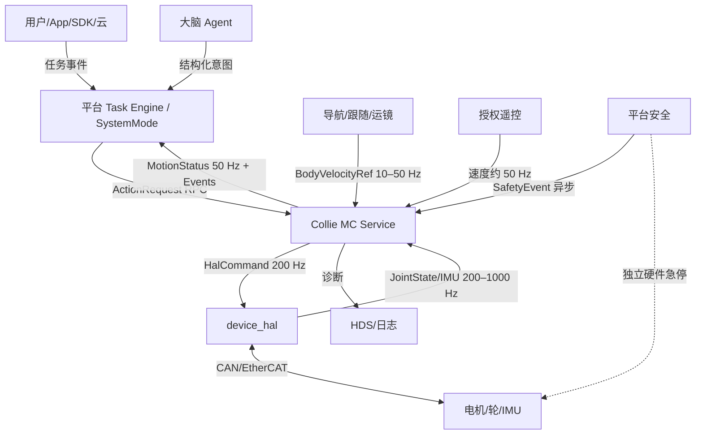
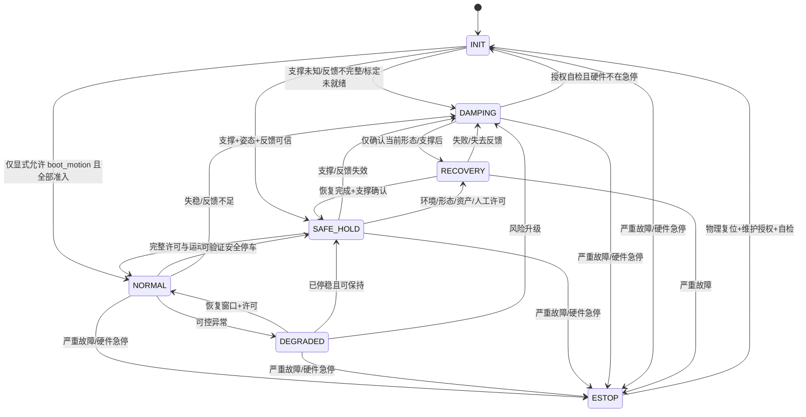
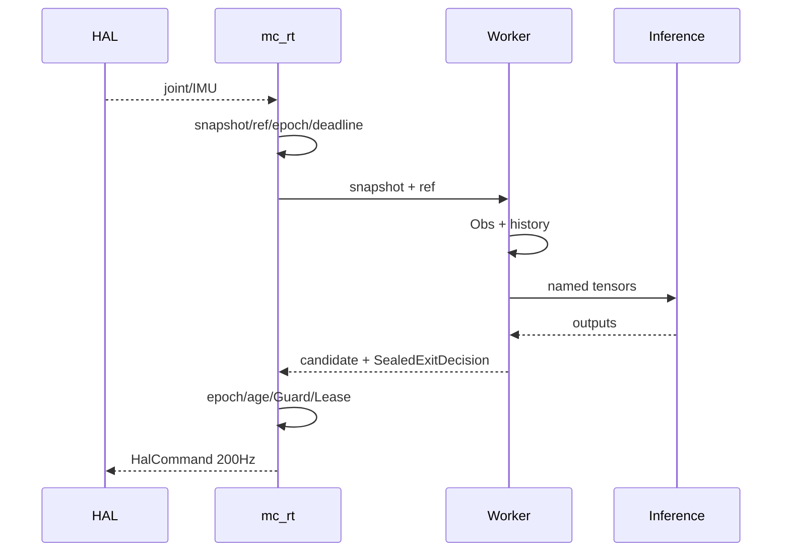
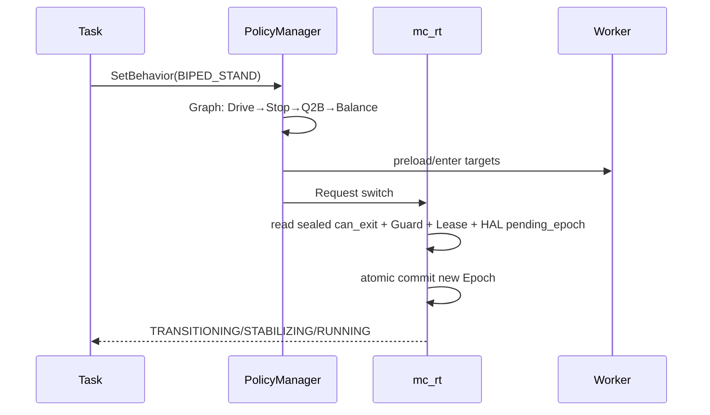
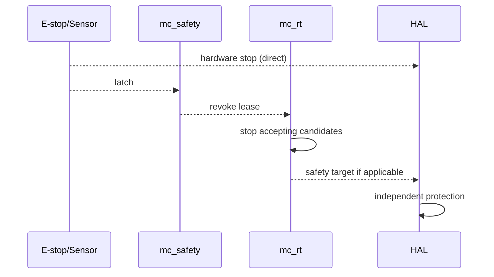
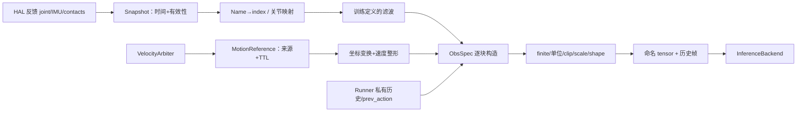

# Collie 运控服务软件架构 V1.1 合并版（D0–D16）

> **版本**：V1.1 合并阅读版　**日期**：2026-11-22　**状态**：软件设计基线（可编码），非实机安全批准。
>
> **来源**：V1.0 六部分（`../../20261122_6parts/`）+ V1.1 定点修订（`../Collie_MC_V1.1_20261122/`）。
> **性质**：把 V1.1 的 9 处修订合并进 V1.0 的 D0–D16 结构，形成一份可直接通读的总文档；HAL/SCHEMA 作为附录 A/B，协议/示例/测试索引为附录 C。
> **保留**：V1.0 原稿未改动，仍在 `../../20261122_6parts/`；V1.1 原始变更单在 `../Collie_MC_V1.1_20261122/`。

> **已知残留（必读）**：`can_exit` 在 `step` 前发布 `READY` 的竞态尚未修（见 Part 2 §D3.5 与 [V1.1 评审 §2.1](../REVIEW_V1.1.md)）。本版如实保留 V1.1 原设计，不假装已解决；编码前应先修或明确接受风险。

## 全文目录

| Part | 内容 | 文件 |
|---|---|---|
| Part 1 | D0–D2 执行摘要、架构总览、领域模型 | [`Part1_D0-D2_执行摘要_架构总览_领域模型.md`](Part1_D0-D2_执行摘要_架构总览_领域模型.md) |
| Part 2 | D3–D4 Runner 框架、PolicyManager | [`Part2_D3-D4_Runner框架_PolicyManager.md`](Part2_D3-D4_Runner框架_PolicyManager.md) |
| Part 3 | D5–D6 每拍链路、上下游接口 | [`Part3_D5-D6_每拍链路_上下游接口.md`](Part3_D5-D6_每拍链路_上下游接口.md) |
| Part 4 | D7–D8 安全、并发实时 | [`Part4_D7-D8_安全_并发实时.md`](Part4_D7-D8_安全_并发实时.md) |
| Part 5 | D9–D12 配置资产、观测回放、测试、网络安全 | [`Part5_D9-D12_配置资产_观测回放_测试_网络安全.md`](Part5_D9-D12_配置资产_观测回放_测试_网络安全.md) |
| Part 6 | D13–D16 ADR、风险、路线图、评审清单 | [`Part6_D13-D16_ADR_风险_路线图_评审清单.md`](Part6_D13-D16_ADR_风险_路线图_评审清单.md) |

**附录**：[A. HAL 合同](Appendix_A_HAL_Contract.md)｜[B. Schema Canon](Appendix_B_Schema_Canon.md)｜[C. 协议/示例/测试索引](Appendix_C_Protocol_Examples_Tests.md)

## 与 V1.0 / V1.1 的关系

- **V1.0**：完整底稿，保留作历史对照；其中 9 处已被 V1.1 替换。
- **V1.1 变更单**：`PartA-E` + `HAL_CONTRACT` + `SCHEMA_CANON` + `proto/schemas/examples/tests`；是字段/合同的权威源。
- **本合并版**：把 V1.1 的决策与替换写回 D0–D16 的阅读版；若与 V1.1 原始文件冲突，以 `proto/schemas/HAL_CONTRACT` 为准。

## 阅读建议

1. 先读 Part 1（一页结论 + 12 决策）和 Part 2（Runner 框架）。
2. 再读 Part 3（每拍链路/接口）和 Part 4（安全/实时）。
3. 最后读 Part 5（配置/测试/网安）和 Part 6（ADR/风险/checklist）。
4. 需要字段细节时查附录 B；需要 HAL 行为时查附录 A；需要 proto/示例/测试时查附录 C。

---


# Collie 运控服务软件架构 V1.1 — Part 1（D0–D2）

> **版本**：V1.1 合并阅读版　**日期**：2026-11-22　**状态**：软件设计基线（可编码），非实机安全批准
>
> **来源**：V1.0 六部分（`output/20261122_6parts/`）+ V1.1 定点修订（`PartA-E`、`HAL_CONTRACT.md`、`SCHEMA_CANON.md`、`proto/`、`schemas/`、`examples/`、`tests/`）。
>
> **读法**：本版把 V1.1 的 9 处修订合并进 V1.0 的章节结构；详细字段/合同以附录 A（HAL）、附录 B（Schema）为准。V1.0 原文保留，仅作历史对照。
>
> **已知残留**：`can_exit` 在 `step` 前发布 `READY` 的竞态尚未修（见 Part 2 的“审阅注记”与 `REVIEW_V1.1.md` §2.1）；本版如实保留，不假装已解决。

---

## 0. 一页结论

Collie 运控采用“**Behavior 对外、Action 配置化、ActionBundle 组合、Runner 执行、PolicyManager 编排、RT 唯一关节出口、SafetyKernel 独立许可**”的结构。

四个 MC 进程：

| 进程 | 职责 | 能否写 HAL |
|---|---|---|
| `mc_gateway` | RPC/权限/PolicyManager/Registry/ActionGraph/请求仲裁 | 否 |
| `mc_runner_worker` | ObsBuilder / Runner / Inference / Codec，按 100 Hz 计算候选 | 否 |
| `mc_rt` | 200 Hz 快照、速度仲裁、切换提交、JointMux、OutputGuard、唯一发布 | **唯一正常写入者** |
| `mc_safety` | SafetyKernel / Lease / Fault / 安全状态机 | 否（只收紧许可） |

外加 `device_hal`（设备合同、独立看门狗/保护）。硬件急停不经过软件。

**一句话原则**：一个关节出口、一套策略契约、一条可回放的每拍链路、一条不依赖推理的安全路径。

---

## D0. 执行摘要与 12 条关键决策

| ID | 决策 | 理由 | 替代方案 | 代价/状态 |
|---|---|---|---|---|
| ADR-01 | Behavior（产品能力）与 Runner（执行单元）分开 | 接口不受模型变更影响 | 仅 Runner 或仅 Behavior | 多一层映射；【建议】 |
| ADR-02 | ActionBundle = 单 Primary + 可选 Overlay slots | 五类行为共用组合机制 | 一 Action 一类一线程 | 组合校验成本；【建议】 |
| ADR-03 | Gateway / Worker / RT / Safety 混合多进程 | 推理挂死不阻塞发布 | 单进程多线程 | IPC/部署成本；【建议，待平台验证】 |
| ADR-04 | 只有 `mc_rt` 有正常 HAL 写权限 | 消除双写与不确定覆盖 | 每 Runner 写 HAL | 统一仲裁点；【建议】 |
| ADR-05 | 100 Hz 策略、200 Hz 关节发布 | 分离推理与发令实时性 | 同频执行 | 需 hold/整形验证；【假设+建议】 |
| ADR-06 | 双足先按动态平衡接口设计 | 不隐含机械静态锁止 | 全用姿态位控 | 需平衡资产；【待定】 |
| ADR-07 | Q2B/B2Q 使用独立 TransitionRunner | 形态过渡需相位、支撑与退路 | 位置线性插值 | 独立资产/验收；【建议】 |
| ADR-08 | bitmask 逐关节所有权，默认不做同关节混合 | 禁止叠加抢写 | Scope 粗分/最后写者赢 | 需训练协商；【建议】 |
| ADR-09 | 四个稳定 RPC + 两个流；内部保留三类领域输入 | 限制外部 ABI 变化 | 暴露每个 Runner API | Adapter 维护；【建议】 |
| ADR-10 | 本地 SafetyKernel + OutputGuard + HAL + 硬件链 | 不能依赖模型运行 | 单看门狗/单安全进程 | 状态/复位协议；【建议】 |
| ADR-11 | Manifest + 逐维 ObsSpec/ActionSpec + Golden | 检出训练/部署错位 | 仅 ONNX + 参数数量 | 算法交付增加；【建议】 |
| ADR-12 | 独立 MC 仓；从旧代码阶段迁移 | 可独立编译/回滚 | 旧节点里加 switch(model) | 建骨架成本；【建议】 |
| ADR-13 | 冷启动 `INIT` + `Form=UNKNOWN`，未知支撑不发保持 | 未知姿态下位置保持可能危险 | 直接 SAFE_HOLD | 启动变慢；【建议】 |
| ADR-14 | ControlLease 独立于 Session/SafetyLease | 运动资源需要独占所有权 | 只靠优先级 | 租约协议成本；【建议】 |

### 非软件背景决策者 5 分钟版

架构把“谁可以让机器人做什么”（平台任务）、“当前用哪个动作”（MC PolicyManager）、“动作怎么算”（Runner）、“什么命令真的能写电机”（OutputGuard/HAL）分开。新增动作主要是交付资产，不是改整机软件；同一套接口可回放、回滚、故障注入。最大风险是双足/变形失稳、模型与本体映射错、软件挂死后继续输出旧命令。必须拍板：关节拓扑、双足支撑形式、HAL/硬件急停能力、首发载荷/地形、实时计算平台。

---

## D1. 架构总览

### D1.1 上下文



### D1.2 进程与连接

| 连接 | 周期/预算 | 断链措施 |
|---|---|---|
| Gateway→RT 切换邮箱 | 事件，≤1 个 5 ms tick 可见 | 请求超时，活动 Epoch 不变 |
| Gateway→Worker 资源操作 | 准备期，不占 RT | 新 Action 不加载，旧动作不中断 |
| HAL→RT 反馈 SHM | 200–1000 Hz；读取 ≤0.2 ms | 无效数据触发 Guard |
| RT→Worker 快照 | 100 Hz，零分配读视图 | 过期快照不得推理 |
| Worker→RT 候选 | 100 Hz，截止 Worker tick+8 ms | 不积压，迟到拒绝 |
| Safety→RT Lease | 100 Hz + 异步严重故障 | 失租立即退出正常输出 |
| RT→HAL 命令 | 200 Hz，单写者 | HAL 15 ms 看门狗（待验证） |
| HAL→Safety 设备健康 | ≥100 Hz | 不续租 |

`mc_rt` 不执行模型加载、同步推理、ROS 回调、文件写入或等待锁。Worker 输出带 `(boot_id, action_epoch, tick_id, snapshot_seq, deadline_ns, manifest_hash)`；RT 只采用当前 Epoch、未过期、完整且有限的候选。

### D1.3 逻辑模块

`MotionApiAdapter → PolicyManager/Registry/Graph → SwitchCoordinator`；`HAL → Snapshot → ObservationBuilder → Runner/Inference → ActionCodec → JointMux → OutputGuard → HalCommand`；`SafetyKernel → OutputGuard`；`MotionStatusPublisher` 旁路。

**正常主链**：HAL → 快照 → 逐维观测 → Runner（需要时推理）→ 解码 → 所有权合成 → 安全限幅 → 唯一 HAL 命令。模型运行库失效也不能跳过后两级。

### D1.4 安全链

`Worker` 只产生候选；`mc_safety` 发短时 Lease；`OutputGuard` 每拍检查；`mc_rt` 唯一发令；HAL/驱动器/硬件急停逐级兜底。`SAFE_HOLD` 是“经过特定形态验证的受控保持”，不是任意姿态的默认输出。

---

## D2. 领域模型

### D2.1 五个限界上下文

| 上下文 | 聚合根/对象 | 唯一负责 | 不能做 |
|---|---|---|---|
| Motion API | `Session`, `ActionRequest` | 身份、权限、请求回执 | 改写当前关节 |
| Motion Orchestration | `ActionExecution`, `ActionGraph` | 路径、准备、切换阶段 | 绕过 RT 直接提交 |
| Runner Runtime | `RunnerInstance`, `RunnerManifest` | 生命周期、模型/轨迹、候选 | 自行订阅/发 HAL |
| Joint Control | `RobotStateSnapshot`, `Ownership`, `JointTargetArray` | 时间对齐、合成、Epoch、输出 | 业务仲裁 |
| Motion Safety | `SafetyState`, `SafetyLease`, `Fault` | 本地严重故障、降级/复位 | 擅自降低平台急停 |

**关键对象**：`Behavior` 对外能力；`Action` 配置化执行定义；`ActionBundle` 组合；`Runner` 内部执行单元；`RunnerManifest` 静态契约；`Session` 来源会话；`ControlLease` 运动资源独占权；`ActionEpoch` 接管代数；`Ownership` 关节位图；`StepInput` 每拍输入；`RunnerOutput` 候选输出。

### D2.2 Runner 生命周期

`Created → Loaded → Entered → Running → Exiting → Exited → Faulted`。

- `load` 非实时校验/预分配；
- `enter` 只准备，不提交 HAL/RT Epoch；
- `can_exit=READY` 只代表旧 Runner 可交出；
- `step` 在 Worker 预算内产候选，不保证被 RT 采用；
- `exit` 在 RT 撤销 Epoch 后执行；
- `Faulted` 不授权自恢复。

### D2.3 切换状态机

`REQUESTED → PREPARING → WAIT_EXIT → ENTERING → TRANSITIONING → STABILIZING → RUNNING`；失败 `FAULT/SAFE`。

- 提交前失败：旧 Runner 仍有效则保留旧 Action；
- 一旦提交新 Epoch：禁止未经验证直接回旧策略；
- `TRANSITIONING → STABILIZING` 必须由物理判据触发，不是计时器；
- `switch_ready` 仅在“稳定 + 无切换 + 安全允许 + 可退出”时为真。

### D2.4 安全状态机（V1.1 合并）



**未知形态（Form=UNKNOWN）禁止**：Q2B、B2Q、Balance、Recovery、全部 TransitionRunner、正常四轮移动/受力姿态/Overlay。不得用上一次请求推断 Form。

### D2.5 ControlLease（V1.1 合并）

`ControlLease` 是某个运动资源的独占控制权，独立于 `Session` 与 `SafetyLease`：

`IDLE → REQUESTED → GRANTED → RENEWING → REVOKING → REVOKED/EXPIRED`

- 正常运动同时要求：有效 Session + 有效 ControlLease + 有效 SafetyLease + HAL normal writer lease；
- 同一 scope 任一时刻最多一个 `GRANTED/RENEWING` owner；
- 抢占必须先撤旧租、停车/保护确认，再授予新 owner；
- 失租时按 Action 类型降级：四轮制动、Q2B/B2Q phase fallback、Balance 走已验证安全平衡/降能、无资产则 HAL 保护。

### D2.6 Q1–Q3 裁决

| 问题 | 决策 | 替代方案 | 切换条件 |
|---|---|---|---|
| Q1 抽象 | Behavior→Action→Bundle→Runner | 仅 Behavior+Scope | 永远没有组合/过渡可裁剪 Bundle |
| Q2 进程 | Gateway+Worker+RT+Safety | 单进程多线程 | 实时 MCU + 完整故障证明可合并 Worker |
| Q3 双足 | 默认动态平衡接口，静态锁止可替换 | 全 ClassicalPose | 本体证实全工况静态锁止 |

---

**Part 1 完成度：100%（D0–D2 合并稿）；待补：Collie 拓扑、双足支撑、HAL/急停能力、平台 WCET。**


---


# Collie 运控服务软件架构 V1.1 — Part 2（D3–D4）

> 合并说明：本 Part 以 V1.1 的 `IRunner`、`SealedExitDecision`、二维 Runner 工厂、ModeTransition、PolicyManager/ControlLease 为准；V1.0 的 ActionBundle/切换骨架保留。  
> **审阅注记**：V1.1 的 `can_exit` 在 `step()` 前发布 `READY`，存在“旧 Runner 已故障/进入不可中断相位，RT 仍提交”的竞态；本文保留 V1.1 原设计并在 §D3.5 标注，修法见 `REVIEW_V1.1.md` §2.1。

---

## D3. Runner 框架详细设计

### D3.1 内部 ABI 与插件边界

`IRunner` 是 Worker **进程内**的 C++ 接口；跨进程只用版本化、固定布局 IPC，不传 `std::vector`、虚表或裸指针。首版推荐把已审核 Runner 静态链接进 Worker，避免运行时随意装入第三方 `.so`；若用动态库，必须提供版本化 C 入口工厂。

| 方法 | 调用线程 | 资源/时效 | 前置/后置/失败 |
|---|---|---|---|
| `load()` | Worker loader（非 RT） | 允许模型 I/O 与预分配 | Created、manifest/robot 校验；失败→Faulted，无设备输出 |
| `enter()` | Worker 实例线程 | 不等待外部服务/磁盘 | Loaded/Exited；快照/形态/安全准入有效；失败→Faulted |
| `can_exit()` | Worker 实例线程，**每 tick 在 step 前** | 只读已冻结输入与内部相位；计入 7.6 ms | 输出 sealed `kind/reason/snapshot_seq/valid_until/retry_not_before`；不得同步 IPC |
| `step()` | Worker 100 Hz | ≤ `worker_budget_ns`；禁止磁盘/无界阻塞 | 返回候选或错误；不保证被 RT 采用 |
| `exit()` | Worker 实例线程 | 不阻塞 RT；大资源释放转 loader | RT 已撤销 Epoch；失败锁存 Faulted |
| `status()` | 非阻塞只读 | 常数时间 | 返回状态副本 |

线程安全：每个 `RunnerInstance` 的 `enter/can_exit/step/exit` 由同一 Worker 线程串行调用；不同实例可并行，但不能共享可写历史/滤波/后端会话。异常必须在 Worker 包装层捕获，不跨 `noexcept` 传播。RT 从不调用 `IRunner`。

### D3.2 类型与 C++ 签名

```cpp
using TimeNs = uint64_t;
using ActionEpoch = uint64_t;
using TickId = uint64_t;
using JointMask = uint64_t;   // 首版 ≤64 关节

enum class Errc : uint32_t {
  Ok=0, InvalidManifest=1001, TopologyMismatch=1002, BadTensor=1003,
  InvalidState=2001, GuardWait=2002, GuardRefuse=2003,
  StaleFeedback=3001, SafetyDenied=3002, Timeout=4001,
  ResourceExhausted=4002, Internal=5001
};

enum class ExitKind : uint8_t { READY=1, WAIT=2, REFUSE=3 }; // 与 proto EXIT_READY/WAIT/REFUSE 对齐

struct ExitDecision {
  ExitKind kind;
  uint32_t reason_code;
  uint64_t snapshot_seq;
  uint64_t valid_until_ns;
  uint64_t retry_not_before_ns;
};
struct SealedExitDecision {
  Uuid boot_id; ActionEpoch action_epoch; Uuid runner_instance_id;
  uint64_t seal_seq; uint64_t snapshot_stamp_ns; ExitDecision data;
};

struct JointTarget {
  uint16_t index; uint8_t mode; bool enabled;
  float q_rad, dq_radps, tau_nm, kp, kd;
};
struct RunnerOutput {
  ActionEpoch epoch; TickId tick_id; TimeNs snapshot_stamp_ns, deadline_ns;
  JointMask owns_mask; uint16_t target_count; JointTarget* preallocated_targets;
  uint16_t phase_id; bool done, exit_ready; uint32_t fault_code;
};
struct StepInput {
  const RobotStateSnapshot& state;
  const MotionReference& reference;
  const TransitionContext& transition;
  TickId tick_id; TimeNs deadline_ns;
};

class IRunner {
public:
  virtual ~IRunner() noexcept = default;
  virtual Status load(const RunnerManifest&, const RobotDescription&, LoadContext&) noexcept = 0;
  virtual Status enter(const EnterContext&) noexcept = 0;
  virtual ExitDecision can_exit(const RobotStateSnapshot&, const MotionReference&) const noexcept = 0;
  virtual Status step(const StepInput&, RunnerOutput&) noexcept = 0;
  virtual Status exit(ExitReason) noexcept = 0;
  virtual RunnerStatus status() const noexcept = 0;
};
```

`JointTarget*` 只在 Worker 内有效；跨 IPC 用固定 `MAX_JOINTS=64` 容量 + 实际 `joint_count`。候选外层 `CandidateHeader` 携带 `manifest_hash/boot_id/epoch/tick_id/snapshot_seq/deadline`。

### D3.3 八类 Runner 与二维工厂（V1.1）

RunnerManifest 不再只靠 `class_id` 猜算法，而是两个正交字段：

- `ExecutionKind`：`ONNX / CLASSICAL / PLAYBACK / COMPOSITE`
- `BehaviorRole`：`LOCOMOTION / TRANSITION / BALANCE / POSE / RECOVERY / OVERLAY`

| kind \ role | LOCOMOTION | TRANSITION | BALANCE | POSE | RECOVERY | OVERLAY |
|---|---|---|---|---|---|---|
| ONNX | RlLocomotionRunner | TransitionRunner | BalanceRunner | — | RecoveryRunner | OverlayRunner |
| CLASSICAL | WheelDriveRunner | TransitionRunner | BalanceRunner | ClassicalPoseRunner | RecoveryRunner | OverlayRunner |
| PLAYBACK | — | TransitionRunner | — | PlaybackRunner | — | OverlayRunner |
| COMPOSITE | — | TransitionRunner | — | — | — | OverlayRunner |

工厂规则：`(execution_kind, behavior_role) → class_id` 唯一；`backend_id` 必须在白名单；不匹配直接 `MANIFEST_CLASS_MISMATCH`，不做模糊回退。四轮 ONNX 策略选 `(ONNX, LOCOMOTION) → RlLocomotionRunner`，`behavior_id` 仍是四轮移动；不要因为类名不是 `WheelDriveRunner` 就认为角色不同。

### D3.4 八类 Runner 接口卡

| Runner | 参考/反馈 | 输出/所有权 | 进入/退出/完成 | 失败/必交资产 |
|---|---|---|---|---|
| WheelDriveRunner | vx/vy/wz；轮速/腿/IMU/接触 | 腿+轮位置/速度/力矩，mask 声明 | 四轮支撑稳定进入；零速/滑移/姿态稳定退出 | 滑移/反馈异常→停车/安全；轮腿映射、速度域、Obs/ActionSpec、制动包络 |
| RlLocomotionRunner | 速度参考、关节/IMU、历史动作、观测历史 | 模型定义的逐关节目标 | 张量有效/预热；按停止/接触窗退出 | 超时/NaN→无候选；模型、tensor IO、逐维规格、Golden |
| ClassicalPoseRunner | 姿态/高度、关节/IMU | 位置+增益，必要时轮制动 | 姿态包络；误差/低速保持窗 | 超时/过流→SAFE；插值曲线、增益、限位、完成窗 |
| TransitionRunner | Q2B/B2Q 请求、phase 参考、关节/IMU/接触/轮速 | 相位相关目标，通常独占承重关节 | 初态包络+净空；阶段判据；终态接触/姿态保持 | 失败只走 phase 可行回退或 DAMPING；相位表、模型/轨迹、phase guard、超时/回退、Golden |
| BalanceRunner | 姿态/速度、IMU、轮接触、关节/估计 | 承重/姿态目标 | 双足支撑有效；可退出需姿态/轮速满足 | 失衡→保护；动态支撑域、失稳阈值、输出模式、扰动测试 |
| RecoveryRunner | 安全授权、倒地方向、净空、反馈 | 受限恢复轨迹/策略 | 安全授权+场地清空；固定重试上限 | 超时/净空变化→DAMPING；可恢复姿态集、次数、Golden |
| PlaybackRunner | `.mref` 时标/关节参考、反馈 | 轨迹目标、限定 mask | 起点误差/速度；时间轴完成+跟踪误差稳定 | 越界/超时→停用；轨迹、采样、增益、校验和 |
| OverlayRunner | 手势/头臂参考、主 Runner 稳定态、关节反馈 | 仅拥有的局部 mask | 主动作允许组合、mask 不冲突；主退出前撤销 | 冲突/失联→同步取消；组合白名单、返回中性、时间窗 |

首版对 Q2B/B2Q/Balance/Recovery/表演 `enabled=false`；缺 Collie 资产和物理证据时任何调用返回 `ACTION_NOT_RELEASED`，不能用 T1 资产替代。

### D3.5 `enter / can_exit / step` 契约

**V1.1 决策**：Worker 每 10 ms tick 在 `step` 前计算 `can_exit` 并封存 `SealedExitDecision`；RT 每 5 ms 只读 mailbox，校验 `boot/epoch/runner_instance/seal_seq/snapshot_seq/valid_until`，不等待 Worker。

```cpp
// Worker：先算退出，再发布，再跑 step（V1.1 原设计）
void RunnerWorker::on_10ms_tick(const StepInput& in) noexcept {
  const auto now = in.state.snapshot_robot_time_ns;
  ExitDecision d;
  if (refuse_latched_) d = {ExitKind::REFUSE, REASON_LATCHED, 0, 0, 0};
  else if (last_exit_.kind == ExitKind::WAIT && now < last_exit_.retry_not_before_ns)
    d = {ExitKind::WAIT, last_exit_.reason_code, 0, 0, last_exit_.retry_not_before_ns};
  else d = runner_.can_exit(in.state, in.reference);
  d.snapshot_seq = in.state.snapshot_seq;
  d.valid_until_ns = min(now + 10'000'000ULL, config_.exit_decision_ttl_deadline_ns(in.state));
  d.retry_not_before_ns = (d.kind == ExitKind::WAIT)
      ? max(d.retry_not_before_ns, now + 10'000'000ULL) : 0;
  if (d.kind == ExitKind::REFUSE) refuse_latched_ = true;
  last_exit_ = d;
  publish_sealed_exit(boot_id_, active_epoch_, instance_id_, ++seal_seq_, d, now);
  (void)runner_.step(in, preallocated_output_); // 可能挂死
}

// RT：每个 5 ms tick，只读，不等待
ExitKind SwitchCoordinator::read_exit_nonblocking(const RtSnapshot& s,
                                 const PreparedSwitch& p, TimeNs now) noexcept {
  SealedExitDecision e;
  if (!exit_mailbox_.try_read_sealed(e)) return ExitKind::WAIT;
  if (e.boot_id != boot_id_ || e.action_epoch != active_.epoch ||
      e.runner_instance_id != active_.runner_id) return ExitKind::WAIT;
  if (e.data.snapshot_seq > s.snapshot_seq ||
      (s.snapshot_seq - e.data.snapshot_seq) > 2ULL) return ExitKind::WAIT;
  if (now > e.data.valid_until_ns || now < e.snapshot_stamp_ns ||
      (now - e.snapshot_stamp_ns) > 10'000'000ULL) return ExitKind::WAIT;
  if (active_.exit_refuse_latched) return ExitKind::REFUSE;
  if (e.data.kind == ExitKind::REFUSE) { active_.exit_refuse_latched = true; return ExitKind::REFUSE; }
  if (e.data.kind == ExitKind::WAIT) return ExitKind::WAIT;
  return current_rt_support_guard(s) && target_preflight_valid(p,s)
      ? ExitKind::READY : ExitKind::WAIT;
}
```

> **审阅注记（P0 残留）**：`can_exit` 在 `step` 前发布 `READY`。如果 `step` 把相位推进到不可中断、输出 NaN/fault、或挂死，RT 仍可能在 `valid_until`（10 ms）内用“上一步的 READY”提交新 Epoch。现有 `test_exit_worker_hang_50ms_rt_not_block` 只测“无决策”，没测“先 READY 再挂死”。建议 V1.2：`READY` 只在 `step` 成功返回后发布；或给 `SealedExitDecision` 加 `last_completed_step_seq/phase_seq/fault_seq`，RT 只接受“最近成功 step”的 `READY`，step 进行中/挂死强制 `WAIT`。详见 `REVIEW_V1.1.md` §2.1。

### D3.6 历史与状态保留

每个 `RunnerInstance` 独占 `RunnerContext`：Obs 历史、滤波状态、`previous_action`、RNN hidden、Transition phase。`enter` 按 manifest `initial_fill` 重置；`exit` 冻结/销毁。跨策略保留只允许 manifest 明示且 ObsSpec hash/频率/坐标/历史顺序一致。`ActionEpoch` 由 RT 单调递增；`Safety fault latch` 不随 Runner 改变。

### D3.7 三条关键时序







---

## D4. PolicyManager、ActionGraph、ActionBundle

### D4.1 注册表与预加载

| 注册表 | 主键 | 内容 |
|---|---|---|
| BehaviorRegistry | behavior_id | 业务能力→Action/权限 |
| ActionRegistry | action_id@version | Bundle/Manifest/拓扑/release 状态 |
| RunnerFactoryRegistry | (execution_kind,behavior_role) | class_id/backend/能力 |

加载顺序：RobotDescription/校准 → Bundle/Manifest → 模型/轨迹 SHA 与 Tensor IO → Obs/ActionSpec → mask/组合矩阵 → 预分配 → 预热 → Golden smoke → `AVAILABLE`。`release.status` 与 `runtime.asset_state` 分开：`DISABLED/CANDIDATE/APPROVED` vs `UNLOADED/LOADING/AVAILABLE/ACTIVE/BROKEN`。热加载不在 P0。

### D4.2 ActionGraph

根为 `nodes`（只含 Action，不含 `INIT/SAFE_HOLD/DAMPING/ESTOP/RECOVERY`），边字段 `from/to/cost/guard/max_duration_ms/on_timeout`。安全抢占无条件旁路图。

```yaml
schema_version: '1.1'
nodes: [quad_stand, quad_drive, quad_stop, q2b, biped_balance, b2q]
edges:
  - {from: quad_drive, to: quad_stop, cost: 1, guard: [feedback_fresh],
     max_duration_ms: 1500, on_timeout: DAMPING}
  - {from: quad_stop, to: q2b, cost: 3,
     guard: [support_valid, clearance_token_fresh],
     max_duration_ms: 2000, on_timeout: DAMPING}
```

启动校验：引用存在、Action/Bundle 兼容、guard 已注册、无重复/自环、P1 禁用动作不在 P0 路径、所有边有限 deadline 与故障目标、安全抢占保留。运行期默认带风险权重最短合法路径，但实时 guard 不能被路径权重替代。

### D4.3 ActionBundle 与 Ownership

`ActionBundle = primary + overlay_slots + combination_rules`。必须检查：`primary_mask & overlay_mask == 0`；overlay 之间不重叠；未声明关节 `enabled=false` 或由显式 neutral/fallback owner 提供；同一关节不能同时 POSITION/TORQUE；平衡需要头/臂反作用力时，让 Balance 接收手势参考，而不是第二路覆盖。

Overlay 只在主策略 `RUNNING && stable && allowed` 时进入；主策略退出前先停新 overlay、回中性姿态；超时则阻止普通切换或进安全。运行中禁止动态改所有权，必须新 Bundle + 新 Epoch。

组合矩阵（初版）：QuadStand 允许非承重头/臂；QuadWheelDrive 仅经测试的头/受限臂；QuadStop/Q2B/B2Q 默认拒绝；BipedBalance 仅 mask 不争用且联合验证；Recovery/Safety 只允许内部保护。

### D4.4 请求仲裁、来源与 ControlLease

| 来源 | Action | Velocity | Overlay | 限制 |
|---|---|---|---|---|
| 硬件急停 | — | — | — | 最高，硬件独立 |
| PlatformSafety | 保护性取消 | 限速/停止 | 取消 | 安全约束不参与普通优先级 |
| 本地授权遥控 | 授权站立/停止 | 是 | 有限 | priority 90，需 ControlLease |
| Task Engine | 是 | 授权会话 | 是 | priority 60，任务级仲裁 |
| 导航/跟随 | 否 | 是 | 否 | priority 50，需任务授权 |
| SDK/App | 经 Task | 经网关 | 经 Task | priority 40，不能直达 RT |

**ControlLease**：`IDLE→REQUESTED→GRANTED→RENEWING→REVOKING→REVOKED/EXPIRED`；字段 `lease_id,session_id,boot_id,owner_source_id,seq,scope,ttl_ms,expires_mono_ns,priority,state`。同一 scope 最多一个 owner；抢占先 `REVOKE` 旧租并确认停车/保护，再授予新租；失租时禁止新速度/新 Action，按 Action 走制动/phase fallback/安全平衡/HAL 保护。TTL 初值 500 ms、续租 ≤150 ms（待压测签发）。

幂等键 `(source_id,session_id,request_id)`；同键不同 payload → `IDEMPOTENCY_CONFLICT`。每 source 最多 8 个 Action 排队，总 32；速度只保留最新 seq；断流按 TTL 制动归零。

### D4.5 原子切换

`REQUESTED → PREPARING → WAIT_EXIT → ENTERING → TRANSITIONING → STABILIZING → RUNNING`。

1. PolicyManager 准备目标 Action/首候选，Worker 完成 `enter`，旧 Action 仍活动；
2. RT 读取旧 Runner 的 sealed `ExitDecision` + 目标首候选 + SafetyLease + HAL `pending_epoch`；
3. 全部有效时 RT 在 5 ms 拍边界原子提交 `active_epoch`，发第一条新 Epoch `HalCommand`；
4. HAL 原子 `pending_epoch→active_epoch`，旧 Epoch 永久失效；
5. 提交后新 Epoch 被拒/ACK 超期/HAL 非 ACTIVE：只能本地保护/撤权，不能普通回旧策略。

`switch_ready=true` 当且仅当：`phase==RUNNING`、物理稳定窗成立、无切换事务、反馈有效、安全允许、`can_exit` 对新快照 READY、overlay 满足退出。

### D4.6 MotionStatus

50 Hz 状态 + 事件。字段以 `proto` 为准：`boot_id/request_id/execution_id/session_id`、`seq/action_epoch/stamp_robot_ns`、`current/target_action`、`phase/transition_phase/form`、`stable/switch_ready/action_done`、`active_primary/overlays`、`effective_velocity/source/age`、`safety_state/latched_fault`、`feedback/inference_age`、`release_id/manifest_sha256`、`control_lease_id/state`、`hal_state/last_ack_seq/last_reject_reason`。`age_ms=UINT32_MAX` 表示未知，不填 0；HAL 失联为 `HAL_UNKNOWN`。

### D4.7 Q4/Q5 裁决

| 问题 | 决策 | 替代方案 | 切换条件 |
|---|---|---|---|
| Q4 过渡 | Q2B/B2Q 各有独立 TransitionRunner、phase、接触/姿态守卫、phase fallback；无资产禁用 | 位置线性插值/倒放 | 本体证实准静态且全 phase 可验证时可用经典 Transition |
| Q5 叠加 | 主/overlay 精确 mask，静态预检 + RT 复核，主退出则 overlay 停 | Scope 粗分/最后写覆盖 | 共享关节改为单个 WBC Runner 消费 overlay 参考 |

---

**Part 2 完成度：100%（D3–D4 合并稿）；待补：Q2B/B2Q 资产与 phase 回退、模式切换物理包络、真实 RT/HAL 时序。**


---


# Collie 运控服务软件架构 V1.1 — Part 3（D5–D6）

> 合并说明：本 Part 以 V1.1 的 `SCHEMA_CANON`、`proto`、`HAL_CONTRACT`、16 关节 Obs/Action 示例为准；V1.0 的逐拍链路与接口表保留。  
> 字段唯一权威：`proto/collie_mc_v11.proto`；配置唯一权威：`schemas/*.schema.json`；HAL 唯一权威：`HAL_CONTRACT.md`。

---

## D5. 每拍数据链路

### D5.1 时间、数据身份与单调性

系统同时记录三种时间：

- `sample_mono_ns`：采集设备本地单调时间，用于本机延迟/顺序；
- `robot_time_ns`：跨板同步映射后的统一时基，用于对齐；
- `wall_utc_ns`：只用于审计/显示，禁止用于控制过期判断。

跨板必须实测 PTP 或等效时钟映射的 offset/抖动/失锁；不能假设两台主机的 `CLOCK_MONOTONIC` 可直接相减。时间同步失效时，停止使用需要跨板精确对齐的动态参考；HAL/IMU 的本地安全监控仍须工作。所有关键参考/候选有独立 deadline，不能靠“新消息到达”延长旧数据生命期。

### D5.2 RobotStateSnapshot

Snapshot 是**同一控制拍的不可变输入**，由 RT 预分配双缓冲/序列锁生成；Worker 只读。每类传感器保留采样时刻、seq、年龄、有效位、时间同步质量；全零不等于 invalid。

```cpp
constexpr size_t MAX_JOINTS = 64;
struct JointSample {
  uint16_t joint_index;               // 校验 RobotDescription
  float q, dq, tau;                   // rad / rad/s / N*m（直线关节用 variant）
  float motor_temp_c, winding_temp_c, voltage_v, current_a;
  bool valid;
};
struct ImuSample {
  float quat_wxyz[4];                 // body->reference
  float omega_radps[3];               // body FLU
  float acc_mps2[3];                  // 明确是否含重力
  bool valid;
};
struct RobotStateSnapshot {
  uint64_t boot_id_hi, boot_id_lo, tick_id;
  uint64_t snapshot_seq;              // V1.1 新增；同一 boot 内 == tick_id
  uint64_t snapshot_robot_time_ns;
  uint32_t joint_count;
  JointSample joints[MAX_JOINTS];
  ImuSample imu;
  uint64_t joints_sample_ns, imu_sample_ns, contacts_sample_ns;
  uint64_t joints_age_ns, imu_age_ns, contacts_age_ns;
  uint64_t joint_valid_mask;
  uint32_t form, support_state, estimator_quality;
  float wheel_slip_ratio[4];
  uint32_t fault_bits;
};
```

| 输入 | 默认对齐 | 失效判据（初始建议） | 反应 |
|---|---|---|---|
| 关节 q/dq/tau | 按 joint_index 映射；相同 producer_seq 不重复用新帧 | age>15 ms、序号倒退、缺失承重关节、NaN/Inf | Snapshot invalid；Guard 禁正常输出 |
| IMU | 四元数归一化/范数检查；相邻有效才 slerp，否则最近有效+年龄 | age>15 ms、方向非法、不同步、NaN/Inf | Balance/过渡禁用；按形态保护 |
| 接触/支撑 | 明确估计器版本/置信度/延迟 | age>30 ms 或低可信 | 禁依赖支撑的新进入/转换 |
| 机身速度/里程计 | 估计器值+协方差/质量/stamp，不用期望速度代替 | 时基不可信/质量不达标 | 降级或拒绝该 Action |
| 温度/电压/电流 | 设备序号与健康；允许慢更新但不延缓严重故障 | HAL/本体标定；断流 invalid | Safety/HAL 降级、驱动保护 |
| 避障/净空许可 | source/场景/范围/issued/expiry/签名 | TTL 到期/形态不匹配 | 新过渡拒绝或撤销授权 |

对齐优先用 `snapshot_robot_time_ns` 前后包围样本显式插值；不得为掩盖断流任意外推。超过 `max_age` 拒绝关键观测；optional 维度也必须与训练一致的 `missing_policy`。Snapshot 建立后不再修改；双缓冲写方等待无读者或版本化环形块，不能覆盖 Worker 正在读的内存。

### D5.3 ObservationBuilder 与 ObsSpec



**ObsSpec 21 列**：

`tensor_name,index,block,element,source,source_field,joint_or_axis,unit,frame,transform,offset,scale,clip_min,clip_max,filter_id,history_lag,history_order,include_current,initial_fill,missing_policy_ref,dtype`

- `transform`：`IDENTITY / CENTER_SCALE_CLIP / SCALE_CLIP / ANGLE_WRAP_SCALE_CLIP / QUAT_TO_GRAVITY_SCALE_CLIP`；`CENTER_SCALE_CLIP` 为 `clamp((x-offset)*scale,min,max)`。
- `history_order`：`OLDEST_TO_NEWEST/NEWEST_TO_OLDEST`；`include_current` 严格 boolean；`history_lag=0` 表示当前 Worker tick；`initial_fill`：`REPEAT_FIRST/ZEROS/REFERENCE/ASSET`。
- `missing_policy_ref` 指向已批准策略（如 `STRICT_INVALID`），不得运行时填零；跨板不同步直接 INVALID。
- `(tensor_name,index)` 唯一且 0 连续；总数与 tensor IO 声明一致；同一 joint 明确 `source_field=q`，方向在 SensorAdapter 归一化。

### D5.4 InferenceBackend

启动检查：模型 SHA256/签名、backend ABI、provider/opset、tensor 逐名称/shape/dtype、量化参数、最大内存、输出有限性；预热至少 N=100 次（建议），记录 p50/p99/max；首版同模型会话串行推理。GPU/NPU 若有非确定性延迟、异步阻塞或设备 reset，不得直接进 RT；Worker 可崩溃隔离。超时调用不能保证中断 ONNX，依赖 RT 丢弃过期候选。运行时版本切换只在安全状态完成，回退到已签名上一完整 Release。

### D5.5 ActionCodec

```cpp
for (size_t i=0; i<spec.action_dims; ++i) {
  const auto& ch=spec.channels[i]; // joint/index/mode/sign/scale/default...
  float a0 = activate(raw[i], ch.activation);
  float a1 = clamp(a0, ch.raw_clip_min, ch.raw_clip_max);
  float a2 = float(ch.sign) * a1;             // 仅一次：模型输出→规范关节方向
  float value = ch.default_value + ch.scale * a2;
  switch(ch.mode) {
    case POSITION: out[ch.index].q_rad = value; break;
    case VELOCITY: out[ch.index].dq_radps = value; break;
    case TORQUE:   out[ch.index].tau_nm = value + ch.tau_ff; break;
    default: return error(UNSUPPORTED_MODE);
  }
  out[ch.index].mode = ch.mode;
  out[ch.index].kp = ch.kp; out[ch.index].kd = ch.kd;
  out[ch.index].enabled = ch.owns;
}
// RobotDescription.direction 仅在 HAL 适配电机命令/反馈边界执行一次。
```

`ActionSpec` 16 列：`tensor_name,tensor_index,joint_name,mode,unit,scale,default,raw_clip_min,raw_clip_max,activation,kp,kd,tau_ff,limit_profile,owns,sign`。

- `sign ∈ {-1,+1}`、`scale>=0`、`activation=IDENTITY/TANH`；`default` 在机器人规范关节坐标系；
- 唯一公式：`activation → raw_clip → sign → default+scale*value`；TORQUE 再加 `tau_ff`；
- `sign` 是“训练输出→规范关节正方向”，Codec 执行一次；`RobotDescription.direction` 是“规范关节→电机坐标”，HAL 执行一次；反馈反向变换也在 HAL 一次；
- `raw_clip` 是模型域处理，不是安全限位；Guard/HAL 另查 q/dq/tau/kp/kd、估计扭矩、变化率、模式。

### D5.6 JointMux、OutputGuard 与 ModeTransition

合成规则：只接受当前 Epoch 的 Primary；Overlay 必须在允许 slot 且 mask 互不重叠；未覆盖关节只能由 Bundle 显式 neutral/fallback owner 提供，不能沿用旧命令；同一关节不能同时 POSITION/TORQUE；平衡需头/臂反作用力时，走 Balance 参考输入，不让 Overlay 覆盖。

Guard 检查：安全授权/ESTOP、反馈新鲜度、输出身份/时效、数值有限性、位置/速度、加速度/jerk/步进、力矩/电流/温度、控制模式/增益、支撑/形态/切换、HAL 写权限/确认。失败按 `form × support × fault` 查验收表；无有效替代则 HAL/硬件保护；软件不能用“循环保持旧目标”实现无限期安全保持。

**ModeTransition（V1.1）**：在 JointMux 与 OutputGuard 之间增加 `ModeTransitionEngine`，仍属 `mc_rt`，不增加进程：

```cpp
struct ModeTransitionPlan {
  uint64_t mode_plan_id;
  JointMask joint_mask;
  ControlMode from_mode, to_mode;
  uint64_t window_ns;
  float max_command_q_rate_radps;
  float max_command_dq_rate_radps2;
  float max_tau_rate_nmps;
  float max_kp_rate_per_s, max_kd_rate_per_s;
  uint32_t stable_window_ms;
  ControlMode approved_rollback_mode;
  uint32_t phase_id;
};
```

状态：`HOLD_OLD → RAMP_DOWN → NEUTRAL_TRANSFER → RAMP_UP → VERIFY → ACTIVE_NEW`，失败 `ROLLBACK/FAULT`。`u=clamp((t-t0)/window,0,1)`，`r(u)=3u²−2u³`；逐 5 ms 再强制 q/dq/tau/kp/kd 变化包络。模式位只在 `NEUTRAL_TRANSFER` 切换；HAL 必须异步 `PREPARE_MODE` 并以同一 `mode_plan_id` 原子接受首帧。没有 plan 的 mode 对直接 `MODE_TRANSITION_NOT_APPROVED`；Q2B/B2Q 每个 phase 必须声明 `mode_before/mode_after/plan_ref`，未批准不运行。

### D5.7 10 ms/200 Hz 预算

| 阶段 | 预算 | 超期 |
|---|---:|---|
| 快照接收/格式检查 | 0.2 ms | 当前 tick 无效 |
| 观测+历史+滤波 | 0.8 ms | 推理无效 |
| 模型计算/同步 | 5.0 ms | 丢弃过期输出 |
| ActionCodec | 0.5 ms | 候选无效 |
| Overlay 计算 | 0.6 ms | 取消 Overlay；primary 依赖则整包失败 |
| 有限性/守卫/发送 | 0.5 ms | 不发布候选 |
| **合计** | **7.6/10 ms** | 2.4 ms 裕量 |

RT 5 ms 预算：Snapshot 0.2、校验 0.2、仲裁/整形 0.15、候选/epoch 0.2、Mux 0.25、整形/增益 0.35、Guard 0.30、HAL 发布 0.25、统计 0.20 = **2.10/5 ms**，保留 2.9 ms。Worker 截止与 RT 周期不完全对齐；端到端最大时延必须由 timestamp 回放/示波器测量。两次发布之间只允许在 manifest `max_hold_ns` 内使用上一个有效候选并整形；超出年龄/Epoch/反馈无效立即失效。

### D5.8 内存与零拷贝

HAL 反馈 rings、Snapshot rings、Tensor I/O、Runner history/filter、Candidate buffers、Guard/Joint command、黑匣子 rings 全部启动/加载时预分配。RT→HAL 专用 SHM 固定槽位+序号+CRC/length；RT 不动态分配/不加锁/不写盘；黑匣子满时丢旧非关键记录并计数，不阻塞 RT。

---

## D6. 上下游字段级接口

### D6.1 对外收敛

**四个稳定 RPC**：`SetBehavior`（primary + overlay）、`SetVelocity`（低频/SDK 配置入口；高频速度仍走 Topic）、`GetState`、`SetSafety`（只有可信本地 Safety/Admin 可设更严格限制；普通用户只能 TriggerStop，不能解 ESTOP）。**两个流**：`MotionStatus` 50 Hz、`MotionEvent` 事件。内部仍保留 `ActionRequest/BodyVelocityRef/OverlayRequest` + 独立 `SafetyEvent`。

| 方向 | 接口 | 传输/频率 | 关键字段 | 失败 |
|---|---|---|---|---|
| 任务→MC | `SetBehavior → ActionRequest` | RPC，事件，受理≤20 ms | `request_id,session_id,source_id,action_id,params,timeout_ms,preempt_mode,idempotency_hash,control_lease_id` | REJECTED/QUEUED/ACCEPTED；完成看 Event/State |
| 任务→MC | `OverlayRequest` | RPC，事件 | `motion_id,slot,owns_mask,interrupt,timeout_ms` | 无主动作稳定/冲突→REJECTED |
| 导航/遥控→MC | `BodyVelocityRef` | DDS Topic（可经 SetVelocity） | `source_id,session_id,control_lease_id,seq,stamp_robot_ns,ttl_ms,frame_id,vx,vy,wz` | seq/权限/TTL 错拒收；过期制动归零 |
| 平台安全→MC | `SafetyEvent/SetSafety` | 可信 IPC/RPC/事件 | `kind,severity,latched,source,stamp,reason,nonce` | 立即撤销许可/升级；复位单独流程 |
| MC→HAL | `HalCommand` | 单写者 SHM，200 Hz | `boot_id,writer_id,seq,action_epoch,deadline_ns,payload_crc,joint_count,joints,mode_plan_id` | 过期/非法拒收；HAL watchdog |
| HAL→MC | `JointStateArray/IMU` + `HalStatus` | SHM，200–1000 Hz | 关节/IMU + ack/seq/epoch/watchdog/fault | 缺失/过期/倒退→Snapshot invalid |
| MC→Task/HMI | `MotionStatus` | DDS，50 Hz | 见 D4.6 | 上游 TTL 后标 UNKNOWN |
| MC→Task/HDS | `MotionEvent` | DDS+审计 | `execution_id,from_phase,to_phase,reason,trace_id` | 丢消息可用 GetState 重建 |

`RequestHeader.timeout_ms` 是外部相对时间；Gateway 接收时换算 `ScheduledAction.deadline_ns`；重试不延长 deadline；跨未同步计算单元不比较 monotonic。

### D6.2 领域 IDL 与 ROS 映射

`proto/collie_mc_v11.proto` 是消息字段唯一源；C++ 代码由 proto 生成，文档不再手写第二版结构。ROS2 侧建议包 `collie_mc_interfaces`：`SetBehavior.srv`、`BodyVelocityRef.msg`、`SafetyEvent.msg`、`MotionStatus.msg`、`MotionEvent.msg`；T1 `SetMcAction/McLocomotionVelocity` 只在兼容 Adapter 中映射。

明确边界：ROS2/DDS executor 只在 Gateway/桥接进程处理回调；不得直接触发 RT 模型计算或写 HAL；跨 RT 结构用 schema 生成固定布局或校验过的 IPC，禁止把 ROS msg 裸指针塞进 Runner。

### D6.3 错误码

`uint32` 分段：

| 段 | 范围 | 例子 | 客户端动作 |
|---|---|---|---|
| 参数/协议 | 1000–1999 | INVALID_ARGUMENT/SCHEMA_MISMATCH/IDEMPOTENCY_CONFLICT | 修参数/升级接口 |
| 运行状态 | 2000–2999 | INVALID_ACTION_STATE/EDGE_NOT_ALLOWED/GUARD_WAIT | 订阅阶段/选合法动作 |
| 安全/权限 | 3000–3999 | SAFETY_DENIED/E_STOP_LATCHED/SOURCE_UNAUTHORIZED/STALE_FEEDBACK | 不自动重试运动 |
| 资源/时效 | 4000–4999 | RESOURCE_BUSY/DEADLINE_EXCEEDED/ASSET_NOT_RELEASED/OUTPUT_STALE | 按 retry_after；危险动作不自动重试 |
| 内部/设备 | 5000–5999 | INFERENCE_FAILED/HAL_REJECTED/INTERNAL_ERROR | 记录 trace，转安全/维护 |

`ACCEPTED` 只表示受理，不代表站稳；`QUEUED` 未执行；`REJECTED` 没有活跃动作。

### D6.4 幂等、背压、断流

- 幂等键 `(source,session,request_id)`；同 payload 返回原 execution_id；不同 payload → `IDEMPOTENCY_CONFLICT`；
- source seq 严格递增，重启需新 session/boot；旧包不能覆盖新包；
- Action 每 source 最多 8，总 32；超限拒绝；速度只保留每 source 最新 seq；
- 导航/遥控 TTL：50 Hz 遥控 100 ms、10 Hz 导航 250 ms（初始建议）；过期按制动包络归零；
- 安全事件升级可重复、原因锁存；复位单独鉴权；HAL 断流由独立 watchdog 拒收旧命令。

### D6.5 来源权限

| 角色 | SetBehavior | Overlay | Velocity | SetSafety | Reset ESTOP |
|---|---|---|---|---|---|
| Task Engine | 是，受允许集 | 是，受组合矩阵 | 资源会话内 | 仅请求升级 | 否 |
| 物理遥控 | 停止/授权模式 | 白名单 | 是，独立 ControlLease | 仅请求保护 | 否 |
| 导航/跟随 | 否 | 否 | 是，任务资源租约 | 请求停止 | 否 |
| App/SDK | 经 Task | 经 Task | 经授权桥接 | 仅安全升级 | 否 |
| PlatformSafety | 保护性取消 | 撤销 | 限制/禁止 | 是，升级/限制 | 按系统流程，不能单方清硬件锁存 |
| 维护/调试 | 离线/举升授权 | 受限 | 受限 | 独立硬件确认 | 双因素/物理确认，仍需硬件复位 |

### D6.6 坐标系、单位、模式

`base_link` FLU：X 前、Y 左、Z 上；`vx/vy` m/s、`wz` rad/s 右手；非 base_link 速度必须经时间戳 TF，无可靠变换直接拒绝。IMU 四元数固定 `wxyz` 与变换方向；关节角按 RobotDescription 正方向。温度 ℃、电流 A、电压 V；轮速 rad/s。`kp` 转动关节 N·m/rad，`kd` N·m·s/rad。每个动作输出明确 `POSITION/VELOCITY/TORQUE/DAMPING/PASSIVE`；轮式连续关节不能假装有普通角度软限位；`enabled=false` 不等于已验证安全卸力。

### D6.7 Q6/Q8/Q10 裁决

| 问题 | 决策 | 替代 | 切换条件 |
|---|---|---|---|
| Q6 接口 | 4 RPC + 2 stream；内部三类领域输入 + SafetyEvent | 全 Topic/每 Runner RPC | 非 ROS 客户端占主导时加 gRPC gateway，内部不变 |
| Q8 推理 | CPU ONNX Runtime 首版；命名多输入/多输出；Worker 隔离、预热、SHA、限时 | GPU/NPU/进程内同步 | CPU WCET 不达标且加速后端确定性通过 |
| Q10 规格 | 逐维 ObsSpec/ActionSpec + Golden；历史实例私有 | 只约定 N 维/ONNX | 自描述模型元数据仍需生成同等逐维合同 |

---

**Part 3 完成度：100%（D5–D6 合并稿）；待补：真实模型逐维规格、硬件时统、HAL 最终 schema、模式切换物理包络。**


---


# Collie 运控服务软件架构 V1.1 — Part 4（D7–D8）

> 合并说明：本 Part 以 V1.1 的 `INIT/UNKNOWN`、HAL 合同、Safety 独立核 S0/FIFO92、Epoch 两阶段与 watch dog 为准；V1.0 的危害/FMEA/八故障走查保留。  
> 安全边界：软件合同不等于硬件安全；`SAFE_HOLD`、`HAL_SAFE_OUTPUT`、独立 watchdog 的物理有效性必须由 HAL/电气/本体 HIL 证明。

---

## D7. 安全目标、失效模型及防线

### D7.1 安全目标与危害

目标：避免接触伤害、限制失控运动、保留故障可追踪性、在单一软件故障下避免无限继续输出旧命令。**不能承诺所有故障都可避免跌倒**：动态双足掉电、无姿态反馈、失去支撑时不存在通用安全保持姿态；DAMPING、零力矩、刹车、抱死的风险取决于物理位置、旁人距离、轮胎/关节构造。

| H# | 危害/后果 | 触发示例 | 保护目标 | 残余风险 |
|---|---|---|---|---|
| H01 | 跌倒/砸人 | 双足失稳、接触错误、地滑 | 及时撤销危险运动、限制恢复 | 双足跌落能量不能由软件消除 |
| H02 | 失控移动/撞人 | 速度源断流、源切换竞态 | 有界制动时间/距离 | 下坡/低摩擦可能停不住 |
| H03 | 超速/高速冲击 | 原始动作超限 | HAL/Guard 逐关节速度/加速度/变化率 | 物理惯量滞后 |
| H04 | 机械越界/关节损伤 | 错误关节顺序、绝对位置 | 软限位+驱动限制 | 错标定使软件限位也错 |
| H05 | 过流/过温/堵转 | 高增益、碰撞、长时间高扭矩 | 驱动保护+控制律力矩预算 | 温度估算偏差、过流瞬态 |
| H06 | 通信断流/实时停顿 | Worker/RT/HAL/总线挂死 | 各层独立截止/看门狗 | 总线最后一帧可能被固件保持 |
| H07 | 模型/观测异常 | NaN、张量错位、错误权重 | 加载校验+Golden+运行时有限性/范围 | 错误但数值有限的输出 |
| H08 | 非法/重放请求 | 越权 SDK、旧速度包、恶意模型 | 鉴权、序号/时间、签名 | 凭证泄露、内部威胁 |
| H09 | 形态切换夹伤 | Q2B/B2Q 有人靠近、支撑不稳 | 进入净空许可+阶段守卫 | 盲区/误报、无法停在任意相位 |
| H10 | 意外恢复运动 | 急停后旧 Action 自动恢复 | ESTOP 锁存、人工复位、新 Epoch | 操作者判断错误 |

### D7.2 FMEA（设计版）

不填虚构 RPN；真实严重度/概率/可检测性由产品/功能安全/本体签发。

| 失效 | 第一检测 | 反应（不等推理） | 更低层兜底 | 残余/验收 |
|---|---|---|---|---|
| Worker 卡 ONNX | RT 候选 deadline；Supervisor | 不采用旧输出，Guard 进入批准保护 | HAL 命令超时 | 保护姿态受限；无限阻塞注入 |
| RT 线程挂死 | HAL `seq/deadline` watchdog | HAL 拒收/设备保护 | 驱动器/硬件安全链 | HAL 缺陷；杀 RT/占核测试 |
| IMU/关节过期/倒退 | Snapshot + SafetyKernel | 关键观测 invalid，撤销许可 | HAL 反馈 watchdog | 假时间戳仍需传感器自检 |
| Runner NaN/Inf | Worker/RT 两次有限性 | 拒绝整个有影响候选 | Guard/驱动模式限制 | 有限数错误需 Golden 覆盖 |
| 电机过流/过温 | HAL/驱动 + Safety | 降额/停机，锁存 | 驱动器硬限 | 温升惯性，保护曲线需实测 |
| Q2B 接触滑失 | 接触/轮速/姿态 | phase fallback；无回退则保护 | HAL/硬件 | 仍可能倾倒；封闭环境试验 |
| 速度重放/持续旧非零 | Arbiter seq/TTL | 丢弃，按包络减速 | SafetyKernel 时间检查 | 坡面制动不足 |
| 所有权重叠 | Registry + JointMux | 禁止加载/提交 | Guard 只接受单一合成目标 | 需回放验证 |
| 资产签名不匹配 | Release validator | 拒绝激活，保留旧版 | 只读文件/安全启动 | 密钥失窃/供应链 |
| ESTOP 网络被阻断 | 硬件安全输入/本地 Safety | 物理急停直接作用硬件 | 驱动器/安全电路 | 电气共因需安全分析 |
| SafetyKernel 停机 | RT Lease 到期 | 终止正常输出 | HAL watchdog | 共同内核/电源故障 |
| 关节零点/方向错 | 交付映射 Golden/HAL 验收 | 加载拒绝/限能停止 | 硬限位/电流保护 | 软件验证不能排除机械错 |

### D7.3 分层防线

| 层 | 依赖 ONNX | 权限 | 自己失效时下一层 |
|---|---|---|---|
| 平台 Safety/SystemMode | 否 | 业务准入、系统 E_STOP、禁新任务 | MC 自治/硬件链 |
| Runner 自身守卫 | 可选 | 只报告能否进入/退出/候选有效 | JointMux/Guard 拒绝 |
| MotionSafetyKernel | **否** | 本地安全等级、Lease、故障锁存 | RT 发现失租；HAL watchdog |
| OutputGuard (`mc_rt`) | **否** | 唯一正常写 HAL 的命令检查 | HAL 超时独立保护 |
| HAL | **否** | 协议/超时/模式/驱动安全 | 电机驱动/硬件急停 |
| 硬件急停 | **否** | 物理断能/安全停止 | 机械/电气剩余风险分析 |

普通 Action 不能选择 `DAMPING/ESTOP` 作为“特技模式”；请求停止可由上游发起，但保护等级和解除权限受平台/本地安全协议约束。

### D7.4 安全状态机、锁存与恢复

状态：`INIT / NORMAL / DEGRADED / SAFE_HOLD / DAMPING / ESTOP / RECOVERY`。

- 上电/重启/急停复位 → `INIT`，`Form=UNKNOWN`，默认 `enabled=false`/HAL_SAFE；
- 支撑/姿态/反馈确认后才允许 `INIT → SAFE_HOLD`；
- 只有显式 `boot_motion` 且全部准入才 `INIT → NORMAL`；
- `NORMAL → DAMPING` 用于失稳/不可保持；`SAFE_HOLD` 只在 `support_confirmed && form_confirmed && feedback_fresh && hold_controller_approved`；
- `ESTOP → INIT` 需物理复位+维护授权+自检；不得自动回 NORMAL/RECOVERY；
- `DAMPING` 若 HAL 未证明阻尼可用，物理输出为设备保护 disabled，不能假造阻尼控制律。

`SafetyLease` 绑定 `boot_id, safety_epoch, sequence, issued/expire_mono_ns, permitted_mode_mask`；只有本机 SafetyKernel 写，RT 每 5 ms 验证。建议 100 Hz 监护、30 ms Lease；严重故障用独立事件标志快速撤销。Lease 不承诺 30 ms 内检测所有故障；物理急停完全独立。

### D7.5 八种故障走查

| 故障 | 检测 | 反应 | 兜底 | 验收 |
|---|---|---|---|---|
| F01 推理挂死 | RT 候选 deadline | 不阻塞；旧候选只在短 hold 窗内整形；超期 Guard 保护 | HAL watchdog | 挂死 Worker 不拖停 RT；不无限复发旧命令 |
| F02 反馈过期/倒退 | Snapshot/Safety 独立检查 | 标 invalid，不补零；Guard 撤销正常输出；Form 可能转 UNKNOWN | HAL 反馈 watchdog | 单关节/IMU/全部断流有不同 fault_mask |
| F03 输出 NaN/Inf | Worker/RT 两次有限性 | 拒绝候选，锁存模型故障，资产不可自动再激活 | Guard/驱动 | 每个张量边界/最终命令无 NaN/Inf |
| F04 Q2B 中急停 | 硬件/安全事件 | 硬件链直接动作；Safety 锁存/撤 Lease；晚到候选拒收 | 驱动器/硬件 | 每个 phase 注入急停；不自动回 Q2B/B2Q |
| F05 双足失稳 | 姿态/角速度/接触/滑移 | 不等待 Balance 报错；撤许可；查 form/support/fault fallback | HAL/硬件 | 报告误触发/漏触发/跌落能量/响应 |
| F06 速度断流 | Arbiter TTL/seq/时钟 | 按制动包络归零；无法在停车窗稳定则升级 | Safety/HAL | 丢包/乱序/重放/短抖/长断全覆盖 |
| F07 越权/重放 | Gateway 身份/ACL/seq/nonce/时效 | 拒绝，不投递 RT，不改图/锁存；审计+限流 | 硬件特权路径 | 仿冒/ACL/payload/过期/未签名全拒绝 |
| F08 模型加载失败 | SHA/tensor/预热 | 标 BROKEN/NOT_RELEASED，不进入目标；旧 Action 仍有效则继续 | Guard/HAL | 损坏/错版本/缺 tensor/OOM/断电可拒绝 |

### D7.6 独立性论证与认证边界

独立性分三层：①**逻辑独立**：安全判断/保护函数不调用 InferenceBackend、不经 Task、日志仅旁路；②**调度独立**：Safety/RT/Worker 线程与核资源分开，RT 不持业务锁、无动态分配；③**硬件独立**：RT 被杀死、OS 故障、电源共因下仍有 HAL/驱动器/安全电路保护。前两项是软件目标，第三项必须本体/电气实测；未证明不能宣称功能安全完整。

功能安全：ISO 12100 风险分析、相关机器人标准、ISO 13849-1 PL / IEC 61508 SIL 适用性由产品合规判断。本文 Guard/Lease 是**工程安全措施**，未经第三方认证、诊断覆盖率/失效概率计算、硬件安全完整性证明，**不得直接标 PL d/SIL 2**。

---

## D8. 并发、实时性与内存

### D8.1 线程与 CPU

以抽象核 H0（HAL）、R0（RT）、S0（Safety）、W0（Worker）、N0（非实时）说明；平台冻结后映射物理核。核数不足时必须重新做共核预算/隔离并通过 HIL，不能直接删安全调度证明。

| 进程.线程 | 工作 | 周期 | 优先级建议 | 核/栈 | 队列 | 超时 |
|---|---|---|---|---|---|---|
| device_hal.bus_loop | 执行器命令/反馈 | 设备要求，目标 1 kHz | FIFO 95（同 OS 时） | H0/128 KiB | 固定 4 槽 | MC 命令 15 ms 超时→设备保护 |
| mc_rt.control_publish | Snapshot/Arbiter/Switch/Mux/Guard/publish | 5 ms/200 Hz | FIFO 90 | R0/256 KiB | 最新候选 4 槽 | 自监测 WCET；HAL 超时兜底 |
| mc_safety.monitor | 独立监控/Lease | 10 ms/100 Hz | **S0 独立核/FIFO92** | S0/128 KiB | 重要事件 16 槽 | 不续租→RT 禁正常输出 |
| mc_runner_worker.step | Obs/模型/Codec/Runner | 10 ms/100 Hz | SCHED_OTHER 或测试过的 DEADLINE | W0/512 KiB | snapshot/candidate 4 槽 | 超 8 ms 结果作废；超时计数 |
| mc_runner_worker.loader | 资源校验/预热 | 事件级 | OTHER | N0/512 KiB | 4 个加载请求 | 无法加载→拒新 Action |
| mc_gateway.rpc | ROS/DDS/RPC/权限/队列 | 事件 | OTHER | N0/512 KiB | 32 请求槽 | 拒绝/限流 |
| mc_gateway.status | 状态/事件/诊断 | 20 ms + 事件 | OTHER | N0/256 KiB | 状态 4/事件 256 | 丢非关键，保留故障序号 |
| mc_gateway.logger | 黑匣子/文件 I/O | 异步/降采样 | OTHER | N0/512 KiB | 预分配 ring | 磁盘满不阻塞 RT |

优先级数值只表示关系示例；部署要与 IRQ/HAL/其他实时进程一起审查。Safety 必须独立核 S0、FIFO92；核不足时只能 Safety≥RT 且同核 WCET/IRQ/热测通过，否则不准量产。**续租约束**：Lease 30 ms，目标续租 10 ms，`max_renewal_interval≤15 ms`；`wake_jitter` p99.99≤3 ms、绝对最大≤5 ms；`missed_renewals=0/1e6`、`unwanted_protective_stops=0/2h`（批准压力工况）。这些是初版验收目标，不是已验证 WCET。

### D8.2 RT 同步规则

| 位置 | 机制 | 禁止 |
|---|---|---|
| HAL→RT Snapshot | 有界单写多读 ring + 序列号/版本检查 | 等新包、信号量 |
| Worker→RT Candidate | SPSC ring/最新值邮箱 + 身份校验 | 互斥锁、无界队列、跨进程指针 |
| Gateway→RT 切换 | bounded MPSC 控制邮箱，RT 单点消费 | RPC 回调直接改活动 Epoch |
| Safety→RT Lease | 单写者只读共享页，序号+过期校验 | RT 等 Safety 回复 |
| RT→HAL 命令 | 单写者 SHM + seq/deadline | ROS callback 直接发同一关节 |
| RT→日志 | 固定环无阻塞写 | malloc/new、磁盘、格式化大字符串 |

RT 代码构建期禁止：`new/delete/malloc/free`、阻塞 mutex、文件 I/O、DNS、同步 RPC、模型加载、printf、可能分配的异常、不可界定时长 GPU 同步。预分配 `mlockall`/预触页、限制栈深、检查 page fault。

### D8.3 WCET 与超期

WCET 是上界，p99 不等于 WCET。RT 5 ms 预算 2.10 ms（Snapshot 0.20、校验 0.20、仲裁 0.15、候选 0.20、Mux 0.25、整形 0.35、Guard 0.30、发布 0.25、统计 0.20），保留 2.9 ms。Worker 7.6/10 ms，保留 2.4 ms。超期：Worker 晚于 deadline 一律无效；RT 任一 5 ms miss 记录 `RT_DEADLINE_MISS` 与真实最大时间，不补发过期 tick；Safety Lease 不续→RT 停正常输出；HAL 永久无更新→独立 watchdog 保护。不能依赖“超了三次才处理”。

### D8.4 内存与 OOM

| 对象 | 上界建议 | 溢出 |
|---|---|---|
| 关节数组 | MAX_JOINTS=64（实际 N 来自 RobotDescription） | N>64 拒绝启动 |
| Snapshot ring | 8 槽 | 丢帧计数；关键状态失效保护 |
| Candidate ring | 每 Worker 4 槽 | 只取最新有效 |
| 速度最新缓存 | 16 source | 超白名单拒绝 |
| Runner history | `max_history×tensor_elems`，manifest 上界 | OOM→Runner 不开放 |
| 黑匣子 | 128 MiB ring（建议），30+10 s | 满按策略覆盖；故障窗不静默丢 |
| Action 队列 | 每 source 8，总 32 | RESOURCE_BUSY |
| 事件持久化 | 256 条 | 锁存不依赖落盘；统计丢失 |

OOM killer 杀 Worker/Gateway 不能影响 RT；杀 RT 由 HAL 超时保护，不能只靠进程重启。禁止 RT 故障时额外分配诊断对象；GPU/NPU 显存独立配额，禁止推理抢占 HAL/RT 保底资源。

### D8.5 启动、关闭、过载

启动：HAL 安全态/自检 → 时统/估计 → Safety INIT → RT 建立单写者/看门狗握手 → Worker 资产/Schema/Golden/预热 → Gateway 注册 ActionGraph → Task/Nav 等 `mc_ready` → 首次授权 Lease → 正常。**HAL 就绪不等于允许运动。**

关闭：先禁业务/速度 → 受控停车 → 撤许可 → 停 Worker/Gateway → 最后 HAL 安全停机；不能先杀 RT 再等 Runner 优雅退出。

过载：Gateway 令牌桶限流；Worker 迟到候选丢弃/停低优先 Overlay；RT 高抖动记录并减少 trace，HAL 超时保护；日志盘满降采样/轮转；网络拥塞保留最新速度、拒旧 seq；温度节流限高负载 Action；GPU/NPU reset 标故障，切回 CPU 需安全状态重新准入。

### D8.6 ROS/DDS

ROS2/DDS executor 只在 Gateway 普通线程收包、鉴权、拷贝成固定布局；回调不调用 `IRunner::step`、不获取 RT 锁、不写 HAL。速度 `KEEP_LAST(1)` + 短寿命 + 明确可靠性；Action/Event 可靠交付 + 幂等；状态 `KEEP_LAST(1)` + 50 Hz 心跳。**可靠 DDS 不代替 TTL，liveliness 不代替 HAL watchdog。**

### D8.7 Q2/Q7 裁决

| 问题 | 决策 | 替代 | 切换条件 |
|---|---|---|---|
| Q2 线程/实时 | HAL、RT、Safety 独立实时资源；Worker 另核有截止；Gateway 非 RT | 同进程独核多线程 | 独立实时 MCU 承担控制+安全后重设计，但保留同等证明 |
| Q7 安全 | PlatformSafety 策略、MC SafetyKernel 运动/Lease、OutputGuard 唯一出口、HAL/硬件独立 | 只有 Guard 或只有安全线程 | 硬件安全控制器承担某层时可合并软件层，但不得减少有效防线 |

---

**Part 4 完成度：100%（D7–D8 合并稿）；待补：经安全分析批准的保护动作、HAL 独立 watchdog/电气输出实测、核隔离/WCET、认证适用性。**


---


# Collie 运控服务软件架构 V1.1 — Part 5（D9–D12）

> 合并说明：本 Part 以 V1.1 的 `SCHEMA_CANON`、`schemas/`、16 关节 examples、128 MiB 黑匣子、36 个 SIL/合同测试为准；V1.0 的配置/测试/网络安全结构保留。  
> 唯一权威：`proto`（消息）、`schemas/*.json`（配置）、`safety_limits.yaml`（物理界限）；示例均为不可部署夹具。

---

## D9. 配置、资产、签名与升级

### D9.1 四级配置

| 层级 | 权威文件 | 内容 | 签发 |
|---|---|---|---|
| 本体层 | `robot_description.yaml` + calibration artifact | 关节名称/顺序、传动、零点方向、限位、驱动 ID、形态、外参 | 本体/HAL |
| 系统层 | `velocity_sources.yaml`、`action_graph.yaml`、`safety_limits.yaml`、`deployment.yaml` | 控制源权限/TTL、合法边、安全包络、实时配置 | 平台+MC+安全 |
| Action 层 | `bundles/<id>.yaml`、`manifests/<id>.yaml` | Action、Runner 类、所有权、周期、进入/退出、资产依赖 | 运控+软件 |
| 策略层 | `models/*.onnx` / `motions/*.mref`、`specs/*ObsSpec.csv`、`*ActionSpec.csv`、`golden/*` | 权重、张量、逐维配方、校验向量 | 训练/运控联合 |

静态事实只定义一次：关节方向/机械限位在 RobotDescription/标定文件，不允许每个 Runner 重复硬编码；ObsSpec 的训练默认位是模型域数据，不等于 HAL 机械零点。输出最终由 HAL 把 SI 转设备表示，方向转换只执行一次。

### D9.2 RobotDescription

关键字段：`schema_version, robot_id, hardware_revision, calibration_id, calibration_sha256, robot_time_source, frames, joint_order, joint_groups, joints, forms`。

- `joint_order` 无重复，每个 name 有唯一设备映射/类型/限位；无未知多余驱动；
- 有效数量 ≤ `MAX_JOINTS=64`；超过需新 IPC 版本；
- 传动比 >0、方向仅 ±1、限位有限且顺序正确；连续轮与机械受限关节区分；
- 所有 frame/外参/时间源在运行前 ready；不可信估计量不得作为必要控制观测；
- RobotDescription/HAL 标定/训练资产兼容矩阵不一致时拒绝正常运动。

示例 16 关节仅用于结构测试，**不是 Collie 拓扑**；示例故意不完整，真实发布必须有逐关节完整记录、外参/惯量版本、校准签名。

### D9.3 RunnerManifest

| 字段 | 说明 | 校验 |
|---|---|---|
| `schema_version` | 1.1 | major 匹配 |
| `manifest_id/version` | 不可变策略版本 | 组合唯一 |
| `action_id/behavior_id` | 动作/业务能力 | Registry 存在 |
| `runner.execution_kind` | ONNX/CLASSICAL/PLAYBACK/COMPOSITE | 与 role 组成唯一工厂 |
| `runner.behavior_role` | LOCOMOTION/TRANSITION/BALANCE/POSE/RECOVERY/OVERLAY | 同上 |
| `runner.class_id` | 工厂 class ID | 与二维表匹配 |
| `runner.backend_id` | onnxruntime_cpu/classical_builtin/trajectory_engine/... | 白名单 |
| `runner.abi_version/period_ms/worker_budget_ms` | ABI/周期/预算 | budget<period |
| `asset.kind/path/sha256` | MODEL/TRAJECTORY/BUILTIN | 模型/轨迹必须带路径+SHA |
| `tensor_io.inputs/outputs` | name/dtype/shape/semantic | 与模型图一致 |
| `obs_spec/action_spec` | path+SHA | 逐维闭合 |
| `owns` | 规范 joint 名 | 与 Bundle/RobotDescription 匹配 |
| `entry/exit/completion` | predicates/max_duration_ms/stable_ms | 有限时长 |
| `failure_target` | DAMPING/ESTOP/PHASE_FALLBACK/SAFE_HOLD_IF_VERIFIED | 经认证保护出口 |
| `golden` | path+SHA | 未通过 Golden 不开放 |
| `release.status` | DISABLED/CANDIDATE/APPROVED | 只有 APPROVED 可正常运动 |

**双层状态**：

- `release.status`：发布包签发时只读；`DISABLED/CANDIDATE/APPROVED`；
- `runtime.asset_state`：`UNLOADED/LOADING/AVAILABLE/ACTIVE/BROKEN`；`AVAILABLE` 前提是 release APPROVED、拓扑/校准匹配、规格/资源/Golden 通过；`ACTIVE` 只表示 RT 提交了当前 Epoch，不等于物理稳定。

### D9.4 JSON Schema 与示例

`schemas/runner_manifest.schema.json`、`action_graph.schema.json`、`obs_spec.row.schema.json`、`action_spec.row.schema.json`、`safety_limits.schema.json` 为机器校验源；`examples/` 提供 16 关节完整 Obs/Action CSV、Manifest、Graph、safety_limits。

示例规则：

- `release.status=CANDIDATE`、`robot_ids: demo16_nonphysical`，Asset 是 `.placeholder`，**不可部署**；
- ObsSpec 16 行、ActionSpec 16 行，索引 0..15 连续，joint_name 精确 16/16，`owns` 全等；
- `sign` 只出现一次方向变换，示例 `fr_hip=-1` 用于测试；
- `safety_limits.yaml` 的 `physical_limits_signed=false`、所有 `limit_profile.approved=false`；校验器必须拒绝正常运动。

### D9.5 一个 Action 的资产

一个 Action 的完整资产 = 模型/轨迹 + Manifest + RobotDescription 映射 + ObsSpec/ActionSpec + 进入/退出/完成守卫 + Golden + Release 签名。只交 ONNX 不算策略。

示例 `quad_stop` 可以演示无 ONNX 的 BUILTIN 契约；Hash 为占位，`release.status=CANDIDATE`，不能被标 APPROVED。完整 16 关节示例见 `examples/demo16_*`。

### D9.6 加载顺序、兼容矩阵、OTA

加载：验证 Release 签名/文件 SHA → RobotDescription/校准/HAL 映射 → SystemConfig（source/graph/safety） → Bundle/Manifest JSON Schema → 跨文件拓扑/mask/tensor/guard → 预分配/预热 → Golden smoke → `AVAILABLE`/受控激活。失败保留上一个已签名 Release。

兼容：RobotDescription topology SHA 精确命中；校准 SHA/机械版本按允许集；Runner ABI major 精确；Manifest Schema major 一致；Tensor/Obs/Action 名称/shape/dtype/顺序/公式/SHA 精确；provider/opset 在预热+Golden+平台列表；safety limits 同本体/Release 签名。

OTA：A/B 完整 Release；下载非活动槽 → 验签/哈希 → 禁新运动 → 受控停止进安全态 → 预加载/回放 → 原子切 active 指针 → 健康检查 → 允许运动。失败回滚上一签名包；回滚不是继续旧 Epoch；不在运动中热替换模型/安全参数。

### D9.7 Q9 裁决

| 问题 | 决策 | 替代 | 切换条件 |
|---|---|---|---|
| Q9 配置资产 | 四层只读资产包+签名+SHA+JSON Schema+跨文件校验+双槽回滚 | 单 YAML/运行中热写 | 多机型资产平台成熟后合并源格式，但仍生成等价锁定包 |

---

## D10. 可观测性、黑匣子与回放

### D10.1 Trace 与每拍日志

每个 RPC/Event/Candidate/JointTarget/安全事件共享 `trace_id`，并传播 `request_id/execution_id/action_epoch/tick_id/boot_id/release_id`。日志线程不参与 RT；RT 写预分配二进制环，单独线程转储。

| 层 | 字段 | 采样 |
|---|---|---|
| SAMPLE | 实际使用的关节/IMU/接触、每源 timestamp/valid/seq、时基质量 | Worker 10 ms；HAL 高频故障窗按容量 |
| REFERENCE | source/seq/TTL/坐标变换前后速度、限制/失源原因 | 每 Worker tick + 源变更 |
| OBS | 逐维 tensor 名/shape/dtype/数组/历史顺序/摘要 | 每次推理（故障环完整） |
| MODEL | 模型 SHA/provider/IO/耗时/raw output | 每次推理（故障环完整） |
| CODEC | 解码目标/模式/增益/own_mask | 每次候选 |
| RT | Epoch/Mux/Guard clamp/原因/HAL 目标/seq/deadline | 每 5 ms |
| SWITCH | 阶段/物理守卫/fallback/原子接管 tick | 事件 |
| SAFETY | fault/latch/lease_seq/状态迁移/硬件确认 | 事件+周期摘要 |
| SYSTEM | CPU/内存/温度/时统/队列/磁盘 | 1 Hz |

### D10.2 黑匣子容量（唯一 128 MiB）

`blackbox.ring_bytes = 134,217,728`（128 MiB，建议）。编码预算：所有活跃 Worker 合计 `8192 B×100 Hz=819200 B/s`，RT `256 B×200 Hz=51200 B/s`，总 `870400 B/s≈0.8301 MiB/s`；128 MiB 可容约 154 s，未含索引。预留 16 MiB，允许记录 112 MiB，约 135 s；故障前 30 s+后 10 s 最少约 33.20 MiB，仍低于 128 MiB。准入条件：含 Header/对齐/辅助模型的全部活跃 Runner，平均与最坏单窗 `recorded_max_bytes_per_s ≤ (128−16) MiB/40 s = 2.8 MiB/s`；超出则该 Action 的“完整故障窗”标 `UNAVAILABLE`，不得声称满足黑匣子验收。

RT 不写盘；故障触发 ring 保存事件锚点并继续记录 10 s，异步转储最近 30 s+后 10 s；超容量不得静默覆盖故障前窗口。`.mcbx` 文件头含 magic/version/robot_id/boot_id/release_hash/clock_map；SchemaTable 含 joint/tensor 名称/shape/dtype/unit/frame/spec SHA；Record 含 seq/tick/epoch/time/type/payload_len/CRC；Footer 含 file SHA/record_count/incomplete。CBOR/FlatBuffers 二选一，需最终冻结。

### D10.3 Replay 与 Golden

- 纯数据重算：复原 Snapshot/Reference，重新构造 Obs/推理/解码/Guard；
- 锁定 raw 输出重放：跳过不确定推理，验证 Codec/Mux/Guard 确定性；
- 端到端时序重放：各种 timestamp/deadline/丢帧/乱序/切换事件。

Golden 是训练与软件共同签收的固定期望向量；现场黑匣子是可复现输入证据，不能互相替代。回放必须比较逐维 tensor 值，不只比最终轨迹。

### D10.4 指标与告警

关键指标：`mc_rt_tick_exec_ns`/`rt_deadline_miss_total`、`mc_worker_exec_ns`/`inference_timeout_total`、`feedback_age_ns`/`invalid_sample_total`、`velocity_source_age_ms`/`source_switch_total`、`action_switch_duration_ms`/`switch_fail_total`、`guard_clamp_total`/`guard_fault_total`、`lease_expiry_total`/`hal_watchdog_total`、`cpu_pct/memory/page_fault/shm_depth`、`release_id/model_hash/topology_hash`。Dashboard 至少显示行为/形态/安全态、切换阶段、时延直方图、速度源/TTL、模型/配置版本、反馈新鲜度、HAL watchdog、安全事件、磁盘/黑匣子容量。线上不允许改未签发安全阈值。

### D10.5 Q11 裁决

| 问题 | 决策 | 替代 | 切换条件 |
|---|---|---|---|
| Q11 回放 | RT 内存黑匣子完整每拍；普通日志限速；三种 Replay | 全同步日志/只留摘要 | 模型数据超容量时按资产扩容，不能隐式丢张量 |

---

## D11. 测试、故障注入与签收

### D11.1 测试金字塔与门槛

```text
实机封闭场地（已开放边）
  ↑ HIL（真实 HAL/驱动 + 故障注入）
  ↑ 故障注入 + 切换图全边
  ↑ Golden 回放 + 时序重放
  ↑ 单元/Schema/静态检查
```

| 层 | 门槛（建议） | 证据 | 签收 |
|---|---|---|---|
| Unit | 安全关键分支/异常守卫 100% 覆盖；CI；parser fuzz 不崩溃 | 报告/覆盖率/fuzz | 软件+安全 |
| Asset | 错位/缺文件/错 ABI 必须拒绝；0 silent fallback | validator JSON | 软件+运控 |
| Golden | 同 CPU+fp32 逐维 abs error ≤1e-5（初值）；量化/异后端按 tensor 签署 tolerance；Guard/状态精确 | 每 Action Golden diff | 训练/运控+软件 |
| ActionGraph | 100% 已开放边正负例/超时；非法边 0 成功 | 图覆盖清单 | 软件+运控 |
| Replay | 同 Release+同 captured raw，Codec/Mux/Guard bit-exact 或定义差异；阶段可重建 | `.mcbx`/diff | 软件+测试 |
| Fault | 8 类故障+每阶段急停；正常输出不越安全态；旧 Epoch 0 成功 | 注入日志/HAL seq/波形 | 安全+HAL+测试 |
| Timing | RT 2.1/5 ms；24 h 0 次无法解释发令超期；HAL 超时独立有效 | ftrace/perf/示波器/温升 | RT+HAL |
| HIL | 真实驱动/断流/急停/上下电；无未授权驱动命令；watchdog/ESTOP 100% 触发 | HIL 报告/总线抓包 | HAL+安全+测试 |
| 场景 | 批准地形/速度/载荷内完成；0 未解释失控；失败有安全结果 | 视频+黑匣子+版本 | 产品+运控+安全 |

`24h 0 超期` 是回归门槛，不等于理论 WCET；`1e-5` 是 CPU 浮点初值，不适用于量化后端。

### D11.2 测试矩阵与故障注入

模型/控制器（RL 单/多输入多输出、经典、轨迹、Transition、Balance、Overlay）× Action（QuadStand/Drive/Stop/Q2B/Balance/B2Q/Recovery/Overlay）× 切换（每条允许/禁止边、guard WAIT/REFUSE、phase fallback）× 故障（延迟/挂死、NaN、过期、越界、丢帧、急停、模型加载失败、通信断流、Worker/RT/Safety 进程死亡）× 平台（x86 影子/目标 ARM/HAL HIL/实机）。

注入点：Worker（sleep/死循环/异常/杀进程）；Snapshot（固定/倒退 seq、NaN、缺关节、IMU 断流）；Backend（改 tensor name/shape/dtype）；Codec/JointMux（overflow、mask 冲突、缺项）；Velocity（TTL/乱序/旧 session/失同步）；PolicyManager（WAIT_EXIT 永不 READY、目标首拍失败）；HAL（拒收/总线断/驱动 fault/温升）；Safety（撤 Lease/进程崩溃/硬件急停）；OTA（篡改/断电/磁盘满/版本冲突）。

### D11.3 真机开放边

每条 `from→to` 有开放记录：`edge_id, robot_hw_rev, calibration_sha, source/target_asset_sha, test_envelope, max_speed, payload, terrain, guard_values, fallback_coverage, HIL_evidence, real_evidence, safety_signoff`。顺序：离线/静态→SIL→HIL→支架/限能→封闭空场小扰动→既定场景。Q2B/B2Q 每个 phase 必须有急停/失败处理试验；不存在安全可逆轨迹的 phase 不能承诺自动回原形态。

阶段门：P0 影子（0 HAL 写）；P1 单 Action（Golden/100/200 Hz HIL/断流/封闭实机）；P2 切换/叠加（全开放边/非法边/超时/回放）；P3 安全联锁（杀 Worker/RT/Safety、硬件急停、HAL watchdog）；P4 形态（Q2B/B2Q/Balance 全 phase/接触/回退）。

### D11.4 CI 与证据

每次 PR：format/lint → compile → schema/static → unit/fuzz → Golden → graph-generated test → replay → deterministic IPC → report。每个候选 Release 补目标平台长稳时效/内存/线程泄漏/HIL fault matrix；涉及本体标定/Guard/模型张量/HAL 固件的改变必须触发相关真实设备回归。CI 产出带 `git SHA/compiler/OS image/robot_description_sha/model_sha/manifest_sha/golden_sha/test suite` 的不可变验收包，不能只留绿色勾号。

### D11.5 Q13 裁决

| 问题 | 决策 | 替代 | 切换条件 |
|---|---|---|---|
| Q13 测试 | Unit+Golden+Graph 全边+Fault+HIL+真实场景分级开放 | 只仿真/现场手测 | 自动化成熟后减少人工重复，但保留安全/回归门 |

---

## D12. 网络安全与供应链

### D12.1 信任边界

```text
云/App/不可信客户端
  │ TLS/mTLS / Device API Gateway
  ▼
Task Engine 授权域
  │ 经签发的 Action 请求
  ▼
MC Gateway 可信域
  │ schema+ACL 后固定 IPC
  ▼
mc_rt 受限域 ── 独占写权限 ── HAL 最小权限域
  ▲
Worker 模型隔离域（只回候选+epoch+hash）
  ▲
MotionSafetyKernel（安全许可）
  ▲
独立物理急停
```

默认不把任意外部网络、ROS Topic、模型上传直接暴露给 HAL。外部网络失效不能绕过硬件急停和 HAL 本地保护。

### D12.2 STRIDE

| 类别 | 示例 | 措施 | 注入/证据 |
|---|---|---|---|
| S 伪装 | 伪造 `source=local_rc` 抢速度 | 身份证明/mTLS/source 绑定/ControlLease | 冒名 source 拒绝 |
| T 篡改 | 改 ONNX/安全配置/速度 | 签名 Release/SHA/消息完整性/权限隔离 | 单字节修改触发失败 |
| R 抵赖 | 否认启动高风险动作 | 签名/关联审计 `request_id,source,actor,reason` | 记录防篡改 |
| I 泄露 | 日志含用户/地图/令牌 | 匿名 source/脱敏/加密/保留期限 | 日志扫描/访问审计 |
| D 拒绝服务 | 高频 RPC/DDS 洪泛 | 网关限速/配额/隔离/固定队列/RT 独核 | 压测期间 RT 不越门 |
| E 权限提升 | SDK 调 SetSafety(NORMAL)/绕 Gateway 写 HAL | 细粒度 ACL/OS 权限/硬件隔离 | 非授权/直写 SHM 必须失败 |
| 供应链 | 替换动态库/provider | SBOM/构建可追溯/只读签名资产/版本固定 | 篡改/不匹配阻止激活 |
| 重放/乱序 | 重放旧 Action/速度/Lease | session/boot_id/seq/nonce/期限/epoch | 旧包/跨重启 0 接受 |

### D12.3 身份、消息、OTA

- MC Gateway 接受平台签发的身份与动作白名单；source 名称不是凭证；本地维护身份→允许 Action/速度源/Overlay/最高运动等级。
- 不可信链路 mTLS 或同等安全信道；请求含 session/单调 seq/nonce/有效期/payload digest；高风险请求可要求设备内签名或网关重签。合法网络请求仍须过物理 guard。
- Release 包含 manifest 全文件 SHA/签名/签发者/允许 robot_hw_rev/ABI；A/B 完整包；运行用户无修改活动资产权限；动态 `.so`/ONNX provider 入 SBOM；回滚不能越过安全补丁最低版本。
- 量产关闭 JTAG/开发调试/原始关节写入口；维修模式需物理授权、限速/限力、隔离、超时退出；不得用隐藏 ROS topic 开第二关节出口。
- 审计：连续鉴权失败、重复过期 seq、异常峰值、签名失败、非预期版本变更；安全关键异常可提升保护，但网络断流用已验证受控停止，不依赖云端检测。

### D12.4 网络安全与功能安全接口

安全模块接收 `SECURITY_INTEGRITY_LOSS/UNAUTHORIZED_MOTION/REPLAY_DETECTED/ASSET_TAMPERED`，按严重度禁正常 Action/新资产/远程控制，必要时撤销 SafetyLease。HAL/硬件的限位/超时/急停在 Gateway/网络全部受攻击时仍独立生效。恢复需身份/密钥检查、审计、本体物理状态确认；禁止在线自动解 ESTOP。

### D12.5 Q12 裁决

| 问题 | 决策 | 替代 | 切换条件 |
|---|---|---|---|
| Q12 网络安全 | API/Motion/HAL 三道信任边界，ACL+mTLS+seq/nonce+完整包签名，调试物理授权 | 仅 ROS 域隔离/内网可信 | 专用安全总线可替代部分软件鉴权，但要证明同等威胁控制 |

---

**Part 5 完成度：100%（D9–D12 合并稿）；待补：Collie 全量 RobotDescription/模型资产、真实 SHA/签名、Golden、HIL 报告、密钥管理。**


---


# Collie 运控服务软件架构 V1.1 — Part 6（D13–D16）

> 合并说明：本 Part 以 V1.1 的 24 条 ADR、14 项裁决、16 条风险、P0–P5 路线图、20 项 checklist 与 V1.1 自评 86 分为准；V1.0 的原始 ADR/风险保留为历史对照。  
> 结论：**可启动软件编码；不可据此开放真实运动上机。**

---

## D13. 架构决策记录（ADR）

| 编号 | 决策 | 理由 | 替代/代价 | 状态 |
|---|---|---|---|---|
| ADR-01 | Behavior→Action→Bundle→Runner | 对外稳定、内部可替换 | 仅 Runner/仅 Behavior；多映射层 | 【建议】 |
| ADR-02 | ActionBundle = Primary + Overlay slots | 五类行为共用组合 | 一 Action 一类一线程；组合校验 | 【建议】 |
| ADR-03 | Gateway/Worker/RT/Safety 混合多进程 | 推理挂死不阻塞发布 | 单进程；IPC/部署成本 | 【建议，待平台验证】 |
| ADR-04 | 只有 `mc_rt` 有正常 HAL 写权限 | 消除双写 | 每 Runner 写 HAL；统一仲裁 | 【建议】 |
| ADR-05 | 100 Hz 策略 + 200 Hz 发布 | 分离推理与发令 | 同频；需 hold/整形 | 【假设+建议】 |
| ADR-06 | 双足先按动态平衡接口 | 不隐含静态锁止 | 全 Pose；需平衡资产 | 【待定】 |
| ADR-07 | Q2B/B2Q 独立 TransitionRunner | 相位/支撑/退路 | 线性插值；独立资产 | 【建议】 |
| ADR-08 | 逐关节 bitmask，默认不同关节混合 | 禁叠加抢写 | Scope 粗分；需训练协商 | 【建议】 |
| ADR-09 | 4 RPC + 2 stream + 内部三类输入 | 小外部面、细语义 | 全 Topic/每 Runner RPC | 【建议】 |
| ADR-10 | SafetyKernel + Guard + HAL + 硬件链 | 不依赖模型 | 单看门狗/单安全进程 | 【建议】 |
| ADR-11 | Manifest + 逐维 Spec + Golden | 检出训练/部署错位 | 仅 ONNX+参数数 | 【建议】 |
| ADR-12 | 独立 MC 仓、阶段迁移 | 可独立编译/回滚 | 旧节点 switch(model) | 【建议】 |
| ADR-13 | 冷启动 INIT + UNKNOWN，未知支撑不发保持 | 未知姿态位置保持危险 | 直接 SAFE_HOLD；启动变慢 | 【建议】 |
| ADR-14 | ControlLease 独立于 Session/SafetyLease | 运动资源独占 | 只靠优先级；租约成本 | 【建议】 |
| ADR-15 | HAL token + 设备 watchdog + Epoch 预备 | 单写者需设备侧可验证 | 只靠 RT 单进程约定 | 【建议，待硬件】 |
| ADR-16 | proto+JSON Schema 生成；黑匣子 128 MiB | 消除字段漂移 | 手填多份；版本冲突 | 【建议】 |
| ADR-17 | `can_exit` Worker 预计算 sealed + RT 只读 | RT 不依赖 Worker | RT 纯函数；需镜像状态 | 【建议，含竞态待修】 |
| ADR-18 | Safety S0 独立核/FIFO92 | Safety 失调度会失租/误停 | 同核省资源；竞争风险 | 【建议，待平台】 |
| ADR-19 | ModeTransition 统一 ramp + HAL ack | 未受控模式突变会力矩跳变 | 直接切换；风险高 | 【建议，待 HIL】 |
| ADR-20 | Runner `(ExecutionKind,BehaviorRole)` 唯一工厂 | 消除类名歧义 | 字符串猜实现 | 【建议】 |
| ADR-21 | 双层资产状态 | release 审批/运行状态不同 | 单枚举；语义混淆 | 【建议】 |
| ADR-22 | 危险动作按 phase/边逐项开放 | 不能靠“全系统通过”放开 | 一次性全开；不可接受 | 【建议】 |
| ADR-23 | SIL/合同测试与 HIL/实机分级 | 软件合同不等于物理安全 | 只做仿真/只做实测 | 【建议】 |
| ADR-24 | 增量变更单 + 合并阅读版 | 避免重写、保留追溯 | 直接重写全文；易漏 | 【建议】 |

**重审规则**：计算平台/模型 WCET 变化→ADR-03/05/18；HAL/安全硬件变化→ADR-10/15；双足/上肢结构变化→ADR-06/07/08/19；硬件安全能力变化→ADR-13/15/18。

---

## D14. 风险与未决

| ID | 风险/未决 | 概率 | 影响 | 缓解/阻断 | 责任方 | 验证 |
|---|---|---|---|---|---|---|
| R01 | 关节数量/顺序/零点未冻结 | 高 | 极高 | 先冻结 RobotDescription；实机出口关闭 | 本体+HAL | 关节映射/标定/方向/限位 |
| R02 | 双足动态/静态不明确 | 高 | 极高 | 按动态接口设计，不开放双足 | 本体+运控 | 动力学/支撑/扰动/断流 |
| R03 | Q2B/B2Q 资产不足 | 高 | 高 | 只交接口；边禁用 | 运控训练 | 模型/轨迹+Golden+每 phase HIL |
| R04 | 计算平台撑不住进程/周期 | 中 | 极高 | 压测/核/IRQ 规划；不达标禁开放 | 平台+RT | WCET/满载/热/HAL 超时 |
| R05 | HAL 缺独立 watchdog/Writer ACL | 中 | 极高 | HAL P0 改造/硬件联测 | HAL+安全 | 杀 RT/跨用户直写/断总线 |
| R06 | 硬件急停不独立 | 中 | 极高 | 电气审查；未过量产阻断 | 电气+安全 | 断网/杀全 MC/实际 E-stop |
| R07 | 训练/部署观测规格不一致 | 高 | 高 | 强制 Obs/ActionSpec+逐维 Golden | 运控+软件 | 任意 N 维/历史 diff |
| R08 | Overlay 与承重关节争用 | 中 | 高 | mask 严格不重叠；争用改模型参考 | 运控+本体 | 组合矩阵/WBC 扰动 HIL |
| R09 | 多进程候选/提交竞争/旧 Epoch 混入 | 中 | 极高 | RT 单写、不可变 prepare、单调 Epoch | 软件+RT | 乱序/重启/延迟推理注入 |
| R10 | 安全保持/阻尼仍可能伤害 | 高 | 极高 | 按 form/support/fault 分别制定保护动作 | 安全+运控+HAL | 动态/静态/倾倒/碰撞试验 |
| R11 | `roboparty_deploy` 不适配多输入/真实模式 | 高 | 中 | Adapter 重写；旧工程只参考 | 软件+运控 | 审码/Golden/shadow diff |
| R12 | 现场日志过大/不可回放 | 中 | 中 | 预分配环/Schema/30+10 s | 平台+测试 | 磁盘满/截断/故障提取 |
| R13 | 模型/配置升级途中不一致 | 中 | 高 | 签名 A/B 包/原子激活/断电测试 | 平台+安全 | 篡改/回滚/断电/旧版拒绝 |
| R14 | 上游越权/重放/误注入 | 中 | 高 | ACL/身份/seq/nonce/TTL/网关 | 平台安全+软件 | STRIDE/网络压测 |
| R15 | 产品地形/载荷超策略域 | 高 | 极高 | 首版仅无载平地；其他独立门 | 产品+运控+测试 | 需求冻结/场景/超域拒绝 |
| R16 | SIL 成功但无真实接触模型 | 高 | 高 | HIL+低能量实体；保留未知 | 运控+测试 | 仿真差异/现场日志 |

**上机阻断**：R01/R02/R04/R05/R06/R10/R15 未关闭前，相关真实运动不能开放；不得因项目进度强制放行。

---

## D15. 实施路线、人力、迁移与回滚

### D15.1 目标仓库

```text
collie_motion_control/
  include/collie_mc/       # 领域/IDL/错误码/版本
  proto/                   # IPC/ROS2 生成源
  gateway/                 # API/PolicyManager/Registry/Graph
  worker/                  # Runner/Obs/Inference/Codec
  rt/                      # Snapshot/Arbiter/Epoch/Mux/Guard/Publisher
  safety/                  # SafetyKernel/Lease/状态
  hal_contract/            # HAL 客户端/SHM/watchdog
  config/schema/           # JSON Schema/校验器
  assets/                  # 签名 release 构建输入（无私钥）
  tools/mcctl/ replay/ mrefc/
  test/unit/ golden/ fault/ hil/
  docs/adr/ interfaces/ safety/
```

构建产物：`mc_gateway`、`mc_runner_worker`、`mc_rt`、`mc_safety`、`libcollie_mc_api`、`mcctl`、`mcreplay`、版本化 schema/IDL、signed release manifest、Golden 报告、HIL 验收包。

### D15.2 从 `roboparty_deploy` 迁移

| 旧能力 | 策略 | 新位置 | 必须改造 |
|---|---|---|---|
| PolicyRuntime/模型加载 | 参考/抽取 | worker/inference | 多输入输出、tensor 校验、超时、预热、签名 |
| 配置化观测/历史 | 复用算法思想 | worker/observation | 逐维 ObsSpec、实例历史、首帧、Golden |
| RobotInterface::apply_action | 不直接继承写权限 | hal_contract | 模式/增益完整性、唯一 writer、deadline/seq |
| `/cmd_vel` | 只复用协议适配 | gateway→rt/VelocityArbiter | 授权/seq/TTL/frame/整形 |
| 旧同步推理+控制循环 | 不复用为 RT 主循环 | Worker+RT 拆开 | 阻塞推理不能留在唯一出口线程 |
| 状态机/单模型 switch | 不复用为 Action 切换 | gateway+rt/SwitchCoordinator | 图、原子 Epoch、进入/退出守卫 |
| 旧设备 writer | 迁移期只能单活 | 旧进程或 mc_rt 二选一 | 禁止双写；只在安全停机态交接 |

### D15.3 P0–P5 路线图

| 阶段 | 目标/交付 | 退出条件 | 风险门 |
|---|---|---|---|
| P0 骨架/影子 W1–W3 | IRunner/IPC、Schema/Registry、空动作、Dummy HAL、Golden/replay、黑匣子、CI | 0 HAL 正常写；全链虚拟 tick；关键错误可复现 | 无 HAL writer ACL 不上机 |
| P1 单 Action W4–W6 | QuadStand/QuadWheelDrive 二选一；Obs/Codec/Guard、真实 HAL | 单动作 Golden、100/200 Hz HIL、断流保护、封闭实机签收 | HAL watchdog/硬件急停失败即阻断 |
| P2 切换/叠加 W7–W9 | ActionGraph、PolicyManager、Session/Epoch、QuadStop、组合矩阵 | 已开放边/非法边/超时/切换回放通过 | 双写/旧 Epoch 接受即阻断 |
| P3 安全联锁 W10–W12 | SafetyKernel/Lease、平台安全接口、故障注入、黑匣子、A/B OTA | 8 场景、RT/Worker/Safety kill、恢复流程 | 未批准安全替代不得实机 |
| P4 多形态 W13+ | Q2B/B2Q/Balance/Recovery/可选 Overlay | 逐资产/边 SIL→HIL→封闭真机开放记录 | 无资产/无回退/无净空保持 DISABLED |
| P5 量产治理 | 现场 OTA、追溯、指标、合规、灰度/回滚 | Release 矩阵、运维手册、逐版本签发 | 不作未证实 PL/SIL 宣称 |

W 为有效开发周；P4/P5 不因 P0–P3 估算直接承诺。

### D15.4 人力粗估

| 角色 | 峰值 FTE | P0–P3 人周 |
|---|---:|---:|
| 架构/接口 | 1.0 | 8–12 |
| 实时/HAL | 2.0 | 16–24 |
| Runner/推理/模型集成 | 2.0 | 16–24 |
| 平台/API/OTA | 1.0 | 8–12 |
| 安全工程 | 1.0 | 8–12 |
| 测试/HIL | 2.0 | 16–24 |
| 运控算法/资产 | 1–2.0 | 8–20 |
| **合计** | **10–11 FTE** | **80–128 人周** |

12 周是“资源充足且硬件/标定及时”的规划尺度；4–5 人会显著延长；双足/变形训练与安全认证不含在稳定软件骨架工期。

### D15.5 影子双跑与切写

影子只比较计算，不双写 HAL：旧 deploy 是唯一 writer；新 MC Worker 只读同一反馈，输出候选/Guard 结果到 diff；对齐 Snapshot/Obs/raw/decoded/Guard/时延/故障结果。切写流程：停业务/速度→安全形态→确认设备安全/驱动使能→停旧 writer 并撤旧 HAL 权限→启新 writer 握手→新 Release 自检→SAFE_HOLD 重新准入→低能量/单 Action 验收。禁止运行中双 publisher 抢关节。

### D15.6 回滚

| 触发 | 动作 |
|---|---|
| 新 Release 签名/Schema/Golden 失败 | 不激活；旧签名包保持 |
| 新 Action 输出/时延异常 | Guard/HAL 保护；安全停机后恢复旧 writer/旧包 |
| Q2B/Balance HIL/实机未过 | 禁用对应图边/资产；四足能力不受影响 |
| 实机未知危险/急停失效 | 停止全部运动试验，隔离设备；根因关闭+安全联签后继续 |
| OTA 激活后崩溃 | HAL watchdog 安全态；启动器检测新槽失败→原子回滚，复位 Epoch |
| 网络安全/密钥泄漏 | 撤销远程控制/资产激活；轮换凭证/审计；必要时安全态回滚 |

回滚不是两个进程直接抢关节；必须 HAL 安全握手、唯一 writer 切换、新 `boot_id/action_epoch`，不得复用旧控制会话/速度/历史。

### D15.7 Q14 裁决

| 问题 | 决策 | 替代 | 切换条件 |
|---|---|---|---|
| Q14 迁移 | 新独立 `motion_runtime`；旧部署只参考/影子；安全态切唯一 writer | 旧代码加 switch(model)/全部重写 | 所有关键旧功能迁移且新系统通过独立安全/回放/HIL 后退旧 |

---

## D16. 给非软件背景决策者的 20 项 Checklist

填写规则：只在有具体可复核的测试报告/签名资产/接口检查证据时选“是”；没有证据按“否/待证实”。**“设计里写了”不等于“验收完成”。**

| # | 是/否问题 | 证据要求 | 不过的风险 |
|---|---|---|---|
| 1 | 是否只有一个 MC 模块有正常 HAL 写关节权限？ | 进程 ACL/HAL 订阅者清单/双写注入 | 两套策略争电机 |
| 2 | 急停是否不依赖 ONNX/任务/日志？ | 逐进程 kill + 硬件急停测试 | 关键时刻停不住 |
| 3 | MC 全部异常时 HAL/驱动器能否独立保护？ | 杀 RT/断总线/驱动超时波形 | 无限沿用旧命令 |
| 4 | 每个 Action 是否有唯一 Manifest 和签名版本？ | Release 清单/SHA/签名 | 模型/参数不可查 |
| 5 | 关节名称/顺序/方向/零点是否三方确认？ | RobotDescription+标定 Golden | 电机反向/姿态错 |
| 6 | 模型所有输入/输出名/shape/dtype 是否加载前检查？ | 错配模型拒绝测试 | 隐性张量错位 |
| 7 | 每个 Action 是否有逐维 ObsSpec/ActionSpec？ | 训练/软件双签文件 | 同模型实机异常 |
| 8 | 每个 Action 是否至少一份 Golden？ | CI diff/版本记录 | 无法证明训练部署一致 |
| 9 | 旧 Epoch/过期推理是否永不下发？ | 故意延迟推理/切换竞态 | 切换后旧策略抢电机 |
| 10 | ActionGraph 所有开放边/非法边是否测试？ | 图覆盖报告 | 未受控危险切换 |
| 11 | Q2B/B2Q 是否有逐阶段守卫/超时/退路？ | Phase 表+每阶段故障试验 | 变形中断/倒地 |
| 12 | Overlay 是否有明确互斥 mask/退出规则？ | 组合 mask 检查/HIL | 承重关节双写 |
| 13 | 反馈过期/NaN/缺关节是否必阻断正常目标？ | 逐源故障注入 | 用错观测继续控制 |
| 14 | 速度 TTL 到期是否受控归零且有停车期限？ | 断流制动轨迹/距离 | 断网后继续走 |
| 15 | `switch_ready` 是否只在稳定且可退出时为真？ | 阶段事件/稳定窗试验 | 任务误判变形完成 |
| 16 | 是否有完整每拍黑匣子并可回放 30+10 s？ | `.mcbx` 导出/回放 diff | 故障无法定位 |
| 17 | RT/Worker 是否有 WCET 预算及超期动作？ | 24h 压力/ftrace/watchdog | 高负载控制中断 |
| 18 | 越权/重放/伪造速度是否被拒绝？ | STRIDE 注入/ACL 记录 | 外部攻击控制机器人 |
| 19 | OTA 是否整包签名并支持安全回滚？ | 篡改/断电/双槽演练 | 错版资产危险输出 |
| 20 | 每条实机 Action 边是否有本体/运控/软件/安全/测试签收？ | 开放边证据包/责任人签字 | 未验证能力被当量产 |

建议把第 1–3、5、9、11、13、17、20 项设为**高风险硬门槛**；任一否，暂停对应实机动作。

---

## V1.1 自评与残留

| 维度 | 满分 | 自评 | 说明 |
|---|---:|---:|---|
| 完整性 | 15 | 14 | D0–D16 保留，9 处修正 |
| 决策明确 | 15 | 14 | 九项有默认选择；硬件项待定 |
| 接口可实施 | 15 | 13 | proto/schema/时效明确；HAL 模式能力未交付 |
| 安全 | 15 | 12 | INIT/HAL 合同闭环到软件；电气/失稳未验证 |
| 实时/并发 | 10 | 7 | 5/10/30/15 ms 合同清楚；WCET 未测 |
| 可测试 | 10 | 8 | 36 个 SIL；HIL/实机缺失 |
| 可运维 | 5 | 4 | 黑匣子/指标/HAL 观测明确；规模待测 |
| 一致性 | 5 | 4 | 唯一 schema 已定义；生成代码/旧存档同步待实施 |
| 证据使用 | 5 | 5 | T1 仅参考；16 关节明示非 Collie |
| 可读性 | 5 | 5 | 变更/责任/阻断/测试可直接拆分 |
| **合计** | **100** | **86** | **可编码，不可上机** |

**残留 P0/P1（必须带进编码）**：

1. **P0**：`can_exit` 在 `step` 前发布 `READY` 的竞态（Part 2 §D3.5）；修法见 `REVIEW_V1.1.md` §2.1。
2. **P1**：`ExitKind` 的 proto 值（1/2/3）与 V1.1 C++ 伪代码（0/1/2）不一致；本合并版已改为 1/2/3，编码时必须由 proto 生成。
3. **P1**：`ModeTransitionPlan`、Q2B/B2Q phase 表尚未进入 Manifest/Schema。
4. **P1**：Factory 矩阵、HAL 能力表仍是文档/测试硬编码，需 `factory_matrix.yaml`/`hal_capabilities.yaml`。
5. **P2**：部分 Schema 语义（UNKNOWN 下 SAFE_HOLD、BUILTIN 路径、空 tensor/predicates、asset hash）需 `mcctl` 跨字段校验。
6. **P2**：V1.1 是变更单；本文件是合并阅读版，正式基线仍需生成完整 `V1.1_Full` 并跑全文章节/字段一致性。

---

**Part 6 完成度：100%（D13–D16 合并稿）；结论：可启动软件编码；真实运动/Q2B/B2Q/动态双足/Recovery 仍未获 HAL HIL、物理支撑、真实 Golden、RT 截止与安全签收，不能上机。**
