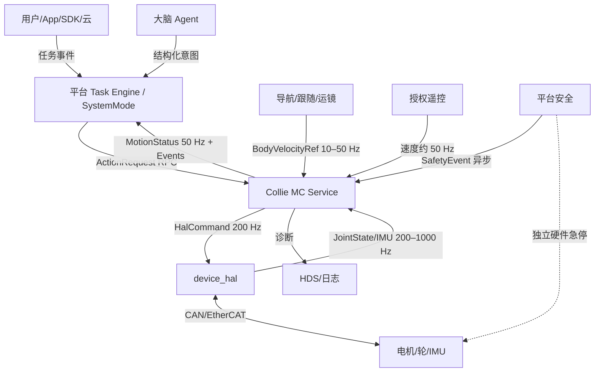
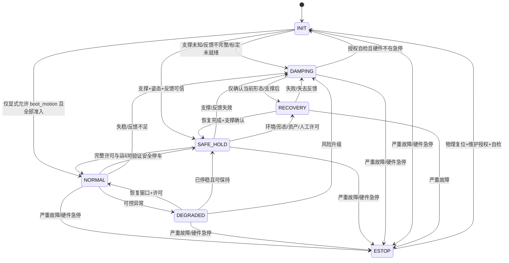

# Collie 运控服务软件架构 V1.1 — Part 1（D0–D2）

> **版本**：V1.1 合并阅读版　**日期**：2026-11-22　**状态**：软件设计基线（可编码），非实机安全批准
>
> **来源**：V1.0 六部分（`output/20261122_6parts/`）+ V1.1 定点修订（`PartA-E`、`HAL_CONTRACT.md`、`SCHEMA_CANON.md`、`proto/`、`schemas/`、`examples/`、`tests/`）。
>
> **读法**：本版把 V1.1 的 9 处修订合并进 V1.0 的章节结构；详细字段/合同以附录 A（HAL）、附录 B（Schema）为准。V1.0 原文保留，仅作历史对照。
>
> **已知残留**：`can_exit` 在 `step` 前发布 `READY` 的竞态尚未修（见 Part 2 的“审阅注记”与 `REVIEW_V1.1.md` §2.1）；本版如实保留，不假装已解决。

---

## 0. 一页结论

Collie 运控采用“**Behavior 对外、Action 配置化、ActionBundle 组合、Runner 执行、PolicyManager 编排、RT 唯一关节出口、SafetyKernel 独立许可**”的结构。

四个 MC 进程：

| 进程 | 职责 | 能否写 HAL |
|---|---|---|
| `mc_gateway` | RPC/权限/PolicyManager/Registry/ActionGraph/请求仲裁 | 否 |
| `mc_runner_worker` | ObsBuilder / Runner / Inference / Codec，按 100 Hz 计算候选 | 否 |
| `mc_rt` | 200 Hz 快照、速度仲裁、切换提交、JointMux、OutputGuard、唯一发布 | **唯一正常写入者** |
| `mc_safety` | SafetyKernel / Lease / Fault / 安全状态机 | 否（只收紧许可） |

外加 `device_hal`（设备合同、独立看门狗/保护）。硬件急停不经过软件。

**一句话原则**：一个关节出口、一套策略契约、一条可回放的每拍链路、一条不依赖推理的安全路径。

---

## D0. 执行摘要与 12 条关键决策

| ID | 决策 | 理由 | 替代方案 | 代价/状态 |
|---|---|---|---|---|
| ADR-01 | Behavior（产品能力）与 Runner（执行单元）分开 | 接口不受模型变更影响 | 仅 Runner 或仅 Behavior | 多一层映射；【建议】 |
| ADR-02 | ActionBundle = 单 Primary + 可选 Overlay slots | 五类行为共用组合机制 | 一 Action 一类一线程 | 组合校验成本；【建议】 |
| ADR-03 | Gateway / Worker / RT / Safety 混合多进程 | 推理挂死不阻塞发布 | 单进程多线程 | IPC/部署成本；【建议，待平台验证】 |
| ADR-04 | 只有 `mc_rt` 有正常 HAL 写权限 | 消除双写与不确定覆盖 | 每 Runner 写 HAL | 统一仲裁点；【建议】 |
| ADR-05 | 100 Hz 策略、200 Hz 关节发布 | 分离推理与发令实时性 | 同频执行 | 需 hold/整形验证；【假设+建议】 |
| ADR-06 | 双足先按动态平衡接口设计 | 不隐含机械静态锁止 | 全用姿态位控 | 需平衡资产；【待定】 |
| ADR-07 | Q2B/B2Q 使用独立 TransitionRunner | 形态过渡需相位、支撑与退路 | 位置线性插值 | 独立资产/验收；【建议】 |
| ADR-08 | bitmask 逐关节所有权，默认不做同关节混合 | 禁止叠加抢写 | Scope 粗分/最后写者赢 | 需训练协商；【建议】 |
| ADR-09 | 四个稳定 RPC + 两个流；内部保留三类领域输入 | 限制外部 ABI 变化 | 暴露每个 Runner API | Adapter 维护；【建议】 |
| ADR-10 | 本地 SafetyKernel + OutputGuard + HAL + 硬件链 | 不能依赖模型运行 | 单看门狗/单安全进程 | 状态/复位协议；【建议】 |
| ADR-11 | Manifest + 逐维 ObsSpec/ActionSpec + Golden | 检出训练/部署错位 | 仅 ONNX + 参数数量 | 算法交付增加；【建议】 |
| ADR-12 | 独立 MC 仓；从旧代码阶段迁移 | 可独立编译/回滚 | 旧节点里加 switch(model) | 建骨架成本；【建议】 |
| ADR-13 | 冷启动 `INIT` + `Form=UNKNOWN`，未知支撑不发保持 | 未知姿态下位置保持可能危险 | 直接 SAFE_HOLD | 启动变慢；【建议】 |
| ADR-14 | ControlLease 独立于 Session/SafetyLease | 运动资源需要独占所有权 | 只靠优先级 | 租约协议成本；【建议】 |

### 非软件背景决策者 5 分钟版

架构把“谁可以让机器人做什么”（平台任务）、“当前用哪个动作”（MC PolicyManager）、“动作怎么算”（Runner）、“什么命令真的能写电机”（OutputGuard/HAL）分开。新增动作主要是交付资产，不是改整机软件；同一套接口可回放、回滚、故障注入。最大风险是双足/变形失稳、模型与本体映射错、软件挂死后继续输出旧命令。必须拍板：关节拓扑、双足支撑形式、HAL/硬件急停能力、首发载荷/地形、实时计算平台。

---

## D1. 架构总览

### D1.1 上下文

### D1.2 进程与连接

| 连接 | 周期/预算 | 断链措施 |
|---|---|---|
| Gateway→RT 切换邮箱 | 事件，≤1 个 5 ms tick 可见 | 请求超时，活动 Epoch 不变 |
| Gateway→Worker 资源操作 | 准备期，不占 RT | 新 Action 不加载，旧动作不中断 |
| HAL→RT 反馈 SHM | 200–1000 Hz；读取 ≤0.2 ms | 无效数据触发 Guard |
| RT→Worker 快照 | 100 Hz，零分配读视图 | 过期快照不得推理 |
| Worker→RT 候选 | 100 Hz，截止 Worker tick+8 ms | 不积压，迟到拒绝 |
| Safety→RT Lease | 100 Hz + 异步严重故障 | 失租立即退出正常输出 |
| RT→HAL 命令 | 200 Hz，单写者 | HAL 15 ms 看门狗（待验证） |
| HAL→Safety 设备健康 | ≥100 Hz | 不续租 |

`mc_rt` 不执行模型加载、同步推理、ROS 回调、文件写入或等待锁。Worker 输出带 `(boot_id, action_epoch, tick_id, snapshot_seq, deadline_ns, manifest_hash)`；RT 只采用当前 Epoch、未过期、完整且有限的候选。

### D1.3 逻辑模块

`MotionApiAdapter → PolicyManager/Registry/Graph → SwitchCoordinator`；`HAL → Snapshot → ObservationBuilder → Runner/Inference → ActionCodec → JointMux → OutputGuard → HalCommand`；`SafetyKernel → OutputGuard`；`MotionStatusPublisher` 旁路。

**正常主链**：HAL → 快照 → 逐维观测 → Runner（需要时推理）→ 解码 → 所有权合成 → 安全限幅 → 唯一 HAL 命令。模型运行库失效也不能跳过后两级。

### D1.4 安全链

`Worker` 只产生候选；`mc_safety` 发短时 Lease；`OutputGuard` 每拍检查；`mc_rt` 唯一发令；HAL/驱动器/硬件急停逐级兜底。`SAFE_HOLD` 是“经过特定形态验证的受控保持”，不是任意姿态的默认输出。

---

## D2. 领域模型

### D2.1 五个限界上下文

| 上下文 | 聚合根/对象 | 唯一负责 | 不能做 |
|---|---|---|---|
| Motion API | `Session`, `ActionRequest` | 身份、权限、请求回执 | 改写当前关节 |
| Motion Orchestration | `ActionExecution`, `ActionGraph` | 路径、准备、切换阶段 | 绕过 RT 直接提交 |
| Runner Runtime | `RunnerInstance`, `RunnerManifest` | 生命周期、模型/轨迹、候选 | 自行订阅/发 HAL |
| Joint Control | `RobotStateSnapshot`, `Ownership`, `JointTargetArray` | 时间对齐、合成、Epoch、输出 | 业务仲裁 |
| Motion Safety | `SafetyState`, `SafetyLease`, `Fault` | 本地严重故障、降级/复位 | 擅自降低平台急停 |

**关键对象**：`Behavior` 对外能力；`Action` 配置化执行定义；`ActionBundle` 组合；`Runner` 内部执行单元；`RunnerManifest` 静态契约；`Session` 来源会话；`ControlLease` 运动资源独占权；`ActionEpoch` 接管代数；`Ownership` 关节位图；`StepInput` 每拍输入；`RunnerOutput` 候选输出。

### D2.2 Runner 生命周期

`Created → Loaded → Entered → Running → Exiting → Exited → Faulted`。

- `load` 非实时校验/预分配；
- `enter` 只准备，不提交 HAL/RT Epoch；
- `can_exit=READY` 只代表旧 Runner 可交出；
- `step` 在 Worker 预算内产候选，不保证被 RT 采用；
- `exit` 在 RT 撤销 Epoch 后执行；
- `Faulted` 不授权自恢复。

### D2.3 切换状态机

`REQUESTED → PREPARING → WAIT_EXIT → ENTERING → TRANSITIONING → STABILIZING → RUNNING`；失败 `FAULT/SAFE`。

- 提交前失败：旧 Runner 仍有效则保留旧 Action；
- 一旦提交新 Epoch：禁止未经验证直接回旧策略；
- `TRANSITIONING → STABILIZING` 必须由物理判据触发，不是计时器；
- `switch_ready` 仅在“稳定 + 无切换 + 安全允许 + 可退出”时为真。

### D2.4 安全状态机（V1.1 合并）

**未知形态（Form=UNKNOWN）禁止**：Q2B、B2Q、Balance、Recovery、全部 TransitionRunner、正常四轮移动/受力姿态/Overlay。不得用上一次请求推断 Form。

### D2.5 ControlLease（V1.1 合并）

`ControlLease` 是某个运动资源的独占控制权，独立于 `Session` 与 `SafetyLease`：

`IDLE → REQUESTED → GRANTED → RENEWING → REVOKING → REVOKED/EXPIRED`

- 正常运动同时要求：有效 Session + 有效 ControlLease + 有效 SafetyLease + HAL normal writer lease；
- 同一 scope 任一时刻最多一个 `GRANTED/RENEWING` owner；
- 抢占必须先撤旧租、停车/保护确认，再授予新 owner；
- 失租时按 Action 类型降级：四轮制动、Q2B/B2Q phase fallback、Balance 走已验证安全平衡/降能、无资产则 HAL 保护。

### D2.6 Q1–Q3 裁决

| 问题 | 决策 | 替代方案 | 切换条件 |
|---|---|---|---|
| Q1 抽象 | Behavior→Action→Bundle→Runner | 仅 Behavior+Scope | 永远没有组合/过渡可裁剪 Bundle |
| Q2 进程 | Gateway+Worker+RT+Safety | 单进程多线程 | 实时 MCU + 完整故障证明可合并 Worker |
| Q3 双足 | 默认动态平衡接口，静态锁止可替换 | 全 ClassicalPose | 本体证实全工况静态锁止 |

---

**Part 1 完成度：100%（D0–D2 合并稿）；待补：Collie 拓扑、双足支撑、HAL/急停能力、平台 WCET。**
