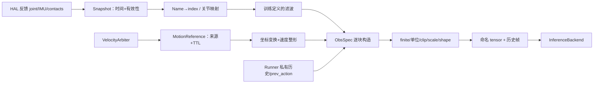

# Collie 运控服务软件架构 V1.1 — Part 3（D5–D6）

> 合并说明：本 Part 以 V1.1 的 `SCHEMA_CANON`、`proto`、`HAL_CONTRACT`、16 关节 Obs/Action 示例为准；V1.0 的逐拍链路与接口表保留。  
> 字段唯一权威：`proto/collie_mc_v11.proto`；配置唯一权威：`schemas/*.schema.json`；HAL 唯一权威：`HAL_CONTRACT.md`。

---

## D5. 每拍数据链路

### D5.1 时间、数据身份与单调性

系统同时记录三种时间：

- `sample_mono_ns`：采集设备本地单调时间，用于本机延迟/顺序；
- `robot_time_ns`：跨板同步映射后的统一时基，用于对齐；
- `wall_utc_ns`：只用于审计/显示，禁止用于控制过期判断。

跨板必须实测 PTP 或等效时钟映射的 offset/抖动/失锁；不能假设两台主机的 `CLOCK_MONOTONIC` 可直接相减。时间同步失效时，停止使用需要跨板精确对齐的动态参考；HAL/IMU 的本地安全监控仍须工作。所有关键参考/候选有独立 deadline，不能靠“新消息到达”延长旧数据生命期。

### D5.2 RobotStateSnapshot

Snapshot 是**同一控制拍的不可变输入**，由 RT 预分配双缓冲/序列锁生成；Worker 只读。每类传感器保留采样时刻、seq、年龄、有效位、时间同步质量；全零不等于 invalid。

```cpp
constexpr size_t MAX_JOINTS = 64;
struct JointSample {
  uint16_t joint_index;               // 校验 RobotDescription
  float q, dq, tau;                   // rad / rad/s / N*m（直线关节用 variant）
  float motor_temp_c, winding_temp_c, voltage_v, current_a;
  bool valid;
};
struct ImuSample {
  float quat_wxyz[4];                 // body->reference
  float omega_radps[3];               // body FLU
  float acc_mps2[3];                  // 明确是否含重力
  bool valid;
};
struct RobotStateSnapshot {
  uint64_t boot_id_hi, boot_id_lo, tick_id;
  uint64_t snapshot_seq;              // V1.1 新增；同一 boot 内 == tick_id
  uint64_t snapshot_robot_time_ns;
  uint32_t joint_count;
  JointSample joints[MAX_JOINTS];
  ImuSample imu;
  uint64_t joints_sample_ns, imu_sample_ns, contacts_sample_ns;
  uint64_t joints_age_ns, imu_age_ns, contacts_age_ns;
  uint64_t joint_valid_mask;
  uint32_t form, support_state, estimator_quality;
  float wheel_slip_ratio[4];
  uint32_t fault_bits;
};
```

| 输入 | 默认对齐 | 失效判据（初始建议） | 反应 |
|---|---|---|---|
| 关节 q/dq/tau | 按 joint_index 映射；相同 producer_seq 不重复用新帧 | age>15 ms、序号倒退、缺失承重关节、NaN/Inf | Snapshot invalid；Guard 禁正常输出 |
| IMU | 四元数归一化/范数检查；相邻有效才 slerp，否则最近有效+年龄 | age>15 ms、方向非法、不同步、NaN/Inf | Balance/过渡禁用；按形态保护 |
| 接触/支撑 | 明确估计器版本/置信度/延迟 | age>30 ms 或低可信 | 禁依赖支撑的新进入/转换 |
| 机身速度/里程计 | 估计器值+协方差/质量/stamp，不用期望速度代替 | 时基不可信/质量不达标 | 降级或拒绝该 Action |
| 温度/电压/电流 | 设备序号与健康；允许慢更新但不延缓严重故障 | HAL/本体标定；断流 invalid | Safety/HAL 降级、驱动保护 |
| 避障/净空许可 | source/场景/范围/issued/expiry/签名 | TTL 到期/形态不匹配 | 新过渡拒绝或撤销授权 |

对齐优先用 `snapshot_robot_time_ns` 前后包围样本显式插值；不得为掩盖断流任意外推。超过 `max_age` 拒绝关键观测；optional 维度也必须与训练一致的 `missing_policy`。Snapshot 建立后不再修改；双缓冲写方等待无读者或版本化环形块，不能覆盖 Worker 正在读的内存。

### D5.3 ObservationBuilder 与 ObsSpec



**ObsSpec 21 列**：

`tensor_name,index,block,element,source,source_field,joint_or_axis,unit,frame,transform,offset,scale,clip_min,clip_max,filter_id,history_lag,history_order,include_current,initial_fill,missing_policy_ref,dtype`

- `transform`：`IDENTITY / CENTER_SCALE_CLIP / SCALE_CLIP / ANGLE_WRAP_SCALE_CLIP / QUAT_TO_GRAVITY_SCALE_CLIP`；`CENTER_SCALE_CLIP` 为 `clamp((x-offset)*scale,min,max)`。
- `history_order`：`OLDEST_TO_NEWEST/NEWEST_TO_OLDEST`；`include_current` 严格 boolean；`history_lag=0` 表示当前 Worker tick；`initial_fill`：`REPEAT_FIRST/ZEROS/REFERENCE/ASSET`。
- `missing_policy_ref` 指向已批准策略（如 `STRICT_INVALID`），不得运行时填零；跨板不同步直接 INVALID。
- `(tensor_name,index)` 唯一且 0 连续；总数与 tensor IO 声明一致；同一 joint 明确 `source_field=q`，方向在 SensorAdapter 归一化。

### D5.4 InferenceBackend

启动检查：模型 SHA256/签名、backend ABI、provider/opset、tensor 逐名称/shape/dtype、量化参数、最大内存、输出有限性；预热至少 N=100 次（建议），记录 p50/p99/max；首版同模型会话串行推理。GPU/NPU 若有非确定性延迟、异步阻塞或设备 reset，不得直接进 RT；Worker 可崩溃隔离。超时调用不能保证中断 ONNX，依赖 RT 丢弃过期候选。运行时版本切换只在安全状态完成，回退到已签名上一完整 Release。

### D5.5 ActionCodec

```cpp
for (size_t i=0; i<spec.action_dims; ++i) {
  const auto& ch=spec.channels[i]; // joint/index/mode/sign/scale/default...
  float a0 = activate(raw[i], ch.activation);
  float a1 = clamp(a0, ch.raw_clip_min, ch.raw_clip_max);
  float a2 = float(ch.sign) * a1;             // 仅一次：模型输出→规范关节方向
  float value = ch.default_value + ch.scale * a2;
  switch(ch.mode) {
    case POSITION: out[ch.index].q_rad = value; break;
    case VELOCITY: out[ch.index].dq_radps = value; break;
    case TORQUE:   out[ch.index].tau_nm = value + ch.tau_ff; break;
    default: return error(UNSUPPORTED_MODE);
  }
  out[ch.index].mode = ch.mode;
  out[ch.index].kp = ch.kp; out[ch.index].kd = ch.kd;
  out[ch.index].enabled = ch.owns;
}
// RobotDescription.direction 仅在 HAL 适配电机命令/反馈边界执行一次。
```

`ActionSpec` 16 列：`tensor_name,tensor_index,joint_name,mode,unit,scale,default,raw_clip_min,raw_clip_max,activation,kp,kd,tau_ff,limit_profile,owns,sign`。

- `sign ∈ {-1,+1}`、`scale>=0`、`activation=IDENTITY/TANH`；`default` 在机器人规范关节坐标系；
- 唯一公式：`activation → raw_clip → sign → default+scale*value`；TORQUE 再加 `tau_ff`；
- `sign` 是“训练输出→规范关节正方向”，Codec 执行一次；`RobotDescription.direction` 是“规范关节→电机坐标”，HAL 执行一次；反馈反向变换也在 HAL 一次；
- `raw_clip` 是模型域处理，不是安全限位；Guard/HAL 另查 q/dq/tau/kp/kd、估计扭矩、变化率、模式。

### D5.6 JointMux、OutputGuard 与 ModeTransition

合成规则：只接受当前 Epoch 的 Primary；Overlay 必须在允许 slot 且 mask 互不重叠；未覆盖关节只能由 Bundle 显式 neutral/fallback owner 提供，不能沿用旧命令；同一关节不能同时 POSITION/TORQUE；平衡需头/臂反作用力时，走 Balance 参考输入，不让 Overlay 覆盖。

Guard 检查：安全授权/ESTOP、反馈新鲜度、输出身份/时效、数值有限性、位置/速度、加速度/jerk/步进、力矩/电流/温度、控制模式/增益、支撑/形态/切换、HAL 写权限/确认。失败按 `form × support × fault` 查验收表；无有效替代则 HAL/硬件保护；软件不能用“循环保持旧目标”实现无限期安全保持。

**ModeTransition（V1.1）**：在 JointMux 与 OutputGuard 之间增加 `ModeTransitionEngine`，仍属 `mc_rt`，不增加进程：

```cpp
struct ModeTransitionPlan {
  uint64_t mode_plan_id;
  JointMask joint_mask;
  ControlMode from_mode, to_mode;
  uint64_t window_ns;
  float max_command_q_rate_radps;
  float max_command_dq_rate_radps2;
  float max_tau_rate_nmps;
  float max_kp_rate_per_s, max_kd_rate_per_s;
  uint32_t stable_window_ms;
  ControlMode approved_rollback_mode;
  uint32_t phase_id;
};
```

状态：`HOLD_OLD → RAMP_DOWN → NEUTRAL_TRANSFER → RAMP_UP → VERIFY → ACTIVE_NEW`，失败 `ROLLBACK/FAULT`。`u=clamp((t-t0)/window,0,1)`，`r(u)=3u²−2u³`；逐 5 ms 再强制 q/dq/tau/kp/kd 变化包络。模式位只在 `NEUTRAL_TRANSFER` 切换；HAL 必须异步 `PREPARE_MODE` 并以同一 `mode_plan_id` 原子接受首帧。没有 plan 的 mode 对直接 `MODE_TRANSITION_NOT_APPROVED`；Q2B/B2Q 每个 phase 必须声明 `mode_before/mode_after/plan_ref`，未批准不运行。

### D5.7 10 ms/200 Hz 预算

| 阶段 | 预算 | 超期 |
|---|---:|---|
| 快照接收/格式检查 | 0.2 ms | 当前 tick 无效 |
| 观测+历史+滤波 | 0.8 ms | 推理无效 |
| 模型计算/同步 | 5.0 ms | 丢弃过期输出 |
| ActionCodec | 0.5 ms | 候选无效 |
| Overlay 计算 | 0.6 ms | 取消 Overlay；primary 依赖则整包失败 |
| 有限性/守卫/发送 | 0.5 ms | 不发布候选 |
| **合计** | **7.6/10 ms** | 2.4 ms 裕量 |

RT 5 ms 预算：Snapshot 0.2、校验 0.2、仲裁/整形 0.15、候选/epoch 0.2、Mux 0.25、整形/增益 0.35、Guard 0.30、HAL 发布 0.25、统计 0.20 = **2.10/5 ms**，保留 2.9 ms。Worker 截止与 RT 周期不完全对齐；端到端最大时延必须由 timestamp 回放/示波器测量。两次发布之间只允许在 manifest `max_hold_ns` 内使用上一个有效候选并整形；超出年龄/Epoch/反馈无效立即失效。

### D5.8 内存与零拷贝

HAL 反馈 rings、Snapshot rings、Tensor I/O、Runner history/filter、Candidate buffers、Guard/Joint command、黑匣子 rings 全部启动/加载时预分配。RT→HAL 专用 SHM 固定槽位+序号+CRC/length；RT 不动态分配/不加锁/不写盘；黑匣子满时丢旧非关键记录并计数，不阻塞 RT。

---

## D6. 上下游字段级接口

### D6.1 对外收敛

**四个稳定 RPC**：`SetBehavior`（primary + overlay）、`SetVelocity`（低频/SDK 配置入口；高频速度仍走 Topic）、`GetState`、`SetSafety`（只有可信本地 Safety/Admin 可设更严格限制；普通用户只能 TriggerStop，不能解 ESTOP）。**两个流**：`MotionStatus` 50 Hz、`MotionEvent` 事件。内部仍保留 `ActionRequest/BodyVelocityRef/OverlayRequest` + 独立 `SafetyEvent`。

| 方向 | 接口 | 传输/频率 | 关键字段 | 失败 |
|---|---|---|---|---|
| 任务→MC | `SetBehavior → ActionRequest` | RPC，事件，受理≤20 ms | `request_id,session_id,source_id,action_id,params,timeout_ms,preempt_mode,idempotency_hash,control_lease_id` | REJECTED/QUEUED/ACCEPTED；完成看 Event/State |
| 任务→MC | `OverlayRequest` | RPC，事件 | `motion_id,slot,owns_mask,interrupt,timeout_ms` | 无主动作稳定/冲突→REJECTED |
| 导航/遥控→MC | `BodyVelocityRef` | DDS Topic（可经 SetVelocity） | `source_id,session_id,control_lease_id,seq,stamp_robot_ns,ttl_ms,frame_id,vx,vy,wz` | seq/权限/TTL 错拒收；过期制动归零 |
| 平台安全→MC | `SafetyEvent/SetSafety` | 可信 IPC/RPC/事件 | `kind,severity,latched,source,stamp,reason,nonce` | 立即撤销许可/升级；复位单独流程 |
| MC→HAL | `HalCommand` | 单写者 SHM，200 Hz | `boot_id,writer_id,seq,action_epoch,deadline_ns,payload_crc,joint_count,joints,mode_plan_id` | 过期/非法拒收；HAL watchdog |
| HAL→MC | `JointStateArray/IMU` + `HalStatus` | SHM，200–1000 Hz | 关节/IMU + ack/seq/epoch/watchdog/fault | 缺失/过期/倒退→Snapshot invalid |
| MC→Task/HMI | `MotionStatus` | DDS，50 Hz | 见 D4.6 | 上游 TTL 后标 UNKNOWN |
| MC→Task/HDS | `MotionEvent` | DDS+审计 | `execution_id,from_phase,to_phase,reason,trace_id` | 丢消息可用 GetState 重建 |

`RequestHeader.timeout_ms` 是外部相对时间；Gateway 接收时换算 `ScheduledAction.deadline_ns`；重试不延长 deadline；跨未同步计算单元不比较 monotonic。

### D6.2 领域 IDL 与 ROS 映射

`proto/collie_mc_v11.proto` 是消息字段唯一源；C++ 代码由 proto 生成，文档不再手写第二版结构。ROS2 侧建议包 `collie_mc_interfaces`：`SetBehavior.srv`、`BodyVelocityRef.msg`、`SafetyEvent.msg`、`MotionStatus.msg`、`MotionEvent.msg`；T1 `SetMcAction/McLocomotionVelocity` 只在兼容 Adapter 中映射。

明确边界：ROS2/DDS executor 只在 Gateway/桥接进程处理回调；不得直接触发 RT 模型计算或写 HAL；跨 RT 结构用 schema 生成固定布局或校验过的 IPC，禁止把 ROS msg 裸指针塞进 Runner。

### D6.3 错误码

`uint32` 分段：

| 段 | 范围 | 例子 | 客户端动作 |
|---|---|---|---|
| 参数/协议 | 1000–1999 | INVALID_ARGUMENT/SCHEMA_MISMATCH/IDEMPOTENCY_CONFLICT | 修参数/升级接口 |
| 运行状态 | 2000–2999 | INVALID_ACTION_STATE/EDGE_NOT_ALLOWED/GUARD_WAIT | 订阅阶段/选合法动作 |
| 安全/权限 | 3000–3999 | SAFETY_DENIED/E_STOP_LATCHED/SOURCE_UNAUTHORIZED/STALE_FEEDBACK | 不自动重试运动 |
| 资源/时效 | 4000–4999 | RESOURCE_BUSY/DEADLINE_EXCEEDED/ASSET_NOT_RELEASED/OUTPUT_STALE | 按 retry_after；危险动作不自动重试 |
| 内部/设备 | 5000–5999 | INFERENCE_FAILED/HAL_REJECTED/INTERNAL_ERROR | 记录 trace，转安全/维护 |

`ACCEPTED` 只表示受理，不代表站稳；`QUEUED` 未执行；`REJECTED` 没有活跃动作。

### D6.4 幂等、背压、断流

- 幂等键 `(source,session,request_id)`；同 payload 返回原 execution_id；不同 payload → `IDEMPOTENCY_CONFLICT`；
- source seq 严格递增，重启需新 session/boot；旧包不能覆盖新包；
- Action 每 source 最多 8，总 32；超限拒绝；速度只保留每 source 最新 seq；
- 导航/遥控 TTL：50 Hz 遥控 100 ms、10 Hz 导航 250 ms（初始建议）；过期按制动包络归零；
- 安全事件升级可重复、原因锁存；复位单独鉴权；HAL 断流由独立 watchdog 拒收旧命令。

### D6.5 来源权限

| 角色 | SetBehavior | Overlay | Velocity | SetSafety | Reset ESTOP |
|---|---|---|---|---|---|
| Task Engine | 是，受允许集 | 是，受组合矩阵 | 资源会话内 | 仅请求升级 | 否 |
| 物理遥控 | 停止/授权模式 | 白名单 | 是，独立 ControlLease | 仅请求保护 | 否 |
| 导航/跟随 | 否 | 否 | 是，任务资源租约 | 请求停止 | 否 |
| App/SDK | 经 Task | 经 Task | 经授权桥接 | 仅安全升级 | 否 |
| PlatformSafety | 保护性取消 | 撤销 | 限制/禁止 | 是，升级/限制 | 按系统流程，不能单方清硬件锁存 |
| 维护/调试 | 离线/举升授权 | 受限 | 受限 | 独立硬件确认 | 双因素/物理确认，仍需硬件复位 |

### D6.6 坐标系、单位、模式

`base_link` FLU：X 前、Y 左、Z 上；`vx/vy` m/s、`wz` rad/s 右手；非 base_link 速度必须经时间戳 TF，无可靠变换直接拒绝。IMU 四元数固定 `wxyz` 与变换方向；关节角按 RobotDescription 正方向。温度 ℃、电流 A、电压 V；轮速 rad/s。`kp` 转动关节 N·m/rad，`kd` N·m·s/rad。每个动作输出明确 `POSITION/VELOCITY/TORQUE/DAMPING/PASSIVE`；轮式连续关节不能假装有普通角度软限位；`enabled=false` 不等于已验证安全卸力。

### D6.7 Q6/Q8/Q10 裁决

| 问题 | 决策 | 替代 | 切换条件 |
|---|---|---|---|
| Q6 接口 | 4 RPC + 2 stream；内部三类领域输入 + SafetyEvent | 全 Topic/每 Runner RPC | 非 ROS 客户端占主导时加 gRPC gateway，内部不变 |
| Q8 推理 | CPU ONNX Runtime 首版；命名多输入/多输出；Worker 隔离、预热、SHA、限时 | GPU/NPU/进程内同步 | CPU WCET 不达标且加速后端确定性通过 |
| Q10 规格 | 逐维 ObsSpec/ActionSpec + Golden；历史实例私有 | 只约定 N 维/ONNX | 自描述模型元数据仍需生成同等逐维合同 |

---

**Part 3 完成度：100%（D5–D6 合并稿）；待补：真实模型逐维规格、硬件时统、HAL 最终 schema、模式切换物理包络。**
