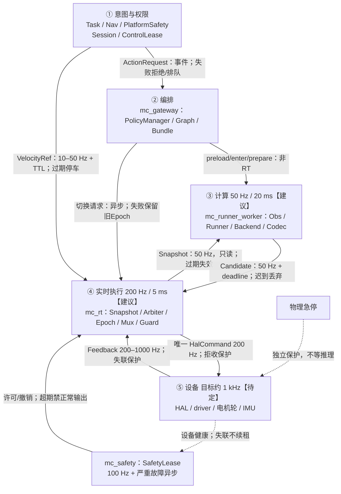
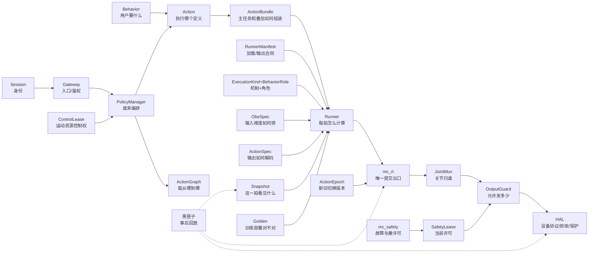

# Collie 运控服务软件架构 V1.3 50 Hz 频率修订版（D0–D16）

> **版本**：V1.3 50 Hz 频率修订版　**日期**：2026-11-23　**状态**：V1.1 架构 + V1.2 讲解 + 50 Hz 频率决策；非实机安全批准。

> **频率基线**：训练侧 `dt=0.02`（50 Hz）。Collie 首版：**50 Hz 策略 / 50 Hz Worker / 200 Hz RT / ZOH 发布 / 15/20 ms 预算 / 25 ms TTL**。完整决策见 [ADR-25](../ADR-25_策略频率50Hz.md)。
>
> **T1 对照**：T1 部署默认 100 Hz，`BIPED_NPZ_MIMIC` 例外 50 Hz；T1 的 100 Hz 证据保留，不改写为 Collie 事实。

> **来源**：V1.0 六部分（`../../20261122_6parts/`）+ V1.1 定点修订（`../../20261122_v1.1/Collie_MC_V1.1_20261122/`）+ V1.2 讲解包。
> **性质**：V1.1 架构 + V1.2 导读/概念解释/36 个 Part 补丁 + V1.3 频率修订；HAL/SCHEMA 为附录 A/B，协议索引为 C，概念解释为 D，自检为 E。
> **保留**：V1.0/V1.1/V1.2 原稿均未改动；V1.2 原稿未上传；本地保留在 `20261123_v1.2/merged/`。

> **已知残留（必读）**：`can_exit` 在 `step` 前发布 `READY` 的竞态尚未修；50 Hz 把窗口从 10 ms 放大到 20 ms，必须先修再开放切换（见 Part 2 §D3.5 与 [V1.1 评审 §2.1](../../v1.1/REVIEW_V1.1.md)）。

## 全文目录

| Part | 内容 | 文件 |
|---|---|---|
| Part 1 | D0–D2 执行摘要、架构总览、领域模型 | [`Part1_D0-D2.md`](Part1_D0-D2.md) |
| Part 2 | D3–D4 Runner 框架、PolicyManager | [`Part2_D3-D4.md`](Part2_D3-D4.md) |
| Part 3 | D5–D6 每拍链路、上下游接口 | [`Part3_D5-D6.md`](Part3_D5-D6.md) |
| Part 4 | D7–D8 安全、并发实时 | [`Part4_D7-D8.md`](Part4_D7-D8.md) |
| Part 5 | D9–D12 配置资产、观测回放、测试、网络安全 | [`Part5_D9-D12.md`](Part5_D9-D12.md) |
| Part 6 | D13–D16 ADR、风险、路线图、评审清单 | [`Part6_D13-D16.md`](Part6_D13-D16.md) |

**附录**：[A. HAL 合同](Appendix_A_HAL_Contract.md)｜[B. Schema Canon](Appendix_B_Schema_Canon.md)｜[C. 协议/示例/测试索引](Appendix_C_Protocol_Examples_Tests.md)｜[D. 概念解释](Appendix_D_Concept_Deep_Dive.md)｜[E. 自检](Appendix_E_Self_Check.md)

## 与 V1.0 / V1.1 的关系

- **V1.0**：完整底稿，保留作历史对照；其中 9 处已被 V1.1 替换。
- **V1.1 变更单**：`PartA-E` + `HAL_CONTRACT` + `SCHEMA_CANON` + `proto/schemas/examples/tests`；是字段/合同的权威源。
- **本合并版**：V1.1 架构 + V1.2 讲解补丁；字段/合同冲突时，仍以 `proto/schemas/HAL_CONTRACT` 为准。

## 阅读建议

1. 先读 Part 1（一页结论 + 12 决策）和 Part 2（Runner 框架）。
2. 再读 Part 3（每拍链路/接口）和 Part 4（安全/实时）。
3. 最后读 Part 5（配置/测试/网安）和 Part 6（ADR/风险/checklist）。
4. 需要字段细节时查附录 B；需要 HAL 行为时查附录 A；需要 proto/示例/测试时查附录 C。

---


<!-- BEGIN_V12: FRONT-BIG-PICTURE -->
# 导读：从一句“站起来”到一条安全关节命令

> `[V1.2-解释]` 此文用于建立理解，不改 V1.1 的进程、安全或接口决策。故事中的动作均为讲解样例；未签发的 Q2B/B2Q、双足平衡、恢复动作维持 `DISABLED`。

## 1. 五幕故事：同一台机器人、同一条链

**第一幕：上电，先不动。** HAL 从设备读关节、IMU、总线健康，MC 的安全状态从 `INIT` 开始，形态 `Form=UNKNOWN`。平台没有确认支撑/姿态时，RT **不**发“保持刚才的位置”，HAL 使用已定义的低能量安全输出（具体能力【待定】）。安全自检通过后，平台才可能签发许可。**谁→谁**：HAL 反馈 → RT Snapshot → Safety 判定 → Gateway 更新可执行范围。

**第二幕：“站起来”。** Task Engine 发 `SetBehavior(quad_stand)`，Gateway 验 Session 和 ControlLease，再按 ActionGraph 找合法 Action，加载并准备 `ActionBundle/RunnerManifest`。Worker 生成候选，RT 检查 Epoch、反馈、SafetyLease、Guard，HAL 验唯一写权限才接受新关节目标。真正“站稳”要等支撑与稳定窗口满足才报 `RUNNING/stable`，不是 RPC `ACCEPTED` 就算。**谁→谁**：Task → Gateway → Worker → RT → HAL → 电机；反馈反向回来。

**第三幕：“跟我走”。** Task 允许 `quad_drive`，导航按 10–50 Hz 给 `BodyVelocityRef`，每条速度带来源、seq、TTL 和 ControlLease。Gateway 验资源权限，RT VelocityArbiter 选择当前有效来源，Worker 50 Hz 使用速度参考算腿/轮候选，RT 200 Hz 在有效窗内整形后发布。导航断流时不是重复上一条“前进”，而是 TTL 到期后按获批制动路径停止。**谁→谁**：Nav → Gateway/RT 参考 → Worker 计算 → RT 发令 → HAL。

**第四幕：“转成双足讲解”。** PolicyManager 按图准备 `quad_drive→quad_stop→q2b→biped_balance`。旧 Runner 的退出判据必须新鲜，目标资源/首拍、安全许可、HAL `pending_epoch` 必须齐全，RT 才允许切换；Q2B 的 phase 要看实际支撑、姿态、净空，不是计时到就成功。双足稳定后，若手势关节与平衡关节的 mask 冲突，不能让 Overlay 抢写，而要由平衡 Runner 消费手势参考。随后 `b2q` 回四足。**谁→谁**：Task → PolicyManager 规划 → Worker 预备 → RT 原子提交 → HAL 确认；本段动作目前【待定/禁用】。

**第五幕：途中急停、复位。** 硬件急停直接走设备链；SafetyKernel 锁存故障、撤销 SafetyLease，RT 不再采纳普通候选，HAL/驱动器独立保护。复位是“回到 `INIT/UNKNOWN`、重新自检和授权”，不是重放急停前的 `B2Q` 或旧速度。**谁→谁**：急停硬件 → 驱动/HAL；同时 Safety → RT；人工复位 → INIT → 检测 → 重新准入。

## 2. 五层主图：四流、三时钟、一条铁律



**四流不是四个进程**：① Action 流决定“做哪个动作”；② Velocity 流持续改变“走多快”；③ Feedback 流把设备真实状态送回来；④ Safety 流使其他三流受到约束，严重时直接禁止输出。四流交汇在 RT，但 RT 不负责产品意图决策。

**三个时钟**：Worker 20 ms 产生一次候选，RT 每 5 ms 可能使用最近未过期候选，设备层目标循环约 1 ms。它们**不是同一个同步函数**；RT 不等待 Worker 的新结果。50/200 Hz 和 1 kHz 均是【设计建议/目标平台待证】。

**铁律**：**只有 `mc_rt` 可写正常 HAL 关节命令**。Gateway 管准入；Worker 只提候选；Safety 只收紧/撤销运动许可；HAL 可独立拒收和保护，硬件急停独立。

## 3. 一张概念关系地图：每个词回答不同问题



**读图顺序**：先从 `Behavior` 沿主链读到 HAL；再看 Graph/Manifest/Spec 是怎样附在主链上的；最后看四个许可、Golden、黑匣子作为横向约束。`Runner` 不等于进程，`Manifest` 不等于模型文件，`Epoch` 不等于会话。

## 4. 责任矩阵：谁做、谁绝不能做、失败谁兜

| 主体 | 负责 | 不能做 | 它失败时谁兜底 |
|---|---|---|---|
| Task / Nav | 意图、规划速度、场景条件 | 不可发关节命令 | Gateway 鉴权/TTL；Safety/HAL |
| 平台 Safety | 系统模式、业务安全边界、急停流程 | 不能绕过 HAL/本地准入 | MC Safety + HAL/硬件链 |
| `mc_gateway` | RPC、Session/ControlLease、Graph、Registry、切换准备 | 不直接发候选电机目标、不占 RT | RT 继续合法旧 Epoch 或停止；TTL |
| `mc_runner_worker` | Obs、模型/经典策略、Codec、封存决策 | 不直接下发关节、不阻塞 RT | RT 截止/Guard；HAL 看门狗 |
| `mc_rt` | 5 ms Snapshot、速度仲裁、Epoch、Mux、Guard、唯一正常 writer | 不等模型/IPC、不做磁盘 I/O | HAL 设备 watchdog/硬件急停 |
| `mc_safety` | 故障锁存、SafetyLease、保护等级 | 不成为第二正常 writer、不替代硬件急停 | RT 失租保护；HAL/硬件 |
| HAL / 驱动 | 协议适配、权限、seq/deadline/CRC 校验、模式/限额/看门狗 | 不决定产品 Behavior，不推理 ONNX | 驱动硬件保护/物理急停【待验证】 |

## 5. 从“站起来”到电机的 13 步

| # | 谁 | 输入 → 输出 | 关键对象 | 失败/超时 |
|---:|---|---|---|---|
| 1 | Task → Gateway | `SetBehavior(quad_stand)` → 收到请求 | `ActionRequest.header` | 超时/重放拒绝 |
| 2 | Gateway | 身份与来源检查 | `Session` | 越权拒绝 |
| 3 | Gateway/PolicyManager | 申请运动资源 → 授予/等待 | `ControlLease` | 冲突/过期不入队 |
| 4 | PolicyManager | 检查当前 Action 到目标的合法路径 | `ActionGraph` | 无边/禁用返回 REJECTED |
| 5 | Registry | 解析 Bundle/Manifest 与发布状态 | `ActionBundle`, `RunnerManifest` | Asset BROKEN/未批准拒绝 |
| 6 | Worker loader | 规格/hash/拓扑/Golden/预热 | `ObsSpec`,`ActionSpec` | 不能加载不替代默认模型 |
| 7 | RT/Safety | 校验形态支撑和当前安全许可 | `Snapshot`,`SafetyLease` | UNKNOWN 不允许运动 |
| 8 | Worker | `enter` → 首候选准备 | `IRunner`,`RunnerOutput` | 准备失败旧 Epoch 不变 |
| 9 | Worker → RT | 封存退出决策并发布候选 | `SealedExitDecision`,`CandidateHeader` | 过期 WAIT；**已知 READY 竞态 P0** |
| 10 | RT ↔ HAL | 异步 `PREPARE_EPOCH` → 状态镜像 | `pending_epoch`,`switch_tx_id` | 未准备不提交；RT 等待=0 |
| 11 | RT | 同拍读 Exit/Guard/Lease、提交新 Epoch | `ActionEpoch`,`JointMux` | 条件不足维持合法旧动作/保护 |
| 12 | RT → HAL | 经 Guard 的 200 Hz 命令 | `HalCommand` | 拒收锁存；不重发旧 seq |
| 13 | HAL → 电机 → RT | 实际执行/ACK/反馈、稳定窗 | `HalStatus`,`RobotStateSnapshot` | 失 ACK/失反馈保护；稳定后才报告成功 |

上表是**跨多个 5 ms/20 ms 周期**的流程，不表示 13 步必须在同一控制拍完成。任何“合法路径”都不能代替真实物理支撑判断。

## 6. 四把钥匙：认人、占资源、允许运动、写设备

| 钥匙 | 类比 | 谁签发/检查 | 过期、撤销或失败 |
|---|---|---|---|
| `Session` | 门禁证：你是谁 | 可信平台/网关建立，Gateway 验身份；请求/源 seq 绑定 | 新请求/新速度拒绝，不能凭旧身份继续抢资源 |
| `ControlLease` | 方向盘钥匙：谁现在控制这个 scope | PolicyManager/资源仲裁签发，Gateway/RT 检查 source、lease ID、TTL | 拒新引用，当前动作按批准停车/过渡 fallback；**不是直接自由落体** |
| `SafetyLease` | 安全员盖章：此刻准许哪些控制模式 | `mc_safety` 10 ms 续发，RT 每 5 ms 检查 | 失租阻断正常输出；不依赖 ONNX |
| `HAL writer lease` | 车钥匙：谁能碰设备接口 | HAL 用 OS 权限+私有 token 授权，设备校验 | HAL 拒收、超时独立保护；不能仅靠填对 `writer_id` |

**为什么不能合并**：一名已登录用户也可能没拿到导航资源；拿到资源也可能已触发安全禁止；安全允许也不意味着任何进程都能直接写电机。四把钥匙分别防不同问题，发放者和时效都不同。

## 7. 5 个盒子：2 分钟复述卡

```text
任务/导航/安全 → Gateway 编排 → Worker 计算 → RT 唯一出口 → HAL 执行
你想做什么     谁有权、何时换     关节候选怎么算   每5ms能否发     电机能否接受
```

推荐复述：**“Task 发意图，Gateway 查身份和资源并选 Action；Worker 根据反馈和策略资产算候选；RT 是唯一能把候选变成关节指令的地方，它检查 Epoch、安全和限幅；HAL 再校验权限和设备合同，真正给驱动器。Safety 不等模型，硬件急停也不等软件。”**

## 8. 白话术语速查（固定五行）
### 01. `Behavior`
- **是什么**：面向产品的能力名。
- **为什么**：可稳定对外承诺，不暴露具体模型。
- **不是什么**：不是一个特定 ONNX。
- **例子**：“跟我走”映射到四轮行走。
- **位置**：D0/D2；Gateway。

### 02. `Action`
- **是什么**：一次被注册的可执行动作定义。
- **为什么**：决定动作范围、入口与合法切换。
- **不是什么**：不是一次执行实例。
- **例子**：quad_stop 是一个 Action，跑几次是不同 execution。
- **位置**：D2/D4；PolicyManager。

### 03. `ActionBundle`
- **是什么**：主 Runner 与可选 Overlay 的组合计划。
- **为什么**：声明谁负责哪些关节。
- **不是什么**：不是多份目标直接相加。
- **例子**：四足站立主 Runner 加头部点头 Overlay。
- **位置**：D4.3；Registry/RT。

### 04. `Runner`
- **是什么**：每拍计算候选关节目标的执行对象。
- **为什么**：用同一生命周期接纳不同算法。
- **不是什么**：不是电机驱动，也不是单独进程。
- **例子**：WheelDriveRunner 根据速度与反馈算轮腿指令。
- **位置**：D3；Worker。

### 05. `RunnerManifest`
- **是什么**：某个 Runner 的加载和执行合同。
- **为什么**：防模型、关节映射、时序不一致。
- **不是什么**：不是策略权重本身。
- **例子**：quad_stop 的 class、mask、后端、hash、退出守卫。
- **位置**：D9.3；Registry/Worker。

### 06. `ExecutionKind`
- **是什么**：Runner 采用的计算机制。
- **为什么**：决定加载 ONNX、经典算法或轨迹引擎。
- **不是什么**：不是产品动作类别。
- **例子**：四轮行走若用 ONNX，kind=ONNX。
- **位置**：D3.3；FactoryRegistry。

### 07. `BehaviorRole`
- **是什么**：Runner 在动作链的用途。
- **为什么**：决定输入参考/守卫/输出职责。
- **不是什么**：不是具体神经网络结构。
- **例子**：Q2B 的 role=TRANSITION。
- **位置**：D3.3；FactoryRegistry。

### 08. `ObsSpec`
- **是什么**：按维度定义模型输入的配方。
- **为什么**：让训练与部署读同一顺序/单位/历史。
- **不是什么**：不是只写一个观测总维数。
- **例子**：关节角第 5 维在 tensor index=4。
- **位置**：D5.3/附录 B；Worker。

### 09. `ActionSpec`
- **是什么**：按维度定义模型输出如何解码。
- **为什么**：避免模型符号/增益/模式错配。
- **不是什么**：不是 HAL 的物理限幅。
- **例子**：模型输出 0.2 经 sign/scale/default 转 q。
- **位置**：D5.5/附录 B；Codec。

### 10. `PolicyManager`
- **是什么**：决定当前动作及如何切换的编排器。
- **为什么**：让切换有路径、准备和失败处理。
- **不是什么**：不在 RT 里跑推理。
- **例子**：跟随变双足需先 quad_stop 后 q2b。
- **位置**：D4；Gateway。

### 11. `ActionGraph`
- **是什么**：合法 Action 与切换边的注册图。
- **为什么**：禁止从任意动作直接跳任意动作。
- **不是什么**：不包含 ESTOP 等安全状态。
- **例子**：quad_drive→quad_stop→q2b。
- **位置**：D4.2；Gateway。

### 12. `Gateway`
- **是什么**：进入运控服务的可信入口进程。
- **为什么**：把上游调用变成受权的领域请求。
- **不是什么**：不产生关节目标。
- **例子**：收到站起来先验 Session/Lease。
- **位置**：D1/D6；mc_gateway。

### 13. `Worker`
- **是什么**：运算候选策略的非 RT 进程。
- **为什么**：让模型慢或挂死不拖住发布线程。
- **不是什么**：不拥有设备写权限。
- **例子**：每 20 ms 计算一次动作候选。
- **位置**：D1/D3/D5；mc_runner_worker。

### 14. `mc_rt`
- **是什么**：具有硬截止目标的关节发布进程。
- **为什么**：在固定拍检查并执行唯一提交。
- **不是什么**：不等待模型或 RPC。
- **例子**：5 ms 验 Epoch/Guard 后发 HalCommand。
- **位置**：D1/D8；mc_rt。

### 15. `mc_safety`
- **是什么**：本机独立运动安全核进程。
- **为什么**：不依赖推理撤销许可并锁存故障。
- **不是什么**：不是第二个普通关节 writer。
- **例子**：发现 IMU 失效时不续 SafetyLease。
- **位置**：D2.4/D7；mc_safety。

### 16. `HAL`
- **是什么**：硬件抽象层：设备协议、权限、看门狗与反馈边界。
- **为什么**：阻止无效或无人授权的命令进入设备。
- **不是什么**：不是策略算法，也不等于纯驱动。
- **例子**：拒绝旧 epoch 或旧 seq 的 HalCommand。
- **位置**：D6.8/附录 A；device_hal。

### 17. `Session`
- **是什么**：已认证的调用者会话。
- **为什么**：防冒名与跨会话重放。
- **不是什么**：不是运动资源独占权。
- **例子**：导航带 session_id 发速度。
- **位置**：D2/D6；Gateway。

### 18. `ControlLease`
- **是什么**：某运动资源在一段时间内的独占控制权。
- **为什么**：防多个授权来源同时控制方向盘。
- **不是什么**：不是 SafetyLease。
- **例子**：遥控抢占导航需先撤旧租并确认停车。
- **位置**：D2.5/D4.4；Gateway/RT。

### 19. `SafetyLease`
- **是什么**：安全核定期签发的运动许可。
- **为什么**：保证安全核失活会使正常输出停止。
- **不是什么**：不是用户授权。
- **例子**：每 10 ms 刷新，30 ms 未续失效【建议】。
- **位置**：D7.4/D8；Safety→RT。

### 20. `HAL writer lease`
- **是什么**：HAL 验证的唯一正常设备写者能力。
- **为什么**：防双写、假冒 writer_id。
- **不是什么**：不是由 Gateway 发的 ControlLease。
- **例子**：只有 mc_rt 持有 OS 认可的写能力。
- **位置**：附录 A；HAL。

### 21. `ActionEpoch`
- **是什么**：RT 每次动作原子移交增加的版本号。
- **为什么**：防旧候选和旧 HAL 命令混进新动作。
- **不是什么**：不是模型推理拍号。
- **例子**：q2b 接管之后，旧 quad_stop epoch 被拒。
- **位置**：D4.5/附录 A；RT。

### 22. `Snapshot`
- **是什么**：RT 汇总同一拍有效反馈的不可变视图。
- **为什么**：防 Worker 同时读到新 IMU/旧关节值。
- **不是什么**：不是无时间信息的状态数组。
- **例子**：含 snapshot_seq/每源 age、valid。
- **位置**：D5.2；RT→Worker。

### 23. `JointMux`
- **是什么**：按 ownership 组合 Primary 与 Overlay。
- **为什么**：让每个关节只收到一个明确的控制来源。
- **不是什么**：不是随意加权求和。
- **例子**：Balance 承重关节不能被挥手覆盖。
- **位置**：D4.3/D5.6；RT。

### 24. `OutputGuard`
- **是什么**：发布前验证安全包络与时效。
- **为什么**：阻止 NaN、越界、过期候选发到 HAL。
- **不是什么**：不是能保证机器人不跌倒的万能算法。
- **例子**：候选中一个承重关节 NaN → 整包失败。
- **位置**：D5.6/D7；RT。

### 25. `Golden`
- **是什么**：固定输入与期望输出的签收向量。
- **为什么**：检测训练/部署维度或公式错位。
- **不是什么**：不是现场轨迹日志。
- **例子**：已知 obs 输入应得到指定 codec 输出。
- **位置**：D9/D10/D11；训练+软件。

### 26. `黑匣子`
- **是什么**：预分配的逐拍故障记录环。
- **为什么**：把现场故障变成可重放的数据。
- **不是什么**：不是同步写盘的日志线程。
- **例子**：保存故障前 30 s + 后 10 s【建议】。
- **位置**：D10；RT 环/日志异步。

### 27. `Form=UNKNOWN`
- **是什么**：上电后形态或支撑未可信确认。
- **为什么**：避免直接保持未知姿势。
- **不是什么**：不是一个可以执行的动作。
- **例子**：INIT 不能直接进入 Q2B/Balance/Recovery。
- **位置**：D2.4/D7.4；Safety。

### 28. `switch_ready`
- **是什么**：当前动作已稳定且满足可交接条件。
- **为什么**：防上游误判“已受理”为“已可切”。
- **不是什么**：不是 action_done。
- **例子**：双足摇摆虽 RUNNING 也可为 false。
- **位置**：D4.6；Status。

### 29. `SIL/HIL`
- **是什么**：软件模型测试/真实设备接口在环测试。
- **为什么**：区分合同测试与物理行为证据。
- **不是什么**：不是彼此可替代的验收。
- **例子**：FakeHal PASS 不证明真实 watchdog。
- **位置**：D11/附录 C；测试。

### 30. `ModeTransition`
- **是什么**：控制模式及增益的有界切换状态机。
- **为什么**：限制位置/力矩/增益突变。
- **不是什么**：不是切换一个 enum 值。
- **例子**：POSITION→TORQUE 需 PREPARE_MODE 与 ramp。
- **位置**：D5.6/附录 A；RT/HAL。

## 9. 三段阅读路径（最短）

| 想弄懂什么 | 先读 | 再读 |
|---|---|---|
| 谁决定动作、谁能发电机 | Part 1 D1.2–D2.1 | Part 3 D6.1–D6.2；附录 A §1–3 |
| 为什么可换 Runner 而不能随意换 | Part 2 D3.3–D3.7 | Part 5 D9.1–D9.6；附录 B §4–5 |
| 系统坏时会发生什么 | Part 1 D2.4–D2.5 | Part 4 D7.4–D8.5；附录 A §5–6 |

**最快的 3 节**：`D1.2 进程与连接` → `D3.7 三条时序` → `D9.1 四级配置`；看完能把“谁在哪、先后怎样、靠什么文件运行”串起来。

> `[V1.2-审阅注记]` `can_exit` 的 pre-step READY 竞态仍为 P0：本文只解释其风险，**没有替换实现**。详见 `REVIEW_V1.1.md` §2.1。

完成度：100%（五幕故事、五层/四流/三时钟、概念地图、责任、13 步、四钥匙、30 词速查）。未完成/假设：频率/时限是 V1.1 建议值；多形态仍禁用。
<!-- END_V12: FRONT-BIG-PICTURE -->
