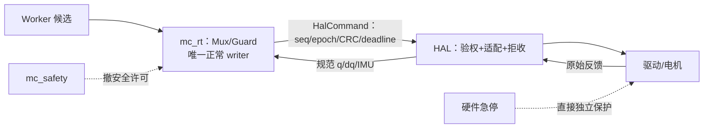
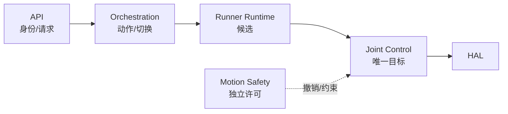
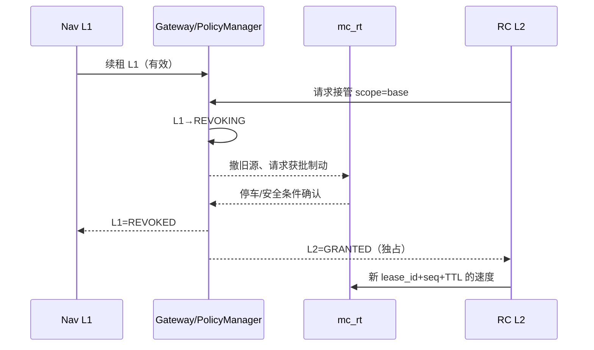
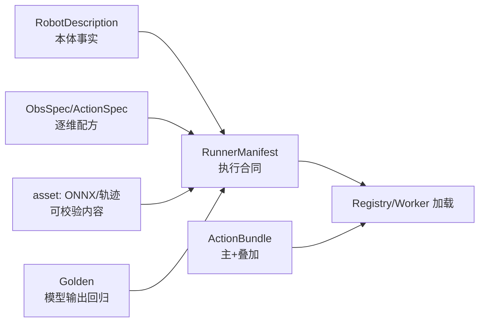
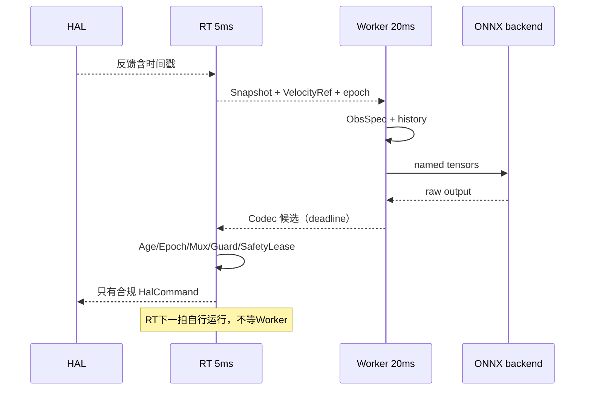
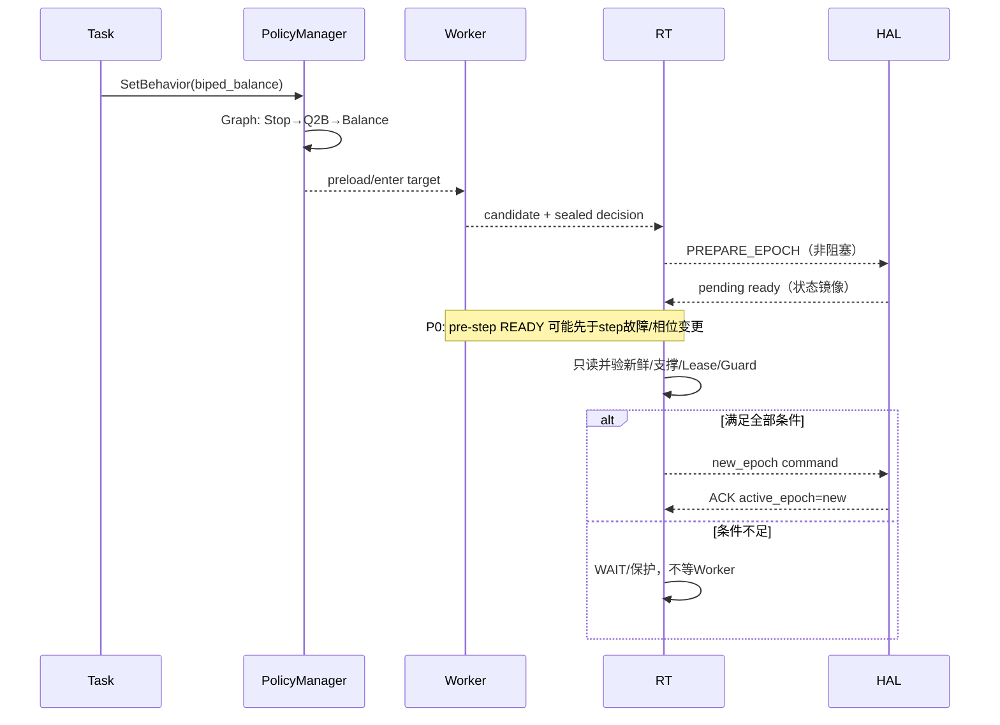
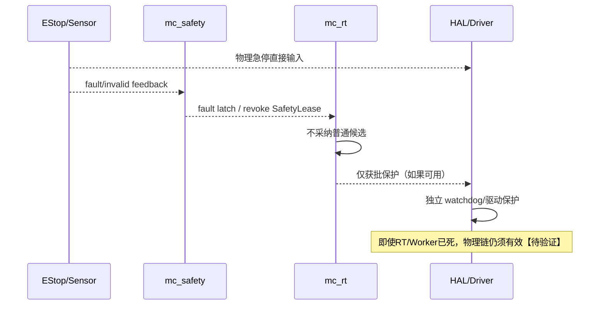
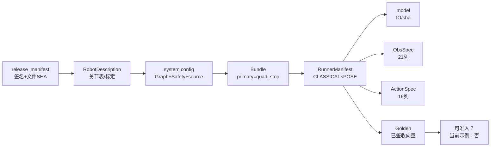

<!-- BEGIN_V12: APPENDIX-CONCEPT -->
# 附录 D：概念讲透（用同一个动作串起来）

> `[V1.2-解释]` 所有例子沿用“上电 UNKNOWN→四足站立→四轮跟随→Q2B→双足手势→B2Q→急停→复位”。示例时间仅使用 V1.1 的目标值；Q2B/B2Q/Balance/Recovery 的 Collie 资产及实机验证均【待定】，**不允许运动使能**。
>
> **每项统一读法**：①是什么、②为什么、③不是什么、④例子、⑤链路位置、⑥所有权边界、⑦失败兜底、⑧章节、⑨三道自测。

## 01. HAL：为什么它不是“直接把数字发到电机”

1. **是什么**：硬件抽象层（HAL）在规范关节命令和具体驱动协议之间提供转换、权限校验、设备模式约束、ACK 与独立保护合同。
2. **为什么**：RT 只理解 `q_rad/dq_radps/tau_nm/kp/kd`，不同电机的 ID、方向、传动、编码器单位都不同。若每个 Runner 自己适配设备，既会双写，也没有统一超时保护。
3. **不是什么**：HAL 不会推理 ONNX，不负责选 Action，也不等于电机固件；固件/驱动器还必须拥有更低层的物理保护能力。【待定】目标设备是否已满足完整合同。
4. **具体例子**：RT 在 5 ms 边界发 `{writer_id,seq=101,epoch=7,deadline_ns,crc,16 joints...}`。HAL 先验独占 writer/seq/Epoch/截止/CRC/模式与范围，再把规范正方向转换为电机正方向；`seq=100` 重放被 `STALE_SEQ` 拒收，不能替系统续看门狗。`15 ms` watchdog 是【建议】，真实响应必须有电气/设备证据。
5. **位置**：`OutputGuard → HalCommand → HAL/driver → motor`；反向 `driver/IMU → HAL 规范反馈 → RT Snapshot`。
6. **拥有/禁止**：仅 mc_rt 持正常 writer 权限；HAL 自行发设备保护/拒收；mc_safety 只能撤销许可，不作为第二个正常 writer。
7. **失败兜底**：杀 RT → HAL 独立超时保护；断 HAL→电机总线 → 驱动侧独立失联动作【待验证】；若设备会无限保持最后指令，则硬件门禁失败、不可上机。
8. **位置**：D1.2、D5.6、D6.1、D7.3、D8.5；附录 A §1–§6。
9. **自测 3 问**：HAL 可以被 Runner 直接调用吗？旧 Epoch 命令为什么不能续看门狗？HAL 拒收了命令后，哪一层还能独立停止电机？



**四个容易混淆的对象**：`mc_rt` 是决定这一拍发不发；HAL 是设备准不准收；设备驱动负责电流/总线/物理模式；电机是实际受控对象。HAL 的“唯一 writer”是设备侧权限合同，不是软件团队约定“大家别写”。

## 02. D1.3 逻辑模块 ≠ 进程/线程

1. **是什么**：模块是“某项职责的代码边界”；进程是 OS 隔离空间；线程是实际调度的执行流。一个进程可以放多个模块，一个模块可被几个线程以只读/写方式使用。
2. **为什么**：D1.3 画 13 个模块不意味着要部署 13 个服务，也不意味着每个模块跑 50 Hz。
3. **不是什么**：`ActionGraph` 是 Gateway 内的数据结构，不是一个独立实时节点；`ObservationBuilder` 是 Worker 里的函数/对象，而不是“观测进程”。
4. **例子**：`BodyVelocityRef` 被 Gateway 普通回调验来源并写固定邮箱，RT 在 5 ms 拍取最新速度，Worker 在 20 ms 拍构造观测；三个动作分别位于不同线程。
5. **位置**：用户请求→Gateway 的 Adapter/PolicyManager→Worker 的 Obs/Runner/Codec→RT 的 Mux/Guard→HAL。
6. **拥有/不能**：Gateway 只能提交切换请求；Worker 只能提候选；RT 只能读合规数据后发普通命令；HAL 管电机适配。
7. **失败**：Gateway 挂死使新任务受阻但不应拖住 RT；Worker 推理卡顿只会产生过期候选；RT 死亡交给 HAL watchdog。
8. **章节**：D1.2–D1.4、D5、D8.1–D8.2。
9. **自测**：一个模块必须独占一个线程吗？速度从 DDS 回调能直接写 HAL 吗？哪个模块在 RT 里处理 `ActionEpoch`？

| 逻辑模块 | 进程/线程 | 输入→输出 | 它不负责 |
|---|---|---|---|
| MotionApiAdapter | Gateway / rpc | RPC→已认证领域请求 | 关节输出 |
| PolicyManager / ActionGraph | Gateway / 控制调度 | 请求+图→合法路径+准备事务 | 直接提交 Epoch |
| Registry / ManifestValidator | Gateway + Worker loader | 配置/签名→可用 Runner 定义 | 每拍发令 |
| ObservationBuilder | Worker / step 50 Hz | Snapshot/Reference→tensor | 源权限仲裁 |
| InferenceBackend / Runner | Worker / step | tensor/反馈→raw output | HAL 写权限 |
| ActionCodec | Worker / step | raw→规范关节候选 | 物理安全限额的最终判定 |
| Snapshot / VelocityArbiter | RT / 5 ms | HAL 反馈+速度源→有效快照/参考 | 网络鉴权 |
| SwitchCoordinator | RT / 5 ms | 准备状态+Decision+HAL pending→Epoch | 同步等待 Worker |
| JointMux / ModeTransition / Guard | RT / 5 ms | 候选+mask+安全→合法设备目标 | 任意神经网络调用 |
| MotionStatusPublisher | Gateway / 20 ms | RT 状态镜像→50 Hz 状态 | 改 RT 控制 |
| MotionSafetyKernel | Safety / 10 ms | 设备/姿态健康→SafetyLease | 普通 writer |
| HAL validator + driver adapter | device_hal / 设备线程 | HalCommand→驱动协议+ACK | ActionGraph |

**单次调用链**：`SetBehavior(quad_stand)` → Adapter → PolicyManager → Registry → Worker.enter/step → RT.SwitchCoordinator → JointMux → OutputGuard → HAL；反馈由 HAL 经 Snapshot 回 Worker，形成下一次计算。不要把这条链理解成一个函数同步调用到底。

## 03. 五个限界上下文：五个责任区，而不是五个进程

1. **是什么**：限界上下文是五块各自定义并负责核心概念的业务/软件责任区，类似五个有明确交接单的部门。
2. **为什么**：没有边界时，Task 直接改 Runner 状态、模型代码直接改 HAL、Safety 与业务抢“谁停机”，一个动作改动就影响所有模块。
3. **不是什么**：不是必须产生五个微服务；V1.1 实际是四个 MC 进程 + 设备 HAL，且一个上下文可跨进程。
4. **例子**：任务说“站立”首先进 Motion API 检 Session；Orchestration 找合法 Action；Runner Runtime 生成候选；Joint Control 把候选变唯一目标；Motion Safety 可以在任一点撤销正常运动许可。
5. **位置**：下表按职责流排列，跨区只传明确的请求/状态/候选/许可。
6. **拥有**：每区负责自己对象的真实性，不允许上一区直接改下一区内部状态。
7. **失败**：例如 API 失败只应阻止新请求，不该阻塞设备级保护；Safety 进程故障由 SafetyLease 超期触发 RT 保护。
8. **章节**：D2.1，交叉 D1、D3、D4、D7。
9. **自测**：为什么五个区不是五个线程？哪一区定义 ActionGraph？哪一区保证每关节只有一个目标？

| 责任区 | 它回答的问题 | 管什么／不管什么 | 交接凭据 |
|---|---|---|---|
| ① Motion API | 谁请求的？是否有权？ | Session、请求/响应；不改电机 | `ActionRequest` |
| ② Motion Orchestration | 何时换哪个动作？ | PolicyManager、ActionGraph、Bundle；不直接写 Epoch | `PreparedSwitch` |
| ③ Runner Runtime | 怎样算候选？ | Manifest、ObsSpec、Runner、Backend；不碰 HAL | `RunnerOutput` |
| ④ Joint Control | 本拍准许输出什么？ | Snapshot、Epoch、Mux、Guard；不处理产品业务 | `HalCommand` |
| ⑤ Motion Safety | 是否还允许正常运动？ | SafetyLease、Fault、状态；不做常规行为规划 | Lease/撤销事件 |



## 04. ControlLease：权限在链路的哪一站发挥作用

1. **是什么**：ControlLease 是“谁在一段 TTL 内独占某个运动 scope”的租约，其状态 `IDLE→REQUESTED→GRANTED→RENEWING→REVOKING→REVOKED/EXPIRED`。
2. **为什么**：即使 Task 与遥控都已登录，不能允许它们同时改四轮速度；普通“优先级高就覆盖”可能在一拍内交错发出非零命令。
3. **不是什么**：Session 不等于独占运动权；SafetyLease 不等于资源竞争裁决；HAL writer lease 不等于导航/遥控“谁能占方向盘”。
4. **例子**：导航 lease `L1` 在 500 ms TTL 内每≤150 ms 续租【建议】；遥控申请更高优先级时，PolicyManager 将 L1→REVOKING，RT 执行已批准停车/稳定验证，再授予 L2；不能让两个 lease 在同一个 scope 同时 GRANTED。
5. **位置**：Gateway 申请/仲裁，RT 验引用中的 lease_id/source/seq/到期，Safety 独立发 SafetyLease，HAL 独立认 writer。
6. **拥有/禁止**：PolicyManager 是控制资源租约签发者；导航只能使用被签发的 lease，不能自己创建、延长或继承旧 lease。
7. **失败**：失联后 TTL 不续 → 速度来源失效→制动/按相位 fallback；Balance 不能简单关电，要用已批准的安全动作，否则交给设备保护并记录跌倒风险。
8. **章节**：D2.5、D4.4、D6.5、D7.4、附录 A §1。
9. **自测**：控制者已登录但没 lease 会怎样？高优先级抢占是否可以跳过停车？SafetyLease 过期了，有 ControlLease 还能动吗？



**四钥匙同时成立**：身份 `Session` → 资源 `ControlLease` → 运动安全 `SafetyLease` → 设备 `HAL writer`。它们发放周期不同、失效场景不同，不能合成一个 boolean。

## 05. RunnerManifest：身份证 + 菜谱 + 守卫 + 验收单

1. **是什么**：RunnerManifest 是 Runner 的静态加载合同，说明“我是哪个 Action、用什么机制/后端、读什么输入、输出哪些关节、进入退出条件和失败去向”。
2. **为什么**：只给 ONNX，软件不知道训练输入第 34 维是轮速还是 IMU、输出哪个关节、哪个形态能进入、需要什么版本。
3. **不是什么**：不是 ActionGraph（图决定可达路径）；不是 Bundle（组合多个 Runner）；不是 RobotDescription（本体事实）；也不等于权重本身。
4. **例子**：`quad_stop` 的 Manifest 写 `execution_kind=CLASSICAL,behavior_role=POSE,class_id=ClassicalPoseRunner`，`owns` 是腿/轮关节、`asset.kind=BUILTIN`、ObsSpec/ActionSpec/Golden 有 SHA；`release.status=CANDIDATE` 因没有真实签发不能动。
5. **位置**：Gateway Registry 在计划动作时读取；Worker loader 校验后实例化；RT 只接受与该 Manifest 哈希一致的候选。
6. **拥有/不能**：配置由运控与软件共同签收；Runner 不可运行中改写 Manifest；安全限额与本体零点从其他唯一权威取。
7. **失败**：路径/hash/接口缺失→`runtime.asset_state=BROKEN`，不加载；发布状态未 APPROVED→不执行；Golden 错位→在发布前阻断。
8. **章节**：D3.1–D3.4、D4.1、D9.1–D9.6、附录 B §4–5。
9. **自测**：Manifest 和 Model 谁定义维度含义？`release.status=APPROVED` 就保证当前可运行吗？为什么 owns_mask 不应写成“自动抢全部关节”？

| 字段组 | 它像什么 | 示例说明 | 缺少/不一致 |
|---|---|---|---|
| `manifest_id/version/action_id/behavior_id` | 身份证 | 这是 `quad_stop` 哪个版本 | 重复/未知拒收 |
| `robot_compatibility` | 适用机器列表 | topology/calibration SHA | 型号不匹配拒收 |
| `runner.execution_kind/behavior_role/class_id/backend_id` | 执行菜谱 | CLASSICAL×POSE→ClassicalPoseRunner | 无唯一工厂拒收 |
| `runner.abi_version/period_ms/worker_budget_ms` | 运算约束 | 20 ms/≤15 ms【建议】 | 算不完候选作废 |
| `asset.kind/path/sha256`, `tensor_io` | 食材+输入输出接口 | `MODEL` 与模型张量 | 模型空端口/错哈希拒收 |
| `obs_spec`, `action_spec`, `owns` | 处理步骤+归属 | 16 维演示观测/16 关节输出 | 映射/方向错误拒收 |
| `entry/exit/completion`, `failure_target` | 安全守卫 | 支撑有效/可退出/超时保护 | 不可无条件过渡 |
| `golden`, `release.status` | 验收单 | 固定向量通过/审批状态 | 无签发不可运动 |



**注意**：V1.1 评审指出 ModeTransitionPlan/phase、Factory 矩阵、HAL 能力表尚未全部机器化；这些不是已完成的配置合同。建议在编码前新增对应 schema/validator，不能仅看上表就宣布可物理切换。

## 06. “八类 Runner”不是 24 个算法

1. **是什么**：`ExecutionKind` 表示计算机制（ONNX/CLASSICAL/PLAYBACK/COMPOSITE）；`BehaviorRole` 表示用途（LOCOMOTION/TRANSITION/BALANCE/POSE/RECOVERY/OVERLAY）；二者组成 RunnerFactoryRegistry 的精确键。
2. **为什么**：`WheelDriveRunner` 是轮式移动角色/经典路径的历史类名，`RlLocomotionRunner` 是 ONNX 移动机制名，不能凭名字猜同一个四轮动作该用哪个。
3. **不是什么**：4×6=24 个坐标格不是 24 个已实现 Runner。`—` 表示默认不支持；部分格子映射到**同一** `TransitionRunner` 类，通过不同 backend 实现。
4. **例子**：四轮 ONNX 移动 `(ONNX,LOCOMOTION)→RlLocomotionRunner`；经典轮速控制 `(CLASSICAL,LOCOMOTION)→WheelDriveRunner`，它们的 `Behavior` 都可以叫“跟随”。
5. **位置**：Manifest 指定两个维度，FactoryRegistry 唯一选 class 与 backend，Worker 实例化；Bundle 再决定是否和 Overlay 共存。
6. **拥有/禁止**：Registry 必须检查唯一映射；开发者不能因为某两个类“看起来都合理”就手工双注册。
7. **失败**：tuple 未注册/不匹配 backend 或 class→`MANIFEST_CLASS_MISMATCH`，禁止回退到另一种算法“凑合运行”。
8. **章节**：D3.3–D3.4、D4.1、附录 B §4。
9. **自测**：一个 ONNX 四轮 Action 为什么不是 WheelDriveRunner？一个格子里复用 TransitionRunner 会创建两个类吗？Overlay 为什么还必须检查 owns_mask？

| ExecutionKind \ BehaviorRole | LOCOMOTION | TRANSITION | BALANCE | POSE | RECOVERY | OVERLAY |
|---|---|---|---|---|---|---|
| ONNX | RlLocomotionRunner | TransitionRunner | BalanceRunner | — | RecoveryRunner | OverlayRunner |
| CLASSICAL | WheelDriveRunner | TransitionRunner | BalanceRunner | ClassicalPoseRunner | RecoveryRunner | OverlayRunner |
| PLAYBACK | — | TransitionRunner | — | PlaybackRunner | — | OverlayRunner |
| COMPOSITE | — | TransitionRunner | — | — | — | OverlayRunner |

| Running Example 场景 | 行为角色 | 执行机制 | 唯一 class | backend 举例 | 为什么 |
|---|---|---|---|---|---|
| 四轮经典速度行驶 | LOCOMOTION | CLASSICAL | WheelDriveRunner | classical_builtin | 速度到轮/腿经典控制 |
| 四轮 RL 跟随 | LOCOMOTION | ONNX | RlLocomotionRunner | onnxruntime_cpu | 由网络给候选 |
| Q2B/B2Q 变形 | TRANSITION | ONNX/CLASSICAL/PLAYBACK（资产选一种） | TransitionRunner | 对应确定 backend | 具有 phase 与支撑守卫 |
| 双足持续平衡 | BALANCE | ONNX | BalanceRunner | onnxruntime_cpu | 需连续响应姿态/接触 |
| 四足站姿/静态姿态 | POSE | CLASSICAL | ClassicalPoseRunner | classical_builtin | 已批准姿态保持/整形 |
| 倒地后的受限恢复 | RECOVERY | ONNX/CLASSICAL（待验证） | RecoveryRunner | 对应 backend | 安全授权/净空/次数限制 |
| 预录动作/轨迹片段 | POSE | PLAYBACK | PlaybackRunner | trajectory_engine | 需要带时标的参考轨迹 |
| 双足讲解手势 | OVERLAY | CLASSICAL/PLAYBACK | OverlayRunner | 对应 backend | 只拥有明确不冲突的上肢 mask |

**类名归类**：`RlLocomotionRunner` 含机制词 `Rl`；`WheelDriveRunner` 含具体行为词；`TransitionRunner/BalanceRunner/ClassicalPoseRunner/RecoveryRunner/PlaybackRunner/OverlayRunner` 混合了角色与机制描述。名字不作为工厂决策依据，**唯一事实源是两维 tuple + 注册矩阵**。表中八类是八个“已规划的类名”，不表示八类已发布、已训练或已真实部署。

## 07. D3.7 三条时序图：把一条箭头翻译成一句人话

1. **是什么**：时序图横向是参与者，纵向从上到下是时间，`→` 表示发请求/送数据，`-->>` 表示异步返回/状态镜像；中间没有箭头不意味着线程停着等。
2. **为什么**：如果不看时序，容易把 Worker 的 50 Hz、RT 的 200 Hz 和 HAL 的高频控制当作一次同步调用，以为每拍都必须等模型出答案。
3. **不是什么**：图是协议中的因果顺序，不是实测毫秒曲线；所有时限必须用 timestamp/ftrace/硬件示波器确认。
4. **例子**：一个 Worker 20 ms tick 在 t=0 得到 Snapshot，t≈15 ms 以内生成候选；RT 在 t=0、5、10、15、20 ms 各运行一次，不等 t=15 才执行；HAL 按合同接受有效新 seq。时间仅为预算示意。
5. **位置**：D3.7 三图贯穿 HAL、RT、Worker、Task、Safety。
6. **拥有/不能**：Worker 的候选没有授权直接成为设备目标；RT 的 `PREPARE_EPOCH` 不意味着 HAL 已接管；急停硬件不等待 Safety 响应。
7. **失败**：候选错过 `deadline` → RT 丢弃；旧 Decision 不可信 → WAIT；新 epoch HAL 拒收 → 保护；硬件急停直接停机链。
8. **章节**：D3.7、D3.5、D4.5、D5.7、附录 A §2/§5，评审 §2.1。
9. **自测**：三条图最重要的独立时钟是什么？`PREPARE_EPOCH` ACK 能代替 `READY` 吗？哪个箭头完全绕过 ONNX？

**六步读图法**：①先数参与者；②找第一个触发；③按时间从上向下读箭头；④每条箭头问“这是什么字段”；⑤在空白处标“谁仍在按自己的周期运行”；⑥补上失败分支和过期检查。

### 07-A. 正常四轮单拍：参与者与逐箭头读法

参与者：HAL（反馈/设备）、RT（5 ms 唯一出口）、Worker（20 ms 候选）、Inference（Worker 内后端）。

| 次序 | 图中的箭头 | 人话、数据与时间 | 失败分支 |
|---:|---|---|---|
| 1 | HAL → RT `joint/IMU` | 设备把带时间戳的真实反馈交给 RT | 老帧/NaN→Snapshot invalid |
| 2 | RT → RT `snapshot/ref/epoch/deadline` | 在自己 5 ms 拍冻结这一次输入 | Velocity TTL 过期→制动引用 |
| 3 | RT → Worker `snapshot+ref` | 把只读输入交非 RT 计算，最多最新有效槽 | Worker 慢不拖住 RT |
| 4 | Worker → Worker `Obs+history` | ObsSpec 决定维度顺序/历史 | 缺必要观测→候选无效 |
| 5 | Worker → Inference `named tensors` | ONNX 按名称/dtype/shape 运算 | Backend 超时/错 shape→无候选 |
| 6 | Inference → Worker `outputs` | 得到网络原始数值 | NaN/Inf→Fault |
| 7 | Worker → RT `candidate+decision` | ActionCodec 转规范关节目标，附 epoch/deadline/manifest | 迟到/旧 epoch/旧 Decision→拒绝/WAIT |
| 8 | RT → RT `Guard/Lease` | 再检查所有权、模式、限幅、安全许可 | 一项失败→不发正常命令 |
| 9 | RT → HAL `HalCommand 200Hz` | 经 HAL 检验后才可能到电机 | HAL 拒收→保护，不续设备狗 |



### 07-B. Q2B 切换：参与者与逐箭头读法

参与者：Task（想转双足）、PolicyManager（找路径/准备）、Worker（Runner 进入与候选）、RT（Epoch 单点提交）、HAL（Epoch 准备与硬件接受）。

| 次序 | 消息/阶段 | 为什么 | 失败分支 |
|---:|---|---|---|
| 1 | Task → Policy `SetBehavior(biped)` | 表达意图，不表示准许改变关节 | Session/Lease/Release 不合格→REJECTED |
| 2 | Policy → Graph | 选 Drive→Stop→Q2B→Balance | Graph 禁边或资产 DISABLED→拒绝 |
| 3 | Policy → Worker `preload/enter` | 先准备目标首拍，不夺旧 Epoch | model/phase/Golden 不匹配→旧动作不变 |
| 4 | Worker → RT `candidate/ExitDecision` | Worker 的 Decision 表示旧 Runner 是否可退出 | **pre-step READY 竞态 P0**：不可当已修 |
| 5 | RT → HAL `PREPARE_EPOCH` | 先让设备准备新版本，仍允许旧版本出令 | HAL 未准备/超时→不提交 |
| 6 | RT 本地 `read/commit` | 每 5 ms 查 Decision+支撑+SafetyLease+首候选，然后原子换 Epoch | 任何条件缺失→WAIT/保护，RT 不阻塞 |
| 7 | RT → HAL `new_epoch first command` | HAL 原子将 pending→active；旧 epoch 永久失效 | 第一命令拒收→保护、不能普通回旧 |
| 8 | RT/Worker → Task `phase/status` | Q2B 到稳定双足需真实支撑判据 | phase 超时/失接触→已批准 fallback/保护 |



**需要标在图旁的 P0**：V1.1 `can_exit → publish READY → step()` 这条顺序允许 READY 先出现，随后 `step` 挂死、输出 NaN，或进入 Q2B 不可中断 phase。RT 在过期前仍可能接纳 READY。**推荐的改法是 READY 只在成功 step 后封存并绑定完成序号/phase/fault，写成生产测试前不得开放新动作边**；本解释文档不悄悄替换 V1.1。

### 07-C. 急停/反馈过期：参与者与逐箭头读法

参与者：物理急停/传感器、SafetyKernel、RT、HAL/驱动。

| 次序 | 箭头 | 含义 | 失败分支 |
|---:|---|---|---|
| 1 | 急停→HAL/驱动 | 电气路径直接动作，不经计算 | 独立电气链失效→硬件门禁失败 |
| 2 | 急停/反馈异常→Safety | 故障锁存、停止签发 SafetyLease | Safety 线程死亡→RT 等租约到期 |
| 3 | Safety→RT `REVOKE` | 使正常动作失去许可 | IPC 丢包仍由租约过期保护 |
| 4 | RT→RT `drop candidates` | 不再使用普通模型输出，不能沿用无限旧目标 | RT 本身死掉→HAL watchdog |
| 5 | RT→HAL `approved protection` | 若物理条件允许则发送已批准保护目标 | 未验证的保持/阻尼不可假装安全 |
| 6 | HAL→驱动 `local protection` | 设备自主保护，不依赖上游运行 | 需真实驱动/HIL 签收 |



### 07-D. 20 ms/5 ms/约 1 ms 一条时间轴

```text
时间(ms)     0    5   10   15   20   25   30   35   40
HAL目标      |----|----|----|----|----|----|----|----| ...【待定】
RT拍         R0   R1  R2   R3   R4   R5   R6   R7   R8
Worker       W0================>候选0(预算≤15ms)       W1================>候选1
             |-------- 20ms tick --------|---------- 20ms ------|
安全核       S0                    S1                    S2     ...
```

这里 `R1` 绝不会“等候选 0 到达”；它要么在时效范围内使用上一条合格候选并整形，要么采取批准的降级路径。**15 ms/20 ms** 是 Worker 预算，**2.1 ms/5 ms** 是 RT 目标预算；两者不是模型计算时间与电机接令延迟的实测数据。

## 08. 五个运行主体：前台、后厨、出菜口、安全员、司机

1. **是什么**：Gateway=前台接单和排队；Worker=后厨按菜谱做候选；RT=唯一出菜口，按规则核对；Safety=安全员，有权撤许可；HAL=设备司机，知道设备能否执行。
2. **为什么**：把模型耗时、网关拥塞、设备响应与安全判断分开，才能解释不同故障不会按同样方式扩散。
3. **不是什么**：五个比喻不对应五个等价优先级；四个是 MC 进程，HAL 是独立设备侧角色。
4. **例子**：Worker 卡 50 ms，RT 仍每 5 ms 做时效检查；超出 hold 窗后不继续正常指令；HAL 不能因“最新收到旧 cmd”无限续狗。
5. **位置**：Gateway→Worker→RT→HAL 是主链，Safety→RT/HAL 是横向保护。
6. **拥有/不能**：见映射表，普通 RPC 不进 RT 回调；只有 RT 有正常设备 writer。
7. **失败**：Gateway 死新请求失败；Worker 死无新候选；RT 死 HAL 自主超时；Safety 死 Lease 过期；HAL/驱动无法保护则不可上机。
8. **章节**：D1.2、D8.1–D8.5、附录 A。
9. **自测**：为什么 Worker 是非 RT？为什么 Gateway 不能直接调用 HAL？Safety 进程死了之后的最后保护在哪？

| 主体 | 周期/线程性质【建议】 | 主数据 | 失败后接力者 |
|---|---|---|---|
| `mc_gateway` | RPC 非实时 + 20 ms status | ActionRequest/Graph/ControlLease | RT/Safety/HAL |
| `mc_runner_worker` | 50 Hz step；loader 非实时 | Snapshot→RunnerOutput | RT 超期丢弃 |
| `mc_rt` | 200 Hz RT；FIFO90 仅示意 | Snapshot/Candidate→HalCommand | HAL watchdog |
| `mc_safety` | 100 Hz 专用核目标；FIFO92 仅示意 | Sensor health→SafetyLease | RT 失租+HAL |
| `device_hal` | 约 1 kHz 目标设备循环【待定】 | HalCommand/Status/反馈 | 设备侧超时/急停 |

## 09. D9.1 四级配置：一份完整 Action 不止一个 YAML

1. **是什么**：配置按本体层、系统层、Action 层、策略层四级组织，每一级对齐不同事实/签发者。
2. **为什么**：模型不应自己定义电机方向，Action 不应私藏新的安全限位；所有资产必须可溯源、可校验、可复现。
3. **不是什么**：四级不是“严格四个文件”；每一级都有多份文件，之间以 ID/SHA/规范 joint name 引用。
4. **例子**：`quad_stop` 需要有效本体标定、系统 Graph 和安全包络、Bundle/Manifest、经典/内置控制资产、Obs/ActionSpec、Golden、Release 签发。
5. **位置**：Registry/Worker 加载时按依赖顺序验证；RT 不在控制拍读 YAML；HAL 按签发的本体映射验证。
6. **拥有/禁止**：本体/HAL 签发 RobotDescription；平台/安全签发安全配置；运控/软件签 Manifest；训练/运控签模型与逐维规格；发布平台整包验签。
7. **失败**：任何 SHA/拓扑/模式/Golden/审批不一致标不可用；不能“跳过这个字段继续跑”。
8. **章节**：D9.1–D9.6、D4.1、附录 B §3–§7、附录 C。
9. **自测**：关节 `direction` 应写在哪一级？一个 `CANDIDATE` 的 model 会进入 ACTIVE 吗？哪一级决定能否从 quad_drive 切到 quad_stop？

| 层 | 回答什么 | 文件举例 | 签发/加载者 | 失败结果 |
|---|---|---|---|---|
| ① 本体 | 我控制的是哪台机器？关节真实方向/限位？ | `robot_description.yaml` + `calibration` | 本体/HAL → Registry/HAL | topology/calibration 错拒绝 |
| ② 系统 | 允许谁控制、可走哪些边、安全边界？ | `velocity_sources.yaml`、`action_graph.yaml`、`safety_limits.yaml`、`deployment.yaml` | 平台/MC/安全 → Gateway/RT | graph/限额错误禁止启动/动作 |
| ③ Action | 哪个 Runner、哪些关节、何时进出？ | `bundles/quad_stop.yaml`、`manifests/quad_stop.yaml` | 运控/软件 → Registry/Worker | Manifest/Factory/Ownership 错拒绝 |
| ④ 策略 | 模型的每一维读写什么、期望输出多少？ | `builtin/quad_stop.yaml`、`specs/*.csv`、`golden/*` | 训练/运控 → Worker/CI | tensor/Golden 错拒绝 |

### 09-A. `quad_stop` 完整文件树（教学包，不能部署）

```text
release/demo16-quad-stop-CANDIDATE/
├── robot/robot_description.yaml
├── robot/calibration.yaml                         # 占位；未签发
├── system/velocity_sources.yaml
├── system/action_graph.yaml                       # 仅 nodes/edges
├── system/safety_limits.yaml                      # approved=false
├── system/deployment.yaml
├── bundles/quad_stop.yaml                         # primary + owns_mask
├── manifests/quad_stop.yaml                       # 2维Runner选择+asset/spec/Golden引用
├── builtin/quad_stop.yaml               # 内置经典停止策略；不加载模型
├── specs/quad_stop_obs.csv                         # 21列×16行示例
├── specs/quad_stop_action.csv                      # 16列×16行示例
├── golden/quad_stop_fixture.json                   # 观测→raw→codec参考（虚构）
└── release_manifest.yaml                          # release.status=CANDIDATE，无有效签名
```

**注意**：这是用“`quad_stop` 采用 CLASSICAL+POSE、BUILTIN”建立的**可理解文件引用闭环**，不是已有可运行策略。`models/*.placeholder` 不是合法 ONNX，不可通过模型加载；不能把虚构 SHA 写成真实签名。V1.1 的 `demo16` 16 关节仅用于接口测试，**不是 Collie 事实**。

### 09-B. 全套引用与加载顺序（用一条链看清楚）



```yaml
# system/action_graph.yaml：与 Appendix B 的 nodes 根一致；演示边，不可部署
schema_version: '1.1'
nodes: [quad_stand, quad_drive, quad_stop, q2b, biped_balance, b2q]
edges:
  - {from: quad_drive, to: quad_stop, cost: 1, guard: [feedback_fresh],
     max_duration_ms: 1500, on_timeout: DAMPING}
```

```yaml
# bundles/quad_stop.yaml：解释性结构，不声称通过现存 JSON Schema
bundle_id: quad_stop_bundle
primary: quad_stop
owns: [fl_hip, fl_thigh, fl_calf, fr_hip, fr_thigh, fr_calf,
       rl_hip, rl_thigh, rl_calf, rr_hip, rr_thigh, rr_calf,
       fl_wheel, fr_wheel, rl_wheel, rr_wheel]
overlay_slots: []
combination_rules: {allow_overlap: false}
```

```yaml
# manifests/quad_stop.yaml：完整字段组的教学映射；具体嵌套格式仍以 schema 为准
schema_version: '1.1'
manifest_id: demo16_quad_stop
version: '0.0.0-demo'
action_id: quad_stop
behavior_id: stop_follow
robot_compatibility: {robot_ids: [demo16_nonphysical], topology_sha256: PLACEHOLDER,
                      calibration_sha256: PLACEHOLDER}
runner: {execution_kind: CLASSICAL, behavior_role: POSE,
         class_id: ClassicalPoseRunner, backend_id: classical_builtin,
         abi_version: '1', period_ms: 20, worker_budget_ms: 15}
asset: {kind: BUILTIN}
tensor_io: {inputs: [{name: demo_obs, dtype: FLOAT32, shape: [1,16], semantic: observation}],
            outputs: [{name: demo_act, dtype: FLOAT32, shape: [1,16], semantic: joint_action}]}
obs_spec: {path: specs/quad_stop_obs.csv, sha256: PLACEHOLDER}
action_spec: {path: specs/quad_stop_action.csv, sha256: PLACEHOLDER}
owns: [fl_hip, fl_thigh, fl_calf, fr_hip, fr_thigh, fr_calf,
       rl_hip, rl_thigh, rl_calf, rr_hip, rr_thigh, rr_calf,
       fl_wheel, fr_wheel, rl_wheel, rr_wheel]
entry: {predicates: [support_valid, feedback_fresh], max_duration_ms: 1000}
exit: {predicates: [velocity_zero, stable], max_duration_ms: 1500}
completion: {predicates: [velocity_zero, stable], stable_ms: 200, max_duration_ms: 1500}
failure_target: DAMPING
golden: {path: golden/quad_stop_fixture.json, sha256: PLACEHOLDER}
release: {release_id: demo16_quad_stop, status: CANDIDATE}
```

**为什么不能靠这些 YAML 上机**：`PLACEHOLDER` 不是真 SHA；模型不存在；标定/拓扑不是真实 Collie；`ModeTransitionPlan`、HAL capabilities、Factory 矩阵的机器化仍是 V1.1 P1；`release.status=CANDIDATE` 禁止正式运动。发布前必须换成已校验、签发、通过 SIL/HIL 的资产，且 P0 竞态先关闭。

### 09-C. 读 CSV 时只看哪几列

| 文件 | 示例行（摘要，不是完整 CSV） | 意义 | 若搞错 |
|---|---|---|---|
| ObsSpec | `demo_obs,0,joint_pos,...,fl_hip,rad,...,history_lag=0` | 第 0 维是规范 FL hip 角 | 训练/部署观测错位 |
| ActionSpec | `demo_act,0,fl_hip,POSITION,rad,...,sign=1` | 原始第 0 维解码到 FL hip | 方向/增益错误 |
| Tensor IO | `demo_obs [1,16]→demo_act [1,16]` | 张量端口和 CSV 每维闭合 | 任意缺维应拒绝加载 |
| RobotDescription | `joint_order[0]=fl_hip; direction=±1` | 唯一本体方向映射 | 硬件关节反向 |

完整 16 行 CSV 采用 V1.1 Appendix B 指向的 `examples/demo16_obsspec.csv`、`examples/demo16_actionspec.csv`，不能在教学片段里用“其余类推”代替正式交付。


## 10. Behavior / Action / ActionExecution

1. **一句话定义**：Behavior 是面向业务的能力，Action 是可注册定义，ActionExecution 是一次运行实例。
2. **为什么需要**：同一个“跟我走”能力可以从经典轮驱实现替换成 ONNX，而任务接口不改。
3. **它不是什么**：不是每收到一个 ActionRequest 就生成一种新 Runner 类。
4. **具体例子**：Task 发跟随请求产生 execution_id=E1，下一次重复启动是 E2；当前 Epoch 在 E1/E2 之间切换。
5. **链路中的位置**：Task→Gateway/PolicyManager→Registry/Worker。
6. **谁拥有、谁不能做**：PolicyManager 拥有执行实例与状态；Runner 不能定义产品能力。
7. **失败与兜底**：未发布的 Action REJECTED；已接收不等于物理稳定。
8. **对应文档**：D0/D2/D4。
9. **自测 3 问**：Task 应绑定 Behavior 还是模型文件？ Action 与 execution_id 能否复用同一个含义？ RPC ACCEPTED 就表示站稳吗？

| 看这条小链 | 具体内容 |
|---|---|
| 输入 | SetBehavior/ActionRequest |
| 输出 | ActionExecution + action_id |
| 必须通过的门 | Graph/Release/ControlLease |

## 11. ActionGraph

1. **一句话定义**：ActionGraph 是 Action 间合法有向边的表；根字段统一为 nodes。
2. **为什么需要**：从行走到变形必须先减速停稳，不能跨过 quad_stop。
3. **它不是什么**：不是存放安全状态 ESTOP/INIT 的图。
4. **具体例子**：quad_drive→quad_stop→q2b；Q2B 禁用时路径不可执行。
5. **链路中的位置**：Gateway PolicyManager 的路径/准入阶段。
6. **谁拥有、谁不能做**：Gateway 拥有 Graph；RT 只执行已准备的切换，不现场搜索图。
7. **失败与兜底**：缺边/守卫失败拒绝或 WAIT，安全抢占绕过图。
8. **对应文档**：D4.2、D9、附录 B §3。
9. **自测 3 问**：为什么安全态不放 nodes？ 边 guard 和真实接触检查是一回事吗？ 删除 quad_stop 边会怎样？

| 看这条小链 | 具体内容 |
|---|---|
| 输入 | 当前 Action/目标 Action |
| 输出 | 合法 Path + guards |
| 必须通过的门 | 节点 release + guard + deadline |

## 12. ActionBundle 与 Ownership

1. **一句话定义**：Bundle 只有一个 Primary，Overlay 占各自声明的关节位图。
2. **为什么需要**：同一关节多个动作会相互覆盖，引发不可预测力矩。
3. **它不是什么**：不是多个 Runner 输出按最后写者覆盖。
4. **具体例子**：BipedBalance 占腿和手臂时，不得叠加直接抢这些臂的 Overlay。
5. **链路中的位置**：Registry/Worker 提供候选→RT JointMux 合成。
6. **谁拥有、谁不能做**：Bundle 定义 owns；RT 每拍复核；Worker 不改 mask。
7. **失败与兜底**：mask 交叉在预加载拒绝，运行期交叉导致保护。
8. **对应文档**：D4.3/D5.6。
9. **自测 3 问**：一个关节能同时被两个 Runner 占用吗？ 没有 owner 的关节可以保持上一拍吗？ 平衡需要挥手时应如何做？

| 看这条小链 | 具体内容 |
|---|---|
| 输入 | Primary+Overlay候选 |
| 输出 | 唯一规范关节目标 |
| 必须通过的门 | bitmask互斥/完成窗口 |

## 13. RobotDescription

1. **一句话定义**：RobotDescription 是机器人真实拓扑、方向、零点与限位的唯一规范记录。
2. **为什么需要**：训练输出是抽象关节名，设备读写按真实 ID 和方向映射。
3. **它不是什么**：不是策略模型的关节顺序，也不是一个能自动校准的算法。
4. **具体例子**：16 关节 demo 是假本体；真实 Collie 需要本体/HAL 签发 topology/calibration。
5. **链路中的位置**：HAL/Registry→Obs/Codec/Guard。
6. **谁拥有、谁不能做**：本体/HAL 签发，运控软件只验证和引用。
7. **失败与兜底**：SHA/关节顺序/方向对不上→动作不可用。
8. **对应文档**：D9.2、附录 B §1。
9. **自测 3 问**：关节方向在 Codec 改还是 HAL 改？ demo16 能否证明 Collie 是 16 自由度？ 拓扑 SHA 错时还能让站立 Runner 动吗？

| 看这条小链 | 具体内容 |
|---|---|
| 输入 | 标定+拓扑 |
| 输出 | joint_name→device_id |
| 必须通过的门 | N≤64及校准签名 |

## 14. ObsSpec

1. **一句话定义**：ObsSpec 是把 SensorSnapshot 按逐维转换写入模型 tensor 的确定配方。
2. **为什么需要**：同样 16 个 float，如果顺序、滤波、历史不同，策略行为完全不同。
3. **它不是什么**：不是模型的输入维数说明一句话。
4. **具体例子**：传感器 q=0.3rad 经 CENTER_SCALE_CLIP 形成 input[0]，历史按 OLDEST_TO_NEWEST 排。
5. **链路中的位置**：Worker ObservationBuilder→InferenceBackend。
6. **谁拥有、谁不能做**：训练/运控签发逐行；Worker 运行；RT 不构造模型张量。
7. **失败与兜底**：缺必要关节/历史/timestamp/字段→候选无效。
8. **对应文档**：D5.3/D9.5、附录 B §5。
9. **自测 3 问**：history_lag=0 是哪一拍？ 全零数据为什么不等于 valid=false？ 为什么要用 Golden 检查每一维？

| 看这条小链 | 具体内容 |
|---|---|
| 输入 | Snapshot+Reference |
| 输出 | 命名tensor与history |
| 必须通过的门 | shape/unit/frame/missing_policy |

## 15. ActionSpec

1. **一句话定义**：ActionSpec 决定原始模型每一维怎样解码到规范关节模式、数值、增益。
2. **为什么需要**：模型 0.2 不是电机 q=0.2 rad；需要 sign、scale、default、mode。
3. **它不是什么**：不是安全限额表；不能用 raw_clip 代替 OutputGuard。
4. **具体例子**：a=0.2、sign=-1、scale=0.5、default=1.0 → q=0.9 rad。
5. **链路中的位置**：Worker ActionCodec→RT Guard/HAL。
6. **谁拥有、谁不能做**：训练/运控签发；Codec 执行 sign；HAL 仅执行 RobotDescription.direction。
7. **失败与兜底**：维度/模式错拒加载；非有限值候选整体失效。
8. **对应文档**：D5.5/附录 B §5。
9. **自测 3 问**：sign 与硬件 direction 能省一个吗？ 默认值在哪个坐标系？ TORQUE 模式还需要检查哪类包络？

| 看这条小链 | 具体内容 |
|---|---|
| 输入 | raw output |
| 输出 | JointTarget候选 |
| 必须通过的门 | raw_clip+sign+scale+default |

## 16. ActionEpoch / sealed ExitDecision

1. **一句话定义**：ActionEpoch 是 RT 提交动作时递增的版本，sealed decision 是旧 Runner 可退出的限时声明。
2. **为什么需要**：防旧候选在新动作接管后重新控制电机。
3. **它不是什么**：不是 Session、不是每个 5ms tick 都加一。
4. **具体例子**：q2b 首命令新 epoch=8，所有 epoch=7 的输出被 HAL/RT 拒绝。
5. **链路中的位置**：Worker 只读 epoch/产 decision→RT 提交→HAL pending/active。
6. **谁拥有、谁不能做**：RT 唯一更新 active epoch；Worker 不能主动切；HAL 校验设备接受。
7. **失败与兜底**：旧/过期决策统一 WAIT；**pre-step READY 竞态 P0 未解决**。
8. **对应文档**：D3.2/D3.5/D4.5、Review §2.1。
9. **自测 3 问**：RT 可以等待 Worker 返回 can_exit 吗？ READY 已发布后 step 挂死安全吗？ 新 epoch HAL ACK 失败能直接回旧 epoch 吗？

| 看这条小链 | 具体内容 |
|---|---|
| 输入 | snapshot_seq/Runner phase |
| 输出 | Epoch原子提交 |
| 必须通过的门 | lease/decision/fault/epoch_ready |

## 17. RobotStateSnapshot

1. **一句话定义**：Snapshot 是 RT 用多个带时间戳反馈构成的同拍不可变状态。
2. **为什么需要**：避免 IMU 更新时又读到上一拍电机状态导致观测不同步。
3. **它不是什么**：不是裸 joint_pos 数组。
4. **具体例子**：seq=200 的关节反馈和当前新 IMU 含各自 age；超过上限则该字段 invalid。
5. **链路中的位置**：HAL feedback→RT Snapshot→Worker ObsBuilder。
6. **谁拥有、谁不能做**：RT 构建，Worker 只读；上游不能伪造 valid 位。
7. **失败与兜底**：关键反馈过期/倒退/NaN→Guard/安全降级。
8. **对应文档**：D5.1/D5.2。
9. **自测 3 问**：snapshot_seq 为何必须单调？ 为什么时钟不对齐会阻断动态参考？ 反馈数值是0能直接判无效吗？

| 看这条小链 | 具体内容 |
|---|---|
| 输入 | HAL反馈和时间戳 |
| 输出 | 冻结RobotStateSnapshot |
| 必须通过的门 | age/valid/clock_quality |

## 18. JointMux

1. **一句话定义**：JointMux 是按所有权把 Primary/Overlay 合成唯一目标的模块。
2. **为什么需要**：任何同关节叠写都会使输出无明确控制者。
3. **它不是什么**：不是数值加权平均器。
4. **具体例子**：四足移动 owns 轮/腿；头部点头仅 owns 头部（且测试批准）。
5. **链路中的位置**：RT Candidate校验→JointMux→Guard。
6. **谁拥有、谁不能做**：RT 唯一合成，Registry 预校验组合表。
7. **失败与兜底**：重叠 mask/未定义关节→拒绝合成并保护。
8. **对应文档**：D4.3/D5.6。
9. **自测 3 问**：谁保证 mask 不重叠？ 主动作离开时 Overlay 先做什么？ 平衡用手臂时为何不能直接加 Overlay？

| 看这条小链 | 具体内容 |
|---|---|
| 输入 | 候选+owns_mask |
| 输出 | 完整JointTargetArray |
| 必须通过的门 | 无重叠/相同epoch |

## 19. OutputGuard / ModeTransition

1. **一句话定义**：OutputGuard 检查发布包络，ModeTransition 限制控制模式及增益的变化。
2. **为什么需要**：即使模型输出 finite，也可能速度过大或 POSITION→TORQUE 突变。
3. **它不是什么**：不是训练奖励，也不是 HAL 的设备保护替代。
4. **具体例子**：变形 phase 要换 TORQUE：先 PREPARE_MODE，再按获批 ramp、ACK 后才 RAMP_UP。
5. **链路中的位置**：RT JointMux→ModeTransition→OutputGuard→HAL。
6. **谁拥有、谁不能做**：RT 负责软件限幅；HAL 确认设备模式；安全配置另签发。
7. **失败与兜底**：无 mode plan 或 ACK/实际反馈失败→保留当前已验证模式或保护。
8. **对应文档**：D5.6、附录 A §2.2。
9. **自测 3 问**：为什么控制模式不能只改 enum？ model raw clip 就足够安全吗？ HAL 不支持 TORQUE 应如何处理？

| 看这条小链 | 具体内容 |
|---|---|
| 输入 | 唯一关节候选 |
| 输出 | 被Guard接受的HalCommand |
| 必须通过的门 | q/dq/tau/kp/kd rate/prepare ack |

## 20. SafetyLease / Form=UNKNOWN

1. **一句话定义**：SafetyLease 是安全核短时准许正常运动的证明；UNKNOWN 是无法证明当前支撑姿态的状态。
2. **为什么需要**：确保无安全监控就不继续发令，并防冷启动错误保持。
3. **它不是什么**：不是获签即代表硬件失控不会跌倒。
4. **具体例子**：上电 INIT+UNKNOWN：不能 Q2B/B2Q/Balance/Recovery，默认设备安全输出。
5. **链路中的位置**：SafetyKernel→RT，每 5ms验证；HAL/硬件继续独立。
6. **谁拥有、谁不能做**：SafetyKernel 签发许可，RT 检查；业务不能续租。
7. **失败与兜底**：Safety 失活 Lease 超期；硬件急停直接走设备。
8. **对应文档**：D2.4–D2.5/D7.4/D8、附录 A。
9. **自测 3 问**：上电 UNKNOWN 可直接 SAFE_HOLD 吗？ 30ms Lease 代表 30ms 急停响应吗？ 安全进程挂死后谁保护？

| 看这条小链 | 具体内容 |
|---|---|
| 输入 | health+physical state |
| 输出 | SafetyLease/INIT gate |
| 必须通过的门 | 许可时效+形态确证 |

## 21. Golden / 黑匣子 / Replay

1. **一句话定义**：Golden 是固定验收输入输出；黑匣子是故障现场逐拍事实；Replay 在软件中重算现场。
2. **为什么需要**：既证明训练部署一致，又能追查临时故障。
3. **它不是什么**：Golden 不是现场观测，黑匣子不是签发审批。
4. **具体例子**：quad_stop 同一 Obs tensor 逐维 diff；运行中急停后取前30s+后10s回放。
5. **链路中的位置**：Worker/RT 写预分配环→异步转储→测试回放。
6. **谁拥有、谁不能做**：训练和软件共同签 Golden；RT 不直接落盘。
7. **失败与兜底**：日志满不可拖 RT；容量不足需阻断完整故障窗宣称。
8. **对应文档**：D9/D10/D11、附录 B §6。
9. **自测 3 问**：Golden PASS 能证明不跌倒吗？ 128MiB 是已测可用内存吗？ 原始输出重放和重新推理回放差别是什么？

| 看这条小链 | 具体内容 |
|---|---|
| 输入 | Golden fixture/Snapshot记录 |
| 输出 | diff/trace/安全审查 |
| 必须通过的门 | hash/时钟/完整性 |

## 22. SIL / HIL / 开放边

1. **一句话定义**：SIL 测软件模型和协议分支，HIL 连接真实 HAL/驱动做故障注入，开放边是被批准的 Action 切换证据。
2. **为什么需要**：合同正确≠真实硬件保护有证据；每条危险动作边需逐一验收。
3. **它不是什么**：不是有36/36软件 PASS 就能上机。
4. **具体例子**：用 FakeHal 测 STALE_SEQ 再用真 HAL 注入同样旧包并抓 ACK/驱动动作。
5. **链路中的位置**：D11 CI→HIL→封闭真机。
6. **谁拥有、谁不能做**：测试执行、HAL/安全/本体分责签收；软件不能代替电气批准。
7. **失败与兜底**：某一 phase 无安全退路则该边保持 DISABLED。
8. **对应文档**：D11.1–D11.4、附录 C。
9. **自测 3 问**：SIL 测试证实独立硬件狗了吗？ 哪个环节需要示波器/抓包？ 只开放 quad_stand 是否意味着开放 Q2B？

| 看这条小链 | 具体内容 |
|---|---|
| 输入 | 模拟输入/真实设备注入 |
| 输出 | 证明与开放记录 |
| 必须通过的门 | 条件/测试包/签名 |

## 23. switch_ready / Status

1. **一句话定义**：switch_ready 是稳定且允许新普通切换的运行状态标记。
2. **为什么需要**：上游不能用 ACTION_ACCEPTED 猜机器人已准备好下一个任务。
3. **它不是什么**：不是 action_done，也不是无故障的唯一依据。
4. **具体例子**：双足平衡 RUNNING 但姿态尚未稳定，switch_ready=false。
5. **链路中的位置**：RT/PolicyManager状态→Gateway 50Hz MotionStatus→Task。
6. **谁拥有、谁不能做**：RT 提供事实状态，Gateway 转发；Task 不能自设 ready。
7. **失败与兜底**：上游状态流逾 TTL 标 UNKNOWN，不自动启动下一步。
8. **对应文档**：D4.6、D6.1。
9. **自测 3 问**：ACTION_ACCEPTED 等于 switch_ready 吗？ Action 做完但不稳定能切吗？ 状态流断掉 Task 该怎么做？

| 看这条小链 | 具体内容 |
|---|---|
| 输入 | 稳定窗+阶段+退出判据 |
| 输出 | MotionStatus/Events |
| 必须通过的门 | 反馈/Lease/无切换 |

## 24. 黑匣子容量与时间预算

1. **一句话定义**：黑匣子记录全链现场，128 MiB 是软件初始容量建议，不是保证任何动作都能保存40s。
2. **为什么需要**：多Runner大tensor可能超出容量，必须在发布时计算带宽上限。
3. **它不是什么**：不是“128MiB无论如何够用”。
4. **具体例子**：按V1.1基准0.4395 MiB/s，40s≈17.6MiB；总112MiB可记录区，阈值2.8MiB/s。
5. **链路中的位置**：RT二进制ring→异步logger→Replay。
6. **谁拥有、谁不能做**：RT只写预分配内存；logger落盘；Release准入审核容量。
7. **失败与兜底**：超过预算不得假称故障完整可回放。
8. **对应文档**：D8.4/D10.2、附录 B §6。
9. **自测 3 问**：40s容量计算包含所有Overlay吗？ 磁盘慢可以让RT等吗？ 录入速度大于2.8MiB/s怎么标注？

| 看这条小链 | 具体内容 |
|---|---|
| 输入 | Snapshot/candidate/event |
| 输出 | mcbx按时间封存 |
| 必须通过的门 | max_bytes_per_s/CRC/索引 |

## 25. 读完后的最终检查

读者应能从 `SetBehavior` 一路指到 `HAL` 的 `accepted/reject_reason`，并说明任何一个进程死亡时下层如何处理；能用 `(ExecutionKind, BehaviorRole)` 唯一查 Runner；能指出完整 Action 包内至少四级资产；能说明 V1.1 **尚未修复** `can_exit` READY 竞态、现有 36 个测试不是 HIL；能说出“可拆模块编码，但不可直接上机”的原因。

完成度：100%（9 个核心专题 + 15 个关联概念，全部使用九项模板、表/图、Running Example）。未完成/假设：样例 SHA、模型、标定、HIL 均未签发；V1.1 P0 仅标注不静默更改。
<!-- END_V12: APPENDIX-CONCEPT -->


---
