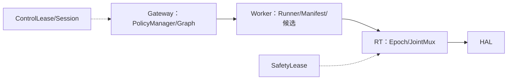
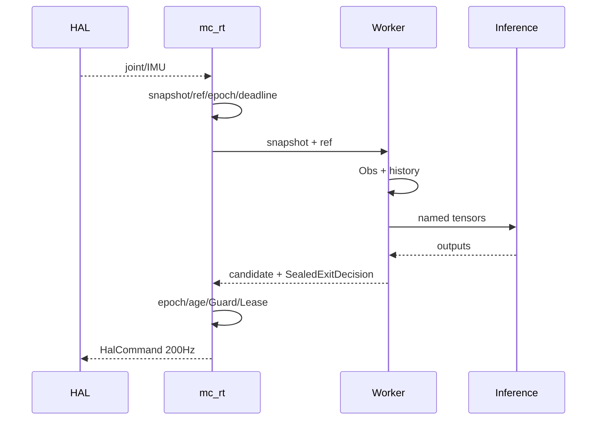
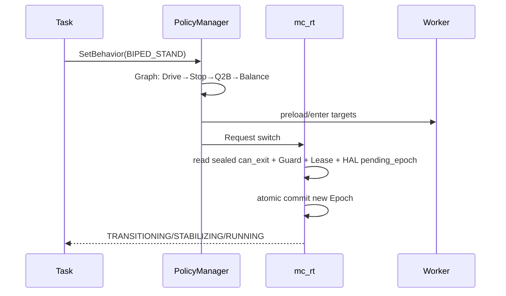
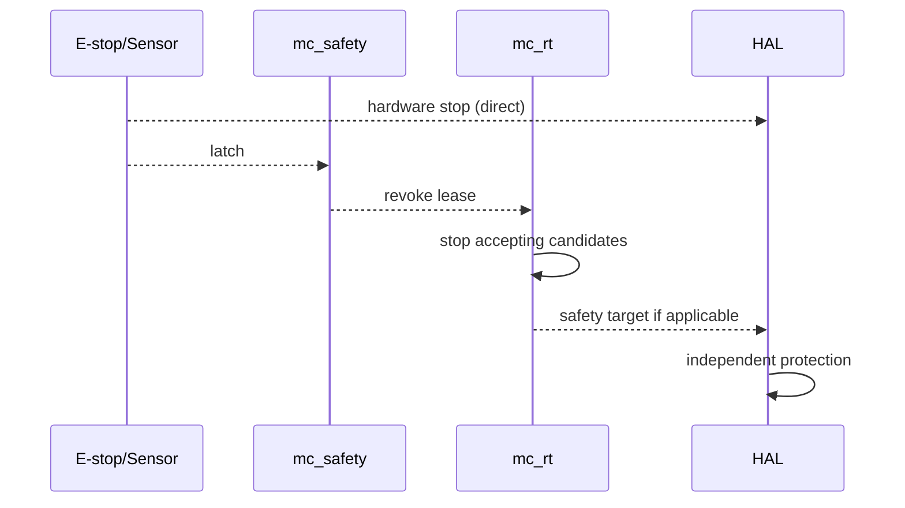

# Collie 运控服务软件架构 V1.3 — Part 2（D3–D4）

<!-- BEGIN_V12: P2-OVERVIEW-01 -->
#### [V1.2-解释] 本 Part 在全局的位置：选择动作，并只提交一次



| 解释盒 | 为什么／是什么 | 不是什么 | Running Example | 常见误解 |
|---|---|---|---|---|
| Runner | 不同算法共用 load/enter/step/exit 接口 | 不是一个进程或一个电机 writer | 四轮 ONNX 与 Q2B 使用不同 Runner | 类名不是工厂判据 |
| Manifest | 静态身份、输入输出和守卫合同 | 不是 ONNX 文件本身 | Q2B 无真实资产则 DISABLED | “有模型”不等于可加载 |
| ActionGraph | 合法动作间的有向边 | 不是安全状态图 | Drive→Stop→Q2B | Graph 通过不等于支撑通过 |
| Epoch | RT 本地切换的唯一版本号 | 不是直接给 Worker 切权限 | Q2B 提交后旧 Drive 候选失效 | PREPARE 不等于 COMMIT |
| ControlLease | 正常运动 scope 的独占权 | 不是 SafetyLease/设备 writer | Nav 失租先停车再换 RC | 有优先级不等于可同时授租 |

**小故事**：“变双足”到达 Gateway 时，系统先查 Session/ControlLease/合法边和资源，Worker 提前准备 Q2B，RT 每 5 ms 检查候选/退出判据/SafetyLease/HAL pending，全部满足才换 Epoch；目前 Q2B 未获真实批准，动作入口必须拒绝。

**怎么读 D3/D4**：D3.3 的两维表先按“怎么计算”找行、再按“要完成什么”找列；D4.4 先看“来源权限”，再看租约；D4.5 先分 PREPARE 与 COMMIT。`can_exit` pre-step READY 已知 P0 **未修**。
<!-- END_V12: P2-OVERVIEW-01 -->

> 合并说明：本 Part 以 V1.1 的 `IRunner`、`SealedExitDecision`、二维 Runner 工厂、ModeTransition、PolicyManager/ControlLease 为准；V1.0 的 ActionBundle/切换骨架保留。  
> **审阅注记**：V1.1 的 `can_exit` 在 `step()` 前发布 `READY`，存在“旧 Runner 已故障/进入不可中断相位，RT 仍提交”的竞态；本文保留 V1.1 原设计并在 §D3.5 标注，修法见 `REVIEW_V1.1.md` §2.1。

---

## D3. Runner 框架详细设计

### D3.1 内部 ABI 与插件边界

`IRunner` 是 Worker **进程内**的 C++ 接口；跨进程只用版本化、固定布局 IPC，不传 `std::vector`、虚表或裸指针。首版推荐把已审核 Runner 静态链接进 Worker，避免运行时随意装入第三方 `.so`；若用动态库，必须提供版本化 C 入口工厂。

| 方法 | 调用线程 | 资源/时效 | 前置/后置/失败 |
|---|---|---|---|
| `load()` | Worker loader（非 RT） | 允许模型 I/O 与预分配 | Created、manifest/robot 校验；失败→Faulted，无设备输出 |
| `enter()` | Worker 实例线程 | 不等待外部服务/磁盘 | Loaded/Exited；快照/形态/安全准入有效；失败→Faulted |
| `can_exit()` | Worker 实例线程，**每 tick 在 step 前** | 只读已冻结输入与内部相位；计入 15 ms | 输出 sealed `kind/reason/snapshot_seq/valid_until/retry_not_before`；不得同步 IPC |
| `step()` | Worker 50 Hz | ≤ `worker_budget_ns`；禁止磁盘/无界阻塞 | 返回候选或错误；不保证被 RT 采用 |
| `exit()` | Worker 实例线程 | 不阻塞 RT；大资源释放转 loader | RT 已撤销 Epoch；失败锁存 Faulted |
| `status()` | 非阻塞只读 | 常数时间 | 返回状态副本 |

线程安全：每个 `RunnerInstance` 的 `enter/can_exit/step/exit` 由同一 Worker 线程串行调用；不同实例可并行，但不能共享可写历史/滤波/后端会话。异常必须在 Worker 包装层捕获，不跨 `noexcept` 传播。RT 从不调用 `IRunner`。

### D3.2 类型与 C++ 签名

```cpp
using TimeNs = uint64_t;
using ActionEpoch = uint64_t;
using TickId = uint64_t;
using JointMask = uint64_t;   // 首版 ≤64 关节

enum class Errc : uint32_t {
  Ok=0, InvalidManifest=1001, TopologyMismatch=1002, BadTensor=1003,
  InvalidState=2001, GuardWait=2002, GuardRefuse=2003,
  StaleFeedback=3001, SafetyDenied=3002, Timeout=4001,
  ResourceExhausted=4002, Internal=5001
};

enum class ExitKind : uint8_t { READY=1, WAIT=2, REFUSE=3 }; // 与 proto EXIT_READY/WAIT/REFUSE 对齐

struct ExitDecision {
  ExitKind kind;
  uint32_t reason_code;
  uint64_t snapshot_seq;
  uint64_t valid_until_ns;
  uint64_t retry_not_before_ns;
};
struct SealedExitDecision {
  Uuid boot_id; ActionEpoch action_epoch; Uuid runner_instance_id;
  uint64_t seal_seq; uint64_t snapshot_stamp_ns; ExitDecision data;
};

struct JointTarget {
  uint16_t index; uint8_t mode; bool enabled;
  float q_rad, dq_radps, tau_nm, kp, kd;
};
struct RunnerOutput {
  ActionEpoch epoch; TickId tick_id; TimeNs snapshot_stamp_ns, deadline_ns;
  JointMask owns_mask; uint16_t target_count; JointTarget* preallocated_targets;
  uint16_t phase_id; bool done, exit_ready; uint32_t fault_code;
};
struct StepInput {
  const RobotStateSnapshot& state;
  const MotionReference& reference;
  const TransitionContext& transition;
  TickId tick_id; TimeNs deadline_ns;
};

class IRunner {
public:
  virtual ~IRunner() noexcept = default;
  virtual Status load(const RunnerManifest&, const RobotDescription&, LoadContext&) noexcept = 0;
  virtual Status enter(const EnterContext&) noexcept = 0;
  virtual ExitDecision can_exit(const RobotStateSnapshot&, const MotionReference&) const noexcept = 0;
  virtual Status step(const StepInput&, RunnerOutput&) noexcept = 0;
  virtual Status exit(ExitReason) noexcept = 0;
  virtual RunnerStatus status() const noexcept = 0;
};
```

`JointTarget*` 只在 Worker 内有效；跨 IPC 用固定 `MAX_JOINTS=64` 容量 + 实际 `joint_count`。候选外层 `CandidateHeader` 携带 `manifest_hash/boot_id/epoch/tick_id/snapshot_seq/deadline`。

### D3.3 八类 Runner 与二维工厂（V1.1）

<!-- BEGIN_V12: P2-D3.3-EIGHT-MATRIX -->
#### [V1.2-解释] 八类 Runner 到底是哪八类、怎样唯一选

| 场景 | `(ExecutionKind,BehaviorRole)` | class | 什么时候用 / 为什么 | 不能误用作 |
|---|---|---|---|---|
| 经典四轮 | CLASSICAL,LOCOMOTION | WheelDriveRunner | 经典轮腿速度控制 | ONNX 通用承载 |
| RL 四轮 | ONNX,LOCOMOTION | RlLocomotionRunner | 动态速度策略 | 只因为“Wheel”改类 |
| Q2B/B2Q | ONNX/CLASSICAL/PLAYBACK,TRANSITION | TransitionRunner | phase/接触/退路 | 线性插值过渡 |
| 动态双足 | ONNX/BALANCE 或 CLASSICAL/BALANCE | BalanceRunner | 持续稳定控制 | 静态 Pose 替代 |
| 已确认静态站姿 | CLASSICAL,POSE | ClassicalPoseRunner | 有限姿态/增益控制 | 未知支撑保持 |
| 受限恢复 | ONNX/CLASSICAL,RECOVERY | RecoveryRunner | 安全批准+净空检查 | 用户任意翻身 |
| 轨迹播放 | PLAYBACK,POSE | PlaybackRunner | 已验时标轨迹 | 持续闭环平衡 |
| 手势 | CLASSICAL/PLAYBACK,OVERLAY | OverlayRunner | 仅不冲突 mask | 覆盖 Balance 的承重臂 |

**选择方法**：确定训练/经典/轨迹机制→确定行为角色→在 Registry 查 **唯一** class/backend 白名单→检查 Manifest/资产签发/owns_mask→实例化。二维格不等于 24 个可用实现；同一个 TransitionRunner 可以承载多种 backend。所有 Q2B/B2Q/Balance/Recovery 目前无 Collie 实证资产，仍禁用。
<!-- END_V12: P2-D3.3-EIGHT-MATRIX -->

RunnerManifest 不再只靠 `class_id` 猜算法，而是两个正交字段：

- `ExecutionKind`：`ONNX / CLASSICAL / PLAYBACK / COMPOSITE`
- `BehaviorRole`：`LOCOMOTION / TRANSITION / BALANCE / POSE / RECOVERY / OVERLAY`

| kind \ role | LOCOMOTION | TRANSITION | BALANCE | POSE | RECOVERY | OVERLAY |
|---|---|---|---|---|---|---|
| ONNX | RlLocomotionRunner | TransitionRunner | BalanceRunner | — | RecoveryRunner | OverlayRunner |
| CLASSICAL | WheelDriveRunner | TransitionRunner | BalanceRunner | ClassicalPoseRunner | RecoveryRunner | OverlayRunner |
| PLAYBACK | — | TransitionRunner | — | PlaybackRunner | — | OverlayRunner |
| COMPOSITE | — | TransitionRunner | — | — | — | OverlayRunner |

工厂规则：`(execution_kind, behavior_role) → class_id` 唯一；`backend_id` 必须在白名单；不匹配直接 `MANIFEST_CLASS_MISMATCH`，不做模糊回退。四轮 ONNX 策略选 `(ONNX, LOCOMOTION) → RlLocomotionRunner`，`behavior_id` 仍是四轮移动；不要因为类名不是 `WheelDriveRunner` 就认为角色不同。

### D3.4 八类 Runner 接口卡

| Runner | 参考/反馈 | 输出/所有权 | 进入/退出/完成 | 失败/必交资产 |
|---|---|---|---|---|
| WheelDriveRunner | vx/vy/wz；轮速/腿/IMU/接触 | 腿+轮位置/速度/力矩，mask 声明 | 四轮支撑稳定进入；零速/滑移/姿态稳定退出 | 滑移/反馈异常→停车/安全；轮腿映射、速度域、Obs/ActionSpec、制动包络 |
| RlLocomotionRunner | 速度参考、关节/IMU、历史动作、观测历史 | 模型定义的逐关节目标 | 张量有效/预热；按停止/接触窗退出 | 超时/NaN→无候选；模型、tensor IO、逐维规格、Golden |
| ClassicalPoseRunner | 姿态/高度、关节/IMU | 位置+增益，必要时轮制动 | 姿态包络；误差/低速保持窗 | 超时/过流→SAFE；插值曲线、增益、限位、完成窗 |
| TransitionRunner | Q2B/B2Q 请求、phase 参考、关节/IMU/接触/轮速 | 相位相关目标，通常独占承重关节 | 初态包络+净空；阶段判据；终态接触/姿态保持 | 失败只走 phase 可行回退或 DAMPING；相位表、模型/轨迹、phase guard、超时/回退、Golden |
| BalanceRunner | 姿态/速度、IMU、轮接触、关节/估计 | 承重/姿态目标 | 双足支撑有效；可退出需姿态/轮速满足 | 失衡→保护；动态支撑域、失稳阈值、输出模式、扰动测试 |
| RecoveryRunner | 安全授权、倒地方向、净空、反馈 | 受限恢复轨迹/策略 | 安全授权+场地清空；固定重试上限 | 超时/净空变化→DAMPING；可恢复姿态集、次数、Golden |
| PlaybackRunner | `.mref` 时标/关节参考、反馈 | 轨迹目标、限定 mask | 起点误差/速度；时间轴完成+跟踪误差稳定 | 越界/超时→停用；轨迹、采样、增益、校验和 |
| OverlayRunner | 手势/头臂参考、主 Runner 稳定态、关节反馈 | 仅拥有的局部 mask | 主动作允许组合、mask 不冲突；主退出前撤销 | 冲突/失联→同步取消；组合白名单、返回中性、时间窗 |

首版对 Q2B/B2Q/Balance/Recovery/表演 `enabled=false`；缺 Collie 资产和物理证据时任何调用返回 `ACTION_NOT_RELEASED`，不能用 T1 资产替代。

### D3.5 `enter / can_exit / step` 契约

**V1.1 决策**：Worker 每 20 ms tick 在 `step` 前计算 `can_exit` 并封存 `SealedExitDecision`；RT 每 5 ms 只读 mailbox，校验 `boot/epoch/runner_instance/seal_seq/snapshot_seq/valid_until`，不等待 Worker。

```cpp
// Worker：先算退出，再发布，再跑 step（V1.1 原设计）
void RunnerWorker::on_20ms_tick(const StepInput& in) noexcept {
  const auto now = in.state.snapshot_robot_time_ns;
  ExitDecision d;
  if (refuse_latched_) d = {ExitKind::REFUSE, REASON_LATCHED, 0, 0, 0};
  else if (last_exit_.kind == ExitKind::WAIT && now < last_exit_.retry_not_before_ns)
    d = {ExitKind::WAIT, last_exit_.reason_code, 0, 0, last_exit_.retry_not_before_ns};
  else d = runner_.can_exit(in.state, in.reference);
  d.snapshot_seq = in.state.snapshot_seq;
  d.valid_until_ns = min(now + 25'000'000ULL, config_.exit_decision_ttl_deadline_ns(in.state));
  d.retry_not_before_ns = (d.kind == ExitKind::WAIT)
      ? max(d.retry_not_before_ns, now + 25'000'000ULL) : 0;
  if (d.kind == ExitKind::REFUSE) refuse_latched_ = true;
  last_exit_ = d;
  publish_sealed_exit(boot_id_, active_epoch_, instance_id_, ++seal_seq_, d, now);
  (void)runner_.step(in, preallocated_output_); // 可能挂死
}

// RT：每个 5 ms tick，只读，不等待
ExitKind SwitchCoordinator::read_exit_nonblocking(const RtSnapshot& s,
                                 const PreparedSwitch& p, TimeNs now) noexcept {
  SealedExitDecision e;
  if (!exit_mailbox_.try_read_sealed(e)) return ExitKind::WAIT;
  if (e.boot_id != boot_id_ || e.action_epoch != active_.epoch ||
      e.runner_instance_id != active_.runner_id) return ExitKind::WAIT;
  if (e.data.snapshot_seq > s.snapshot_seq ||
      (s.snapshot_seq - e.data.snapshot_seq) > 4ULL) return ExitKind::WAIT;
  if (now > e.data.valid_until_ns || now < e.snapshot_stamp_ns ||
      (now - e.snapshot_stamp_ns) > 25'000'000ULL) return ExitKind::WAIT;
  if (active_.exit_refuse_latched) return ExitKind::REFUSE;
  if (e.data.kind == ExitKind::REFUSE) { active_.exit_refuse_latched = true; return ExitKind::REFUSE; }
  if (e.data.kind == ExitKind::WAIT) return ExitKind::WAIT;
  return current_rt_support_guard(s) && target_preflight_valid(p,s)
      ? ExitKind::READY : ExitKind::WAIT;
}
```

> **审阅注记（P0 残留）**：`can_exit` 在 `step` 前发布 `READY`。如果 `step` 把相位推进到不可中断、输出 NaN/fault、或挂死，RT 仍可能在 `valid_until`（25 ms）内用“上一步的 READY”提交新 Epoch。现有 `test_exit_worker_hang_50ms_rt_not_block` 只测“无决策”，没测“先 READY 再挂死”。建议 V1.3：`READY` 只在 `step` 成功返回后发布；或给 `SealedExitDecision` 加 `last_completed_step_seq/phase_seq/fault_seq`，RT 只接受“最近成功 step”的 `READY`，step 进行中/挂死强制 `WAIT`。详见 `REVIEW_V1.1.md` §2.1。

### D3.6 历史与状态保留

每个 `RunnerInstance` 独占 `RunnerContext`：Obs 历史、滤波状态、`previous_action`、RNN hidden、Transition phase。`enter` 按 manifest `initial_fill` 重置；`exit` 冻结/销毁。跨策略保留只允许 manifest 明示且 ObsSpec hash/频率/坐标/历史顺序一致。`ActionEpoch` 由 RT 单调递增；`Safety fault latch` 不随 Runner 改变。

### D3.7 三条关键时序

<!-- BEGIN_V12: P2-D3.7-ARROWS -->
#### [V1.2-解释] 三图该从哪条箭头读起

| 图 | 先看参与者 | 核心 1→2→3→4→5 | 必须补上的失败支路 |
|---|---|---|---|
| 正常单拍 | HAL/RT/Worker/Inference | 反馈→Snapshot→Obs/推理→候选→RT Guard/HAL | Worker 慢/NaN/旧 epoch→丢弃，不阻塞 RT |
| Q2B 切换 | Task/Policy/Worker/RT/HAL | 请求→Graph路径→目标预热→`PREPARE_EPOCH`→RT提交 | 任一 guard/ACK/Lease 失效→WAIT 或保护 |
| 急停/反馈过期 | EStop/Safety/RT/HAL | 硬件直接保护→Safety锁存→撤Lease→RT禁候选→设备保护 | RT自身死亡→HAL独立watchdog |

**读图六步**：①找触发者；②看横向参与者；③按纵轴读请求/异步回执；④把每条箭头翻译成具体结构；⑤记住 RT 仍每 5 ms 自己运行；⑥写明超时、拒绝、设备失联分支。50 Hz Worker 与 200 Hz RT 不同步等待；约 1 kHz 驱动是【待定】。

`[V1.2-审阅注记][P0-必须闭环]` V1.1 `D3.5` 在 `step()` 前封存 READY，之后 step 可能进入不可中断 phase/NaN/挂死；RT 即使校验 `valid_until` 仍可能错误提交。必须先补“已 READY→step 挂死50ms/NaN/phase变更→RT 0次提交/旧 Epoch 0次接受”的生产路径测试。推荐只在 `step` 成功完成后发布 READY 并绑定完成/phase/fault 序号；**本补丁仅标注，不修改 V1.1 行为**。
<!-- END_V12: P2-D3.7-ARROWS -->







---

<!-- BEGIN_V12: P2-D3-QUIZ -->
#### [V1.2-解释] D3 读完自测

1. ONNX四轮 Action 对应哪一个 Runner 类？
2. can_exit 的 pre-step READY 为什么仍是 P0？
3. Runner 能在 step 中直接发电机吗？

> 本节检查的是是否真正理解“输入→责任人→输出→失败兜底”，不是要求机械记忆字段。
<!-- END_V12: P2-D3-QUIZ -->

## D4. PolicyManager、ActionGraph、ActionBundle

### D4.1 注册表与预加载

| 注册表 | 主键 | 内容 |
|---|---|---|
| BehaviorRegistry | behavior_id | 业务能力→Action/权限 |
| ActionRegistry | action_id@version | Bundle/Manifest/拓扑/release 状态 |
| RunnerFactoryRegistry | (execution_kind,behavior_role) | class_id/backend/能力 |

加载顺序：RobotDescription/校准 → Bundle/Manifest → 模型/轨迹 SHA 与 Tensor IO → Obs/ActionSpec → mask/组合矩阵 → 预分配 → 预热 → Golden smoke → `AVAILABLE`。`release.status` 与 `runtime.asset_state` 分开：`DISABLED/CANDIDATE/APPROVED` vs `UNLOADED/LOADING/AVAILABLE/ACTIVE/BROKEN`。热加载不在 P0。

### D4.2 ActionGraph

根为 `nodes`（只含 Action，不含 `INIT/SAFE_HOLD/DAMPING/ESTOP/RECOVERY`），边字段 `from/to/cost/guard/max_duration_ms/on_timeout`。安全抢占无条件旁路图。

```yaml
schema_version: '1.1'
nodes: [quad_stand, quad_drive, quad_stop, q2b, biped_balance, b2q]
edges:
  - {from: quad_drive, to: quad_stop, cost: 1, guard: [feedback_fresh],
     max_duration_ms: 1500, on_timeout: DAMPING}
  - {from: quad_stop, to: q2b, cost: 3,
     guard: [support_valid, clearance_token_fresh],
     max_duration_ms: 2000, on_timeout: DAMPING}
```

启动校验：引用存在、Action/Bundle 兼容、guard 已注册、无重复/自环、P1 禁用动作不在 P0 路径、所有边有限 deadline 与故障目标、安全抢占保留。运行期默认带风险权重最短合法路径，但实时 guard 不能被路径权重替代。

### D4.3 ActionBundle 与 Ownership

`ActionBundle = primary + overlay_slots + combination_rules`。必须检查：`primary_mask & overlay_mask == 0`；overlay 之间不重叠；未声明关节 `enabled=false` 或由显式 neutral/fallback owner 提供；同一关节不能同时 POSITION/TORQUE；平衡需要头/臂反作用力时，让 Balance 接收手势参考，而不是第二路覆盖。

Overlay 只在主策略 `RUNNING && stable && allowed` 时进入；主策略退出前先停新 overlay、回中性姿态；超时则阻止普通切换或进安全。运行中禁止动态改所有权，必须新 Bundle + 新 Epoch。

组合矩阵（初版）：QuadStand 允许非承重头/臂；QuadWheelDrive 仅经测试的头/受限臂；QuadStop/Q2B/B2Q 默认拒绝；BipedBalance 仅 mask 不争用且联合验证；Recovery/Safety 只允许内部保护。

### D4.4 请求仲裁、来源与 ControlLease

<!-- BEGIN_V12: P2-D4.4-LEASE-BOUNDARY -->
#### [V1.2-解释] “有优先级”为什么不等于“拿到方向盘”

| 情况 | Gateway 结果 | RT 行为 | 谁兜底 |
|---|---|---|---|
| Nav lease 有效、速度 seq/TTL 有效 | 允许同 scope 的当前 owner | 接纳有效速度参考 | Guard/HAL |
| 遥控请求抢占 | 先 REVOKE Nav、停车/稳定后授权 RC | 在切换窗口禁止两来源同时生效 | Safety/HAL |
| Nav 失联超 TTL | ControlLease 不续或过期 | 无新有效速度，按批准制动 | HAL/硬件 |
| SafetyLease 已过期 | 即使 ControlLease 有效也不能继续正常运动 | 拒绝正常候选 | HAL看门狗 |

ControlLease 的角色是资源仲裁，SafetyLease 是此刻运动许可，HAL writer lease 是对设备的独占写入；三个“Lease”不能合并。
<!-- END_V12: P2-D4.4-LEASE-BOUNDARY -->

| 来源 | Action | Velocity | Overlay | 限制 |
|---|---|---|---|---|
| 硬件急停 | — | — | — | 最高，硬件独立 |
| PlatformSafety | 保护性取消 | 限速/停止 | 取消 | 安全约束不参与普通优先级 |
| 本地授权遥控 | 授权站立/停止 | 是 | 有限 | priority 90，需 ControlLease |
| Task Engine | 是 | 授权会话 | 是 | priority 60，任务级仲裁 |
| 导航/跟随 | 否 | 是 | 否 | priority 50，需任务授权 |
| SDK/App | 经 Task | 经网关 | 经 Task | priority 40，不能直达 RT |

**ControlLease**：`IDLE→REQUESTED→GRANTED→RENEWING→REVOKING→REVOKED/EXPIRED`；字段 `lease_id,session_id,boot_id,owner_source_id,seq,scope,ttl_ms,expires_mono_ns,priority,state`。同一 scope 最多一个 owner；抢占先 `REVOKE` 旧租并确认停车/保护，再授予新租；失租时禁止新速度/新 Action，按 Action 走制动/phase fallback/安全平衡/HAL 保护。TTL 初值 500 ms、续租 ≤150 ms（待压测签发）。

幂等键 `(source_id,session_id,request_id)`；同键不同 payload → `IDEMPOTENCY_CONFLICT`。每 source 最多 8 个 Action 排队，总 32；速度只保留最新 seq；断流按 TTL 制动归零。

### D4.5 原子切换

`REQUESTED → PREPARING → WAIT_EXIT → ENTERING → TRANSITIONING → STABILIZING → RUNNING`。

1. PolicyManager 准备目标 Action/首候选，Worker 完成 `enter`，旧 Action 仍活动；
2. RT 读取旧 Runner 的 sealed `ExitDecision` + 目标首候选 + SafetyLease + HAL `pending_epoch`；
3. 全部有效时 RT 在 5 ms 拍边界原子提交 `active_epoch`，发第一条新 Epoch `HalCommand`；
4. HAL 原子 `pending_epoch→active_epoch`，旧 Epoch 永久失效；
5. 提交后新 Epoch 被拒/ACK 超期/HAL 非 ACTIVE：只能本地保护/撤权，不能普通回旧策略。

`switch_ready=true` 当且仅当：`phase==RUNNING`、物理稳定窗成立、无切换事务、反馈有效、安全允许、`can_exit` 对新快照 READY、overlay 满足退出。

### D4.6 MotionStatus

50 Hz 状态 + 事件。字段以 `proto` 为准：`boot_id/request_id/execution_id/session_id`、`seq/action_epoch/stamp_robot_ns`、`current/target_action`、`phase/transition_phase/form`、`stable/switch_ready/action_done`、`active_primary/overlays`、`effective_velocity/source/age`、`safety_state/latched_fault`、`feedback/inference_age`、`release_id/manifest_sha256`、`control_lease_id/state`、`hal_state/last_ack_seq/last_reject_reason`。`age_ms=UINT32_MAX` 表示未知，不填 0；HAL 失联为 `HAL_UNKNOWN`。

### D4.7 Q4/Q5 裁决

| 问题 | 决策 | 替代方案 | 切换条件 |
|---|---|---|---|
| Q4 过渡 | Q2B/B2Q 各有独立 TransitionRunner、phase、接触/姿态守卫、phase fallback；无资产禁用 | 位置线性插值/倒放 | 本体证实准静态且全 phase 可验证时可用经典 Transition |
| Q5 叠加 | 主/overlay 精确 mask，静态预检 + RT 复核，主退出则 overlay 停 | Scope 粗分/最后写覆盖 | 共享关节改为单个 WBC Runner 消费 overlay 参考 |

---

**Part 2 完成度：100%（D3–D4 合并稿）；待补：Q2B/B2Q 资产与 phase 回退、模式切换物理包络、真实 RT/HAL 时序。**


---


<!-- BEGIN_V12: P2-D4-QUIZ -->
#### [V1.2-解释] D4 读完自测

1. ActionGraph nodes 能放 ESTOP 吗？
2. ControlLease 被抢占时能立刻采用新速度吗？
3. 新 Epoch HAL 拒收能直接回旧 Runner 吗？

> 本节检查的是是否真正理解“输入→责任人→输出→失败兜底”，不是要求机械记忆字段。
<!-- END_V12: P2-D4-QUIZ -->
